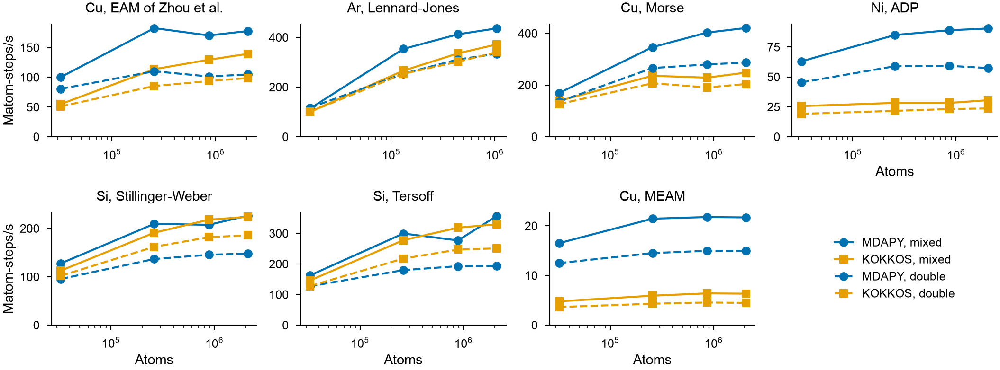

# Molecular dynamics on the GPU

MDAPY and LAMMPS run the same molecular dynamics at constant energy on one NVIDIA GPU,
for each potential that MDAPY has on the [GPU](../user-guide/simulation/gpu.md) and the
KOKKOS package of LAMMPS has too: EAM, Lennard-Jones, Morse, ADP, Stillinger–Weber,
Tersoff and MEAM, from 16 000 to 2 million atoms, in mixed and in double precision.

## Results

A node of the Triton cluster of Aalto University: an NVIDIA Tesla V100-PCIE-32GB
(Volta, driver 580.173.02) and an Intel Xeon Gold 6134. CUDA 12.6.2 and GCC 13.3.0;
MDAPY 2.2.0 in development, built with `-Ccmake.define.MDAPY_CUDA=ON
-Ccmake.define.CMAKE_CUDA_ARCHITECTURES=70`; LAMMPS stable_30Sep2026 with KOKKOS for
this GPU (`Kokkos_ARCH_VOLTA70`), once with `KOKKOS_PREC=mixed` and once in double
precision.



*How many atom-steps each runs in a second: higher is faster. Solid lines in mixed
precision, dashed in double; for KOKKOS the faster of its neighbor lists at each size.*

### What they show

- **Mixed precision**: MDAPY is the faster for EAM, 1.3 to 1.8 times, Lennard-Jones,
  1.15 to 1.3 times, Morse, 1.2 to 1.8 times, ADP, 2.5 to 3 times, and MEAM, 3.4
  times; for Stillinger–Weber and Tersoff the two are about as fast, within 13 %.
- **Double precision**: MDAPY is the faster for EAM, Morse, ADP and MEAM, by about as
  much, and about as fast for Lennard-Jones; for Stillinger–Weber and Tersoff it is
  0.8 times as fast for the larger systems.
- The many-body potentials of MDAPY sum the forces of each atom from the derivatives
  of its pairs in an order that does not change, so that a run repeats to the last
  bit; KOKKOS adds them up with atomic operations as the threads find them. For the
  three-body terms of Stillinger–Weber and Tersoff in double precision this costs MDAPY
  its lead.

### Times

The time of a step in ms; for KOKKOS the faster of its neighbor lists.

#### Cu, EAM of Zhou et al.

| Atoms | MDAPY, mixed | KOKKOS, mixed | MDAPY, double | KOKKOS, double |
|---:|---:|---:|---:|---:|
| 32,000 | 0.32 | 0.58 | 0.40 | 0.63 |
| 256,000 | 1.40 | 2.25 | 2.33 | 3.00 |
| 864,000 | 5.07 | 6.67 | 8.53 | 9.23 |
| 2,048,000 | 11.53 | 14.69 | 19.56 | 20.75 |

#### Ar, Lennard-Jones

| Atoms | MDAPY, mixed | KOKKOS, mixed | MDAPY, double | KOKKOS, double |
|---:|---:|---:|---:|---:|
| 16,384 | 0.14 | 0.16 | 0.14 | 0.16 |
| 131,072 | 0.37 | 0.49 | 0.52 | 0.52 |
| 442,368 | 1.07 | 1.32 | 1.42 | 1.47 |
| 1,048,576 | 2.41 | 2.82 | 3.14 | 3.08 |

#### Cu, Morse

| Atoms | MDAPY, mixed | KOKKOS, mixed | MDAPY, double | KOKKOS, double |
|---:|---:|---:|---:|---:|
| 32,000 | 0.19 | 0.23 | 0.23 | 0.25 |
| 256,000 | 0.74 | 1.09 | 0.96 | 1.24 |
| 864,000 | 2.14 | 3.78 | 3.09 | 4.53 |
| 2,048,000 | 4.87 | 8.25 | 7.13 | 10.04 |

#### Ni, ADP

| Atoms | MDAPY, mixed | KOKKOS, mixed | MDAPY, double | KOKKOS, double |
|---:|---:|---:|---:|---:|
| 32,000 | 0.51 | 1.25 | 0.70 | 1.67 |
| 256,000 | 3.01 | 9.05 | 4.34 | 11.81 |
| 864,000 | 9.71 | 30.54 | 14.58 | 37.29 |
| 2,048,000 | 22.64 | 67.02 | 35.68 | 86.42 |

#### Si, Stillinger-Weber

| Atoms | MDAPY, mixed | KOKKOS, mixed | MDAPY, double | KOKKOS, double |
|---:|---:|---:|---:|---:|
| 32,768 | 0.26 | 0.29 | 0.34 | 0.32 |
| 262,144 | 1.25 | 1.37 | 1.92 | 1.62 |
| 884,736 | 4.27 | 4.06 | 6.08 | 4.87 |
| 2,097,152 | 9.27 | 9.37 | 14.17 | 11.29 |

#### Si, Tersoff

| Atoms | MDAPY, mixed | KOKKOS, mixed | MDAPY, double | KOKKOS, double |
|---:|---:|---:|---:|---:|
| 32,768 | 0.20 | 0.22 | 0.26 | 0.26 |
| 262,144 | 0.88 | 0.94 | 1.46 | 1.21 |
| 884,736 | 3.20 | 2.78 | 4.59 | 3.58 |
| 2,097,152 | 5.88 | 6.36 | 10.84 | 8.36 |

#### Cu, MEAM

| Atoms | MDAPY, mixed | KOKKOS, mixed | MDAPY, double | KOKKOS, double |
|---:|---:|---:|---:|---:|
| 32,000 | 1.94 | 6.68 | 2.56 | 8.80 |
| 256,000 | 11.94 | 43.18 | 17.63 | 59.34 |
| 864,000 | 39.66 | 135.14 | 57.70 | 189.79 |
| 2,048,000 | 94.36 | 323.39 | 136.96 | 457.68 |

## How it was measured

- Each run builds the crystal, gives it the velocities of a temperature, runs 50 steps
  at constant energy and times the next 300, with a skin of 1 Å and the neighbor list
  checked at every step: fcc copper at 600 K with a time step of 2 fs for EAM, Morse
  and MEAM, fcc nickel at 600 K and 2 fs for ADP, diamond silicon at 1000 K and 1 fs
  for Stillinger–Weber and Tersoff, fcc argon at 60 K and 5 fs for Lennard-Jones.
- The potentials: the EAM of Zhou et al. for copper, written by MDAPY; Lennard-Jones
  with ε = 0.0104 eV and σ = 3.40 Å cut at 8.5 Å; Morse with D0 = 0.3429 eV,
  α = 1.3588 Å⁻¹ and r0 = 2.866 Å cut at 6.5 Å; and the files of the potentials
  folder of LAMMPS, `Ni.adp`, `Si.sw`, `Si.tersoff`, and `library.meam` with
  `Cu.meam`.
- LAMMPS reports the time of its loop. The time of MDAPY is that of `run`, which also
  computes the forces and records the state at its start and its end.
- KOKKOS ran with full neighbor lists and Newton's third law off, its default on GPUs,
  and with half lists and the law on; the faster counts. Its Stillinger–Weber, Tersoff
  and MEAM need the law on, so half lists only.

## Running it

The comparison is `benchmarks/gpu.py` in the source repository. It runs the LAMMPS
executables that the environment variables name and leaves out those not given;
`LAMMPS_POTENTIALS` is the potentials folder of LAMMPS.

```bash
LMP_KOKKOS_MIXED=/path/to/kokkos-mixed/lmp LMP_KOKKOS_DOUBLE=/path/to/kokkos/lmp \
    LAMMPS_POTENTIALS=/path/to/lammps/potentials python benchmarks/gpu.py run --output gpu.json
python benchmarks/gpu.py table gpu.json
python benchmarks/gpu.py plot gpu.json gpu.png
```

## On several GPUs of a node

MDAPY's own dynamics [on many processes](../user-guide/simulation/processes.md#with-a-gpu-each),
one process of MPI on each GPU, against LAMMPS with KOKKOS and MPI, on 1, 2 and 4 GPUs
of one node, in mixed precision, for the largest systems of the cases above.

A node of the Triton cluster of Aalto University with four NVIDIA Tesla
V100-PCIE-32GB (driver 580.173.02), three pairs of them joined by NVLink and the
others through PCIe and the host. MDAPY 2.3 in development with mpi4py 4.1.2 on
OpenMPI 4.1.6, LAMMPS stable_30Sep2026 on OpenMPI 5.0.3, both built with CUDA, so
that the memory of the GPUs goes to MPI itself, as KOKKOS does by default. The
processes were started by `srun --mpi=pmix --gpus-per-task=1 --gpu-bind=none`.

| Milliseconds per step | Atoms | 1 GPU, MDAPY | KOKKOS | 2 GPUs, MDAPY | KOKKOS | 4 GPUs, MDAPY | KOKKOS |
|---|---:|---:|---:|---:|---:|---:|---:|
| Cu, EAM of Zhou et al. | 2,048,000 | 11.47 | 14.71 | 6.90 | 8.31 | 4.28 | 4.86 |
| Cu, EAM of Zhou et al. | 8,388,608 | 47.59 | 65.94 | 26.43 | 33.83 | 13.94 | 17.65 |
| Ar, Lennard-Jones | 1,048,576 | 2.34 | 2.82 | 1.71 | 1.79 | 1.29 | 1.18 |
| Cu, Morse | 2,048,000 | 4.87 | 8.21 | 2.95 | 4.61 | 1.95 | 2.84 |
| Si, Stillinger–Weber | 2,097,152 | 9.13 | 9.35 | 5.41 | 5.30 | 3.44 | 3.19 |
| Si, Tersoff | 2,097,152 | 5.83 | 6.35 | 3.89 | 3.69 | 2.62 | 2.38 |

### What they show

- MDAPY is the faster on 1, 2 and 4 GPUs for EAM and Morse, and on 1 and 2 GPUs for
  Lennard-Jones; on 4 GPUs it is 0.92 times as fast for Lennard-Jones, 0.93 times for
  Stillinger–Weber and 0.91 times for Tersoff.
- An MPI that does not move the memory of the GPU sends it through the host:
  with `MDAPY_GPU_AWARE_MPI=0` the 4 GPUs take 5.21 ms a step for EAM of 2 048 000
  atoms, 1.81 ms for Lennard-Jones and 3.53 ms for Tersoff.
- NEP, which KOKKOS does not have: the UNEP-v1 model of Song et al. (2024) for fcc
  copper takes 88.2, 48.5 and 26.3 ms a step for 864 000 atoms on 1, 2 and 4 GPUs,
  and 28.2, 15.9 and 9.0 ms for 256 000.

### How it was measured

The runs of the table above, at constant energy, with a skin of 1 Å, 50 steps and
then 300 timed. KOKKOS ran with full neighbor lists and Newton's third law off for
EAM, Lennard-Jones and Morse, and with half lists and the law on for
Stillinger–Weber and Tersoff, which need it. NEP ran 30 steps from 600 K with a
time step of 2 fs and timed the next 100.

### Running it

`benchmarks/gpus.py` in the source repository runs a case of `benchmarks/gpu.py`
with MDAPY on the processes it is started on, or writes the input of LAMMPS:

```bash
srun -n 4 --gpus-per-task=1 --gpu-bind=none --mpi=pmix \
    python benchmarks/gpus.py mdapy eam 80 mixed potentials
python benchmarks/gpus.py input eam 80 > in.eam
srun -n 4 --gpus-per-task=1 --gpu-bind=none --mpi=pmix \
    lmp -k on g 4 -sf kk -pk kokkos neigh full newton off -in in.eam
```
