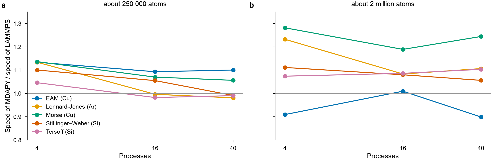

# Molecular dynamics on many processes

MDAPY and LAMMPS run the same molecular dynamics at constant energy, split among 4 to 40
processes of one thread each with MPI, with the five potentials of the
[GPU benchmarks](gpu.md): copper with the EAM of Zhou et al. and with a Morse potential
at 600 K, argon with Lennard-Jones at 60 K, and silicon with Stillinger–Weber and
Tersoff at 1000 K, each at about 250 000 and 2 million atoms: MDAPY's own dynamics
[on many processes](../user-guide/simulation/processes.md), and LAMMPS through MDAPY's
[LAMMPS calculator](../user-guide/potentials/lammps.md). Both read the same files: the
`eam/alloy` file written by `EAM.zhou(["Cu"]).write(path)`, and the `Si.sw` and
`Si.tersoff` of LAMMPS. Each run takes 50 steps after 20, of 2 fs for copper, 5 fs for
argon and 1 fs for silicon, and the time of a step is the time of the 50 over 50;
`benchmarks/processes.py` runs them.

## Results

A node of the Triton cluster of Aalto University: two Intel Xeon Gold 6230, 40 cores,
OpenMPI 4.1.6 and GCC 12.3.0, the processes started by `srun --mpi=pmix`. MDAPY 2.3 in
development, built with `pip install .`; LAMMPS stable_30Sep2026 with MPI and the
MANYBODY package, with its defaults: `newton on`, a skin of 2 Å. MDAPY's skin is 1 Å.

*The speed of MDAPY over that of LAMMPS, the time of a step of LAMMPS over that of
MDAPY: above 1 MDAPY is the faster.*

### What they show

- On 4 to 40 processes MDAPY runs at 0.90 to 1.28 times the speed of LAMMPS: 0.90 to
  1.13 with EAM, 0.98 to 1.11 with Stillinger–Weber and Tersoff, 0.98 to 1.23 with
  Lennard-Jones and 1.06 to 1.28 with Morse. Its slowest case is EAM on 2 048 000 atoms,
  at 0.91 and 0.90 of LAMMPS on 4 and 40 processes.
- Each process of one thread computes each pair of atoms and each term of three bodies
  once, as LAMMPS does with `newton on`, the pairs across the faces of its brick shared
  half and half with the processes beside it. On one process MDAPY computes each pair
  from both its atoms, so that a run repeats to the last bit for any number of threads.

### Times

The time of a step in ms.

| Potential | Atoms | Processes | MDAPY | LAMMPS | LAMMPS / MDAPY |
|---|---:|---:|---:|---:|---:|
| EAM (Cu) | 256 000 | 4 | 108.9 | 123.5 | 1.13 |
| EAM (Cu) | 256 000 | 16 | 32.3 | 35.3 | 1.09 |
| EAM (Cu) | 256 000 | 40 | 17.2 | 18.9 | 1.10 |
| EAM (Cu) | 2 048 000 | 4 | 1074.2 | 977.0 | 0.91 |
| EAM (Cu) | 2 048 000 | 16 | 311.6 | 314.6 | 1.01 |
| EAM (Cu) | 2 048 000 | 40 | 159.1 | 143.1 | 0.90 |
| Lennard-Jones (Ar) | 131 072 | 4 | 24.1 | 27.3 | 1.13 |
| Lennard-Jones (Ar) | 131 072 | 16 | 8.5 | 8.5 | 1.00 |
| Lennard-Jones (Ar) | 131 072 | 40 | 4.8 | 4.7 | 0.98 |
| Lennard-Jones (Ar) | 1 048 576 | 4 | 188.3 | 232.0 | 1.23 |
| Lennard-Jones (Ar) | 1 048 576 | 16 | 56.6 | 61.4 | 1.08 |
| Lennard-Jones (Ar) | 1 048 576 | 40 | 29.8 | 33.0 | 1.11 |
| Morse (Cu) | 256 000 | 4 | 82.2 | 93.4 | 1.14 |
| Morse (Cu) | 256 000 | 16 | 25.2 | 27.0 | 1.07 |
| Morse (Cu) | 256 000 | 40 | 14.0 | 14.8 | 1.06 |
| Morse (Cu) | 2 048 000 | 4 | 625.7 | 801.9 | 1.28 |
| Morse (Cu) | 2 048 000 | 16 | 182.6 | 217.2 | 1.19 |
| Morse (Cu) | 2 048 000 | 40 | 99.8 | 124.2 | 1.24 |
| Stillinger–Weber (Si) | 262 144 | 4 | 91.0 | 100.1 | 1.10 |
| Stillinger–Weber (Si) | 262 144 | 16 | 26.3 | 27.7 | 1.06 |
| Stillinger–Weber (Si) | 262 144 | 40 | 14.1 | 14.0 | 0.99 |
| Stillinger–Weber (Si) | 2 097 152 | 4 | 730.9 | 812.4 | 1.11 |
| Stillinger–Weber (Si) | 2 097 152 | 16 | 206.8 | 223.4 | 1.08 |
| Stillinger–Weber (Si) | 2 097 152 | 40 | 105.2 | 111.1 | 1.06 |
| Tersoff (Si) | 262 144 | 4 | 106.7 | 111.6 | 1.05 |
| Tersoff (Si) | 262 144 | 16 | 31.5 | 31.0 | 0.98 |
| Tersoff (Si) | 262 144 | 40 | 16.2 | 16.0 | 0.99 |
| Tersoff (Si) | 2 097 152 | 4 | 849.3 | 912.3 | 1.07 |
| Tersoff (Si) | 2 097 152 | 16 | 235.0 | 255.3 | 1.09 |
| Tersoff (Si) | 2 097 152 | 40 | 120.5 | 133.0 | 1.10 |
