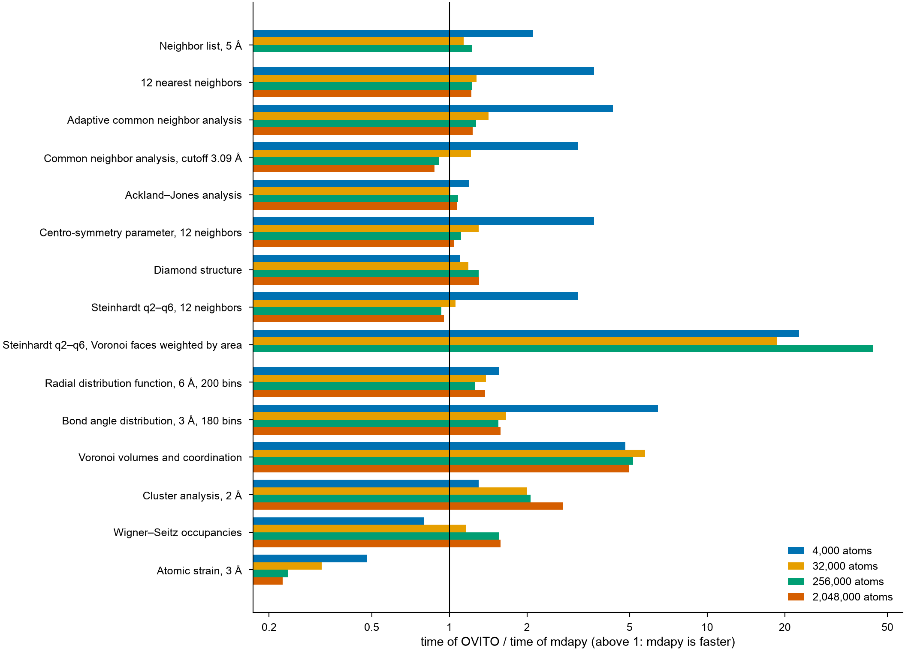

# mdapy and OVITO

The analyses that mdapy and [OVITO](https://www.ovito.org) both have,
computed on the same systems with the same parameters. A case is timed only
where both programs give the same result, atom by atom.

## Results

Apple M5 (4 performance and 6 efficiency cores, 24 GB), macOS, Python
3.13, mdapy 2.0.0.dev0 and OVITO 3.17.0 from pip, both with 10 threads.



At the largest size that ran for each case: the shortest of three times,
and the memory each computation took beyond the system: the peak resident
memory of the process minus its peak before the timings.

| Case | Atoms | mdapy (s) | OVITO (s) | OVITO / mdapy | mdapy (MB) | OVITO (MB) |
|---|---:|---:|---:|---:|---:|---:|
| Neighbor list, 5 Å | 256,000 | 0.058 | 0.071 | 1.22 | 208 | 799 |
| 12 nearest neighbors | 2,048,000 | 0.353 | 0.430 | 1.22 | 437 | 857 |
| Adaptive common neighbor analysis | 2,048,000 | 0.534 | 0.656 | 1.23 | 1154 | 147 |
| Common neighbor analysis, cutoff 3.09 Å | 2,048,000 | 0.211 | 0.185 | 0.88 | 133 | 120 |
| Ackland–Jones analysis | 2,048,000 | 0.606 | 0.647 | 1.07 | 1151 | 150 |
| Centro-symmetry parameter, 12 neighbors | 2,048,000 | 0.477 | 0.497 | 1.04 | 1001 | 112 |
| Diamond structure | 2,000,376 | 0.303 | 0.394 | 1.30 | 369 | 382 |
| Steinhardt q2–q6, 12 neighbors | 2,048,000 | 0.563 | 0.537 | 0.95 | 1077 | 190 |
| Steinhardt q2–q6, Voronoi faces weighted by area | 256,000 | 0.347 | 15.320 | 44.09 | 499 | 57 |
| Radial distribution function, 6 Å, 200 bins | 2,048,000 | 0.333 | 0.459 | 1.38 | 121 | 77 |
| Bond angle distribution, 3 Å, 180 bins | 2,048,000 | 0.401 | 0.632 | 1.58 | 147 | 1427 |
| Voronoi volumes and coordination | 2,048,000 | 2.024 | 10.037 | 4.96 | 1968 | 89 |
| Cluster analysis, 2 Å | 2,048,000 | 0.363 | 1.001 | 2.76 | 537 | 221 |
| Wigner–Seitz occupancies | 2,037,841 | 0.120 | 0.190 | 1.58 | 115 | 140 |
| Atomic strain, 3 Å | 2,048,000 | 0.370 | 0.083 | 0.23 | 756 | 261 |

- From some 30 000 atoms on, the ratios hardly change with the size; below,
  a fixed cost of a few milliseconds per call in OVITO's pipelines favors
  mdapy.
- The analyses on the neighbors of each atom (structure identification,
  Steinhardt parameters, distributions) take about as long in both, within
  some 30 %. Voronoi tessellation is five times faster in mdapy, and
  Steinhardt parameters over Voronoi neighbors weighted by area 20 to 40
  times; OVITO took more than five minutes for the latter at two million
  atoms, which was stopped.
- mdapy builds a list of neighbors first and then computes, so analyses on
  the nearest neighbors take more memory than in OVITO, which finds the
  neighbors of each atom as it goes: about 0.5 kB per atom against less
  than 0.1 kB. Common neighbor analysis with a cutoff finds them as it goes
  in mdapy too, and takes as much memory as in OVITO. The Voronoi analysis
  of mdapy keeps every face of every cell, about 1 kB per atom, for
  Voronoi neighbors and indices later.
- The atomic strain of mdapy includes building the neighbor list of the
  reference, which serves every later frame; computing a frame then takes
  0.14 s for two million atoms, against OVITO's 0.08 s.

## Cases

| Case | System | mdapy | OVITO |
|---|---|---|---|
| Neighbor list, 5 Å | fcc Cu | `NeighborList.build(system, 5.0)` | `CutoffNeighborFinder(5.0, data).find_all()` |
| 12 nearest neighbors | fcc Cu | `NeighborList.build(system, num_neighbors=12)` | `NearestNeighborFinder(12, data).find_all()` |
| Adaptive common neighbor analysis | fcc Cu | `CommonNeighborAnalysis()` | `CommonNeighborAnalysisModifier()` |
| Common neighbor analysis, cutoff 3.09 Å | fcc Cu | `CommonNeighborAnalysis(3.086)` | `CommonNeighborAnalysisModifier(mode=FixedCutoff, cutoff=3.086)` |
| Ackland–Jones analysis | fcc Cu | `AcklandJonesAnalysis()` | `AcklandJonesModifier()` |
| Centro-symmetry parameter | fcc Cu | `CentroSymmetryParameter(12)` | `CentroSymmetryModifier(num_neighbors=12)` |
| Diamond structure | diamond Si | `DiamondStructure()` | `IdentifyDiamondModifier()` |
| Steinhardt q2–q6, 12 neighbors | fcc Cu | `SteinhardtParameters((2, 3, 4, 5, 6), num_neighbors=12)` | `SteinhardtParametersModifier(neighbor_mode=NearestNeighbors, num_neighbors=12, max_l=6)` |
| Steinhardt q2–q6, Voronoi | fcc Cu | `SteinhardtParameters((2, 3, 4, 5, 6), voronoi=True, weighted=True)` | `SteinhardtParametersModifier(neighbor_mode=Voronoi, max_l=6)` |
| Radial distribution function | fcc Cu | `RadialDistributionFunction(6.0, bins=200)` | `CoordinationAnalysisModifier(cutoff=6.0, number_of_bins=200)` |
| Bond angle distribution | fcc Cu | `BondAngleDistribution(cutoff=3.0, bins=180)` | `CreateBondsModifier(cutoff=3.0)`, `BondAngleDistributionModifier(bins=180)` |
| Voronoi volumes and coordination | fcc Cu | `VoronoiAnalysis()` | `VoronoiAnalysisModifier()` |
| Cluster analysis, 2 Å | random points | `ClusterAnalysis(cutoff=2.0)` | `ClusterAnalysisModifier(cutoff=2.0, sort_by_size=True)` |
| Wigner–Seitz occupancies | fcc Cu, 0.5 % vacancies | `WignerSeitz(reference)` | `WignerSeitzAnalysisModifier()` |
| Atomic strain, 3 Å | strained fcc Cu | `AtomicStrain(reference, 3.0)` | `AtomicStrainModifier(cutoff=3.0)` |

The fcc copper has its atoms displaced at random by 0.1 Å along each axis,
as at room temperature; the silicon by 0.05 Å. The random points have the
density of copper and, with a cutoff of 2 Å, are close to percolation, so
that clusters of every size form. OVITO's coordination analysis also counts
the neighbors of each atom along with the radial distribution function.

## How it is measured

- Each program runs in a process of its own, with the same number of
  threads (`MDAPY_NUM_THREADS` and `OVITO_THREAD_COUNT`).
- Before the timings, a separate process computes the case with both
  programs and compares the results: the same structure types, cluster
  sizes, occupancies and bins, floating-point values within 1e-10, and for
  neighbor lists the same number of neighbors of each atom and the same sum
  of their distances. A case that differs is not timed.
- Each process first computes the case for 500 atoms, so that loading
  libraries and starting threads are not timed, then three times for the
  system; the shortest time counts.
- The time runs from the call to the result, with every neighbor search.
  Making the system and converting it into OVITO's data collection are not
  timed. OVITO computes a new pipeline each time, so nothing is cached.
- A process that grows beyond 8 GB is stopped, and a size is skipped where
  the previous one predicts more.

## Running it

The comparison is `benchmarks/ovito_comparison.py` in the source
repository. It needs OVITO (`pip install ovito`) and, for the figure,
matplotlib.

```bash
python benchmarks/ovito_comparison.py run                     # every case
python benchmarks/ovito_comparison.py run cna voronoi --sizes 4000 32000 --threads 1
python benchmarks/ovito_comparison.py table results.json      # Markdown table
python benchmarks/ovito_comparison.py plot results.json ratio.png
```

`run` appends one line of JSON per case and size to `results.json` (the
option `--output`): the machine, the agreement, and the times and peak
memory of each program. A new case is a `Case` in `_cases()`: how to make
its system, the mdapy and OVITO calls, and how to compare their results.
