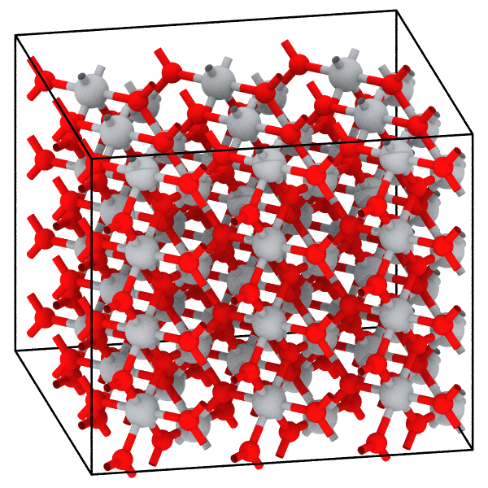

# CIF

The format `cif` reads Crystallographic Information Files, the crystal of
each data block: the atom sites of the asymmetric unit expanded by the
symmetry operations into the whole cell. Files with extension `.cif` are
recognized. mdapy reads CIF files but does not write them.

```python
import mdapy as mp
from mdapy.transform import replicate
from mdapy.visualization import render

# rutile, TiO2: two sites and the sixteen operations of P4_2/mnm
text = """data_rutile
_cell_length_a 4.5937(2)
_cell_length_b 4.5937(2)
_cell_length_c 2.9587(1)
_cell_angle_alpha 90
_cell_angle_beta 90
_cell_angle_gamma 90
_symmetry_space_group_name_H-M 'P 42/m n m'
loop_
_symmetry_equiv_pos_as_xyz
'x, y, z' '-x, -y, z' '-y+1/2, x+1/2, z+1/2' 'y+1/2, -x+1/2, z+1/2'
'-x+1/2, y+1/2, -z+1/2' 'x+1/2, -y+1/2, -z+1/2' 'y, x, -z' '-y, -x, -z'
'-x, -y, -z' 'x, y, -z' 'y+1/2, -x+1/2, -z+1/2' '-y+1/2, x+1/2, -z+1/2'
'x+1/2, -y+1/2, z+1/2' '-x+1/2, y+1/2, z+1/2' '-y, -x, z' 'y, x, z'
loop_
_atom_site_label
_atom_site_type_symbol
_atom_site_fract_x
_atom_site_fract_y
_atom_site_fract_z
Ti1 Ti4+ 0 0 0
O1 O2- 0.30478 0.30478 0
"""
with open("rutile.cif", "w") as f:
    f.write(text)

rutile = mp.read("rutile.cif")  # 2 Ti and 4 O
render(
    replicate(rutile, (3, 3, 4)),
    "images/rutile.png",
    representation="ball_and_stick",
    bonds=2.1,
    view=(-0.2, -1.0, -0.35),
    width=600,
    height=600,
)
```



*Rutile read from the CIF above and repeated 3 × 3 × 4 times: titanium
(gray) in octahedra of oxygen (red).*

## Reading

| Item | In mdapy |
|---|---|
| `data_name` | one frame per data block; `info["name"]` |
| `_cell_length_a`, `_b`, `_c`, `_cell_angle_alpha`, `_beta`, `_gamma` | `box.matrix`: a along x, b in the xy plane; periodic in all directions; angles 90° if absent |
| `_atom_site_fract_x`, `_y`, `_z`, or `_atom_site_Cartn_x`, `_y`, `_z` | `positions` of the sites |
| `_atom_site_type_symbol`, or else `_atom_site_label` | `element`: the letters before charges and numbers, such as `Fe` of `Fe2+` or `O` of `OW1` |
| `_space_group_symop_operation_xyz` or `_symmetry_equiv_pos_as_xyz` | the operations, such as `-x+1/2,y,z+1/2` |

Each site is moved by every operation into the cell, fractional coordinates
in [0, 1); an image closer than 0.01 Å to one before it is the same atom.
The atoms follow the sites, and those of a site the operations. Without
operations the sites are taken as they are, unless the file names a space
group other than P1.

Numbers may carry standard uncertainties, as `4.5937(2)`. Names of tags are
compared without regard to case, and CIF 2 names with a dot, such as
`_cell.length_a`, are read as those with `_`. Values may be quoted with `'`
or `"`, or span lines between lines starting with `;`; `#` starts a
comment. Other items are read and left out. Occupancies are not kept:
sites partly occupied by different atoms give atoms on top of each other.

## Comparison

The atoms and cells of crystals of six lattice systems, written by pymatgen
with their symmetry, are those that pymatgen, ASE and OVITO read from the
same files; the cells and positions are those of ASE, in the same order.

## Errors

[`FileFormatError`](../api.md#mdapy.errors.FileFormatError) at the line of
the fault for: a quote or text field not closed, a loop whose values do not
fill its rows, a tag without a value, a word out of place, a file without a
data block, a block without cell lengths, a cell without volume, a number
that cannot be read, no atom sites or elements, an unknown element, a space
group named without its operations, and an operation that is not three
expressions in x, y and z.

## See also

- [Reading and writing files](../../getting-started/io.md)
- The [CIF dictionaries](https://www.iucr.org/resources/cif) of the IUCr.
