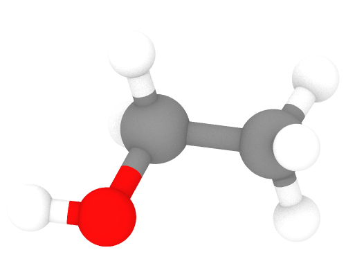

# PDB

The format `pdb` reads the files of the Protein Data Bank: the atoms of each
model, their names and residues, the cell and the bonds of the `CONECT`
records. Files with extension `.pdb` or `.ent` are recognized. mdapy reads
PDB files but does not write them.

```python
import mdapy as mp
from mdapy.visualization import render

text = """\
HETATM    1  C1  ETH A   1       1.168  -0.400   0.000  1.00  0.00           C
HETATM    2  C2  ETH A   1       0.000   0.559   0.000  1.00  0.00           C
HETATM    3  O1  ETH A   1      -1.190  -0.228   0.000  1.00  0.00           O
HETATM    4  H1  ETH A   1      -1.947   0.382   0.000  1.00  0.00           H
HETATM    5  H2  ETH A   1       0.043   1.208   0.887  1.00  0.00           H
HETATM    6  H3  ETH A   1       0.043   1.208  -0.887  1.00  0.00           H
HETATM    7  H4  ETH A   1       2.116   0.145   0.000  1.00  0.00           H
HETATM    8  H5  ETH A   1       1.129  -1.037   0.886  1.00  0.00           H
HETATM    9  H6  ETH A   1       1.129  -1.037  -0.886  1.00  0.00           H
CONECT    1    2    7    8    9
CONECT    2    1    3    5    6
CONECT    3    2    4
END
"""
with open("ethanol.pdb", "w") as f:
    f.write(text)

ethanol = mp.read("ethanol.pdb")
ethanol["atom_name"]  # C1, C2, O1, H1, ...
ethanol.topology.bonds  # the eight bonds of CONECT
render(
    ethanol,
    "images/ethanol.png",
    representation="ball_and_stick",
    box=False,  # the box about a molecule
    view=(0.3, 0.5, -1.0),
    width=500,
    height=400,
)
```



*Ethanol read from the PDB text above: carbon (gray), oxygen (red) and
hydrogen (white).*

## Reading

| Record | Columns | In mdapy |
|---|---|---|
| `CRYST1` | a, b, c in 7–33, α, β, γ in 34–54 | `box.matrix`: a along x, b in the xy plane; periodic in all directions |
| `ATOM`, `HETATM` | serial 7–11 | `id`; the number of the atom where the serial is not a number |
| | atom name 13–16 | `atom_name` |
| | residue name 18–20, residue number 23–26 | `residue`, `residue_number` |
| | x, y, z 31–54 | `positions` |
| | element 77–78 | `element`; without one, the element of the atom name: its second column when the first is blank or a digit (` CA ` is carbon, `1HB ` hydrogen), else its first two letters if they are an element (`CL1 ` is chlorine), else its first |
| `MODEL`, `ENDMDL` | | one frame per model; a file without `MODEL` is one frame |
| `CONECT` | serials 7–31 | bonds of the `Topology`, each pair once, by `id` |
| `END` | | the end of the frame |

The `CRYST1` record before the first atom or model gives the cell of every
model, unless a model has its own. Without a `CRYST1` record, or with one
of 1 Å, as some programs write for molecules, the box encloses the atoms
and is not periodic. Other records, and the alternate locations, chains,
occupancies and temperature factors of atoms, are left out.

## Comparison

The atoms, names, residues and cells are those ASE reads, and the bonds
those of OVITO but for the bonds OVITO adds between atoms close enough,
which [`covalent_bonds`](../../visualization/rendering.md#molecules) gives.

## Errors

[`FileFormatError`](../api.md#mdapy.errors.FileFormatError) at the line of
the fault for: a cell parameter or coordinate that is not a number, an atom
record that ends before its coordinates, an atom whose element cannot be
told, a `CONECT` record with a word that is not a serial, and a bond to an
atom the model lacks.

## See also

- [Reading and writing files](../../getting-started/io.md)
- The [PDB format](https://www.wwpdb.org/documentation/file-format) of the
  wwPDB.
