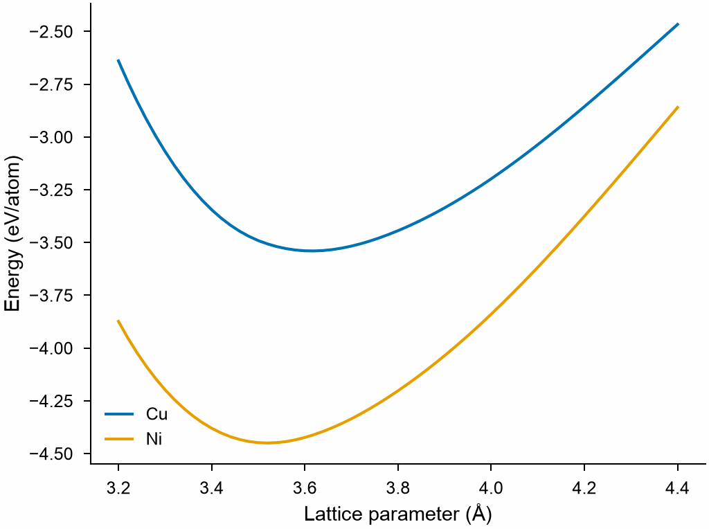

# EAM

```python
from mdapy.calculators import EAM

potential = EAM.zhou(["Cu", "Ni"])  # or EAM("CuNi.eam.alloy")
potential.elements, potential.cutoff
potential.write("CuNi.eam.alloy")
```

The energy per atom of fcc copper and nickel against the lattice parameter,
from the potential:

```python
import numpy as np

from mdapy.build import build_crystal
from mdapy.visualization import plot

lattice = np.linspace(3.2, 4.4, 61)
with plot.style():
    fig, ax = plot.figure("single")
    for element in potential.elements:
        cells = [build_crystal("fcc", a, elements=element) for a in lattice]
        energy = [potential.compute(cell, ("energy",)).energy / 4 for cell in cells]
        ax.plot(lattice, energy, label=element)
    ax.set_xlabel("Lattice parameter (Å)")
    ax.set_ylabel("Energy (eV/atom)")
    ax.legend()
    plot.save(fig, "images/eam", formats=("png",))
```



*The minima are the lattice parameters and cohesive energies of the
potential, near the measured 3.615 Å and 3.52 Å; the curvature at the
minimum gives the bulk modulus.*

`EAM(path)` reads an embedded atom method potential in the `eam/alloy`
(setfl) format of LAMMPS and computes every property.

| Attribute | Type | Meaning |
|---|---|---|
| `path` | str or `None` | the potential file, `None` for a built potential |
| `elements` | tuple of str or `None` | the elements of the potential, in the order of the file; `None` for an average-atom potential |
| `masses` | (n,) float64 | their masses in amu; the mass of the average atom for an average-atom potential |
| `cutoff` | float | cutoff radius in Å |

| Method | Returns |
|---|---|
| `compute(system, properties, *, neighbors=None, progress=None, cancel=None)` | as every calculator, with the `progress=` and `cancel=` of [Parallelism](../getting-started/parallelism.md#progress-and-cancellation) |
| `write(path)` | writes the potential as an `eam/alloy` file, which LAMMPS reads and which reads back to the same tables |
| `EAM.zhou(elements, *, nr=2000, nrho=2000)` | the potential of Zhou, Johnson and Wadley for the elements |
| `average(concentrations)` | the average-atom potential of an alloy of the elements |

The atoms need an `element` column; elements the potential does not have
raise `InvalidParameter`, and a malformed file raises
[`FileFormatError`](../reference/api.md#mdapy.errors.FileFormatError) with
its line. A file may name species that are not elements, such as the `A` of
an average atom; they are kept when the potential is written, but no atom
of a system is one of them.

The energy of atom $i$ is

$$
E_i = F_{s_i}\Big(\sum_j \rho_{s_j}(r_{ij})\Big) + \frac{1}{2}\sum_j \phi_{s_i s_j}(r_{ij}),
$$

with the embedding energy $F$, the electron density $\rho$ and the pair
potential $\phi$ of the species $s$ of the atoms, interpolated from the
tables of the file as LAMMPS `pair_style eam/alloy` does. Each pair's virial
is shared equally by its two atoms.

!!! quote "Please cite"
    [Daw and Baskes (1984)](../reference/references.md#daw1984), and the paper of the potential.

## Potentials of Zhou, Johnson and Wadley

<!-- skip-test -->
```python
potential = EAM.zhou(["Cu", "Ni", "Al"])
potential.write("CuNiAl.eam.alloy")
```

`EAM.zhou` builds the potential for any of Cu, Ag, Au, Ni, Pd, Pt, Al, Pb,
Fe, Mo, Ta, W, Mg, Co, Ti, Zr and Cr, with the tables that the database tool
of LAMMPS (`tools/eam_database`) writes for them: the parameters of
[Zhou et al. (2004)](../reference/references.md#zhou2004), those of
[Lin et al. (2008)](../reference/references.md#lin2008) for Cr, and their rule for the pair
potential between two elements,

$$
\phi_{ab}(r) = \frac{1}{2}\left(\frac{\rho_b(r)}{\rho_a(r)}\phi_{aa}(r)
+ \frac{\rho_a(r)}{\rho_b(r)}\phi_{bb}(r)\right).
$$

| Name | Type | Default | Unit | Meaning |
|---|---|---|---|---|
| `elements` | sequence of str | | | the elements, in the order of the file |
| `nr` | int | 2000 | | points of the tables in distance, up to the cutoff $\sqrt{10}/2$ times the largest fcc lattice constant $\sqrt 2\, r_e$ |
| `nrho` | int | 2000 | | points of the embedding tables in density |

The parameters are fitted to the pure metals; the pair potentials between
elements come from the rule above, not from a fit to alloys. An unknown or
repeated element raises `InvalidParameter`.

!!! quote "Please cite"
    [Zhou et al. (2004)](../reference/references.md#zhou2004); with Cr, also [Lin et al. (2008)](../reference/references.md#lin2008).

## Average atom

<!-- skip-test -->
```python
average = potential.average({"Cu": 0.4, "Ni": 0.4, "Al": 0.2})
average.compute(system)  # every atom is the average atom
average.write("CuNiAl.average.eam.alloy")  # Cu, Ni, Al and the average atom A
```

`average(concentrations)` returns the average-atom potential of
[Varvenne et al. (2016)](../reference/references.md#varvenne2016) for a random alloy with the
fractions $c_a$ of the elements:

$$
F_A = \sum_a c_a F_a, \qquad \rho_A = \sum_a c_a \rho_a, \qquad
\phi_{Ab} = \sum_a c_a \phi_{ab}, \qquad
\phi_{AA} = \sum_{a,b} c_a c_b \phi_{ab}.
$$

`concentrations` is a mapping from element to fraction, or the fractions in
the order of `elements`; elements left out have none, and the fractions sum
to 1. In mdapy every atom of a system is the average atom, whatever its
element. The written file holds the elements of the potential and the
average atom, named `A`, last, so that LAMMPS can mix them, for example
with `pair_coeff * * CuNiAl.average.eam.alloy A Cu` for a Cu solute in the
average alloy. Invalid fractions raise `InvalidParameter`.

!!! quote "Please cite"
    [Varvenne et al. (2016)](../reference/references.md#varvenne2016), and the paper of the potential averaged.
