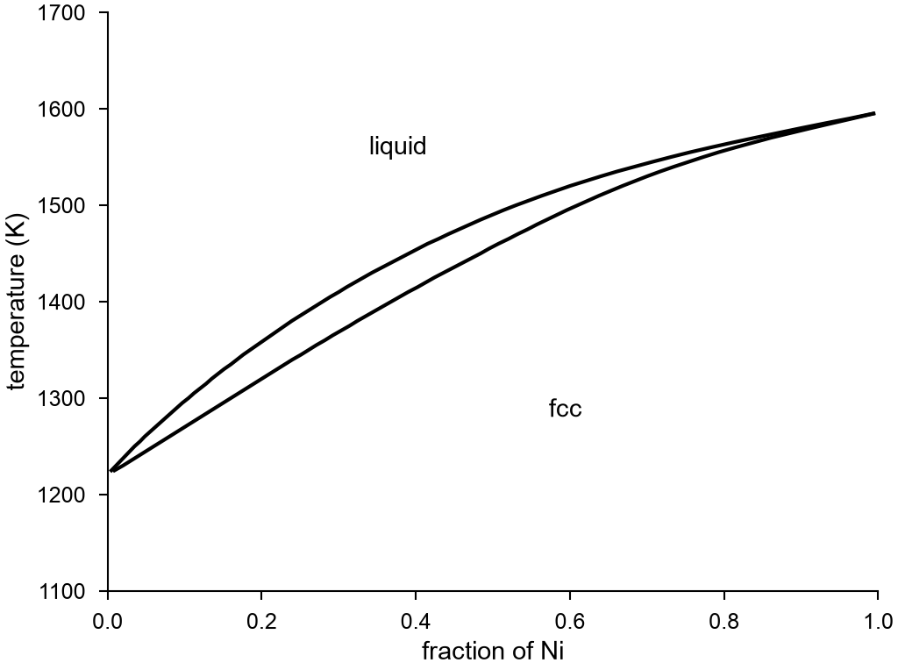

# Phase diagrams

`mdapy.simulation.binary_phase_diagram(phases, temperatures)` gives the phase diagram
of two elements from the [free energies](free-energy.md) of their phases: at each
temperature the stable phases at each composition lie on the lower convex hull of the
free energies.

<!-- skip-test -->
```python
import numpy as np

from mdapy.build import build_crystal, random_alloy
from mdapy.calculators import LAMMPS
from mdapy.simulation import binary_phase_diagram, free_energy, minimize

potential = LAMMPS("pair_style nep/kk\npair_coeff * * nep.txt Cu Ni", ["Cu", "Ni"])
temperatures = np.arange(900.0, 2101.0, 25.0)
solid, liquid = {}, {}
for x in (0.0, 0.25, 0.5, 0.75, 1.0):
    a = 3.63 * (1 - x) + 3.52 * x
    atoms = random_alloy(
        build_crystal("fcc", a, repeat=(8, 8, 8)), {"Cu": 1 - x, "Ni": x}, seed=7
    )
    atoms = minimize(atoms, potential, cell="full", max_stress=1e-2).system
    solid[x] = free_energy(atoms, potential, temperatures, mixing=0 < x < 1)
    liquid[x] = free_energy(atoms, potential, temperatures[::-1], phase="liquid")

diagram = binary_phase_diagram(
    {"fcc": solid, "liquid": liquid}, temperatures, elements=("Cu", "Ni")
)
diagram.phases_at(1400.0, 0.5)  # the stable phases, one or two
diagram.tie_lines[0]  # which two phases, at which fractions
```

The diagram, with `plot.phase_diagram`:

<!-- skip-test -->
```python
from mdapy.visualization import plot

with plot.style():
    fig, ax = plot.figure("single")
    plot.phase_diagram(diagram, ax=ax)
    plot.save(fig, "images/phase-diagram", formats=("png",))
```



*CAPTION_DIAGRAM*

| Name | Type | Default | Unit | Meaning |
|---|---|---|---|---|
| `phases` | mapping | | | for each phase, its free energies by the fraction of the second element: each a [`FreeEnergyResult`](free-energy.md#results), or a pair of (T,) temperatures in K and (T,) free energies in eV per atom |
| `temperatures` | array_like | | K | the temperatures of the diagram |
| `elements` | 2 str | `("A", "B")` | | the elements, for the labels |
| `points` | int | 1001 | | the number of fractions from 0 to 1 |
| `degree` | int | 4 | | the largest degree of the polynomials |

A phase of one fraction is a compound of that composition. A phase of more is a
solution between its lowest and its highest fractions: at each temperature the free
energy minus that of ideal mixing is a polynomial of the fraction, through the given
points as closely as its degree allows. Beyond its temperatures a free energy goes on
along a straight line; a phase there is usually one that has already lost to another,
as a crystal above the temperature to which it stayed a crystal.

The free energies must include the entropy of mixing, which
[`free_energy`](free-energy.md) gives a liquid by itself and a random solid solution
with `mixing=True`. Short-range order in a solid solution, which the dynamics cannot
reach, is left out. All free energies must be at one pressure.

For a phase diagram at 0 K of any number of elements, from energies of formation,
see the `PhaseDiagram` of [pymatgen](https://pymatgen.org), to which a free energy at
one temperature can be given as the energy of an entry.

## Results

`binary_phase_diagram` returns a `BinaryPhaseDiagram`; arrays are read-only.

| Attribute or method | Type | Meaning |
|---|---|---|
| `elements` | tuple of str | the two elements; the fraction is that of the second |
| `phases` | tuple of str | the names of the phases |
| `temperatures` | (T,) array | the temperatures in K |
| `fractions` | (X,) array | the fractions of the second element |
| `stable` | (T, X) int array | the index in `phases` of the one stable phase, or -1 where two coexist |
| `tie_lines` | tuple of `TieLine` | each pair of phases in equilibrium |
| `phases_at(temperature, fraction)` | tuple of str | the one or two stable phases at the nearest temperature of the diagram |

A `TieLine` has `temperature` in K, `first` and `second`, the phases, the first at the
lower fraction, and `first_fraction` and `second_fraction`.

`plot.phase_diagram(result, *, ax=None, labels=True)` draws where the tie lines end
against the temperature, with the name of each phase in the middle of where it is the
only one.

## Definition

With $G_p(x, T)$ the free energy per atom of phase $p$ at a fraction $x$ of the second
element, the stable phases at $T$ are those on the lower convex hull of all $G_p(x, T)$
against $x$. A straight piece of the hull between two points is a tie line: two phases
with the same chemical potentials of both elements. A solution has

$$
G(x, T) = \sum_k a_k(T) x^k + k_B T \left[ x \ln x + (1 - x) \ln (1 - x) \right].
$$

## Errors

`binary_phase_diagram` raises `InvalidParameter` for no phases, a phase with no free
energies, a fraction out of range, no phase at the fractions 0 or 1, free energies with
another number of values than temperatures, or invalid temperatures, `points`, `degree`
or `elements`. `phases_at` raises it for a fraction out of range.
