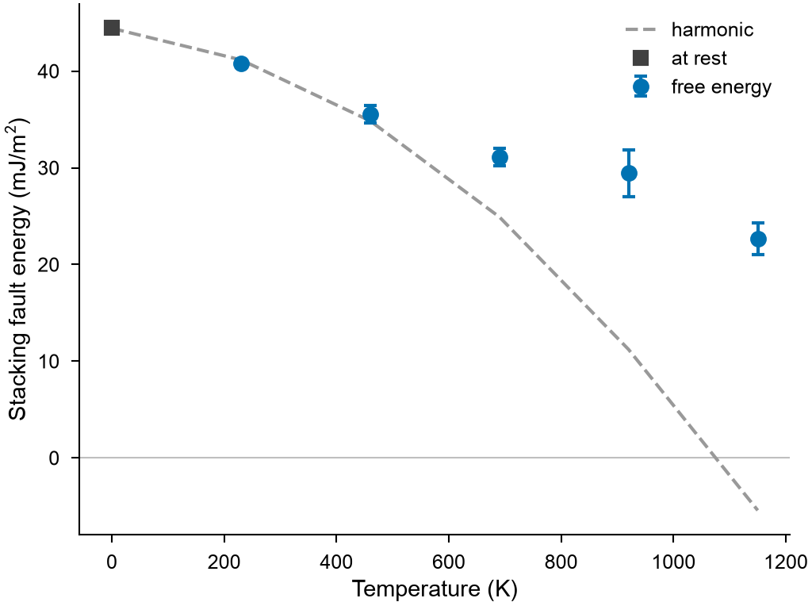

# Stacking faults at finite temperature

`mdapy.simulation.stacking_fault_free_energy(crystal, potential, direction,
temperatures)` gives the free energy of a stacking fault per area at each temperature:
the difference of the [free energies](free-energy.md) of the crystal with and without
it, in one box of the size the crystal has at that temperature and pressure. The
energy at rest is the business of
[`stacking_fault_energy`](defect-energies.md).

<!-- skip-test -->
```python
import numpy as np

from mdapy.build import build_crystal
from mdapy.calculators import LAMMPS
from mdapy.simulation import minimize, stacking_fault_free_energy

potential = LAMMPS(
    "pair_style eam/alloy\npair_coeff * * Cu_mishin1.eam.alloy Cu", elements=["Cu"]
)
a = 3.615
layers = minimize(
    build_crystal(
        "fcc",
        a,
        elements="Cu",
        orientation=[(1, 1, -2), (-1, 1, 0), (1, 1, 1)],
        repeat=(2, 4, 4),
    ),
    potential,
    cell="full",
    max_stress=1e-3,
).system

result = stacking_fault_free_energy(
    layers, potential, [a * np.sqrt(6) / 6, 0, 0], [300, 600, 900, 1200]
)
result.energy, result.error  # J/m²
```

CAPTION_FAULT



*CAPTION_FAULT_IMAGE*

The wider the plane the smaller the error: the error of the free energy of all atoms
grows with their square root, the free energy of the fault with the area. The crystal
must keep its fault during the runs: a slip vector that leads to no minimum of the
energy, as a partial in a potential with no stable stacking fault, slides back, and
gives something lower than the energy at rest.

| Name | Type | Default | Unit | Meaning |
|---|---|---|---|---|
| `crystal` | `System` | | | the crystal, relaxed, with an `element` column, periodic in every direction, with the plane of the fault normal to the Cartesian axis of `axis`, such as fcc with z along [111] |
| `potential` | `LAMMPS` | | | the interaction |
| `direction` | array_like | | Å | (3,) the slip vector in the plane, such as a/6 [11-2] |
| `temperatures` | float or array_like | | K | the temperatures |
| `height` | float | between the two layers nearest the middle | | the fault, as a fractional coordinate along the box vector of `axis` |
| `axis` | int or str | `z` | | the Cartesian axis normal to the fault |
| `pressure` | float | 0 | GPa | the pressure |
| `timestep` | float | 0.001 | ps | the time step |
| `equilibration` | float | 10 | ps | the time of each equilibration |
| `switching` | float | 50 | ps | the time of each switching between the crystal and the springs |
| `repeats` | int | 4 | | independent free energies of each crystal at each temperature |
| `max_force` | float | 1e-4 | eV/Å | convergence of the relaxation of the fault at each size of the box |
| `max_steps` | int | 10000 | | the largest number of steps of each relaxation |
| `seed` | int | 1 | | the seed of the random numbers |
| `progress` | callable | `None` | | called as `progress(done, total)` with the steps run |
| `cancel` | `CancelToken` | `None` | | stops the calculation, which raises `Cancelled` |

## Results

It returns a `FaultFreeEnergyResult`; arrays are read-only.

| Attribute | Type | Unit | Meaning |
|---|---|---|---|
| `temperatures` | (T,) array | K | the temperatures |
| `energy` | (T,) array | J/m² | the free energy of the fault per area |
| `error` | (T,) array | J/m² | its standard error from the repeats; zero for one repeat |
| `area` | float | Ų | the area of the fault at the first temperature |
| `volume` | (T,) array | ų | the volume per atom of the crystal |
| `dissipation` | (T,) array | eV | half the difference of the work there and back per atom, the largest over the runs |

## Definition

$$
\gamma(T) = \frac{F_\mathrm{fault}(T) - F_\mathrm{crystal}(T)}{A},
$$

where both free energies are those of [`free_energy`](free-energy.md) for solids, of
the same atoms in one box but for the box vector that the fault tilts. Classical atoms,
as in molecular dynamics. With the phonons of the two cells, the
[harmonic part](phonons.md) of this difference is cheaper and free of noise, but it
gets worse with the temperature.

## Errors

`stacking_fault_free_energy` raises `InvalidParameter` for invalid options, a plane not
normal to the axis, a box not periodic in every direction, or if LAMMPS fails;
`MissingProperty` for a crystal without an `element` column; `Cancelled` when
cancelled.

!!! quote "Please cite"
    [Frenkel and Ladd (1984)](../reference/references.md#frenkel1984) and
    [Freitas et al. (2016)](../reference/references.md#freitas2016) for the free
    energies; see also [Zhang et al. (2018)](../reference/references.md#zhang2018) on
    stacking faults at high temperature.
