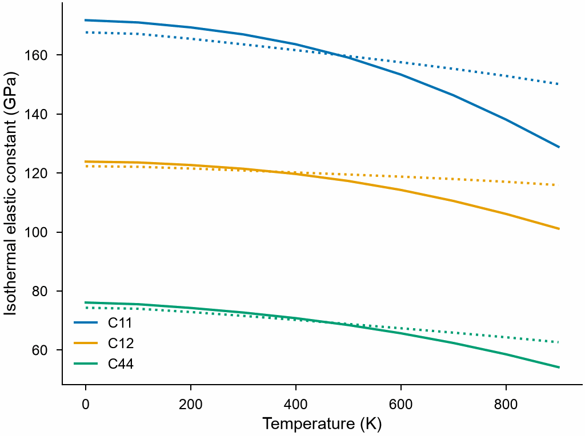

# Elastic constants at finite temperature

`mdapy.lattice_dynamics.thermal_elastic_constants(qha, calculator, *,
method="quasi-harmonic", strain=5e-3, supercell=None, mesh=20,
displacement=0.01, max_force=1e-6, max_steps=5000)` gives the isothermal and
adiabatic elastic constants of a crystal at the temperatures of a
[quasi-harmonic calculation](quasi-harmonic.md).

<!-- skip-test -->
```python
import numpy as np

from mdapy.lattice_dynamics import (
    primitive_cell,
    quasi_harmonic,
    thermal_elastic_constants,
)

cell = primitive_cell(crystal)  # relaxed, as for the phonons
qha = quasi_harmonic(cell, potential, np.arange(0, 901, 100))
result = thermal_elastic_constants(qha, potential)
result.isothermal[:, 0, 0]  # C11 in GPa at each temperature
result.adiabatic[:, 3, 3]  # C44
fast = thermal_elastic_constants(qha, potential, method="quasi-static")
```

The isothermal constants of copper by both methods:

<!-- skip-test -->
```python
from mdapy.visualization import plot

t = qha.temperatures
with plot.style():
    fig, ax = plot.figure("single")
    for name, (i, j) in {"C11": (0, 0), "C12": (0, 1), "C44": (3, 3)}.items():
        (line,) = ax.plot(t, result.isothermal[:, i, j], label=name)
        ax.plot(t, fast.isothermal[:, i, j], ":", color=line.get_color())
    ax.set_xlabel("Temperature (K)")
    ax.set_ylabel("Isothermal elastic constant (GPa)")
    ax.legend()
    plot.save(fig, "images/thermal-elastic", formats=("png",))
```



*Copper with the EAM potential of Mishin et al., quasi-harmonic (solid) and
quasi-static (dotted): the crystal softens as it heats. The quasi-static
constants, which see only the expansion, soften less; at low temperature
the zero-point vibrations make the quasi-harmonic ones a little stiffer.*

The elastic constants at a temperature are the second derivatives of the
free energy with respect to strain, at the volume of that temperature.
They are found in the cells of the quasi-harmonic grid around the volumes
of the temperatures, two more on either side, and taken at each volume by
a cubic polynomial through those cells.

- `"quasi-harmonic"`: the free energy is the static energy and the free
  energy of the vibrations, from the phonons of each strained cell. This
  takes 73 phonon calculations for each cell, a few seconds with an EAM
  potential.
- `"quasi-static"`: the static energy alone, at the volume of each
  temperature; the crystal softens only as it expands. Without phonons, it
  is much faster, and close to the quasi-harmonic constants well below the
  melting point, but stiffer as it nears.

| Name | Type | Default | Unit | Meaning |
|---|---|---|---|---|
| `qha` | `QuasiHarmonicResult` | | | the quasi-harmonic calculation, with its cells |
| `calculator` | `Calculator` | | | computes energies and forces, as for the quasi-harmonic calculation |
| `method` | str | `"quasi-harmonic"` | | `"quasi-harmonic"` or `"quasi-static"` |
| `strain` | float | 5e-3 | | the magnitude $h$ of the Lagrangian strains of the finite differences |
| `supercell`, `mesh`, `displacement` | | | | of the phonons of the strained cells, as in [`phonons`](phonons.md) |
| `max_force` | float | 1e-6 | eV/Å | convergence of the relaxation of the positions in each strained cell |
| `max_steps` | int | 5000 | | largest number of steps of each relaxation |
| `symmetry` | bool or None | `None` | | compute one of each set of strains that the operations make from each other, and use symmetry in the phonons; with the symmetry operations of the crystal, found by [spglib](../analysis/space-group.md): `True`, `False`, or by default whenever spglib is installed |

A cubic crystal takes 12 of the 73 strains of the differences, hcp 36.
The strained cells keep the supercell of their cell and the periodic images
its force constants go to, so that their free energies change smoothly
with the strain, even in a supercell thinner than the force constants
reach.

## Results

A `ThermalElasticResult`; arrays are read-only.

| Attribute | Type | Unit | Meaning |
|---|---|---|---|
| `temperatures` | (T,) array | K | the temperatures |
| `isothermal` | (T, 6, 6) array | GPa | the isothermal elastic constants $C^T$, in Voigt order xx, yy, zz, yz, xz, xy |
| `adiabatic` | (T, 6, 6) array | GPa | the adiabatic elastic constants $C^S$, those of sound waves |
| `method` | str | | the method |

Under a pressure, the constants are the stress–strain coefficients, which
give the speed of sound and the stability of the crystal under it.

## Errors

`thermal_elastic_constants` raises `InvalidParameter` for an unknown method,
a strain that is not positive, a result without cells, a relaxation that
does not converge within `max_steps`, imaginary frequencies in a strained
cell, and `symmetry=True` without spglib.

## Definition

A cell of the grid, of volume $V$, is deformed by the Lagrangian strain
$\eta$ as $\sqrt{1 + 2\eta}$, its positions relax, and

$$
C_{ij} = \frac{1}{V}\frac{\partial^2 F}{\partial\eta_i\,\partial\eta_j},
$$

in Voigt notation with engineering shears, by central differences of step
$h$; $F$ is the static energy $E$ and, but for the quasi-static method, the
free energy of the vibrations. Under a pressure $P$ the stress–strain
coefficients are
$B_{ijkl} = C_{ijkl} - P(\delta_{ik}\delta_{jl} + \delta_{il}\delta_{jk} - \delta_{ij}\delta_{kl})$.
With the thermal expansion tensor $\alpha$, from the cells of the grid
against volume, and the heat capacity at constant volume $C_V$, the
adiabatic constants are

$$
C^S_{ij} = C^T_{ij} + \frac{T V \lambda_i\lambda_j}{C_V}, \qquad
\lambda_i = \sum_k C^T_{ik}\,\alpha_k
$$

([Wallace (1972)](../reference/references.md#wallace1972)).
