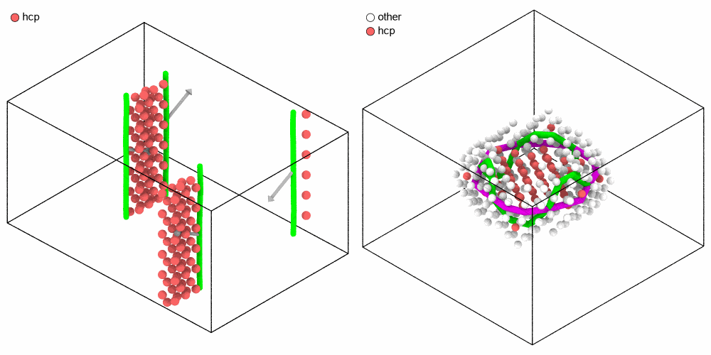

# Dislocation analysis

`DislocationAnalysis` finds the dislocations of a crystal, by the
dislocation extraction algorithm (DXA) of OVITO: lines through the cores,
the Burgers vector of each, and the junctions where they meet. Partial
dislocations at the edges of stacking faults are found as well. The defects
that are not dislocations, such as grain boundaries, free surfaces and
voids, make the defect mesh around them.

```python
import numpy as np
from mdapy.analysis import DislocationAnalysis
from mdapy.build import dislocation_quadrupole

# two edge dislocations of copper and their opposites, each split into two
# Shockley partials 10 Å apart
system = dislocation_quadrupole(
    "fcc edge", 3.615, (168.4, 121.4, 75.4), (14, 8, 6), elements="Cu", dissociation=10
)
result = DislocationAnalysis("fcc").compute(system)
len(result.lines)  # 4 partials
line = result.lines[0]
line.family  # 1/6<112>: a Shockley partial
line.burgers  # [-1/6, -1/3, 1/6] in the lattice frame, units of a
line.spatial_burgers  # Å, [-1.278, 0, 0.738] along the axes of the box
line.loop, line.infinite  # True, True: straight through the periodic box
line.length  # Å, 26.6
result.lengths()  # Å, {"1/2<110>": 0, "1/6<112>": 106.3, ..., "other": 0}
result.counts()  # atoms, {"other": 120, "fcc": 3630, "hcp": 138, ...}
system = system.with_columns(result)  # dxa_structure, dxa_crystal_cluster
```

A disc of vacancies in a (111) plane collapses into a Frank loop, which in
copper turns into a stacking-fault tetrahedron: six Shockley partials and
six stair-rod dislocations along its edges, meeting at junctions.

```python
from mdapy.build import build_crystal
from mdapy.calculators import EAM
from mdapy.simulation import minimize

copper = build_crystal(
    "fcc",
    3.615,
    elements="Cu",
    orientation=[(1, -1, 0), (1, 1, -2), (1, 1, 1)],
    repeat=(14, 8, 4),
)
p = copper["positions"] - copper.box.matrix.diagonal() / 2
plane = p[np.argmin(np.abs(p[:, 2])), 2]  # the (111) plane through the middle
disc = (np.abs(p[:, 2] - plane) < 0.3) & (np.linalg.norm(p[:, :2], axis=1) < 10)
relaxed = minimize(copper.filter(~disc), EAM.zhou(["Cu"]), max_force=1e-2).system

tetrahedron = DislocationAnalysis("fcc").compute(relaxed)
len(tetrahedron.lines), len(tetrahedron.junctions)  # 12 lines, 6 junctions
tetrahedron.lengths()  # Å, {"1/6<112>": 68.8, "1/6<110>": 56.7, ...}
tetrahedron.lines[0].junctions  # the junctions at its first and last point
```

The partials with the stacking faults between them, and the tetrahedron,
drawn by the [renderer](../visualization/rendering.md) in the colors of
their families, with a legend of the atoms and the lines shown:

```python
from mdapy.visualization import render, write_png

kinds = {"1/2<110>": "perfect", "1/6<112>": "Shockley", "1/6<110>": "stair-rod",
         "1/3<100>": "Hirth", "1/3<111>": "Frank"}  # fmt: skip


def legend(found, shown):
    """The structures of the atoms shown and the families of the lines."""
    names = {found.names[k]: found.colors[k] for k in np.unique(found.structure[shown])}
    palette = DislocationAnalysis.FAMILY_COLORS[found.crystal]
    for family in sorted({line.family for line in found.lines}):
        names[f"{kinds.get(family, 'other')} {family}"] = palette[family]
    return names


hcp = result.structure == result.names.index("hcp")
not_fcc = tetrahedron.structure != tetrahedron.names.index("fcc")
pictures = [
    render(
        system,
        atoms=hcp,
        color=result,
        legend=legend(result, hcp),
        radius=0.8,
        dislocations=result,
        burgers_vectors=True,
        burgers_scale=5,
        width=640,
        height=500,
    ),
    render(
        relaxed,
        atoms=not_fcc,
        color=tetrahedron,
        legend=legend(tetrahedron, not_fcc),
        radius=0.6,
        dislocations=tetrahedron,
        width=640,
        height=500,
    ),
]
write_png("images/dislocations.png", np.hstack(pictures))
```



*Left: the four Shockley partials (green) with their Burgers vectors (gray
arrows), and between each pair the two layers of hcp atoms (red) of its
stacking fault, one across the periodic boundary. Right: the stacking-fault tetrahedron of the relaxed Frank loop,
Shockley partials (green) and stair-rods (magenta) along its edges, with
the hcp atoms of its faces and the other atoms of its corners (white).*

## Parameters

| Name | Type | Default | Unit | Meaning |
|---|---|---|---|---|
| `crystal` | str | | | the crystal: `fcc`, `hcp`, `bcc`, `cubic_diamond` or `hexagonal_diamond` |
| `circuit_length` | int32 | 14 | | the number of edges of the longest Burgers circuit that finds a line; at least 3 |
| `stretch` | int32 | 9 | | the number of edges more a circuit may grow to follow a line |
| `perfect_only` | bool | `False` | | find perfect dislocations only: the atoms of stacking faults are other, and partials make one line |
| `point_separation` | float64 | 2.5 | | how sparse the points along the lines are: each is the mean of a run of the points found, longer where the line is wider; 0 keeps them all |
| `smoothing` | int32 | 1 | | the number of smoothing steps of the lines |
| `mesh_smoothing` | int32 | 8 | | the number of smoothing steps of the defect mesh |
| `interface_mesh` | bool | `False` | | also give the interface mesh, on which the circuits run |
| `low_ca_ratio` | bool | `False` | | for `hcp` of a low c/a: an atom whose 12 nearest neighbors are not hcp is tried again with them stretched along its c axis to the ideal c/a |

`compute(system, *, progress=None, cancel=None)` takes the `progress` and
`cancel` of [every analysis](overview.md#parameters), but no neighbor list.
No two atoms may be at the same position.

The structures are those of OVITO's dislocation analysis, found with the
crystal: fcc and hcp for `fcc` or `hcp` (each the stacking fault of the
other), bcc for `bcc`, cubic and hexagonal diamond for either diamond.
Longer circuits find dislocations of wider cores, and take longer.

Below a c/a of some 1.15 the 12 nearest neighbors of hcp no longer form
its shells, and its atoms are other. With `low_ca_ratio=True` the c axis of
an atom is that between the two triangles of its 6 nearest neighbors, and
its 14 nearest neighbors are stretched along it to the ideal c/a; a hot
crystal is then hcp down to a c/a of some 0.75, as in OVITO. The option
does nothing for the other crystals.

```python
from mdapy.build import build_crystal

hcp = build_crystal("hcp", 3.0, c=3.0, elements="Mg", repeat=(8, 5, 5))
DislocationAnalysis("hcp").compute(hcp).counts()["hcp"]  # 0
DislocationAnalysis("hcp", low_ca_ratio=True).compute(hcp).counts()["hcp"]  # 400, all
```

## Results

A `DislocationResult`:

| Attribute or method | Type | Meaning |
|---|---|---|
| `crystal` | str | the crystal analyzed |
| `lines` | tuple of `DislocationLine` | the dislocation lines |
| `junctions` | (J, 3) float64 | the points in Å where three or more lines meet, in the box |
| `structure` | (N,) int8 | the structure of each atom, an index into `names`; its column `dxa_structure` |
| `names` | tuple of str | `other`, `fcc`, `hcp`, `bcc`, `cubic_diamond`, `hexagonal_diamond` |
| `colors` | tuple of (3,) float64 | the default color of each structure |
| `crystal_cluster` | (N,) int64 | the crystal cluster of each atom, −1 for none; its column `dxa_crystal_cluster` |
| `clusters` | `CrystalClusters` | the crystal clusters |
| `defect_mesh` | `TriangleMesh` | the surface around the defects that are not dislocations, closed over the free ends of the lines, its normals pointing into the crystal |
| `defect_atoms` | (V,) int64 | the atom at each vertex of the defect mesh, −1 at the end of a line |
| `interface_mesh` | `TriangleMesh` or `None` | the mesh between the good crystal and the rest, with `interface_mesh=True` |
| `interface_atoms` | (V,) int64 or `None` | the atom at each of its vertices |
| `lengths()` | dict of str to float64 | the total length of the lines of each family of the crystal in Å, `other` last |
| `total_length` | float64 | the total length of the lines in Å |
| `densities()` | dict of str to float64 | the length of the lines of each family per volume of the box in Å⁻², `other` last; times 10<sup>20</sup> in m⁻² |
| `density` | float64 | the total length of the lines per volume of the box in Å⁻² |
| `counts()` | dict of str to int64 | the number of atoms of each structure, by name |
| `write(path)` | | writes the lines, the crystal clusters and the defect mesh as a CA file, below |

A `DislocationLine`:

| Attribute | Type | Meaning |
|---|---|---|
| `points` | (P, 3) float64 | the points along the line in Å, unwrapped: consecutive points are close also across a periodic boundary |
| `burgers` | (3,) float64 | the Burgers vector in the lattice frame of its crystal cluster, in units of the lattice constant |
| `spatial_burgers` | (3,) float64 | the Burgers vector in Å along the axes of the box, as the crystal cluster is turned and stretched; where the lattice about the line, within 7 Å, is turned from the cluster by more than 3°, as when one cluster holds two grains, as that lattice is turned |
| `cluster` | int32 | the crystal cluster of the lattice frame |
| `family` | str | the family of the Burgers vector, or `other` |
| `length` | float64 | the length in Å |
| `loop` | bool | whether the line closes on itself: a loop, or a line through periodic boundaries |
| `infinite` | bool | whether it closes through periodic boundaries |
| `junctions` | (int32, int32) | the junctions at its first and last point, −1 for a free end and for the ends of a closed line |

The families of Burgers vectors, by crystal:

| Crystal | Families |
|---|---|
| `fcc` | `1/2<110>` perfect, `1/6<112>` Shockley, `1/6<110>` stair-rod of the Lomer–Cottrell lock, `1/3<100>` Hirth, `1/3<111>` Frank, `1/6<310>` and `1/3<110>` the stair-rods where Shockley partials on two {111} planes meet in other ways |
| `bcc` | `1/2<111>`, `<100>`, `<110>` |
| `cubic_diamond` | `1/2<110>`, `1/6<112>`, `1/6<110>`, `1/3<111>` |
| `hcp` | `1/3<11-20>`, `<0001>`, `<1-100>`, `1/3<1-100>`, `1/3<11-23>` |
| `hexagonal_diamond` | `1/3<11-20>`, `<0001>`, `<1-100>`, `1/3<1-100>` |

A `CrystalClusters`:

| Attribute | Type | Meaning |
|---|---|---|
| `structure` | (C,) int8 | the structure of each cluster, an index into `names` |
| `sizes` | (C,) int64 | the number of atoms of each |
| `orientation` | (C, 3, 3) float64 | the matrix that takes vectors of its lattice frame, in units of the lattice constant, to vectors in Å along the axes of the box |

The lattice frame of a cubic crystal is that of its cubic cell; that of
hcp and hexagonal diamond has c along z and a<sub>1</sub> along x, in units
of the cubic lattice constant with the same nearest neighbors (√2 a for
hcp). Of the frames the symmetry of the lattice allows, that of a cluster
of the crystal is the one closest to the axes of the box, so that the
lattice Burgers vectors of a crystal along the box read as usual.

`render(system, dislocations=result)` draws the lines as tubes in the
colors of their families, cut at the periodic boundaries; their colors are
`DislocationAnalysis.FAMILY_COLORS[crystal]`. With `burgers_vectors=True`
an arrow from the middle of each line shows its Burgers vector in space,
`burgers_scale` times as long. `mesh=result.defect_mesh` draws the defect
mesh.

### Some atoms only

To analyze some atoms only, as a sublattice of an alloy, analyze the system
of those atoms; the others are as if they were not there. The gallium of
gallium arsenide, a zinc blende of two fcc lattices, is fcc:

```python
from mdapy.build import dislocation_quadrupole

gaas = dislocation_quadrupole(
    "diamond screw", 5.65, (119.0, 53.8, 59.5), (6, 10, 3), elements=("Ga", "As")
)
gallium = gaas["element"] == "Ga"
found = DislocationAnalysis("fcc").compute(gaas.filter(gallium))
[line.family for line in found.lines]  # ["1/2<110>", "1/2<110>"]
structure = np.zeros(len(gaas), dtype=np.int8)  # of every atom, other for As
structure[gallium] = found.structure
```

The per-atom results are those of the atoms analyzed, in their order.

### CA files

`result.write("dislocations.ca")` writes the result as a crystal analysis
file of OVITO, version 6, which OVITO opens as it opens the files of its
own dislocation analysis; `read_dislocations` reads such a file back, and
those OVITO writes:

```python
from mdapy.analysis import read_dislocations

result.write("dislocations.ca")
again = read_dislocations("dislocations.ca")
again.lengths()  # Å, as result.lengths()
```

The file holds the box, the structures and their families of Burgers
vectors with the colors of `FAMILY_COLORS`, the crystal clusters with their
structure, orientation and size, each line with its points, its Burgers
vector in the lattice frame and its cluster, the junctions, and the defect
mesh, its triangles run the other way round as OVITO keeps them. OVITO
keeps the orientations of the clusters in float32, so the Burgers vectors in
space it gives differ from `spatial_burgers` by some $10^{-6}$ Å. The
suffix `.gz`, `.bz2`, `.xz` or `.zst` compresses the file; OVITO reads
`.gz`. OVITO names the families in its statistics by a vector of each, such
as `1/2<011>`.

A file holds no atoms: the result read has empty `structure` and
`crystal_cluster`, and `defect_atoms` −1 at every vertex. Its
`spatial_burgers` are those of the orientation of each cluster, also where
the lattice about a line is turned from it, and the crystal is the one the
file names, or for the files of OVITO the structure of the most atoms in
clusters. `read_dislocations` reads versions 5 to 7, the first frame of a
file of several, and raises `FileFormatError` for a file that does not
follow the format.

## Errors

The constructor raises `InvalidParameter` for an unknown `crystal`, a
`circuit_length` below 3, a `stretch`, `smoothing` or `mesh_smoothing` that
is not an integer of at least 0, and a `point_separation` that is negative
or not finite; `compute` raises it for a periodic box so short that an atom
meets its own periodic image or an edge of the mesh spans half of it
(replicate the system first).

## Limits

- **Grain boundaries.** In low-angle grain boundaries and twin boundaries the
  analysis finds the dislocations well. In general grain boundaries it finds
  a part of them only, and it is not clear what the lines it finds there are;
  their number and length depend on which grain the atoms of the boundary are
  given to. Draw no conclusions from the lines in such boundaries. OVITO says
  the same of its own analysis.
- **Small loops** come out shorter than 2πR, as the lines are smoothed: by
  7 % for a radius of 10 Å, by 2 % for 18 Å.
- **Wide partials.** With `perfect_only`, two partials more than about 12 Å
  apart are not joined into one perfect line, and are left out; larger
  `circuit_length` and `stretch`, such as 20 and 12, reach 20 Å.
- **Disorder.** Lines hold in crystals whose atoms are moved at random by
  0.15 Å; at 0.2 Å they break, at 0.25 Å none is found. The atoms of copper
  vibrate by about 0.08 Å at room temperature.
- **Units.** Positions are in Å: the test of empty space between atoms takes
  five times the cutoff as a square of a length, as OVITO does, so that
  lengths in other units find nothing.
- **Order of the atoms.** Where a circuit could go two ways, the order of the
  atoms decides; another order changes the lengths by about 1 %. For the same
  order the results are the same on every run and for any number of threads.
- **Turned lattices.** Where the lattice about a line is turned by more than
  3° from the mean orientation of its cluster, as in a cluster that holds two
  grains or in a strongly bent crystal, the spatial Burgers vector is that of
  the lattice about the line. The spatial vectors of lines in differently
  turned lattices then need not add up to zero at a junction; the lattice
  vectors `burgers` of one cluster do.

## Where the results differ from OVITO

On straight, split and bent dislocations, loops, locks, stacking-fault
tetrahedra, twins, low-angle boundaries and crystals at temperature the two
programs find the same lines, of the same families and Burgers vectors, with
lengths within about 0.5 %. They differ in these ways:

- **Junctions.** Where lines meet, one program can give a short junction line
  where the other gives a node of four lines, or split a line in two; the
  Burgers vectors add up the same. Two crossing loops of bcc make one node of
  eight lines in MDAPY and two of four in OVITO, 4 % longer in all.
- **Slivers of crystal.** A line traced in a cluster of fewer than 100 atoms,
  such as the layer of crystal inside an extrinsic fault next to a lock, is
  given in the largest crystal cluster related to it. OVITO keeps the frame
  of the sliver, whose orientation is poorly fitted: its Burgers vector there
  is off by up to 0.5 Å and need not be a lattice vector.
- **Grain boundaries.** An atom outside the crystal takes the cluster of most
  of the crystal atoms around it, where OVITO takes that of the first its
  tessellation lists. The interface mesh of MDAPY then lies on the atoms of
  the boundary, OVITO's a layer further out, and MDAPY finds 6 to 11 % more
  line length in general boundaries; OVITO's own length changes by about 4 %
  with the order of the atoms.
- **Turned lattices.** MDAPY gives the spatial Burgers vector of the lattice
  about a line, as above; OVITO that of the mean orientation of the cluster.
- **Families.** OVITO names the stair-rods `1/6<310>` and `1/3<110>` of fcc
  "Other".
- **Ties of the tessellation.** In a perfect lattice four atoms on a circle
  can be split along either diagonal. MDAPY moves the atoms by up to
  $10^{-4}$ Å to settle it, OVITO has its own rule: the triangles of the
  meshes there can differ, their areas do not.
- **Lattice frames.** Of the frames the symmetry of the lattice allows, both
  give a cluster the one closest to the axes of the box; when two are as
  close, they may take different ones, and the lattice Burgers vectors then
  differ by a rotation of the lattice, the spatial ones do not.

OVITO's options to analyze the selected atoms only and to mark the atoms of
the cores are not here.

## Definition

The atoms of the crystal are found by common neighbor analysis with
adaptive cutoffs, with the rules of OVITO's dislocation analysis, and their
neighbors put in the order of the ideal ones of their lattice. Neighboring
atoms of one structure whose neighbors map onto each other by a rotation of
the lattice make a crystal cluster, with one lattice frame; two clusters
that touch, or both touch a third, are related by the rotation between
their frames. Each edge of the Delaunay tessellation of the atoms gets an
ideal vector, the vector between its atoms in the perfect crystal, along
the neighbors of the crystal atoms, at most four steps; an atom of no
cluster takes that of most of the crystal atoms it neighbors.

A tetrahedron is good when the ideal vectors of its six edges are known and
add up to zero around each of its faces, the rotations between the frames
too, the elastic mapping compatible there. The interface mesh is made of
the faces between the good tetrahedra and the rest. A Burgers circuit is a
closed path of $n$ edges along it; its Burgers vector

$$
\mathbf b = \sum_{k=1}^{n} \mathsf R_k \, \mathbf v_k
$$

adds up the ideal vectors $\mathbf v_k$ of its edges, each turned by
$\mathsf R_k$ into the frame of the first. Circuits that do not close,
$\mathbf b \neq 0$, enclose dislocations: found shortest first, up to
`circuit_length` edges, each is swept along its line in both directions
over the triangles of the mesh, taking them, and the centers of the
circuits on the way are the points of the line. Lines whose circuits close
in on each other meet in a junction, or, two of them, join; circuits around
the holes left between others find the lines missing there. The faces of
the mesh no circuit took, closed over the free ends of the lines, are the
defect mesh. Burgers vectors are then given in the frame of a cluster of
the crystal, each line runs along the axis it runs along most, and the
lines are coarsened and smoothed.

The sense of a line and its Burgers vector are those of OVITO, which
[`insert_dislocation`](../build/dislocations.md) and the dislocation
models of the structure builder follow too: along +z the analysis finds
the Burgers vector put in. In the convention of Hirth and Lothe (FS/RH) it
is the opposite.

!!! quote "Please cite"
    [Stukowski and Albe (2010)](../../reference/references.md#stukowski2010)
    and [Stukowski, Bulatov and Arsenlis (2012)](../../reference/references.md#stukowski2012dxa).

## See also

- OVITO [Dislocation analysis (DXA)](https://docs.ovito.org/reference/pipelines/modifiers/dislocation_analysis.html),
  the same method and the reference.
- [Dislocations](../build/dislocations.md) to build them,
  [common neighbor analysis](cna.md) and [planar faults](planar-faults.md)
  for the atoms of the defects, and the [surface mesh](surface-mesh.md).
