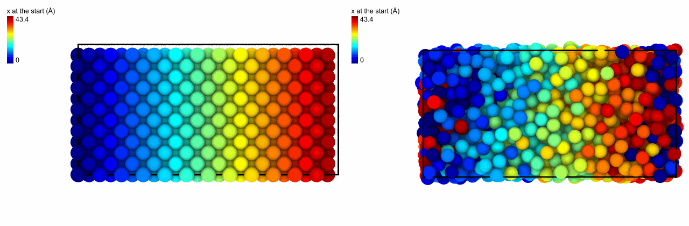

<!-- needs: lammps -->

# Frozen values

`freeze` gives the atoms of one frame the values a column has in another,
such as the first of a trajectory, matched by their ids, as OVITO's freeze
property. It keeps a property of the start, such as where each atom was or
its structure, at hand in every later frame, to compare with what the atom is
now.

Copper melts at 2500 K, here in [LAMMPS](../simulation/lammps.md) for 10 ps.
Where did each atom of the liquid start?

```python
import numpy as np
from mdapy.build import build_crystal
from mdapy.calculators import EAM, LAMMPS
from mdapy.identify import CommonNeighborAnalysis
from mdapy.simulation import MolecularDynamics
from mdapy.transform import freeze

copper = build_crystal("fcc", 3.615, elements="Cu", repeat=(12, 6, 6))
copper = copper.with_columns(id=np.arange(1, len(copper) + 1))
EAM.zhou(["Cu"]).write("Cu.eam.alloy")
potential = LAMMPS(
    "pair_style eam/alloy\npair_coeff * * Cu.eam.alloy Cu", elements=["Cu"]
)
with MolecularDynamics(copper, potential, timestep=0.002) as md:
    md.velocities(5000, seed=1)
    md.run(5000, ensemble="npt", temperature=2500.0, pressure=0.0)
    liquid = md.system

liquid = freeze(liquid, copper, "positions.x")  # the column positions_x_frozen

# the same for the structure: the atoms that are no longer what they were
cna = CommonNeighborAnalysis()
start = copper.with_columns(cna.compute(copper))
liquid = freeze(liquid.with_columns(cna.compute(liquid)), start, "cna_structure")
changed = liquid.where("cna_structure != cna_structure_frozen")
changed.sum()  # 1728: every atom, the crystal has melted
```

The crystal and the liquid, each atom in the color of where it started along x:

```python
from mdapy.visualization import render, write_png

options = dict(
    colormap="jet",
    value_range=(0, copper.box.matrix[0, 0]),
    legend="x at the start (Å)",
    view="front",
    width=640,
    height=420,
)
write_png(
    "images/freeze.png",
    np.hstack(
        [
            render(copper, color=copper["positions.x"], **options),
            render(liquid, color="positions_x_frozen", **options),
        ]
    ),
)
```



*Left: the crystal, colored from blue to red along x. Right: the liquid after 10 ps,
each atom still in the color of where it started: the stripes have mixed over some
ångströms, and atoms that crossed the periodic boundary at the ends of the box carry
their color to the other side.*

## Parameters

`freeze(system, reference, column, name=None)`

| Name | Type | Default | Meaning |
|---|---|---|---|
| `system` | `System` | | the frame that takes the values |
| `reference` | `System` | | the frame of the values, its atoms matched by the `id` column where both have one, else in the same order |
| `column` | str | | a column, a component such as `"positions.z"` or an expression over the columns |
| `name` | str | `None` | the new column; by default the column, its dots as underscores, followed by `_frozen` |

## Results

The system with the values of the reference in the new column; its other
columns as they are.

## Errors

`MissingProperty` if an atom of the system is not in the reference;
`InvalidParameter` for repeated ids in the reference or, without ids, a
reference of another number of atoms.

## See also

- [Difference between frames](frame-difference.md): the change since the reference.
- OVITO [Freeze property](https://docs.ovito.org/reference/pipelines/modifiers/freeze_property.html).
