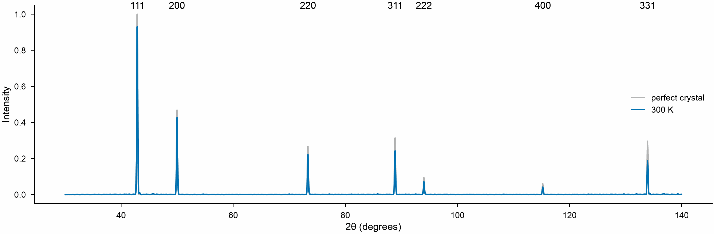

# Powder diffraction

`mdapy.analysis.PowderDiffraction(wavelength=1.5406, two_theta=(10, 90),
bins=1600, *, radiation="xray", lorentz_polarization=True, debye_waller=None,
broadening=None, weights=None)` gives the X-ray or neutron powder diffraction
pattern of a periodic system: the scattering of every wave vector of its box,
each atom weighted by its form factor or scattering length, at the angle 2θ
where a powder sends it, λ = 2d sin θ. A crystal gives its reflections; atoms
that move, as in molecular dynamics, weaken them and spread intensity between
them; defects, strains and amorphous regions show in the pattern as they would
in an experiment.

Copper at 300 K against the perfect crystal:

```python
import numpy as np
from mdapy.analysis import PowderDiffraction
from mdapy.build import build_crystal
from mdapy.calculators import EAM
from mdapy.simulation import MolecularDynamics
from mdapy.visualization import plot

crystal = build_crystal("fcc", 3.615, elements="Cu", repeat=(6, 6, 6))
with MolecularDynamics(crystal, EAM.zhou(["Cu"]), timestep=0.002) as md:
    md.velocities(600, seed=1)
    md.run(2000, ensemble="npt", temperature=300, pressure=0.0)
    md.run(1000, ensemble="nvt", temperature=300, save_every=100)
    frames = md.frames[1:]

a = frames[-1].box.matrix[0, 0] / 6  # the lattice constant at 300 K
perfect = build_crystal("fcc", a, elements="Cu", repeat=(6, 6, 6))
# B = 8π²<u²>/3 of the displacements from the sites, the drift taken away
u = []
for frame in frames:
    d = frame["positions"] - perfect["positions"]
    d -= np.round(d / (6 * a)) * 6 * a
    u.append(d - d.mean(axis=0))
b = 8 * np.pi**2 * np.mean(np.sum(np.concatenate(u) ** 2, axis=1)) / 3

pattern = PowderDiffraction(two_theta=(30, 140), bins=2200, broadening=0.2)
hot = np.mean([pattern.compute(frame).intensity for frame in frames], axis=0)
still = pattern.compute(perfect)
damped = PowderDiffraction(two_theta=(30, 140), bins=2200, broadening=0.2,
                           debye_waller=b).compute(perfect)  # fmt: skip
print(f"B = {b:.2f} Ų")  # B = 0.64 Ų

with plot.style():
    fig, ax = plot.figure("double", 60)
    ax.plot(still.two_theta, still.intensity / still.intensity.max(),
            color="0.7", label="perfect crystal")  # fmt: skip
    ax.plot(still.two_theta, hot / still.intensity.max(), label="300 K")
    for hkl in (
        (1, 1, 1),
        (2, 0, 0),
        (2, 2, 0),
        (3, 1, 1),
        (2, 2, 2),
        (4, 0, 0),
        (3, 3, 1),
    ):
        angle = 2 * np.degrees(np.arcsin(1.5406 * np.linalg.norm(hkl) / (2 * a)))
        ax.annotate("".join(map(str, hkl)), (angle, 1.03), ha="center")
    ax.set_xlabel("2θ (degrees)")
    ax.set_ylabel("Intensity")
    ax.legend(loc="center right")
    plot.save(fig, "images/powder-diffraction", formats=("png",))
```



*Copper with Cu Kα1 X-rays, the perfect crystal and ten frames at 300 K, each
bin spread over 0.2°. The thermal motion weakens the reflections the more the
higher the angle: by 7 % at (111) and 36 % at (331). Their heights fall as the
Debye–Waller factor with B = 0.64 Ų, from the mean squared displacement of the
same atoms, says, to within 1 %; the intensity they lose spreads around them as
thermal diffuse scattering.*

## Parameters

| Name | Type | Default | Unit | Meaning |
|---|---|---|---|---|
| `wavelength` | float64 | 1.5406 | Å | wavelength of the radiation, by default Cu Kα1 |
| `two_theta` | tuple of float64 | (10, 90) | degrees | range of 2θ, within 0 to 180 |
| `bins` | int32 | 1600 | | number of bins of 2θ |
| `radiation` | str | `"xray"` | | `"xray"`, the form factors of neutral atoms, or `"neutron"`, the coherent scattering lengths |
| `lorentz_polarization` | bool | True | | multiply by the Lorentz-polarization factor of a powder in an unpolarized beam, $(1 + \cos^2 2\theta) / (\sin^2\theta \cos\theta)$, or for neutrons $1 / (\sin^2\theta \cos\theta)$ |
| `debye_waller` | float64 | `None` | Ų | multiply by $e^{-2B (\sin\theta / \lambda)^2}$, for a crystal without thermal motion; atoms of molecular dynamics carry their own |
| `broadening` | float64 | `None` | degrees | full width at half maximum of a Gaussian each bin is spread over, keeping its intensity |
| `weights` | dict of str to float64 | `None` | electrons or fm | weights that replace those of the radiation for some elements |

`compute(system, *, progress=None, cancel=None)` needs an `element` column and
a box periodic in every direction. It costs the number of wave vectors up to
$q_\text{max} = 4\pi \sin(\theta_\text{max}) / \lambda$, about
$q_\text{max}^3 V / (12\pi^2)$ for a box of volume $V$, times the number of
atoms.

## Results

A `PowderDiffractionResult`:

| Attribute | Type | Meaning |
|---|---|---|
| `two_theta` | (bins,) float64 | bin centers in degrees |
| `intensity` | (bins,) float64 | intensity of each bin per atom, in electrons² or fm², with the factors asked for |
| `wavelength` | float64 | wavelength in Å |
| `radiation` | str | `"xray"` or `"neutron"` |

## Errors

`PowderDiffraction` raises `InvalidParameter` for a wavelength, a number of bins
or a broadening that is not positive, a range of 2θ outside 0 to 180 or not
increasing, an unknown radiation, a negative `debye_waller`, and, for X-rays, a
range that reaches beyond the form factors, $\sin\theta / \lambda > 6$ 1/Å;
`compute` raises `MissingProperty` without an `element` column and
`InvalidParameter` for a box that is not periodic or an element without a
weight.

## Definition

Each wave vector $\mathbf q = h\mathbf b_1 + k\mathbf b_2 + l\mathbf b_3$ of the
box, with integers $h$, $k$, $l$ and $\mathbf b$ its reciprocal vectors, and
$0 < |\mathbf q| \le q_\text{max}$, scatters

$$
I(\mathbf q) = \frac{1}{N} \Big| \sum_j w_j(|\mathbf q|)\, e^{i\mathbf q \cdot
\mathbf r_j} \Big|^2 L_p(\theta)\, e^{-2B s^2},
\qquad \sin\theta = \frac{|\mathbf q| \lambda}{4\pi}, \quad s = \frac{\sin\theta}{\lambda},
$$

with $w_j$ the form factor of atom $j$ at $|\mathbf q|$
([Waasmaier and Kirfel 1995](../../reference/references.md#waasmaier1995)) or
its scattering length
([Rauch and Waschkowski 2003](../../reference/references.md#rauch2003)); the
intensity of a bin is the sum over the vectors whose 2θ falls in it, each vector
and its opposite. A reflection $(hkl)$ of a crystal thus counts its
multiplicity. LAMMPS's `compute xrd` sums over the same vectors with the form
factors of the International Tables; the two agree to 0.3 %.

!!! quote "Please cite"
    [Waasmaier and Kirfel (1995)](../../reference/references.md#waasmaier1995) for
    X-rays, [Rauch and Waschkowski (2003)](../../reference/references.md#rauch2003)
    for neutrons.
