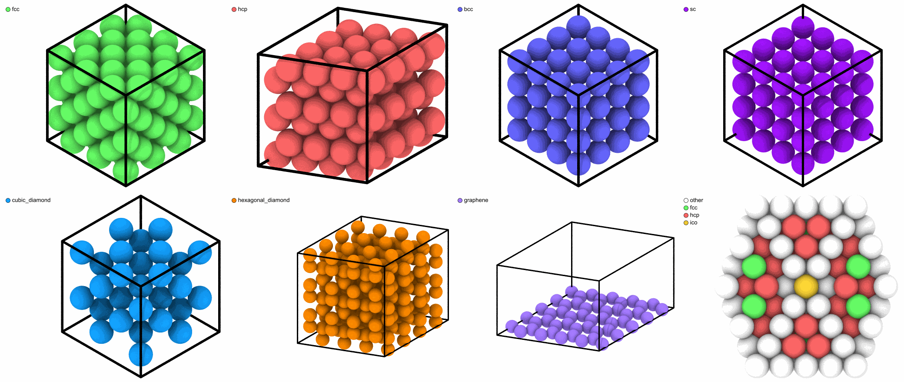
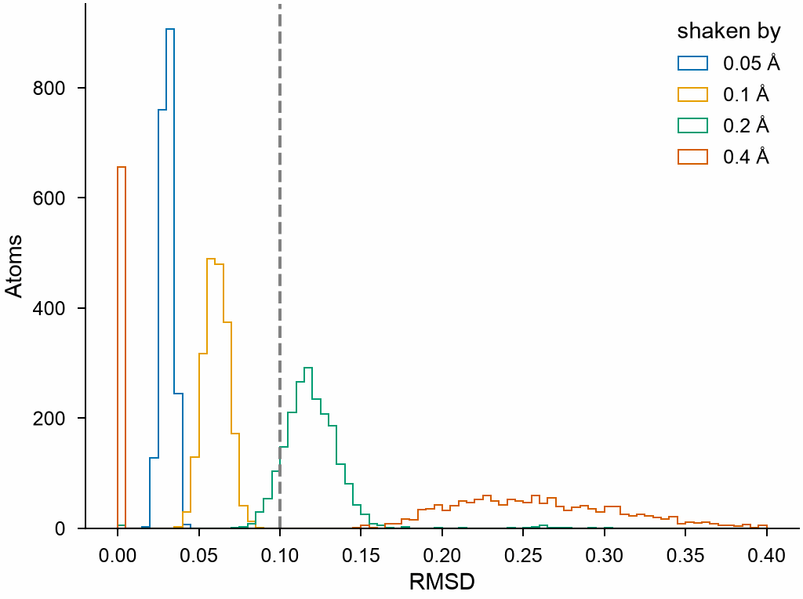
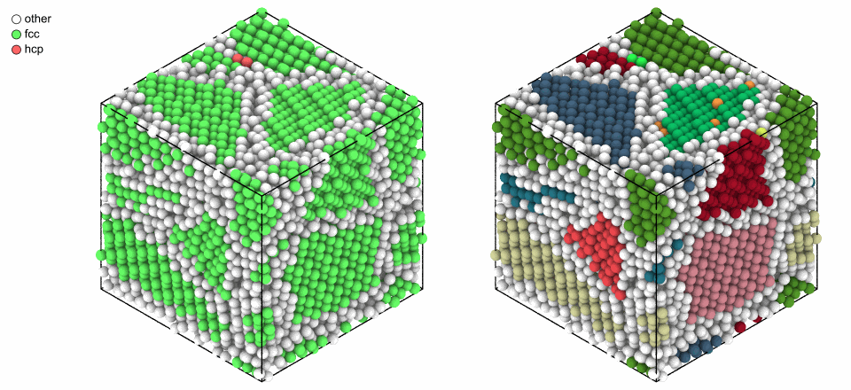
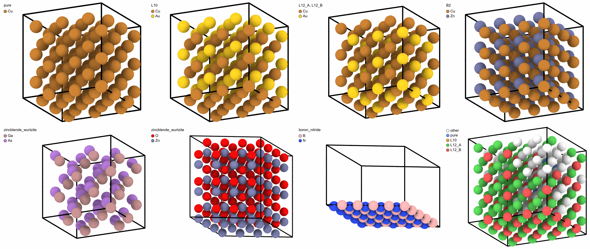

# Polyhedral template matching

`PolyhedralTemplateMatching` gives each atom the crystal structure of its
neighborhood, the rotation of that crystal, its elastic deformation and the
chemical ordering of its elements, by matching the polyhedron of its
nearest neighbors to the templates of nine structures. MDAPY implements
the method of Larsen, Schmidt and Schiøtz itself and gives the same results
as OVITO 3.17, atom by atom.

```python
import numpy as np
from mdapy.build import build_crystal
from mdapy.identify import PolyhedralTemplateMatching

# Cu3Au: an fcc lattice ordered in the L1_2 structure, slightly disordered
alloy = build_crystal("l1_2", 3.75, elements=("Cu", "Au"), repeat=(4, 4, 4))
rng = np.random.default_rng(1)
alloy = alloy.with_columns(
    positions=alloy["positions"] + rng.normal(scale=0.05, size=(256, 3))
)

ptm = PolyhedralTemplateMatching(deformation_gradient=True, ordering=True)
result = ptm.compute(alloy)
result.counts()["fcc"]  # 256
result.interatomic_distance.mean()  # about 2.65 Å, 3.75 / sqrt(2)
result.orientation[0]  # near (0, 0, 0, 1): the cubic axes along x, y and z
result.ordering_names[result.ordering[0]]  # "L12_A": a Cu site
alloy = alloy.with_columns(result)  # structure, rmsd, orientation and more
```

## The structures

PTM knows nine types: `other` and eight structures. The structures to look for
are chosen with `structures`; by default fcc, hcp and bcc, as in OVITO. Each is
matched by the polyhedron of the nearest neighbors of an atom:

| Structure | Neighbors matched | For example |
|---|---|---|
| `fcc` | 12 | Cu, Al, Ni, and the A1, L1<sub>0</sub> and L1<sub>2</sub> alloys |
| `hcp` | 12 | Mg, Ti, Zn, and the stacking faults and twins of fcc |
| `bcc` | 14, 8 first and 6 second | Fe, W, Mo, and B2 alloys |
| `ico` | 12 | the centers of icosahedra, in metallic glasses and clusters |
| `sc` | 6 | α-Po, and rocksalt, whose two elements the structure does not tell apart |
| `cubic_diamond` | 4 first and 12 second | Si, Ge, diamond, and zincblende |
| `hexagonal_diamond` | 4 first and 12 second | lonsdaleite, and wurtzite |
| `graphene` | 3 first and 6 second | graphene, and hexagonal boron nitride |

Each crystal, and a Mackay icosahedron of 309 atoms cut in half, with all eight
structures looked for:

```python
import itertools
import mdapy as mp
from mdapy.visualization import render, write_png


def mackay(shells, d):
    """A Mackay icosahedron: on each shell, triangular lattices on 20 faces."""
    g = (1 + 5**0.5) / 2
    corners = [(0, s, t * g) for s, t in itertools.product((-1, 1), repeat=2)]
    corners = np.array([np.roll(c, k) for c in corners for k in range(3)]) * d / 2
    faces = [
        f
        for f in itertools.combinations(range(12), 3)
        if all(
            np.isclose(np.linalg.norm(corners[i] - corners[j]), d)
            for i, j in itertools.combinations(f, 2)
        )
    ]
    points = [np.zeros(3)]
    for n in range(1, shells + 1):
        for a, b, c in faces:
            for i in range(n + 1):
                for j in range(n + 1 - i):
                    points.append(
                        i * corners[a] + j * corners[b] + (n - i - j) * corners[c]
                    )
    points = np.unique(np.round(points, 6), axis=0)
    return mp.System(points + 30.0, mp.Box(60.0, pbc=False), elements="Cu")


everything = PolyhedralTemplateMatching(PolyhedralTemplateMatching.NAMES[1:])
crystals = [
    build_crystal("fcc", 3.615, elements="Cu", repeat=(3, 3, 3)),
    build_crystal("hcp", 3.21, c=5.21, elements="Mg", repeat=(4, 4, 3)),
    build_crystal("bcc", 2.865, elements="Fe", repeat=(4, 4, 4)),
    build_crystal("sc", 3.35, elements="Po", repeat=(4, 4, 4)),
    build_crystal("diamond", 5.431, elements="Si", repeat=(2, 2, 2)),
    build_crystal("lonsdaleite", 2.52, c=4.12, elements="C", repeat=(4, 4, 3)),
    build_crystal("graphene", 2.46, c=10.0, elements="C", repeat=(5, 5, 1)),
]
pictures = []
for crystal in crystals:
    found = everything.compute(crystal)
    pictures.append(render(crystal, color=found, legend=True, width=520, height=440))
icosahedron = mackay(4, 2.55)
found = everything.compute(icosahedron)
found.counts()  # 1 ico at the center, 90 hcp, 20 fcc, 198 other
pictures.append(
    render(
        icosahedron,
        atoms=icosahedron["positions.z"] < 30.5,
        color=found,
        view="top",
        box=False,
        legend=True,
        width=520,
        height=440,
    )
)
write_png(
    "images/ptm-structures.png",
    np.vstack([np.hstack(pictures[:4]), np.hstack(pictures[4:])]),
)
```



*Top: fcc copper, hcp magnesium, bcc iron and simple cubic polonium. Bottom: cubic
diamond silicon, hexagonal diamond (lonsdaleite), graphene, and half of a Mackay
icosahedron: its center is icosahedral, the planes between its twenty tetrahedra hcp,
the insides of the tetrahedra fcc, and the surface other.*

Look only for the structures the system can have: each structure added is one
more template that an atom of another structure, or of a defect, may match by
accident. Atoms of a liquid, of a surface or of a grain boundary are `other`.

## The RMSD and its cutoff

Thermal motion moves the neighbors away from the template; the RMSD measures how
far, after the template is scaled and rotated onto them. An atom whose best RMSD
is above `rmsd_cutoff` is `other`. With no cutoff, the RMSD of every atom shows
where the crystal ends and the disorder begins:

```python
from mdapy.visualization import plot

crystal = build_crystal("fcc", 3.615, elements="Cu", repeat=(8, 8, 8))
rng = np.random.default_rng(3)
no_cutoff = PolyhedralTemplateMatching(rmsd_cutoff=0)
with plot.style():
    fig, ax = plot.figure("single")
    for shake in (0.05, 0.1, 0.2, 0.4):
        moved = crystal["positions"] + rng.normal(0, shake, (len(crystal), 3))
        rmsd = no_cutoff.compute(crystal.with_columns(positions=moved)).rmsd
        ax.hist(rmsd, bins=np.linspace(0, 0.4, 81), histtype="step", label=f"{shake} Å")
    ax.axvline(0.1, color="0.5", ls="--")
    ax.set_xlabel("RMSD")
    ax.set_ylabel("Atoms")
    ax.legend(title="shaken by")
    plot.save(fig, "images/ptm-rmsd", formats=("png",))
```



*Copper with every atom shaken by a normal distribution of 0.05 to 0.4 Å along each
axis. The default cutoff of 0.1 (dashed) keeps a crystal shaken by 0.05 Å, about room
temperature, and a good part of one shaken by 0.1 Å, near melting; a
crystal shaken by 0.4 Å is no longer one. Raise the cutoff for hot crystals, or use
0 to classify every atom by its best template.*

## Orientations

`orientation` is the rotation of the lattice of each atom from its standard
orientation, the cubic axes along x, y and z for the cubic structures, as a
quaternion (x, y, z, w) reduced by the symmetry of the lattice. Atoms of one grain
have nearly the same; [grain segmentation](grain-segmentation.md) groups them.
Here the x, y and z of the quaternion color each atom:

```python
from mdapy.build import build_polycrystal

grains = build_polycrystal(
    build_crystal("fcc", 3.615, elements="Cu"), mp.Box(50.0), 8, seed=3
)
grains = grains.with_columns(
    positions=grains["positions"] + rng.normal(0, 0.05, (len(grains), 3))
)
found = PolyhedralTemplateMatching().compute(grains)
rotation = np.clip(0.5 + 1.25 * found.orientation[:, :3], 0, 1)
rotation[found.structure == 0] = 0.95  # other
write_png(
    "images/ptm.png",
    np.hstack(
        [
            render(grains, color=found, legend=True, width=520, height=440),
            render(grains, color=rotation, width=440, height=440),
        ]
    ),
)
```



*A copper polycrystal of eight grains. Left: the structure of each atom, fcc inside the
grains, other at the boundaries, and some hcp where two grains share a plane of
atoms. Right: the orientation of each atom, one color for each grain.*

`interatomic_distance` gives the distance between nearest neighbors of the matched
lattice of each atom, and, with `deformation_gradient=True`, the elastic
deformation gradient maps the template, scaled to that distance, onto the
neighbors: from it the [elastic strain](elastic-strain.md) of each atom follows.

## Chemical ordering

With `ordering=True` and an `element` column, PTM also compares the elements of the
neighbors with the sublattices of the ordered crystals of each structure:

| Ordering | Structure | Its atoms |
|---|---|---|
| `pure` | any | all neighbors of the element of the atom |
| `L10` | `fcc` | layers of two elements alternating along a cube axis, as CuAu |
| `L12_A` | `fcc` | the face centers of L1<sub>2</sub>, as Cu in Cu<sub>3</sub>Au |
| `L12_B` | `fcc` | the corners of L1<sub>2</sub>, as Au in Cu<sub>3</sub>Au |
| `B2` | `bcc` | the eight first neighbors of the other element, as CuZn |
| `zincblende_wurtzite` | `cubic_diamond`, `hexagonal_diamond` | the four first neighbors of the other element, as GaAs and ZnO |
| `boron_nitride` | `graphene` | the three first neighbors of the other element, as hexagonal BN |
| `other` | any | none of these, such as a random alloy |

```python
ordered = PolyhedralTemplateMatching(
    PolyhedralTemplateMatching.NAMES[1:], ordering=True
)
alloys = [
    build_crystal("fcc", 3.615, elements="Cu", repeat=(3, 3, 3)),
    build_crystal("fcc", 3.8, elements=("Cu", "Au"), repeat=(3, 3, 3)),
    build_crystal("l1_2", 3.75, elements=("Cu", "Au"), repeat=(3, 3, 3)),
    build_crystal("cscl", 2.95, elements=("Cu", "Zn"), repeat=(4, 4, 4)),
    build_crystal("zincblende", 5.65, elements=("Ga", "As"), repeat=(2, 2, 2)),
    build_crystal("wurtzite", 3.25, c=5.21, elements=("Zn", "O"), repeat=(4, 4, 3)),
    build_crystal("graphene", 2.50, c=10.0, elements=("B", "N"), repeat=(5, 5, 1)),
]
side = [1.0, 0.5, 0.35]  # off the rows of atoms along [111]
pictures = []
for crystal in alloys:
    found = ordered.compute(crystal)
    title = ", ".join(found.ordering_names[k] for k in np.unique(found.ordering))
    pictures.append(
        render(crystal, radius=0.8, view=side, legend=title, width=520, height=440)
    )

# Cu3Au with 4 pairs of Cu and Au swapped: the atoms around them are other
mixed = build_crystal("l1_2", 3.75, elements=("Cu", "Au"), repeat=(4, 4, 4))
element = np.asarray(mixed["element"]).copy()
copper = rng.choice(np.flatnonzero(element == "Cu"), 4, replace=False)
gold = rng.choice(np.flatnonzero(element == "Au"), 4, replace=False)
element[copper], element[gold] = "Au", "Cu"
found = ordered.compute(mixed.with_columns(element=element))
colors = np.array(PolyhedralTemplateMatching.ORDERING_COLORS)
names = {found.ordering_names[k]: colors[k] for k in np.unique(found.ordering)}
pictures.append(
    render(
        mixed,
        color=colors[found.ordering],
        radius=0.8,
        view=side,
        legend=names,
        width=520,
        height=440,
    )
)
write_png(
    "images/ptm-ordering.png",
    np.vstack([np.hstack(pictures[:4]), np.hstack(pictures[4:])]),
)
```



*The ordered crystals in the colors of their elements, each titled with the orderings
found. Top: pure copper, L1<sub>0</sub> CuAu, L1<sub>2</sub> Cu<sub>3</sub>Au with its
two sublattices, and B2 CuZn. Bottom: zincblende GaAs, wurtzite ZnO, hexagonal boron
nitride, and Cu<sub>3</sub>Au with 4 of its 64 Au atoms swapped with Cu atoms, in
the colors of the orderings: the atoms whose neighbors no longer match a sublattice are
other.*

The ordering of an atom is that of the best template of its structure; an atom of
`other` structure gets the ordering `other`. In a random solid solution most atoms
are `other` too, and the share of an ordering is a measure of chemical order next to
the [Warren–Cowley parameters](warren-cowley.md).

## Parameters

`PolyhedralTemplateMatching(structures=("fcc", "hcp", "bcc"), *, rmsd_cutoff=0.1, deformation_gradient=False, ordering=False, template_neighbors=False)`

| Name | Type | Default | Unit | Meaning |
|---|---|---|---|---|
| `structures` | iterable of str | `("fcc", "hcp", "bcc")` | | the structures to look for: `fcc`, `hcp`, `bcc`, `ico`, `sc`, `cubic_diamond`, `hexagonal_diamond` and `graphene` |
| `rmsd_cutoff` | float64 | 0.1 | | atoms that deviate more from their best template are `other`; 0 for no cutoff |
| `deformation_gradient` | bool | `False` | | compute the elastic deformation gradient of each atom |
| `ordering` | bool | `False` | | identify the chemical ordering from the `element` column |
| `template_neighbors` | bool | `False` | | give the neighbors of each atom in the order of its template |

`compute(system, *, neighbors=None, progress=None, cancel=None)` takes the
arguments of [every analysis](overview.md#parameters). A given neighbor list
must hold the 18 nearest neighbors of every atom.

## Results

A `PTMResult`, a [`StructureResult`](overview.md#results) with the types
`other`, `fcc`, `hcp`, `bcc`, `ico`, `sc`, `cubic_diamond`,
`hexagonal_diamond` and `graphene`, numbered as in OVITO, and:

| Attribute | Type | Unit | Meaning |
|---|---|---|---|
| `rmsd` | (N,) float64 | | the root-mean-square deviation from the best template, after scaling; 0 where none matches |
| `interatomic_distance` | (N,) float64 | Å | the distance between nearest neighbors of the matched lattice |
| `orientation` | (N, 4) float64 | | the rotation of the lattice from its standard orientation, a quaternion (x, y, z, w) |
| `deformation_gradient` | (N, 3, 3) float64 or `None` | | the elastic deformation gradient, from the template scaled to the interatomic distance to the neighbors |
| `ordering` | (N,) int8 or `None` | | the chemical ordering, an index into `ordering_names`: `other`, `pure`, `L10`, `L12_A`, `L12_B`, `B2`, `zincblende_wurtzite` and `boron_nitride` |
| `correspondences` | (N,) uint64 | | the order of the neighbors that matches the template, encoded as OVITO's Correspondences |
| `template_index` | (N,) int8 | | which of the equivalent templates of the structure matched |
| `neighbors` | (N, 16) `index_dtype` or `None` | | the neighbors of each atom in the order of the points of its template, -1 beyond its count |

The columns are `ptm_structure`, `ptm_rmsd`, `ptm_interatomic_distance`,
`ptm_orientation`, and when computed `ptm_deformation_gradient` (9 values per atom, by
rows) and `ptm_ordering`. As in OVITO, an atom above the RMSD cutoff is `other` but keeps
the other results of its best template; an atom that matches no template
gets zeros.

## Errors

The constructor raises `InvalidParameter` for an unknown structure, no
structure, or a negative RMSD cutoff; `compute` raises it for a neighbor
list that does not hold the 18 nearest neighbors, and `MissingProperty` for
the ordering without an `element` column.

## Definition

The 18 nearest neighbors of an atom are first ordered by the solid angles
of the faces of its Voronoi cell, which they share. For fcc, hcp, icosahedral,
bcc and simple cubic, the first 12, 14 or 6 of them form a convex hull; its
graph of edges, put in a canonical form, finds the templates of the same
graph and every way the neighbors can map onto the points of a template.
For the diamond structures, the 4 nearest neighbors and 3 of each of their
own neighbors are matched together, and for graphene 3 and 2 of each. For
every mapping, the neighbors are centered and scaled, and the rotation that
brings the template closest to them is found by the quaternion method; the
root-mean-square deviation of that fit, the RMSD, picks the best mapping and
structure. The interatomic distance comes from the scale of the fit, and the
deformation gradient is the linear map that brings the scaled template
closest to the neighbors. The chemical ordering compares the elements of the
neighbors with the sublattices of the ordered structures on the same
template.

Neighbors at exactly the same distance, as in a perfect crystal, may come
in an order other than OVITO's. The structure types are then the same, but
an atom that matches no structure may report another best template.

## See also

- [Common neighbor analysis](cna.md), faster, without orientations.
- OVITO [Polyhedral template matching](https://docs.ovito.org/reference/pipelines/modifiers/polyhedral_template_matching.html).

!!! quote "Please cite"
    [Larsen, Schmidt and Schiøtz (2016)](../../reference/references.md#larsen2016).
