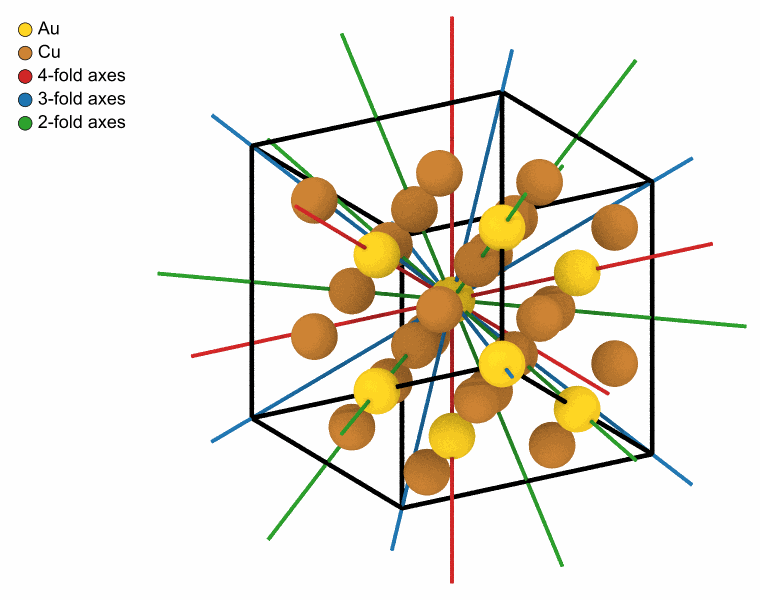
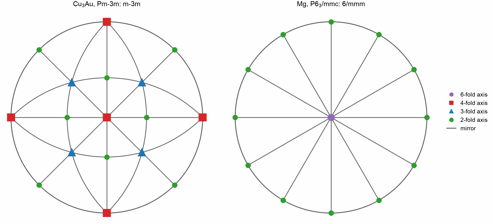

# Space group

`SpaceGroup` finds the space group of a crystal with
[spglib](https://spglib.readthedocs.io): its number and symbol, its
symmetry operations, and the atoms they make equivalent. The same
operations let [phonons](../simulation/phonons.md) and
[elastic constants](../simulation/elastic-constants.md) skip the
displacements and strains that symmetry relates to others.

<!-- needs: spglib -->

```python
from mdapy.analysis import SpaceGroup
from mdapy.build import build_crystal

cell = build_crystal("l1_2", 3.75, elements=("Cu", "Au"))
result = SpaceGroup().compute(cell)
result.number, result.symbol  # 221, 'Pm-3m'
len(result.rotations)  # 48 operations
result.equivalent  # the Au corner on its own, the three Cu face centers together
```

spglib is an optional dependency: `pip install spglib`, or the extra
`symmetry` of mdapy.

## The point group

The rotations of the operations, without their translations, form the point group of
the crystal: the rotations about axes, mirrors, the inversion and their products that
leave the directions of the crystal as they were. A rotation of order $n$ turns by
$360°/n$, and its trace is $1 + 2\cos(360°/n)$; a mirror has the determinant $-1$ and
the trace 1. Each axis and the normal of each mirror is the eigenvector of the
eigenvalue 1 or $-1$:

```python
import numpy as np


def symmetry_elements(result):
    """The axes of the rotations with their largest order, and the mirrors."""
    axes, mirrors = {}, set()
    for rotation in result.rotations:
        values, vectors = np.linalg.eig(rotation)
        proper = np.linalg.det(rotation) > 0
        if proper and not np.allclose(rotation, np.eye(3)):
            vector = vectors[:, np.argmin(np.abs(values - 1))]
            cosine = np.clip((np.trace(rotation) - 1) / 2, -1, 1)
            order = round(2 * np.pi / np.arccos(cosine))
        elif not proper and np.isclose(np.trace(rotation), 1):
            vector, order = vectors[:, np.argmin(np.abs(values + 1))], 0
        else:
            continue  # the identity, the inversion and the rotoinversions
        vector = np.real(vector) / np.linalg.norm(vector)
        vector *= np.sign(vector[np.flatnonzero(np.abs(vector) > 1e-6)[0]])
        key = tuple(np.round(vector, 6))
        if order:
            axes[key] = max(axes.get(key, 0), order)
        else:
            mirrors.add(key)
    return axes, mirrors


axes, mirrors = symmetry_elements(result)
sorted(axes.values())  # 6 two-fold, 4 three-fold and 3 four-fold axes
len(mirrors)  # 9 mirrors: the point group m-3m
```

The axes drawn through an Au atom of the crystal, in its middle:

```python
from mdapy.transform import replicate
from mdapy.visualization import element_colors, render

ORDERS = {6: "#9467bd", 4: "#d62728", 3: "#1f77b4", 2: "#2ca02c"}
crystal = replicate(cell, (2, 2, 2))
middle = crystal.box.matrix.sum(axis=0) / 2  # an Au atom
reach = 0.6 * np.linalg.norm(crystal.box.matrix.sum(axis=0))
legend = dict(zip(["Au", "Cu"], element_colors(["Au", "Cu"])))
render(
    crystal,
    "images/space-group-axes.png",
    radius=0.6,
    lines=[np.array([middle - reach * np.array(a), middle + reach * np.array(a)]) for a in axes],
    line_color=[ORDERS[order] for order in axes.values()],
    line_radius=0.05,
    view=[1, 0.6, 0.45],
    legend=legend | {f"{n}-fold axes": ORDERS[n] for n in (4, 3, 2)},
    width=760,
    height=600,
)  # fmt: skip
```



*Cu<sub>3</sub>Au, 2 × 2 × 2 cubic cells: the three four-fold axes along the edges of
the cube, the four three-fold axes along its diagonals and the six two-fold axes along
the diagonals of its faces.*

The usual picture of a point group is its stereogram: each axis and each mirror cut
with a sphere about the crystal, and the upper half of the sphere projected onto its
equator from its south pole. A mirror becomes a line or an arc, an axis a point in the
symbol of its order. That of Cu<sub>3</sub>Au, and that of hcp magnesium, whose
operations include the screw axis 6<sub>3</sub>:

```python
from mdapy.visualization import plot

SYMBOLS = {6: "h", 4: "s", 3: "^", 2: "o"}


def stereogram(ax, axes, mirrors):
    turn = np.linspace(0, 2 * np.pi, 361)
    ax.plot(np.cos(turn), np.sin(turn), color="black", lw=0.8)
    for normal in map(np.array, mirrors):
        u = np.cross(normal, [0, 0, 1.0] if abs(normal[2]) < 0.9 else [1.0, 0, 0])
        u /= np.linalg.norm(u)
        circle = np.outer(np.cos(turn), u) + np.outer(np.sin(turn), np.cross(normal, u))
        circle[circle[:, 2] < -1e-9] = np.nan  # the upper half only
        ax.plot(*(circle[:, :2].T / (1 + circle[:, 2])), color="0.4", lw=0.8)
    for axis, order in axes.items():
        for end in (np.array(axis), -np.array(axis)):
            if end[2] > -1e-9:
                ax.plot(
                    *(end[:2] / (1 + end[2])),
                    SYMBOLS[order],
                    color=ORDERS[order],
                    ms=7 if order > 2 else 4.5,
                    zorder=3,
                )
    ax.set_aspect("equal")
    ax.set_axis_off()


magnesium = build_crystal("hcp", 3.21, c=5.21, elements="Mg")
with plot.style():
    fig, panels = plot.figure("double", 82, ncols=2)
    for ax, crystal, title in zip(
        panels, (cell, magnesium), ("Cu$_3$Au, Pm-3m: m-3m", "Mg, P6$_3$/mmc: 6/mmm")
    ):
        stereogram(ax, *symmetry_elements(SpaceGroup().compute(crystal)))
        ax.set_title(title)
    for n in (6, 4, 3, 2):
        ax.plot([], [], SYMBOLS[n], color=ORDERS[n], label=f"{n}-fold axis")
    ax.plot([], [], color="0.4", label="mirror")
    fig.legend(loc="outside right center")
    plot.save(fig, "images/space-group", formats=("png",))
```



*Left: m-3m, the point group of Cu<sub>3</sub>Au and of every cubic metal, 48
operations: nine mirrors, three normal to the edges of the cube, one of them the
equator, and six normal to the diagonals of its faces. Right: 6/mmm, that of hcp, 24
operations: a six-fold axis along c, the equator a mirror, and six mirrors and six
two-fold axes about it.*

## Parameters

| Name | Type | Default | Unit | Meaning |
|---|---|---|---|---|
| `tolerance` | float64 | 1e-5 | Å | atoms closer than it count as images of each other |

`compute(system)` takes the cell of a crystal, periodic in every direction,
of at most 2000 atoms: spglib searches its translations pair by pair, which
takes minutes for 100,000 atoms where a unit cell takes milliseconds.
Atoms of different elements are different; without an `element` column,
atoms of different types; without either, all atoms are alike. Relaxed
crystals keep their symmetry to well below the default tolerance; a
structure whose atoms have moved more, such as a crystal at a temperature,
needs a larger one to show the symmetry of its lattice.

## Results

A `SpaceGroupResult`:

| Attribute | Type | Meaning |
|---|---|---|
| `number` | int32 | the number of the space group in the International Tables, 1 to 230 |
| `symbol` | str | its Hermann–Mauguin symbol, such as `"Fm-3m"` |
| `rotations` | (K, 3, 3) float64 | the rotations of the K symmetry operations, on Cartesian column vectors |
| `translations` | (K, 3) float64 | their translations in Å: operation k moves the point **r** to `rotations[k] @ r + translations[k]` |
| `equivalent` | (N,) int64 | the first atom that symmetry makes each atom equivalent to |

The operations of a supercell include the translations of its lattice that
are not translations of the supercell: a cubic cell of fcc has 192, four
times the 48 of its primitive cell.

## Errors

The constructor raises `InvalidParameter` for a tolerance that is not
positive; `compute` raises it for a box that is not periodic, a system
without atoms or of more than 2000, and without spglib.

## Definition

The space group is the group of the rotations, reflections and translations
that map the crystal onto itself, each atom onto an atom of its kind.
spglib ([Togo et al. 2024](../../reference/references.md#togo2024)) finds it
from the lattice and the positions, within the tolerance.
