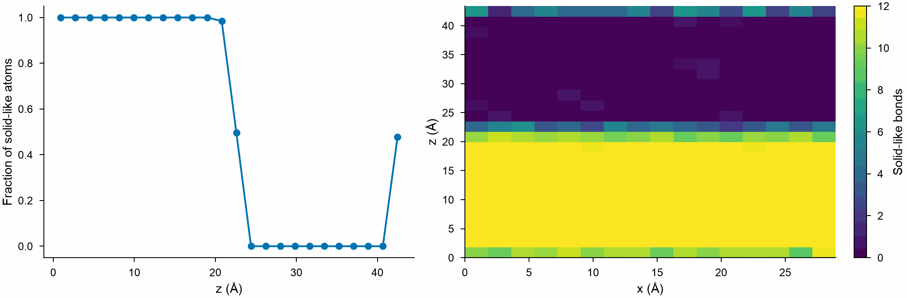
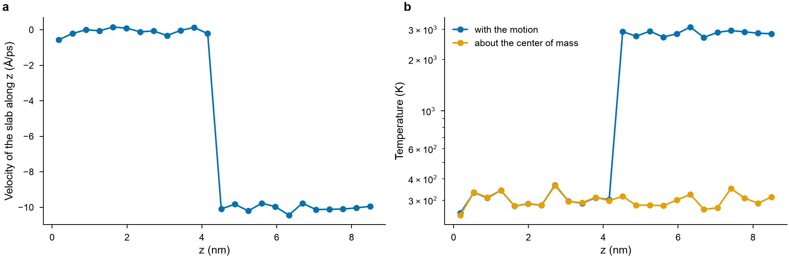

# Spatial binning

`SpatialBinning` divides the box into bins of equal size along one, two or
three of its vectors and reduces a property of the atoms in each: its mean,
sum, sum per volume, minimum or maximum. Profiles across interfaces and
surfaces, and maps over a plane, are made this way.

```python
import numpy as np
from mdapy.analysis import SpatialBinning, SteinhardtParameters
from mdapy.build import build_crystal

# copper whose upper half is disordered like a liquid
rng = np.random.default_rng(0)
melt = build_crystal("fcc", 3.615, elements="Cu", repeat=(8, 8, 12))
shaking = np.where(melt["positions.z"] > 22.0, 0.6, 0.1)[:, None]
melt = melt.with_columns(
    positions=melt["positions"] + rng.normal(0, shaking, (len(melt), 3))
)
melt = melt.with_columns(SteinhardtParameters(solid=True).compute(melt))

# the fraction of solid-like atoms in 24 slabs along z
profile = SpatialBinning("solid", 24, axes="z").compute(melt)
profile.centers[0]  # Å along c, the middle of each slab
profile.values  # 1 in the crystal, near 0 above 22 Å
profile.counts  # atoms in each slab

# a map over x and z of the mean number of solid-like bonds
bonds = SpatialBinning("solid_bonds", (16, 24), axes=("x", "z")).compute(melt)
bonds.values.shape  # (16, 24)

# the solid-like atoms per ų in each slab
density = SpatialBinning("solid", 24, reduction="density").compute(melt)
```

```python
from mdapy.visualization import plot

with plot.style():
    fig, (left, right) = plot.figure("double", 60, ncols=2)
    left.plot(profile.centers[0], profile.values, marker="o", markersize=3)
    left.set_xlabel("z (Å)")
    left.set_ylabel("Fraction of solid-like atoms")
    image = right.imshow(
        bonds.values.T,
        origin="lower",
        extent=(0, melt.box.matrix[0, 0], 0, melt.box.matrix[2, 2]),
        aspect="auto",
        vmin=0,
        vmax=12,
    )
    right.set_xlabel("x (Å)")
    right.set_ylabel("z (Å)")
    fig.colorbar(image, ax=right, label="Solid-like bonds")
    plot.save(fig, "images/spatial-binning", formats=("png",))
```



*Left: the fraction of solid-like atoms falls from 1 to 0 across the
interface at 22 Å, and rises again at the top, where the crystal below
the periodic boundary orders the first layer. Right: the mean number of
solid-like bonds over x and z.*

## Moving atoms

The atoms of a shock, a flyer or a flow move with their slab as a whole, and the
temperature of their velocities as they are counts that motion as heat. The reduction
`"temperature"` of a column of velocities takes the velocity of the center of mass of
each bin off first, `"stress"` of a column of the virials of each atom does the same for
its kinetic part, and `"mass_mean"` gives that velocity itself. Copper at 300 K whose
upper half moves down at 1 km/s:

```python
import numpy as np
from mdapy import units
from mdapy.analysis import SpatialBinning
from mdapy.build import build_crystal
from mdapy.calculators import EAM

copper = EAM.zhou(["Cu"])
crystal = build_crystal("fcc", 3.615, elements="Cu", repeat=(6, 6, 24))
# velocities of 300 K, and the upper half moving down at 10 Å/ps, 1 km/s
mass = 63.546 * units.AMU_A2_PER_PS2_TO_EV  # eV ps²/Ų
sigma = np.sqrt(units.BOLTZMANN * 300.0 / mass)
v = np.random.default_rng(1).normal(0.0, sigma, (len(crystal), 3))
upper = crystal["positions.z"] > crystal.box.matrix[2, 2] / 2 - 0.5  # 12 slabs of 24
v[upper, 2] -= 10.0
moving = crystal.with_columns(velocities=v)
moving = copper.compute(moving, ("atomic_virials",)).attach(moving)

velocity = SpatialBinning("velocities", 24, reduction="mass_mean").compute(moving)
temperature = SpatialBinning("velocities", 24, reduction="temperature").compute(moving)
stress = SpatialBinning("atomic_virials", 24, reduction="stress").compute(moving)
# the kinetic energy of each slab with the motion, as a temperature
hot = moving.with_columns(kinetic=mass * (v * v).sum(axis=1) / (3 * units.BOLTZMANN))
naive = SpatialBinning("kinetic", 24).compute(hot)
temperature.values  # about 300 K in every slab
stress.values[:, 2, 2]  # GPa, about -0.35 in both halves: the motion is no stress
```

```python
from mdapy.visualization import plot

z = temperature.centers[0] / 10  # nm
with plot.style():
    fig, (a, b) = plot.figure("double", 60, ncols=2)
    a.plot(z, velocity.values[:, 2], marker="o", markersize=3)
    a.set(xlabel="z (nm)", ylabel="Velocity of the slab along z (Å/ps)")
    b.plot(z, naive.values, marker="o", markersize=3, label="with the motion")
    b.plot(
        z,
        temperature.values,
        marker="o",
        markersize=3,
        label="about the center of mass",
    )
    b.set(xlabel="z (nm)", ylabel="Temperature (K)", yscale="log")
    b.legend()
    for ax, label in zip((a, b), "ab"):
        plot.panel_label(ax, label)
    plot.save(fig, "images/spatial-binning-moving", formats=("png",))
```



*a: the velocity of the center of mass of each slab, zero below and 10 Å/ps down
above. b: the kinetic energy of the slabs as it is gives the moving half some 2900 K;
about the center of mass of each slab both halves are at 300 K.*

The virials of each atom come from a calculator, `potential.compute(system,
("atomic_virials",)).attach(system)`, and the velocities from the system; a slab of
atoms of several velocities, such as one across a shock front, keeps their spread in
its temperature.

## Fixed bins

The bins divide the box, so they change with it: along a direction that is not
periodic, the box of [molecular dynamics](../molecular-dynamics/running.md#parameters)
grows with the atoms that leave it, as when a shock reaches a free surface and the
crystal releases or spalls, and the bins of each frame differ. `bounds` fixes the range
of each axis instead, in Å from (0, 0, 0) along its
box vector, the coordinate itself for a box vector along x, y or z, so that the bins of
every frame are the same, wherever the box is; atoms outside the range are left out.
Slabs of 4 Å from z = −20 to 120 Å, beyond the copper above, which is 87 Å high:

```python
fixed = SpatialBinning(
    "velocities", 35, reduction="temperature", bounds=[(-20.0, 120.0)]
).compute(moving)
fixed.centers[0][:3]  # -18, -14, -10 Å
fixed.counts[:5]  # no atoms below the copper
```

## Parameters

| Name | Type | Default | Unit | Meaning |
|---|---|---|---|---|
| `column` | str | | | a column, a component such as `positions.z`, or an expression over the columns, as `system[...]` takes |
| `bins` | int32 or sequence of int32 | | | the number of bins along each axis, or one number for all |
| `axes` | int32, str or a sequence of them | `"z"` | | the box vectors binned along, one to three of 0, 1, 2 or x, y, z |
| `reduction` | str | `"mean"` | | one of `REDUCTIONS`: `"mean"`, `"sum"`, `"density"` (the sum per ų), `"min"`, `"max"`, `"mass_mean"` (weighted by the masses), `"temperature"` (of the velocities, about the center of mass of each bin) or `"stress"` (of the virials of each atom with the velocities about the center of mass, in GPa, positive under tension) |
| `bounds` | sequence of (float64, float64) or `None` | `None` | Å | for each axis, the range binned, (lo, hi) along its box vector from (0, 0, 0), or `None` for the box: see [Fixed bins](#fixed-bins) |

`compute(system)` takes the system. Along periodic vectors the atoms are
wrapped into the box first; along the others, those outside the box are
left out. With `bounds`, the atoms outside the range of an axis are left out, and the
volume of a bin, for `"density"` and `"stress"`, is that of the box over the bins times
the part of each box vector its range covers.

## Results

A `SpatialBinningResult`:

| Attribute | Type | Meaning |
|---|---|---|
| `values` | (n1[, n2[, n3]]) float64 | the reduced property in each bin, with a last axis for its components when it has several, and two, (3, 3), of a stress; NaN for the mean, minimum or maximum of an empty bin, and for the temperature of a bin of fewer than two atoms |
| `counts` | (n1[, n2[, n3]]) int64 | the number of atoms in each bin |
| `centers` | tuple of (n,) float64 | for each axis, the centers of its bins in Å along its box vector, from the origin of the box, or with `bounds` from (0, 0, 0) |

The bins are numbered as the axes are given: `values[i, j]` for the bin `i`
along the first axis and `j` along the second.

## Errors

The constructor raises `InvalidParameter` for no axis or more than three,
an unknown or repeated axis, a number of bins that is not a positive
integer or not one per axis, an unknown reduction, and `bounds` that are not one
pair of finite numbers, lo below hi, or `None` for each axis; `compute` raises it
for a property the system does not have, a temperature of a column that is not (N, 3)
and a stress of one that is not (N, 3, 3), and `MissingProperty` for the moving
reductions of a system without masses, a `mass` or an `element` column, and a stress
without velocities.

## Definition

The bin of an atom along a box vector is $\lfloor n s \rfloor$, with $s$
its fractional coordinate along that vector, from 0 to below 1, and $n$
the number of bins along it. The density is the sum divided by the volume of
a bin, $V / (n_1 n_2 n_3)$, with $V$ the volume of the box and $n_1$, $n_2$ and
$n_3$ the numbers of bins along its three vectors, 1 along a vector not
binned.

About the center of mass of a bin of $N$ atoms of masses $m_i$ and velocities
$\mathbf v_i$, whose velocity is $\bar{\mathbf v} = \sum_i m_i \mathbf v_i / \sum_i m_i$,

$$
T = \frac{\sum_i m_i |\mathbf v_i - \bar{\mathbf v}|^2}{3 (N - 1) k_B}, \qquad
\boldsymbol\sigma = -\frac{1}{V_\mathrm{bin}} \sum_i \left[ \mathsf W_i + m_i
(\mathbf v_i - \bar{\mathbf v}) \otimes (\mathbf v_i - \bar{\mathbf v}) \right],
$$

with $k_B$ the Boltzmann constant, $\mathsf W_i$ the virial of atom $i$, positive under
compression, and $V_\mathrm{bin}$ the volume of the bin; $N - 1$, as the velocity of the
center of mass takes three of the $3N$ directions.

## See also

- OVITO [Spatial binning](https://docs.ovito.org/reference/pipelines/modifiers/spatial_binning.html),
  which gives 0 for the mean, minimum and maximum of an empty bin, where
  `SpatialBinning` gives NaN, as an empty bin has no value.
