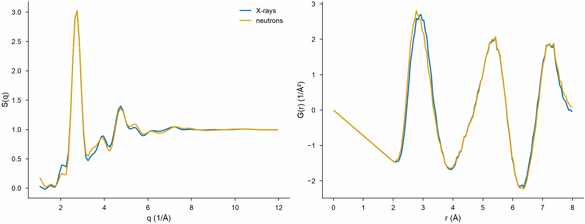

# Total scattering

`mdapy.analysis.TotalScattering(radiation, q_max, bins=200, *, r_max=10.0,
r_bins=500, method="direct", cutoff=None, weights=None)` gives what an X-ray or a
neutron total scattering experiment measures of a periodic system: the total
structure factor S(q), each pair of elements weighted by how strongly they
scatter, and the pair distribution function G(r) that such experiments report.
The [structure factor](structure-factor.md) and the
[radial distribution function](rdf.md) count atoms alone; here X-rays weigh each
atom by its form factor, about its number of electrons, and neutrons by the
scattering length of its nucleus, which differs from isotope to isotope and can
be negative.

Liquid Cu–Zr seen by X-rays and by neutrons:

```python
import numpy as np
from mdapy.analysis import TotalScattering
from mdapy.build import build_crystal
from mdapy.calculators import EAM
from mdapy.simulation import MolecularDynamics
from mdapy.visualization import plot

# a B2 crystal of Cu and Zr, melted at 2000 K, then ten frames of the liquid
cubic = build_crystal("bcc", 3.26, elements="Cu", repeat=(8, 8, 8))
zr = np.arange(len(cubic)) % 2 == 1  # the atoms at the centres of the cubes
crystal = cubic.with_columns(element=np.where(zr, "Zr", "Cu").tolist())
with MolecularDynamics(crystal, EAM.zhou(["Cu", "Zr"]), timestep=0.002) as md:
    md.velocities(4000, seed=1)
    md.run(3000, ensemble="nvt", temperature=2000)
    md.run(2000, ensemble="nvt", temperature=2000, save_every=200)
    frames = md.frames[1:]

seen = {}
for radiation, name in (("xray", "X-rays"), ("neutron", "neutrons")):
    analysis = TotalScattering(
        radiation, 12.0, 120, r_max=8.0, r_bins=160, method="debye"
    )
    results = [analysis.compute(frame) for frame in frames]
    seen[name] = (
        results[0].q, np.mean([r.s for r in results], axis=0),
        results[0].r, np.mean([r.pdf for r in results], axis=0),
    )  # fmt: skip

with plot.style():
    fig, (left, right) = plot.figure("double", 70, ncols=2)
    for name, (q, s, r, pdf) in seen.items():
        left.plot(q[q > 1.0], s[q > 1.0], label=name)
        right.plot(r, pdf, label=name)
    left.set_xlabel("q (1/Å)")
    left.set_ylabel("S(q)")
    right.set_xlabel("r (Å)")
    right.set_ylabel("G(r) (1/Ų)")
    left.legend()
    plot.save(fig, "images/total-scattering", formats=("png",))
```



*Liquid Cu–Zr at 2000 K, ten frames averaged; below 1 1/Å the Debye method
reaches no further than half the box. Neutrons see copper and zirconium about
alike (7.72 and 7.16 fm); X-rays see zirconium, 40 electrons, more than copper,
29, so the Zr–Zr pairs, at longer distances, weigh more and the first peak of
G(r) moves out, from 2.78 to 2.93 Å.*

`result.partial` holds the share of each pair of elements in S(q) − 1: at its
peak Zr–Zr reaches 0.65 for X-rays and 0.46 for neutrons, Cu–Cu 0.37 and 0.54. For heavy water,
or any isotope, give its scattering length, `weights={"H": 6.6681}`;
[`mdapy.elements`](../../reference/api/utilities.md) has the form factors,
`xray_form_factors(elements, q)`, and the scattering lengths of the elements
and their isotopes, `neutron_scattering_lengths(elements, mass_numbers)`.

## Parameters

| Name | Type | Default | Unit | Meaning |
|---|---|---|---|---|
| `radiation` | str | | | `"xray"`, the form factors of neutral atoms, or `"neutron"`, the coherent scattering lengths of the natural elements |
| `q_max` | float64 | | 1/Å | largest q; at most 75.40 for X-rays, the range of their form factors |
| `bins` | int32 | 200 | | number of bins of q |
| `r_max` | float64 | 10.0 | Å | largest distance of the pair distribution function |
| `r_bins` | int32 | 500 | | number of bins of distance |
| `method` | str | `"direct"` | | how S(q) is computed, as for the [structure factor](structure-factor.md): the sum over the wave vectors of the box, or `"debye"`, the transform of the radial distribution function |
| `cutoff` | float64 | `None` | Å | the largest distance of the Debye method |
| `weights` | dict of str to float64 | `None` | electrons or fm | weights that replace those of the radiation for some elements |

`compute(system, *, neighbors=None, progress=None, cancel=None)` takes the
arguments of [every analysis](overview.md#parameters); the system needs an
`element` column and a box periodic in every direction.

## Results

A `TotalScatteringResult`:

| Attribute or method | Type | Meaning |
|---|---|---|
| `q` | (bins,) float64 | bin centers in 1/Å |
| `s` | (bins,) float64 | the total structure factor S(q); with the direct method NaN in bins without wave vectors |
| `f` | (bins,) float64 | the total scattering F(q), in electrons² or fm² |
| `partial` | dict of (str, str) to (bins,) float64 | the share of each pair of elements `(a, b)` in S(q) − 1, both orders counted |
| `r` | (r_bins,) float64 | bin centers in Å |
| `g` | (r_bins,) float64 | the weighted radial distribution function |
| `pdf` | (r_bins,) float64 | the reduced pair distribution function G(r) in 1/Ų |
| `weights` | dict | the form factors of each element at `q`, or its scattering length |
| `radiation` | str | `"xray"` or `"neutron"` |
| `density` | float64 | number density in 1/ų |
| `transform(r=None, *, q_range=None, lorch=False)` | (len(r),) float64 | G(r) from S(q) over a range of q, as an experiment that measures only that range gives it, damped at its ends by the function of Lorch when asked |

## Errors

`TotalScattering` raises `InvalidParameter` for an unknown `radiation` or
`method` and a `q_max` beyond 75.40 1/Å for X-rays; `compute` raises
`MissingProperty` without an `element` column, and `InvalidParameter` for an
element without a form factor (beyond Cf) or a known scattering length (as Tc),
weights whose mean is zero, or a box that is not periodic.

## Definition

With $x_a$ the fraction of element $a$, $w_a$ its weight, the form factor
$f_a(q)$ of [Waasmaier and Kirfel (1995)](../../reference/references.md#waasmaier1995)
or the scattering length $b_a$ of
[Rauch and Waschkowski (2003)](../../reference/references.md#rauch2003),
$\langle w \rangle = \sum_a x_a w_a$, and $A_{ab}(q)$ the
[Faber–Ziman partial factors](structure-factor.md#definition), the total
scattering and the total structure factor are

$$
F(q) = \sum_{a, b} x_a x_b\, w_a w_b \big[A_{ab}(q) - 1\big], \qquad
S(q) = 1 + \frac{F(q)}{\langle w \rangle^2},
$$

the sums over ordered pairs, so that S(q) tends to 1 at large q
([Faber and Ziman 1965](../../reference/references.md#faber1965)). In real space
the radial distribution functions $g_{ab}$ weigh alike,

$$
g(r) = \frac{\sum_{a,b} x_a x_b\, w_a w_b\, g_{ab}(r)}{\langle w \rangle^2},
\qquad G(r) = 4\pi\rho\, r\, \big[g(r) - 1\big],
$$

X-rays with their form factors at q = 0, the numbers of electrons, as PDFgui
does. `transform` gives the same function from S(q), as experiments do
([Keen 2001](../../reference/references.md#keen2001)):

$$
G(r) = \frac{2}{\pi} \int_{q_\text{min}}^{q_\text{max}} q\, \big[S(q) - 1\big]\,
\sin(qr)\, M(q)\, \mathrm dq ,
$$

with $M(q) = \sin(\pi q / q_\text{max}) / (\pi q / q_\text{max})$ of
[Lorch (1969)](../../reference/references.md#lorch1969), against the ripples
that cutting the range makes, or $M = 1$. A neutron S(q) of elements whose
lengths nearly cancel, as Ni and Ti (10.3 and −3.37 fm), divides by a small
$\langle b \rangle^2$ and swings far from 1; F(q) shows such data better.

!!! quote "Please cite"
    [Faber and Ziman (1965)](../../reference/references.md#faber1965), and for the
    weights [Waasmaier and Kirfel (1995)](../../reference/references.md#waasmaier1995)
    or [Rauch and Waschkowski (2003)](../../reference/references.md#rauch2003).
