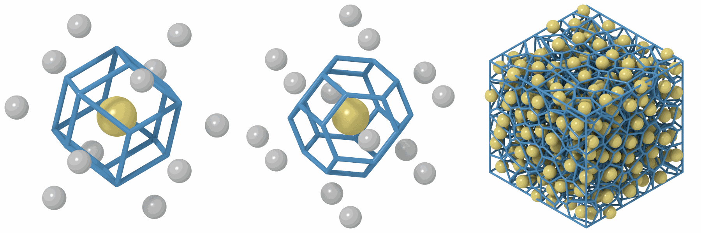

# Voronoi analysis

`VoronoiAnalysis` divides space into the Voronoi cells of the atoms, the
regions closer to one atom than to any other, and gives the volume and the
coordination of each cell, and, when asked for, its faces, its Voronoi index
and its shape as a polyhedron.

```python
import numpy as np
from mdapy.analysis import VoronoiAnalysis
from mdapy.build import build_crystal

# an fcc crystal of 5 x 5 x 5 cubic cells, atoms displaced by about 0.05 Å
crystal = build_crystal("fcc", 3.6, elements="Cu", repeat=(5, 5, 5))
shake = np.random.default_rng(0).normal(scale=0.05, size=(len(crystal), 3))
system = crystal.with_columns(positions=crystal["positions"] + shake)

voronoi = VoronoiAnalysis(relative_face_threshold=0.01, edge_threshold=0.5)
result = voronoi.compute(system)
result.volume  # ų, a³/4 = 11.66 on average
result.coordination  # 12 for every atom
system = system.with_columns(result)  # voronoi_volume, ..., cavity_radius

# the faces too: the atom across each, its area and its edges
faces = VoronoiAnalysis(relative_face_threshold=0.01, edge_threshold=0.5, faces=True)
result = faces.compute(system)
result.index(6)  # faces with 3, 4, 5 and 6 edges: [0, 12, 0, 0]

shapes = VoronoiAnalysis(polyhedra=True).compute(system).polyhedra
shapes.vertices  # Å, the corners of every cell
```

The cell of an atom in fcc and in bcc, with the neighbors across its faces, and
the cells of atoms packed at random, as voro++ draws them: each face a closed line
through its corners, drawn as a tube by the
[renderer](../visualization/rendering.md):

```python
import mdapy as mp
from mdapy.build import add_interstitials
from mdapy.visualization import render, write_png


def faces(cells, i):
    """The faces of the cell of atom i, each a closed line through its corners."""
    lines = []
    for f in range(cells.face_offsets[i], cells.face_offsets[i + 1]):
        corners = cells.corners[cells.corner_offsets[f] : cells.corner_offsets[f + 1]]
        lines.append(cells.vertices[np.append(corners, corners[0])])
    return lines


blue, yellow, gray = (0.36, 0.62, 0.82), (0.95, 0.88, 0.52), (0.82, 0.82, 0.82)
look = dict(line_color=blue, box=False, style="shiny", width=600, height=600)
pictures = []
for crystal, reach in (
    (build_crystal("fcc", 3.6, elements="Cu", repeat=(3, 3, 3)), 2.6),
    (build_crystal("bcc", 2.87, elements="Fe", repeat=(4, 4, 4)), 2.9),
):
    cells = VoronoiAnalysis(polyhedra=True).compute(crystal).polyhedra
    middle = crystal.box.matrix.diagonal() / 2
    i = int(np.argmin(np.linalg.norm(crystal["positions"] - middle, axis=1)))
    apart = crystal.box.minimum_image(crystal["positions"] - crystal["positions"][i])
    distance = np.linalg.norm(apart, axis=1)
    pictures.append(
        render(
            crystal,
            atoms=distance < reach,
            color=np.where((distance < 0.1)[:, None], yellow, gray),
            radius=np.where(distance < 0.1, 0.5, 0.3),
            lines=faces(cells, i),
            line_radius=0.07,
            view=[1, 0.6, 0.45],
            **look,
        )
    )

# 320 atoms at random, none closer than 2.3 Å, in a box that is not periodic
empty = mp.System(np.zeros((0, 3)), mp.Box(18.0, pbc=False), elements=[])
packed = add_interstitials(empty, "Ar", 320, min_distance=2.3, seed=3)
cells = VoronoiAnalysis(polyhedra=True).compute(packed).polyhedra
edges = [face for i in range(len(packed)) for face in faces(cells, i)]
pictures.append(
    render(packed, color=yellow, radius=0.9, lines=edges, line_radius=0.14, **look)
)
write_png("images/voronoi.png", np.hstack(pictures))
```



*Left: the cell of an atom of fcc, a rhombic dodecahedron, each of its 12 faces
halfway to one of its 12 nearest neighbors (gray). Middle: in bcc a truncated
octahedron, 8 hexagons toward the first neighbors and 6 squares toward the second.
Right: 320 atoms packed at random in a box that is not periodic, whose faces close the
outer cells.*

`render(system, polyhedra=cells)` draws the cells of all the atoms shown as solids
instead, their faces in the color of their atom or by their number of edges; see
[Rendering](../visualization/rendering.md#parameters).

## Parameters

| Name | Type | Default | Unit | Meaning |
|---|---|---|---|---|
| `face_threshold` | float64 | 0 | Ų | faces of this area or less do not count |
| `relative_face_threshold` | float64 | 0 | | faces of this fraction of the surface of their cell or less do not count; from 0 to below 1 |
| `edge_threshold` | float64 | 0 | Å | edges shorter than this do not count, and faces with fewer than three edges that count do not count |
| `faces` | bool | `False` | | also give the faces of each cell that count, with the atom across each, its area and its edges |
| `polyhedra` | bool | `False` | | also give the shape of each cell |

Without `faces`, the faces of each cell are counted and let go as soon as
its volume and coordination are known, so that the memory a computation
takes does not grow with the faces: some 14 per atom, which take as much as
the rest of the result several times over.

`compute(system, *, progress=None, cancel=None)` takes the `progress` and
`cancel` of [every analysis](overview.md#parameters), but no neighbor list:
the neighbors of each cell are searched as far as the cell needs. No two
atoms may be at the same position. Directions that are not periodic are
closed by the faces of the box, moved out as far as needed to include every
atom.

The thresholds remove the small faces and short edges that thermal motion
creates where a perfect crystal has a vertex shared by more than four
cells, as in fcc; they do not change the volume, the radius or the shapes.
The atoms across the faces are also a kind of
[neighbor list](../../basics/neighbor.md#voronoi-neighbors), built
with `NeighborList.build(system, voronoi=True)` and the same thresholds.

## Results

A `VoronoiResult`:

| Attribute or method | Type | Meaning |
|---|---|---|
| `volume` | (N,) float64 | the volume of each cell in ų; its column `voronoi_volume` |
| `coordination` | (N,) int64 | the number of faces that count shared with other atoms; its column `voronoi_coordination` |
| `radius` | (N,) float64 | the distance from each atom to the farthest vertex of its cell in Å; its column `cavity_radius` |
| `offsets` | (N + 1,) int64 | the faces that count of atom `i` are `offsets[i]:offsets[i + 1]`; with `faces`, else `None` |
| `j` | (F,) `mdapy.index_dtype` | the atom across each face, −1 for a wall of the box; with `faces` |
| `shifts` | (F, 3) int8 | the periodic image of that atom; with `faces` |
| `areas` | (F,) float64 | the area of each face in Ų; with `faces` |
| `edges` | (F,) int32 | the number of edges of each face that count; with `faces` |
| `index(largest=8)` | (N, largest − 2) int64 | the Voronoi index: the number of faces with 3, 4, ..., `largest` edges shared with other atoms; with `faces` |
| `polyhedra` | `VoronoiPolyhedra` or `None` | the shapes of the cells, with `polyhedra=True` |

The faces are listed like the pairs of a
[neighbor list](../../basics/neighbor.md): the vector from atom `i`
to the atom across a face is `x[j] - x[i] + shifts @ box.matrix`.

The walls of the box are faces of the cells of the atoms next to them, in
the faces with `j` = −1, but they are not neighbors: `coordination`,
`index` and the Voronoi neighbors count only the faces shared with atoms.
OVITO and LAMMPS count the walls in the coordination and the Voronoi index
as well, so their values are larger for atoms next to a wall.

A `VoronoiPolyhedra` holds every face of every cell, those that do not
count included, so that each cell is a closed polyhedron, for example to
draw it:

| Attribute | Type | Meaning |
|---|---|---|
| `vertices` | (V, 3) float64 | the corners of the cells in Å, each cell with its own; a cell may reach out of the box |
| `vertex_offsets` | (N + 1,) int64 | the vertices of the cell of atom `i` are `vertex_offsets[i]:vertex_offsets[i + 1]` |
| `face_offsets` | (N + 1,) int64 | the faces of the cell of atom `i` are `face_offsets[i]:face_offsets[i + 1]` |
| `corner_offsets` | (F + 1,) int64 | the corners of face `f` are `corners[corner_offsets[f]:corner_offsets[f + 1]]` |
| `corners` | (C,) int64 | the vertex of each corner, counterclockwise seen from outside the cell |
| `j` | (F,) `mdapy.index_dtype` | the atom across each face, −1 for a wall of the box |
| `areas` | (F,) float64 | the area of each face in Ų |

```python
f = shapes.face_offsets[0]  # the first face of the cell of atom 0
loop = shapes.corners[shapes.corner_offsets[f] : shapes.corner_offsets[f + 1]]
polygon = shapes.vertices[loop]  # its corners in order
```

## Errors

The constructor raises `InvalidParameter` for a negative threshold or a
`relative_face_threshold` of 1 or more; `compute` raises it for two atoms at
the same position, and `index` for a `largest` below 3.

## Definition

The Voronoi cell of atom $i$ at $\mathbf r_i$ is the set of points closer to
it than to any other atom or periodic image,

$$
V_i = \{\, \mathbf x : \lvert \mathbf x - \mathbf r_i \rvert \le
\lvert \mathbf x - \mathbf r_j - \mathbf s H \rvert
\text{ for every } (j, \mathbf s) \ne (i, \mathbf 0) \,\},
$$

with $H$ the matrix of the lattice vectors as rows. It is a convex
polyhedron whose faces lie on the planes halfway to its neighbors, or on a
wall of the box in a direction that is not periodic. A face counts when its
area $A$ and its edges satisfy

$$
A > \max(A_\text{min},\; f\, S_i) \quad\text{and}\quad
\#\{\text{edges of length} \ge \ell_\text{min}\} \ge 3 ,
$$

with $A_\text{min}$ the `face_threshold`, $f$ the
`relative_face_threshold`, $\ell_\text{min}$ the `edge_threshold` and $S_i$
the surface of the cell, walls included. The coordination is the number of
faces that count shared with atoms, and the Voronoi index
$\langle n_3, n_4, n_5, \dots \rangle$ the number of these faces with 3, 4,
5, ... edges that count. The radius, the distance to the farthest vertex of
the cell, is that of the largest sphere centered on a vertex of the cell
with no atom inside.

| Crystal | Cell | Faces | Volume |
|---|---|---|---|
| fcc | rhombic dodecahedron | 12 rhombi | $a^3/4$ |
| bcc | truncated octahedron | 6 squares, 8 hexagons | $a^3/2$ |
| hcp | trapezo-rhombic dodecahedron | 12 quadrilaterals | $\sqrt 2\, a^3 / 2$ |
| cubic diamond | | 12 triangles, 4 hexagons | $a^3/8$ |

!!! quote "Please cite"
    [Voronoi (1908)](../../reference/references.md#voronoi1908).

## See also

- OVITO [Voronoi analysis](https://docs.ovito.org/reference/pipelines/modifiers/voronoi_analysis.html).
- LAMMPS [`compute voronoi/atom`](https://docs.lammps.org/compute_voronoi_atom.html).
