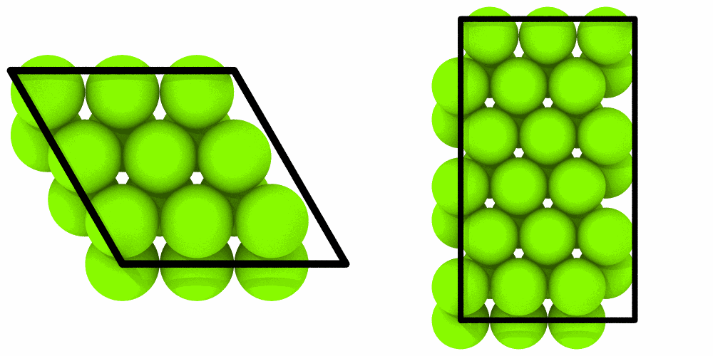

# Orthogonal cells

`mdapy.transform.orthogonal_cell` puts a crystal in a box whose lattice
vectors lie along x, y and z, as atomsk's orthogonal cell does: along each
axis, the shortest combination of the lattice vectors of the box that lies
along it. The hexagonal cell of a metal, with 120° between **a** and **b**,
becomes a rectangular one for programs and methods that need it.

```python
from mdapy.build import build_crystal
from mdapy.transform import orthogonal_cell, replicate

magnesium = build_crystal("hcp", 3.21, c=5.21, elements="Mg")  # 2 atoms
cell = orthogonal_cell(magnesium)
len(cell)  # 4
cell.box.lengths  # Å, [3.21, 5.56, 5.21]: a, a √3 and c

many = replicate(magnesium, (2, 2, 1))
len(orthogonal_cell(many))  # 16: the box of 2 × 2 cells gives 2a and 2a √3
len(orthogonal_cell(many, minimal=True))  # 4: from the primitive cell
```

The hexagonal cell and the orthogonal one, each repeated 3 × 3 times:

```python
import numpy as np
from mdapy.visualization import render, write_png

pictures = [
    render(replicate(system, (3, 3, 1)), width=500, height=500, view="top")
    for system in (magnesium, cell)
]
write_png("images/orthogonal-cell.png", np.hstack(pictures))
```



*Magnesium seen along z: 3 × 3 hexagonal cells of two atoms, and 3 × 3
orthogonal cells of four.*

## Parameters

| Name | Type | Default | Unit | Meaning |
|---|---|---|---|---|
| `system` | `System` | | | a crystal in a box periodic in every direction |
| `minimal` | bool | `False` | | start from the [primitive cell](../simulation/phonons.md) of the crystal, which gives the smallest orthogonal cell; otherwise from the box, as atomsk does, so that a box of several periods gives a cell of as many |
| `max_search` | int32 | 20 | | the largest multiple of each lattice vector in the combinations searched |
| `tolerance` | float64 | 1e-6 | Å | how far a combination may lie from an axis |

A crystal needs a lattice vector along each of x, y and z to have an
orthogonal cell: one built along its axes has them, one turned by an
arbitrary angle does not.

## Results

A `System` in a box of lengths along x, y and z with the origin of the
original box: the copies of the atoms at the points of the lattice inside it,
every column copied; the box itself when it is already orthogonal.

- Ids, and molecules above 0, of each copy are offset by the largest of the
  original, as in [`replicate`](transform.md).
- With an `image` column, each atom is placed by its unwrapped position, and
  its image flags are those of the new box.
- Each bond, angle, dihedral and improper joins the atoms of the copies where
  they lie next to its first atom: by the image flags, or else at the nearest
  periodic image.
- `energy` and `virial`, which describe the whole original system, are left
  out of the info.

## Errors

[`InvalidParameter`](../../reference/api/utilities.md#mdapy.errors.InvalidParameter)
for a box not periodic in every direction, a `max_search` that is not a
positive integer, a `tolerance` that is not positive, and a crystal with no
combination of lattice vectors along an axis within `max_search`.

## See also

- [Periodic copies and images](transform.md).
- atomsk's [orthogonal cell](https://atomsk.univ-lille.fr/doc/en/option_orthocell.html).
