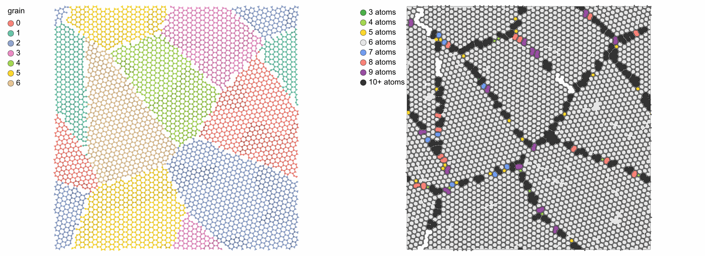
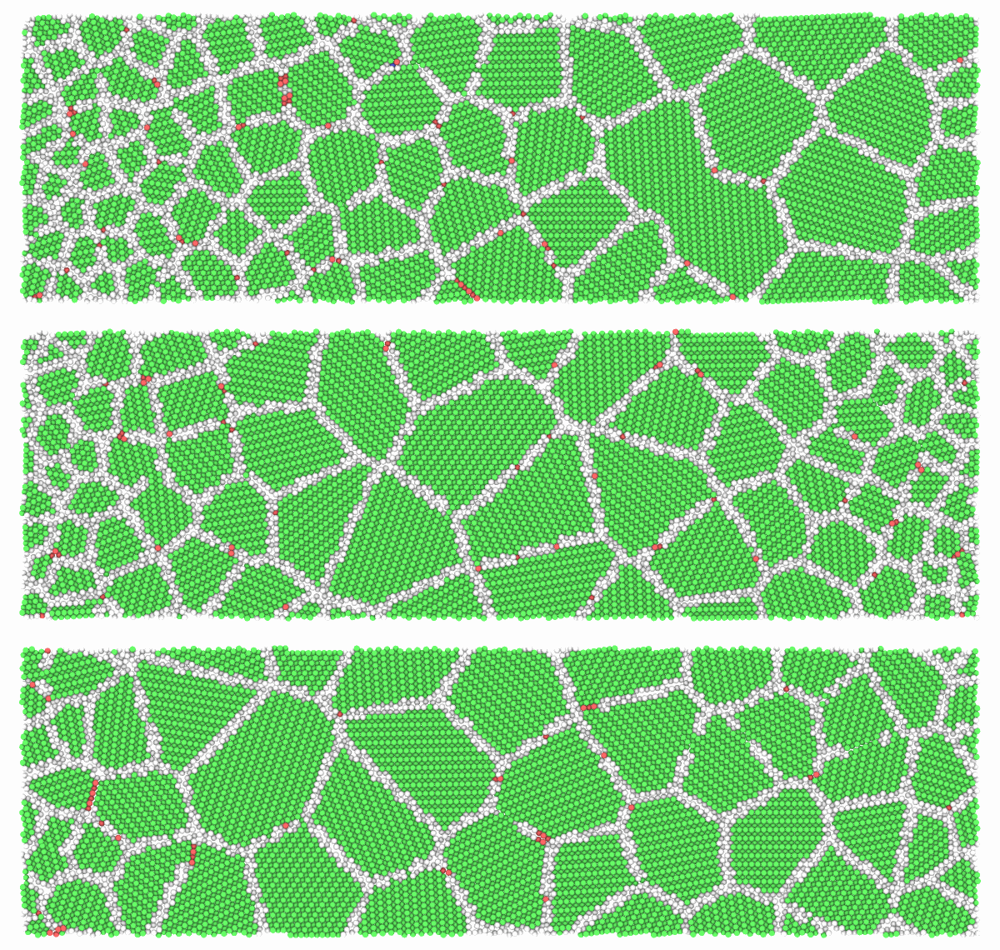
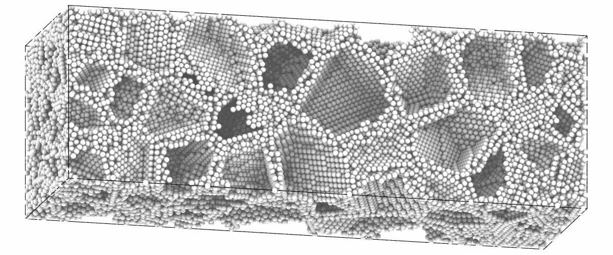

<!-- needs: lammps -->

# Polycrystals and twins

`build_polycrystal` fills a periodic box with grains, each the crystal of a
unit cell, rotated, filling the Voronoi cell of its seed; `twin_lamellae`
makes a crystal of twin lamellae, which as the unit gives twinned grains.

```python
import numpy as np
import mdapy as mp
from mdapy.build import build_crystal, build_polycrystal, rotations_about, twin_lamellae

copper = build_crystal("fcc", 3.615, elements="Cu")
grains = build_polycrystal(copper, mp.Box(80.0), 8, seed=1)
grains.table["grain"]  # the grain of each atom

# twinned grains: lamellae of six (111) planes
layers = build_crystal(
    "fcc", 3.615, elements="Cu", orientation=[(1, 1, -2), (-1, 1, 0), (1, 1, 1)]
)
twinned = build_polycrystal(twin_lamellae(layers, 6), mp.Box(80.0), 8, seed=1)

# columnar grains along [111] on a hexagonal pattern, every neighbor turned by 20°
d = 40.0
places = [(i, k) for i in range(3) for k in range(2)]
seeds = [[(i + k / 2) * d, k * d * np.sqrt(3) / 2, 0.0] for i, k in places]
turns = rotations_about("z", [20.0 * ((i - k) % 3) for i, k in places])
box = mp.Box([3 * d, d * np.sqrt(3), 1.0])
columns = build_polycrystal(layers, box, seeds, orientations=turns)
```

Colored by grain, by structure and seen along the columns:

```python
from mdapy.identify import CommonNeighborAnalysis
from mdapy.transform import replicate
from mdapy.visualization import render, write_png

size = {"width": 600, "height": 600}
boundaries = CommonNeighborAnalysis().compute(twinned)
by_grain = render(grains, color="grain", colormap="labels", **size, legend=True)
twins = render(
    twinned, atoms=boundaries.structure != 1, color=boundaries, **size, legend=True
)
tiled = replicate(columns, (1, 2, 1))
from_above = render(
    tiled,
    color="grain",
    colormap="labels",
    view="top",
    width=700,
    height=600,
    legend=True,
)
write_png("images/polycrystals.png", np.hstack([by_grain, twins, from_above]))
```


*Left: the eight grains. Middle: the twinned grains without their fcc atoms,
which leaves the grain boundaries (white) and the twin boundaries (red, hcp
by [common neighbor analysis](../analysis/cna.md)). Right: the columnar
grains seen from above, repeated twice along y to show the hexagonal pattern.*

## Two-dimensional grains

A sheet is a columnar polycrystal one layer thick. The unit needs an orthogonal box, such as
graphene with x and y along two directions of the plane and vacuum along z, and the box of
the polycrystal no longer than the unit along z:

```python
sheet = build_crystal(
    "graphene",
    2.46,
    c=10.0,
    elements="C",
    orientation=[(1, -1, 0, 0), (1, 1, -2, 0), (0, 0, 0, 1)],
)
flakes = build_polycrystal(
    sheet, mp.Box([120.0, 120.0, 1.0]), 7, min_distance=1.2, seed=4
)
flakes.box.lengths  # 120, 120 and 10 Å
```

The atoms at the boundaries need a potential to settle. Minimizing and a short run at
300 K, here with the Tersoff parameters of carbon of
[Lindsay and Broido (2010)](../../reference/references.md#lindsay2010), bond them where
they can reach each other. The box follows the sheet with `barostat="xy"`:

```python
from pathlib import Path
from mdapy.analysis import RingStatistics
from mdapy.calculators import LAMMPS
from mdapy.simulation import MolecularDynamics, minimize

Path("C.tersoff").write_text(
    "C C C 3.0 1.0 0.0 3.8049e4 4.3484 -0.930 0.72751 1.5724e-7 "
    "2.2119 430.0 1.95 0.15 3.4879 1393.6\n"
)
carbon = LAMMPS("pair_style tersoff\npair_coeff * * C.tersoff C", ["C"])
minimized = minimize(flakes, carbon, max_force=0.05, max_steps=2000).system
with MolecularDynamics(minimized, carbon, timestep=0.0005) as md:
    md.velocities(600, seed=1)
    md.run(6000, ensemble="npt", temperature=300.0, pressure=0.0, barostat="xy")
    settled = md.system
```

The grains, and the rings of [ring statistics](../analysis/rings.md), which show the
boundaries: hexagons inside the grains, other rings along their boundaries. A ring larger
than `max_size`, here 20, is not found and stays white.

```python
rings = RingStatistics(20, cutoff=1.8).compute(settled)
rings.counts[6], rings.counts.sum()  # 2412 of 2564 are hexagons
mesh, ring = rings.polygons(settled)
colors = {
    3: (0.30, 0.69, 0.29),
    4: (0.65, 0.85, 0.33),
    5: (1.00, 0.85, 0.18),
    6: (0.90, 0.90, 0.90),
    7: (0.45, 0.62, 0.94),
    8: (0.97, 0.51, 0.47),
    9: (0.60, 0.31, 0.64),
    10: (0.20, 0.20, 0.20),  # the larger rings too
}
sizes = np.minimum(rings.sizes, 10)
top = {"view": "top", "box": False, "width": 1100, "height": 800, "bonds": 1.8}
by_grain = render(
    settled,
    color="grain",
    colormap="labels",
    representation="ball_and_stick",
    legend=True,
    **top,
)
by_ring = render(
    settled,
    radius=0.3,
    style="flat",
    mesh=mesh,
    mesh_color=np.array([colors[size] for size in sizes[ring]]),
    legend={
        f"{size}{'+' if size == 10 else ''} atoms": colors[size]
        for size in np.unique(sizes)
    },
    **top,
)
write_png("images/polycrystal-sheet.png", np.hstack([by_grain, by_ring]))
```



*Seven grains of graphene, turned about the normal of the sheet, after 3 ps at 300 K. Left:
the grains stay whole. Right: the rings up to 20 atoms, those of 10 or more in one color. Pentagons, heptagons and
larger rings form where the boundaries closed, and the large rings are the holes left in
them.*

A unit with two kinds of atoms, such as boron nitride with `elements=["B", "N"]`, goes the
same way.

## Gradient polycrystals

In a gradient polycrystal the grain size changes along one direction, as in a metal
whose surface was deformed: `gradient_seeds` gives seeds that make it. `sizes` lists
positions along the box vector, as fractions from 0 to 1, with the grain size at each,
linear between them, so one list holds any profile:

```python
from mdapy.build import gradient_seeds

# columns along [110], where few pairs of grains differ by a small angle
rows = build_crystal(
    "fcc", 3.615, elements="Cu", orientation=[(0, 0, 1), (1, -1, 0), (1, 1, 0)]
)
box = mp.Box([400.0, 120.0, 1.0])
profiles = {
    "one side": [(0, 15), (1, 60)],
    "both sides": [(0, 15), (0.5, 60), (1, 15)],
    "two gradients": [(0, 15), (0.25, 60), (1, 30)],
}
pictures = []
for sizes in profiles.values():
    seeds = gradient_seeds(box, sizes, axis="x", columns="z", seed=1)
    grains = build_polycrystal(rows, box, seeds, seed=1)
    cna = CommonNeighborAnalysis().compute(grains)
    pictures.append(
        render(grains, color=cna, view="top", box=False, width=1200, height=380)
    )
write_png("images/gradient-polycrystals.png", np.vstack(pictures))
```



*Columnar copper, the atoms of the grains green and those of the boundaries white. Top:
fine grains on the left growing to the right. Middle: fine grains on both sides and coarse
ones in the middle. Bottom: a steep gradient on the left and a gentle one on the right,
with grains of different sizes at the two ends.*

Without `columns` the seeds fill the box and a grain size is the diameter of the sphere of
the same volume:

```python
box = mp.Box([80.0, 80.0, 240.0])
seeds = gradient_seeds(box, [(0, 20), (0.5, 50), (1, 20)], seed=1)
graded = build_polycrystal(copper, box, seeds, seed=1)
len(seeds), len(graded)  # 103 grains, 121823 atoms
cna = CommonNeighborAnalysis().compute(graded)
render(
    graded,
    "images/gradient-3d.png",
    atoms=cna.structure != 1,
    color="white",
    view=(0.25, -1.0, 0.25),
    up=(1.0, 0.0, 0.0),
    width=1200,
    height=500,
)
```



*The atoms of the grain boundaries alone, z to the right: dense at both ends, where the
grains are of 20 Å, and sparse in the middle, where they are of 50 Å.*

The box of a polycrystal is periodic, so across its ends the first grains meet the last:
that suits a profile with the same size at both ends, and otherwise makes a boundary
between fine and coarse grains. For free surfaces, open the box along the gradient:

```python
surfaces = graded.with_box(mp.Box(graded.box.matrix, pbc=(True, True, False)))
```

| Name | Type | Default | Unit | Meaning |
|---|---|---|---|---|
| `box` | `Box` or (3, 3) float64 | | Å | the box of the polycrystal |
| `sizes` | (K, 2) float64 | | —, Å | the positions along the box vector, from 0 to 1 in increasing order, and the grain size at each |
| `axis` | int32 or str | `"z"` | | the box vector along which the size changes |
| `columns` | int32 or str | `None` | | the box vector of the columns of a columnar polycrystal: the seeds lie in one plane and a grain size is the diameter of the circle of the same area |
| `seed` | int64 or `numpy.random.Generator` | `None` | | the random seeds |

`gradient_seeds` returns (G, 3) `float64` positions in Å, for `build_polycrystal`. The
number of grains is the number the sizes ask for. Along the box vector each seed takes
its own equal share of them, so every slab has the grains its sizes ask for; across it,
each seed takes the place farthest from the others of 16 at random, so the grains are
close to even. It raises `InvalidParameter` for `sizes` that are not pairs, positions
that do not increase from 0 to 1, grain sizes that are not positive, or a gradient along
the columns.

## Parameters

`build_polycrystal(unit, box, grains, *, orientations=None, min_distance=None, seed=None)`

| Name | Type | Default | Unit | Meaning |
|---|---|---|---|---|
| `unit` | `System` | | | the crystal of every grain in a periodic box: a unit cell or any periodic arrangement |
| `box` | `Box` or (3, 3) float64 | | Å | the box of the polycrystal, periodic in every direction |
| `grains` | int32 or (G, 3) float64 | | Å | the number of grains with seeds at random, or the positions of the seeds |
| `orientations` | (G, 3, 3) float64 | random | | the rotation of each grain, from the axes of `unit` to those of the box |
| `min_distance` | float64 | 0.7 × nearest distance of `unit` | Å | of two atoms closer than this, the later is removed |
| `seed` | int64 or `numpy.random.Generator` | `None` | | the random seeds and orientations |

Along an axis where the box is no longer than the box of `unit`, the
polycrystal is columnar: the seeds lie in one plane, every grain spans the
axis, the box takes the length of `unit` along it, and the grains turn about
it only. Both boxes must then be orthogonal. `random_rotations(count,
seed=None)` gives rotations uniformly over all orientations.

`rotations_about(axis, angles)` gives the rotations about one axis by angles in
degrees, for the grains of a columnar polycrystal.

`twin_lamellae(cell, layers)` takes a periodic crystal whose third box
vector is along z and whose atoms lie on equally spaced planes normal to z,
such as fcc with z along [111], and the number of planes of each lamella,
at least 2.

## Results

`build_polycrystal` returns the atoms with a `grain` column, numbered as the
seeds, wrapped into the box, and the (G, 3) positions of the seeds in
`info["seeds"]`, from which [`add_graphene`](graphene.md) finds the grain
boundaries. The first atom of `unit` sits on the seed of each grain. Grains that meet their own periodic image meet a copy shifted
by a box vector, generally not a lattice vector of the rotated crystal, so a
boundary forms there too.

`twin_lamellae` returns two lamellae, 2 × `layers` planes, in the box of
`cell` along x and y; every lamella is the mirror image of the next across
the plane between them, which is a coherent twin boundary of fcc, and the
box repeats them along z.

## Errors

`build_polycrystal` raises `InvalidParameter` for a unit or box that is not
periodic, a number of grains below one, seeds not of shape (G, 3),
orientations of another shape or not rotations, rotations of a columnar
polycrystal not about its axis, a box no longer than the unit along two
axes, a box that is not orthogonal when columnar, or a negative minimum
distance. `twin_lamellae` raises it for a cell that is not periodic, whose
third vector is not along z or first two not in the xy plane, whose atoms
are not on equally spaced planes, or for fewer than two layers.

## See also

- [Graphene on grain boundaries](graphene.md).

- atomsk [`--polycrystal`](https://atomsk.univ-lille.fr/doc/en/mode_polycrystal.html).
