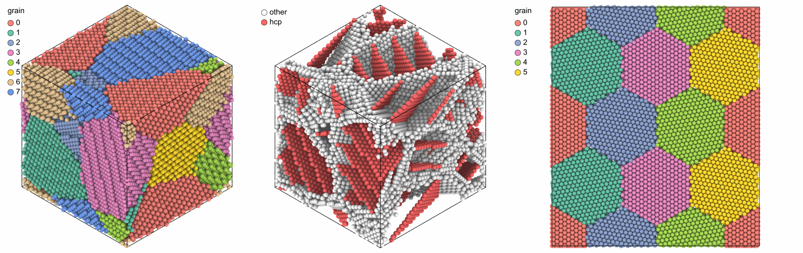

# Polycrystals and twins

`build_polycrystal` fills a periodic box with grains, each the crystal of a
unit cell, rotated, filling the Voronoi cell of its seed; `twin_lamellae`
makes a crystal of twin lamellae, which as the unit gives twinned grains.

```python
import numpy as np
import mdapy as mp
from mdapy.build import build_crystal, build_polycrystal, rotations_about, twin_lamellae

copper = build_crystal("fcc", 3.615, elements="Cu")
grains = build_polycrystal(copper, mp.Box(80.0), 8, seed=1)
grains.table["grain"]  # the grain of each atom

# twinned grains: lamellae of six (111) planes
layers = build_crystal(
    "fcc", 3.615, elements="Cu", orientation=[(1, 1, -2), (-1, 1, 0), (1, 1, 1)]
)
twinned = build_polycrystal(twin_lamellae(layers, 6), mp.Box(80.0), 8, seed=1)

# columnar grains along [111] on a hexagonal pattern, every neighbor turned by 20°
d = 40.0
places = [(i, k) for i in range(3) for k in range(2)]
seeds = [[(i + k / 2) * d, k * d * np.sqrt(3) / 2, 0.0] for i, k in places]
turns = rotations_about("z", [20.0 * ((i - k) % 3) for i, k in places])
box = mp.Box([3 * d, d * np.sqrt(3), 1.0])
columns = build_polycrystal(layers, box, seeds, orientations=turns)
```

Colored by grain, by structure and seen along the columns:

```python
from mdapy.identify import CommonNeighborAnalysis
from mdapy.transform import replicate
from mdapy.visualization import render, write_png

size = {"width": 600, "height": 600}
boundaries = CommonNeighborAnalysis().compute(twinned)
by_grain = render(grains, color="grain", colormap="labels", **size, legend=True)
twins = render(
    twinned, atoms=boundaries.structure != 1, color=boundaries, **size, legend=True
)
tiled = replicate(columns, (1, 2, 1))
from_above = render(
    tiled,
    color="grain",
    colormap="labels",
    view="top",
    width=700,
    height=600,
    legend=True,
)
write_png("images/polycrystals.png", np.hstack([by_grain, twins, from_above]))
```



*Left: the eight grains. Middle: the twinned grains without their fcc atoms,
which leaves the grain boundaries (white) and the twin boundaries (red, hcp
by [common neighbor analysis](../analysis/cna.md)). Right: the columnar
grains seen from above, repeated twice along y to show the hexagonal pattern.*

## Two-dimensional grains

A sheet is a columnar polycrystal one layer thick. The unit needs an orthogonal box, such as
graphene with x and y along two directions of the plane and vacuum along z, and the box of
the polycrystal no longer than the unit along z:

```python
sheet = build_crystal(
    "graphene",
    2.46,
    c=10.0,
    elements="C",
    orientation=[(1, -1, 0, 0), (1, 1, -2, 0), (0, 0, 0, 1)],
)
flakes = build_polycrystal(
    sheet, mp.Box([120.0, 120.0, 1.0]), 7, min_distance=1.2, seed=4
)
flakes.box.lengths  # 120, 120 and 10 Å
```

[A polycrystal of graphene](../../examples/graphene-polycrystal.md) settles the boundaries
with a potential and shows their rings.

## Molecules

With a `molecule` column in the unit, the molecules stay whole: a molecule belongs to the grain
that holds its center, the atoms too close are removed by whole molecules, and the bonds and
angles of the topology are kept. [A molecular polycrystal](../../examples/molecular-polycrystal.md)
builds a polycrystal of ice this way.

## Gradient polycrystals

In a gradient polycrystal the grain size changes along one direction, as in a metal
whose surface was deformed: `gradient_seeds` gives seeds that make it. `sizes` lists
positions along the box vector, as fractions from 0 to 1, with the grain size at each,
linear between them, so one list holds any profile:

```python
from mdapy.build import gradient_seeds

box = mp.Box([80.0, 80.0, 240.0])
seeds = gradient_seeds(box, [(0, 20), (0.5, 50), (1, 20)], seed=1)
graded = build_polycrystal(copper, box, seeds, seed=1)
len(seeds), len(graded)  # 103 grains, 122207 atoms
```

[A gradient polycrystal](../../examples/gradient-polycrystals.md) builds gradients from one
side, from both sides and with two different slopes.


| Name | Type | Default | Unit | Meaning |
|---|---|---|---|---|
| `box` | `Box` or (3, 3) float64 | | Å | the box of the polycrystal |
| `sizes` | (K, 2) float64 | | —, Å | the positions along the box vector, from 0 to 1 in increasing order, and the grain size at each |
| `axis` | int32 or str | `2` | | the box vector along which the size changes, as 0, 1, 2 or `"x"`, `"y"`, `"z"` |
| `columns` | int32 or str | `None` | | the box vector of the columns of a columnar polycrystal: the seeds lie in one plane and a grain size is the diameter of the circle of the same area |
| `seed` | int64 or `numpy.random.Generator` | `None` | | the random seeds |

`gradient_seeds` returns (G, 3) `float64` positions in Å, for `build_polycrystal`. The
number of grains is the number the sizes ask for. Along the box vector each seed takes
its own equal share of them, so every slab has the grains its sizes ask for; across it,
each seed takes the place farthest from the others of 16 at random, so the grains are
close to even. It raises `InvalidParameter` for `sizes` that are not pairs, positions
that do not increase from 0 to 1, grain sizes that are not positive, or a gradient along
the columns.

## Parameters

`build_polycrystal(unit, box, grains, *, orientations=None, min_distance=None, seed=None)`

| Name | Type | Default | Unit | Meaning |
|---|---|---|---|---|
| `unit` | `System` | | | the crystal of every grain in a periodic box: a unit cell or any periodic arrangement; its other columns, such as charges, are kept |
| `box` | `Box` or (3, 3) float64 | | Å | the box of the polycrystal, periodic in every direction |
| `grains` | int32 or (G, 3) float64 | | Å | the number of grains with seeds at random, or the positions of the seeds |
| `orientations` | (G, 3, 3) float64 | random | | the rotation of each grain, from the axes of `unit` to those of the box |
| `min_distance` | float64 | 0.7 × nearest distance of `unit` | Å | no two atoms stay closer than this, with as few removed as possible, as in [`find_overlapping`](../../basics/overlapping.md) |
| `seed` | int64 or `numpy.random.Generator` | `None` | | the random seeds and orientations |

Along an axis where the box is no longer than the box of `unit`, the
polycrystal is columnar: the seeds lie in one plane, every grain spans the
axis, the box takes the length of `unit` along it, and the grains turn about
it only. Both boxes must then be orthogonal. `random_rotations(count,
*, seed=None)` gives rotations uniformly over all orientations.

`rotations_about(axis, angles)` gives the rotations about one axis by angles in
degrees, for the grains of a columnar polycrystal.

`twin_lamellae(cell, layers)` takes a periodic crystal whose third box
vector is along z and whose atoms lie on equally spaced planes normal to z,
such as fcc with z along [111], and the number of planes of each lamella,
at least 2.

## Results

`build_polycrystal` returns the atoms with a `grain` column, numbered as the
seeds, wrapped into the box, and the (G, 3) positions of the seeds in
`info["seeds"]`, from which [`add_graphene`](graphene.md) finds the grain
boundaries. The first atom of `unit` sits on the seed of each grain. Grains that meet their own periodic image meet a copy shifted
by a box vector, generally not a lattice vector of the rotated crystal, so a
boundary forms there too.

`twin_lamellae` returns two lamellae, 2 × `layers` planes, in the box of
`cell` along x and y; every lamella is the mirror image of the next across
the plane between them, which is a coherent twin boundary of fcc, and the
box repeats them along z.

## Errors

`build_polycrystal` raises `InvalidParameter` for a unit or box that is not
periodic, a number of grains below one, seeds not of shape (G, 3),
orientations of another shape or not rotations, rotations of a columnar
polycrystal not about its axis, a box no longer than the unit along two
axes, a box that is not orthogonal when columnar, a negative minimum
distance, a unit with a topology and no `molecule` column, or terms of a topology across
molecules. `twin_lamellae` raises it for a cell that is not periodic, whose
third vector is not along z or first two not in the xy plane, whose atoms
are not on equally spaced planes, or for fewer than two layers.

## See also

- [Graphene on grain boundaries](graphene.md).
- [A gradient polycrystal](../../examples/gradient-polycrystals.md),
  [a polycrystal of graphene](../../examples/graphene-polycrystal.md) and
  [a molecular polycrystal](../../examples/molecular-polycrystal.md).

- atomsk [`--polycrystal`](https://atomsk.univ-lille.fr/doc/en/mode_polycrystal.html).
