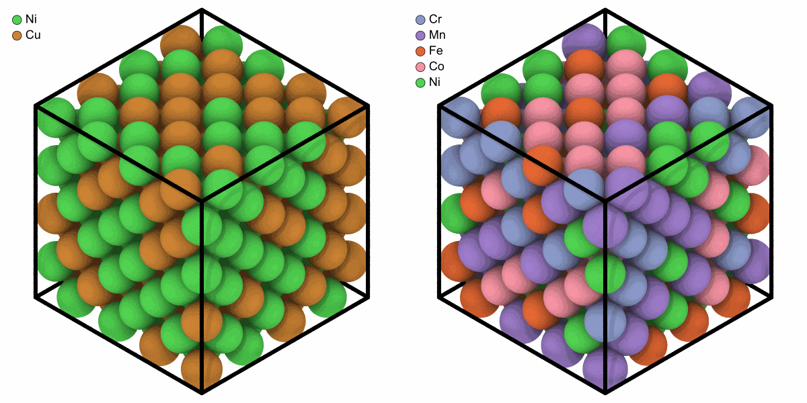
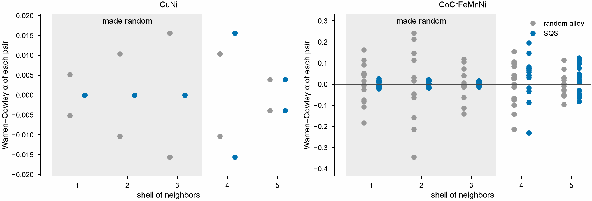

# Special quasirandom structures

`sqs_alloy` places elements in given fractions on the sites of a perfect
lattice so that the pairs of the nearest shells of neighbors are those of a
random alloy, the best that a small cell can do for a random alloy.

```python
from mdapy.build import build_crystal, sqs_alloy

sites = build_crystal("fcc", 3.6, repeat=(4, 4, 4))
binary = {"Cu": 1, "Ni": 1}
quinary = {"Co": 1, "Cr": 1, "Fe": 1, "Mn": 1, "Ni": 1}
cuni = sqs_alloy(sites, binary, shells=3, seed=1)
cantor = sqs_alloy(sites, quinary, seed=1)
```

```python
import numpy as np
from mdapy.visualization import render, write_png

left = render(cuni, width=600, height=600, legend=True)
right = render(cantor, width=600, height=600, legend=True)
write_png("images/sqs.png", np.hstack([left, right]))
```



*Left: equiatomic CuNi of 256 atoms whose pair correlations in the first three
shells come as close as the cell allows to those of the random alloy. Right:
the Cantor alloy on the same sites.*

The [Warren–Cowley parameters](../analysis/warren-cowley.md) of every pair
of elements, shell by shell, against those of a random alloy of the same
atoms:

```python
from mdapy.analysis import WarrenCowley
from mdapy.build import random_alloy
from mdapy.visualization import plot

order = WarrenCowley(num_neighbors=(12, 6, 24, 12, 24))  # five shells of fcc
shell = np.arange(1, 6)
with plot.style():
    fig, axes = plot.figure("double", 62, ncols=2)
    for ax, sqs, fractions in zip(axes, (cuni, cantor), (binary, quinary)):
        random = random_alloy(sites, fractions, seed=1)
        for k, (system, name) in enumerate(((random, "random alloy"), (sqs, "SQS"))):
            alpha = order.compute(system).alpha
            pairs = np.triu_indices(alpha.shape[1])  # each pair of elements once
            values = alpha[:, pairs[0], pairs[1]]
            x = np.repeat(shell + 0.15 * (2 * k - 1), values.shape[1])
            ax.plot(
                x, values.ravel(), "o", color=("0.6", plot.COLORS[0])[k], label=name
            )
        ax.axvspan(0.5, 3.5, color="0.93", zorder=0, linewidth=0)
        ax.margins(y=0.15)  # room for the label of the shaded shells
        ax.text(
            2,
            0.98,
            "made random",
            transform=ax.get_xaxis_transform(),
            ha="center",
            va="top",
        )
        ax.axhline(0, color="0.3", linewidth=0.5)
        ax.set_xticks(shell)
        ax.set_xlabel("shell of neighbors")
        ax.set_ylabel("Warren–Cowley α of each pair")
        ax.set_title("".join(fractions))
    axes[1].legend()
    plot.save(fig, "images/sqs-warren-cowley", formats=("png",))
```



*Each point is the Warren–Cowley parameter of one pair of elements in one
shell, 0 for a random alloy of infinite size. In the three shells made
random, those of CuNi are 0 and those of the Cantor alloy within 0.03,
where the random alloys of 256 atoms reach 0.016 and 0.35; the fourth and
fifth shells, left out, are no better than at random.*

## Parameters

`sqs_alloy(system, fractions, *, shells=3, weights=None, steps=100000, temperature=1.0, seed=None, progress=None, cancel=None)`

| Name | Type | Default | Meaning |
|---|---|---|---|
| `system` | `System` | | the sites, a perfect lattice such as from [`build_crystal`](crystals.md) |
| `fractions` | dict of str to float64 | | the fraction of each element; the counts are those of [`random_alloy`](alloys.md) |
| `shells` | int32 | 3 | the number of shells of neighbors made random, 1 to 10 |
| `weights` | sequence of float64 | all 1 | the weight of each shell in the deviation |
| `steps` | int64 | 100000 | the number of swaps tried |
| `temperature` | float64 | 1 | the starting temperature of the annealing, in units of the typical change of a swap; 0 keeps only improvements |
| `seed` | int64 or `numpy.random.Generator` | `None` | the starting alloy and the swaps |
| `progress`, `cancel` | | `None` | as for [every analysis](../analysis/overview.md#parameters) |

The shells are the distinct distances between sites, nearest first, so the
lattice must be perfect.

## Results

The system with a new `element` column, the best arrangement found.

## Errors

`sqs_alloy` raises `InvalidParameter` for a number of shells out of range,
weights that are not one per shell or negative, a negative number of steps
or temperature, and the errors of `random_alloy`; `Cancelled` when
cancelled.

## Definition

With $N^{(s)}_{ab}$ the ordered pairs of shell $s$ from an atom of element
$a$ to one of $b$, $P_s$ all pairs of shell $s$ and $x_a$ the fractions, the
deviation from a random alloy

$$
D = \sum_s w_s \sum_{a,b} \left( \frac{N^{(s)}_{ab}}{P_s} - x_a x_b \right)^2
$$

is zero when the Warren–Cowley parameters
$\alpha^{(s)}_{ab} = 1 - N^{(s)}_{ab} / (x_a x_b P_s)$ of every shell
vanish. Starting from a random alloy, pairs of atoms of different elements
swap places when the swap lowers $D$, or with the probability
$e^{-\Delta D / T}$ otherwise, while $T$ falls linearly to zero; the
arrangement with the lowest $D$ is returned.

!!! quote "Please cite"
    [Zunger et al. (1990)](../../reference/references.md#zunger1990).
