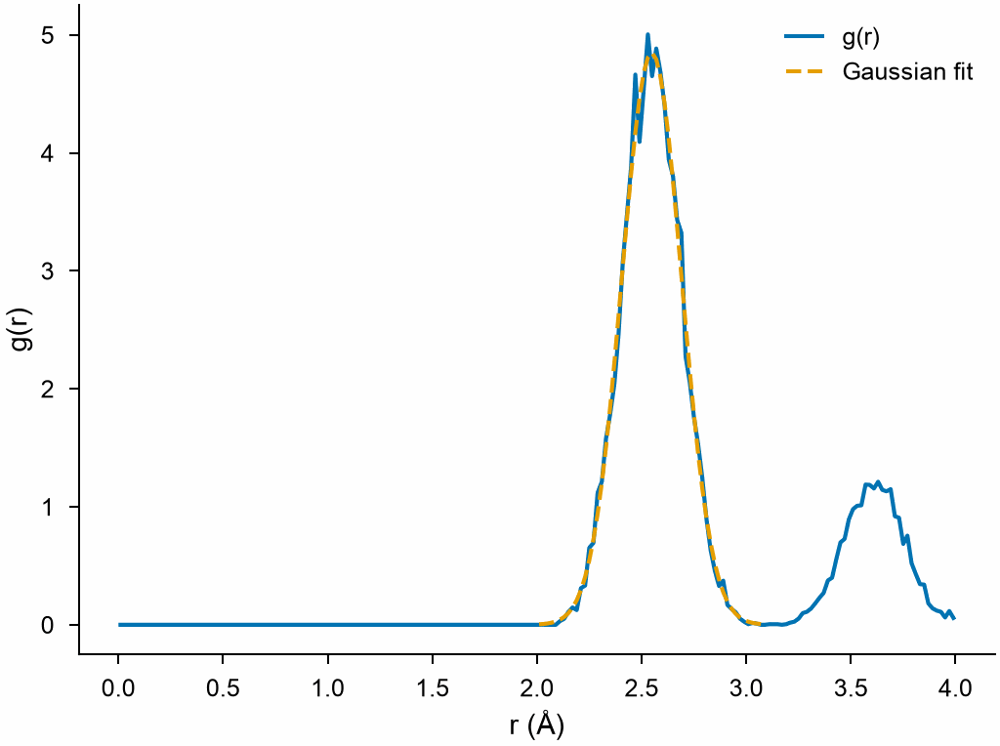

# Curve fitting

`mdapy.fitting` fits curves to values by least squares: `fit_polynomial` a
polynomial of one variable, `fit_surface` one of two, and `fit_curve` any
function with parameters, such as the decay of a correlation, the peak of a
distribution or a law of temperature. Each gives the parameters with their
standard errors and covariance, and the residuals.

```python
import numpy as np
from mdapy.analysis import RadialDistributionFunction
from mdapy.build import build_crystal
from mdapy.fitting import fit_curve, gaussian

# copper with every atom shaken by a normal distribution of 0.1 Å
copper = build_crystal("fcc", 3.615, elements="Cu", repeat=(8, 8, 8))
rng = np.random.default_rng(0)
shaken = copper.with_columns(
    positions=copper["positions"] + rng.normal(0, 0.1, (len(copper), 3))
)
rdf = RadialDistributionFunction(cutoff=4.0, bins=200).compute(shaken)

first = (rdf.r > 2.0) & (rdf.r < 3.1)  # the first peak
peak = fit_curve(gaussian, rdf.r[first], rdf.g[first])
peak["center"]  # Å, 2.548
peak[
    "width"
]  # Å, 0.143: the distance of two atoms each shaken by 0.1 Å spreads by 0.1 √2
peak.errors  # the standard errors of amplitude, center and width
```

```python
from mdapy.visualization import plot

with plot.style():
    fig, ax = plot.figure("single")
    ax.plot(rdf.r, rdf.g, label="g(r)")
    ax.plot(rdf.r[first], peak(rdf.r[first]), "--", label="Gaussian fit")
    ax.set_xlabel("r (Å)")
    ax.set_ylabel("g(r)")
    ax.legend()
    plot.save(fig, "images/curve-fitting", formats=("png",))
```



*The radial distribution function of shaken copper and the Gaussian fitted
to its first peak.*

## Polynomials and surfaces

```python
from mdapy.fitting import fit_polynomial, fit_surface

temperature = np.array([300.0, 500, 700, 900, 1100])  # K
volume = np.array([11.81, 11.90, 12.00, 12.11, 12.24])  # ų per atom
line = fit_polynomial(temperature, volume, 2)
line.coefficients  # of 1, T and T²
line.errors  # their standard errors
line(800.0), line(800.0, 1)  # the volume and its slope at 800 K

x, y = rng.random((2, 50))
z = 1 + 2 * x - y + 0.5 * x * y
surface = fit_surface(x, y, z, 2)  # every term x^i y^j with i + j up to 2
surface.powers  # (6, 2): the powers (i, j) of the terms
(
    surface(0.5, 0.5),
    surface(0.5, 0.5, dx=1),
)  # 1.625 and 2.25: the value, the slope along x
```

## Parameters

`fit_polynomial(x, y, degree, *, sigma=None, absolute_sigma=False)` and
`fit_surface(x, y, z, degree, *, sigma=None, absolute_sigma=False)`:

| Name | Type | Default | Meaning |
|---|---|---|---|
| `x`, `y` | (n,) float64 | | the points; for `fit_surface` their two coordinates, and `z` the values |
| `degree` | int32 | | the degree, or the total degree of the terms of a surface, with fewer coefficients than points |
| `sigma` | (n,) float64 | `None` | the standard deviations of the values, which weigh them by 1/σ; all equal by default |
| `absolute_sigma` | bool | `False` | take σ as the true standard deviations for the errors; otherwise scale the errors so that the residuals have unit variance |

`fit_curve(model, x, y, guess=None, *, sigma=None, absolute_sigma=False, max_steps=500, tolerance=1e-12)`:

| Name | Type | Default | Meaning |
|---|---|---|---|
| `model` | `Model` or callable | | one of `MODELS`, a `Model`, or a function `f(x, *parameters)` |
| `x` | array | | the points, as the function takes them: (n,) float64, or any array for a function of several variables |
| `y` | (n,) float64 | | the values |
| `guess` | (p,) float64 | `None` | a first guess of the parameters; by default that of the model, which a plain function must be given |
| `sigma`, `absolute_sigma` | | | as above |
| `max_steps` | int32 | 500 | the most steps |
| `tolerance` | float64 | 1e-12 | the fit has converged when a step changes the sum of squares by less than this fraction of it |

The models, with x along the curve:

| Model | Function | Parameters |
|---|---|---|
| `exponential` | A e<sup>−x/τ</sup> | `amplitude`, `time` |
| `stretched_exponential` | A e<sup>−(x/τ)<sup>β</sup></sup> | `amplitude`, `time`, `exponent` |
| `gaussian` | A e<sup>−(x−μ)²/2w²</sup> | `amplitude`, `center`, `width` |
| `lorentzian` | A w² / ((x−μ)² + w²) | `amplitude`, `center`, `width` |
| `arrhenius` | A e<sup>−E/k<sub>B</sub>T</sup>, T in K, E in eV | `prefactor`, `energy` |
| `power_law` | A x<sup>b</sup> | `prefactor`, `exponent` |

`Model(name, function, parameters, guess=None)` makes a model of a function:
`parameters` names them in the order the function takes them, and
`guess(x, y)`, if given, guesses them from the data.

## Results

| Attribute or method | Type | Meaning |
|---|---|---|
| `coefficients` | (k,) float64 | of `PolynomialFit`, of 1, x, x², ...; of `SurfaceFit`, of the terms in `powers` |
| `powers` | (k, 2) int64 | of `SurfaceFit`, the powers (i, j) of each term x<sup>i</sup> y<sup>j</sup> |
| `parameters` | (p,) float64 | of `CurveFit`, the fitted parameters, also by name: `fit["width"]` |
| `model` | `Model` | of `CurveFit`, the function and the names of its parameters |
| `errors` | float64 | the standard errors, NaN where as many values as parameters leave none to estimate them |
| `covariance` | float64 | the covariance of the coefficients or parameters |
| `residuals` | (n,) float64 | the values less the fit |
| `r_squared` | float64 | the coefficient of determination, 1 for a perfect fit |
| `steps` | int32 | of `CurveFit`, the steps the fit took |
| `fit(x)` | float64 | the fitted curve at points; `PolynomialFit(x, derivative)` and `SurfaceFit(x, y, dx=, dy=)` give derivatives too |

## Errors

[`InvalidParameter`](../../reference/api/utilities.md#mdapy.errors.InvalidParameter)
for values that are not finite or of other shapes, a degree out of range, a
σ that is not positive, a plain function without a guess, a guess of
another length, a function that is not finite at the guess, and a fit that
does not converge within `max_steps`.

## Definition

The fit minimizes the sum of squares of the weighted residuals,
$\sum_i \left(y_i - f(x_i; \mathbf p)\right)^2 / \sigma_i^2$.
Polynomials and surfaces are linear in their coefficients and are solved at
once; `fit_curve` takes steps of the Levenberg–Marquardt method from the
guess. The covariance of the parameters is
$(J^\mathsf{T} W J)^{-1}$, with $J$ the derivatives of the function with
respect to the parameters and $W$ the weights $1/\sigma_i^2$, multiplied
by the variance of the residuals, $\chi^2/(n - p)$, unless
`absolute_sigma`.

## See also

- [Interpolation](interpolation.md), through every value.
- [Equations of state](equation-of-state.md), fitted to energies at volumes.
