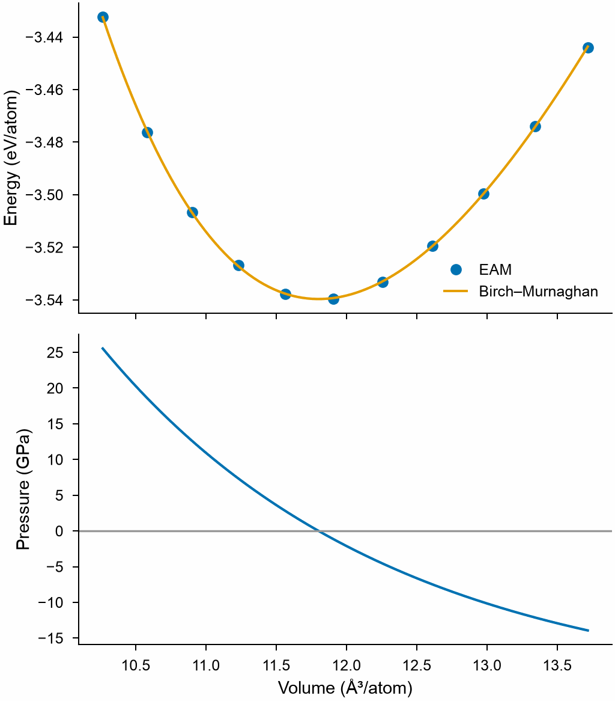

# Equations of state

`mdapy.fitting.fit_eos(volumes, energies, *, form="birch_murnaghan")` fits
an equation of state to energies at volumes: the energy at the minimum, the
volume there, the bulk modulus and its derivative with respect to the
pressure, with their standard errors, and the energy and the pressure at any
volume.

```python
import numpy as np
from mdapy.build import build_crystal
from mdapy.calculators import EAM
from mdapy.fitting import fit_eos

potential = EAM.zhou(["Cu"])
a = np.linspace(3.45, 3.80, 11)
cells = [build_crystal("fcc", s, elements="Cu") for s in a]
volumes = a**3 / 4  # ų per atom
energies = np.array([potential.compute(c, ("energy",)).energy / 4 for c in cells])

eos = fit_eos(volumes, energies)
eos.v0, eos.e0  # 11.80 ų and -3.540 eV per atom
eos.b0, eos.b0_prime  # 131.7 GPa and 4.7
eos.errors  # of e0, v0, b0 (GPa) and b0_prime
eos.pressure(11.0)  # GPa, under compression
vinet = fit_eos(volumes, energies, form="vinet")
```

```python
from mdapy.visualization import plot

fine = np.linspace(volumes.min(), volumes.max(), 200)
with plot.style():
    fig, (top, bottom) = plot.figure("single", 100, nrows=2, sharex=True)
    top.plot(volumes, energies, "o", label="EAM")
    top.plot(fine, eos.energy(fine), label="Birch–Murnaghan")
    top.set_ylabel("Energy (eV/atom)")
    top.legend()
    bottom.plot(fine, eos.pressure(fine))
    bottom.axhline(0, color="0.6", lw=0.8)
    bottom.set_ylabel("Pressure (GPa)")
    bottom.set_xlabel("Volume (ų/atom)")
    plot.save(fig, "images/equation-of-state", formats=("png",))
```



## Parameters

| Name | Type | Default | Unit | Meaning |
|---|---|---|---|---|
| `volumes` | (n,) float64 | | ų | five or more volumes, of a cell or per atom |
| `energies` | (n,) float64 | | eV | the energies at the volumes, of the same cell or per atom |
| `form` | str | `"birch_murnaghan"` | | one of `FORMS`: `"birch_murnaghan"` (third order), `"vinet"` or `"murnaghan"` |

## Results

An `EquationOfState`:

| Attribute or method | Type | Unit | Meaning |
|---|---|---|---|
| `form` | str | | the form fitted |
| `e0` | float64 | eV | the energy at the minimum |
| `v0` | float64 | ų | the volume at the minimum |
| `b0` | float64 | GPa | the bulk modulus there |
| `b0_prime` | float64 | | its derivative with respect to the pressure |
| `errors` | (4,) float64 | | the standard errors of `e0`, `v0`, `b0` and `b0_prime` |
| `residuals` | (n,) float64 | eV | the energies less the fit |
| `r_squared` | float64 | | the coefficient of determination |
| `energy(volume)` | float64 | eV | the energy at volumes |
| `pressure(volume)` | float64 | GPa | −dE/dV at volumes |

## Errors

[`InvalidParameter`](../../reference/api/utilities.md#mdapy.errors.InvalidParameter)
for an unknown form, fewer than five volumes, volumes that are not positive,
values that are not finite, and energies without a minimum within the
volumes.

## Definition

With $\eta = (V_0/V)^{2/3}$ and $x = (V/V_0)^{1/3}$:

$$
E_\text{BM} = E_0 + \frac{9 V_0 B_0}{16}\left[(\eta - 1)^3 B_0' + (\eta - 1)^2 (6 - 4\eta)\right],
$$

$$
E_\text{Vinet} = E_0 + \frac{2 B_0 V_0}{(B_0' - 1)^2}\left[2 - \left(5 + 3B_0'(x - 1) - 3x\right) e^{-\frac{3}{2}(B_0' - 1)(x - 1)}\right],
$$

$$
E_\text{Murnaghan} = E_0 + \frac{B_0 V}{B_0'}\left[\frac{(V_0/V)^{B_0'}}{B_0' - 1} + 1\right] - \frac{V_0 B_0}{B_0' - 1}.
$$

The third-order Birch–Murnaghan energy is a cubic in $V^{-2/3}$, whose least
squares are linear; it also gives the first guess of the other forms, which
`fit_curve` then fits.

!!! quote "Please cite"
    [Birch (1947)](../../reference/references.md#birch1947) for the
    Birch–Murnaghan form, [Vinet et al. (1987)](../../reference/references.md#vinet1987)
    for the Vinet form and [Murnaghan (1944)](../../reference/references.md#murnaghan1944)
    for the Murnaghan form.

## See also

- [Curve fitting](curve-fitting.md).
- [The quasi-harmonic approximation](../simulation/quasi-harmonic.md), which
  fits the free energy at each temperature in the same way.
