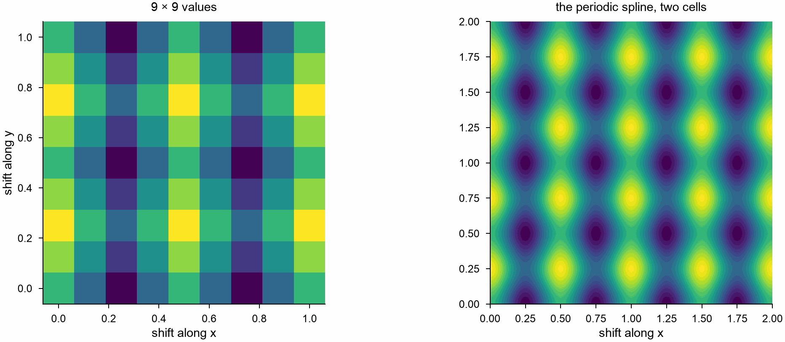

# Interpolation

`mdapy.fitting.Spline` draws a cubic spline through values at points on a
line, and `GridSpline` one through values on a rectangular grid: a curve or
a surface through every value, with continuous first and second
derivatives, for values between the points, slopes, curvatures and
integrals.

```python
import numpy as np
from mdapy.build import build_crystal
from mdapy.calculators import EAM
from mdapy.fitting import Spline

# the energy per atom of copper at eight lattice constants
potential = EAM.zhou(["Cu"])
a = np.linspace(3.45, 3.80, 8)
energy = np.array(
    [
        potential.compute(build_crystal("fcc", s, elements="Cu"), ("energy",)).energy
        / 4
        for s in a
    ]
)

curve = Spline(a, energy)
fine = np.linspace(3.45, 3.80, 3501)
best = fine[np.argmin(curve(fine))]  # Å, 3.615
curve(best)  # eV, -3.540
curve(best, 2)  # eV/Ų, 7.09: the curvature at the minimum
curve.integral(3.5, 3.7)  # eV Å
curve(3.9)  # NaN: no values beyond the points
```

A `Spline` takes several curves through the same points at once, as the
columns of `y`; its values then have one more axis.

## Parameters

`Spline(x, y, *, boundary="not-a-knot", slopes=None, extrapolate=False)`:

| Name | Type | Default | Meaning |
|---|---|---|---|
| `x` | (n,) float64 | | the points, strictly increasing, two or more |
| `y` | (n,) or (n, m) float64 | | the values at the points, or those of m curves |
| `boundary` | str | `"not-a-knot"` | at the two ends, one of `BOUNDARIES`: `"not-a-knot"`, the third derivative continuous at the second and the second-last point; `"natural"`, second derivatives zero; `"clamped"`, first derivatives given by `slopes`; `"periodic"`, a periodic curve whose first and last values are equal |
| `slopes` | (2,) or (2, m) float64 | `None` | the first derivatives at the two ends, for `"clamped"` |
| `extrapolate` | bool | `False` | continue the end cubics beyond the points; otherwise values there are NaN, or repeat with the period for `"periodic"` |

`GridSpline(x, y, z, *, boundary="not-a-knot", extrapolate=False)`:

| Name | Type | Default | Meaning |
|---|---|---|---|
| `x`, `y` | (nx,) and (ny,) float64 | | the points along the two axes, each strictly increasing, two or more |
| `z` | (nx, ny) float64 | | the values on the grid |
| `boundary` | str or (str, str) | `"not-a-knot"` | the condition along each axis, as for `Spline`, except `"clamped"`; `"periodic"` for a surface that repeats with the grid |
| `extrapolate` | bool | `False` | as for `Spline` |

Three or four points make one cubic or parabola with `"not-a-knot"`, and two
make a straight line.

## Results

| Method or attribute | Returns |
|---|---|
| `Spline(at, derivative=0)` | float64 values, or a derivative of order 1 to 3, at points of any shape, followed by (m,) for m curves |
| `Spline.integral(start, end)` | float64, or (m,) float64, the integral from start to end |
| `GridSpline(x, y, *, dx=0, dy=0)` | float64 values or derivatives at points, x and y broadcast together |
| `x`, `y`, `boundary` | the points, the values and the conditions given |

A surface of energies over the shifts of a lattice repeats with the cell of
the lattice; a coarse periodic grid of such values gives the whole surface:

```python
from mdapy.fitting import GridSpline
from mdapy.visualization import plot

# an energy on the shifts of a square cell: a 9 by 9 grid, its last row and
# column equal to its first
x = y = np.linspace(0.0, 1.0, 9)
z = np.cos(2 * np.pi * x)[:, None] ** 2 + 0.5 * np.sin(2 * np.pi * y)[None, :] ** 2
surface = GridSpline(x, y, z, boundary="periodic")
fine = np.linspace(0.0, 2.0, 201)  # two cells
fx, fy = np.meshgrid(fine, fine, indexing="ij")
with plot.style():
    fig, (left, right) = plot.figure("double", 70, ncols=2)
    left.pcolormesh(x, y, z.T, shading="nearest")
    left.set_title("9 × 9 values")
    right.pcolormesh(fine, fine, surface(fx, fy).T, shading="gouraud")
    right.set_title("the periodic spline, two cells")
    for ax in (left, right):
        ax.set_aspect("equal")
        ax.set_xlabel("shift along x")
    left.set_ylabel("shift along y")
    plot.save(fig, "images/interpolation", formats=("png",))
```



## Errors

[`InvalidParameter`](../../reference/api/utilities.md#mdapy.errors.InvalidParameter)
for points that are not strictly increasing or not finite, values of
another shape, an unknown boundary, slopes missing or of the wrong shape,
periodic values whose ends differ, a derivative out of range, and the limits
of an integral beyond the points of a spline that does not extrapolate.

## Definition

On each interval between neighboring points the spline is a cubic. The
cubics meet with equal values, first and second derivatives at every point,
which leaves two conditions to choose, set by `boundary`. A `GridSpline` is
the spline along x of the splines along y: at every point of the grid it
takes the values given, and along any line of the grid it is the `Spline`
through them.

## See also

- [Curve fitting](curve-fitting.md), which passes near noisy values rather
  than through them.
