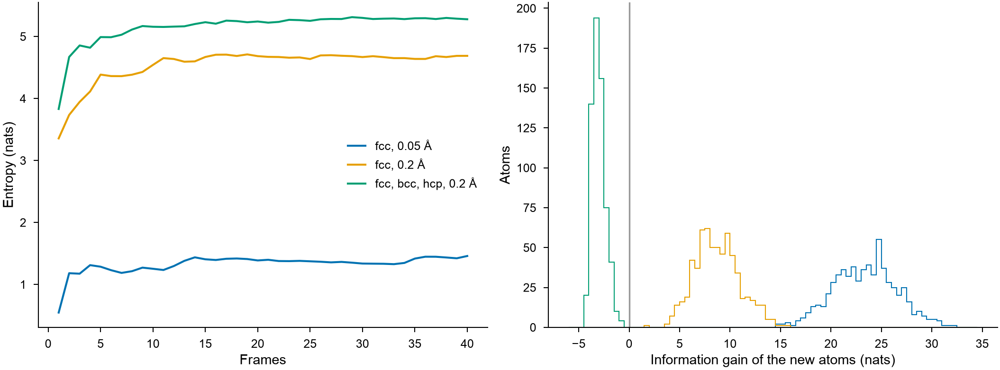

# Coverage of descriptor space

A training set covers some of the environments its atoms can have, and a
model is reliable only among them. `entropy` measures how much of
descriptor space a set of environments covers, and `information_gain` what
new structures add to it: the methods of QUESTS, which need no labels and do
not depend on the model. `QUESTS` gives the descriptor they were made for:
the distances of each atom to its nearest neighbors and between them.

```python
import numpy as np
from mdapy.build import build_crystal
from mdapy.mlip import QUESTS, entropy, information_gain, perturb
from mdapy.visualization import plot

quests = QUESTS()  # 32 nearest neighbors within 5 Å
fcc = build_crystal("fcc", 4.05, elements="Al", repeat=(3, 3, 3))
bcc = build_crystal("bcc", 3.24, elements="Al", repeat=(4, 4, 4))
hcp = build_crystal("hcp", 2.86, elements="Al", repeat=(4, 3, 3))


def descriptors(frames):
    """The descriptors of the atoms of all frames, one after the other."""
    return np.concatenate([quests.descriptors(frame) for frame in frames])


# three training sets of 40 frames, shaken and strained by up to 3 %
mixed = zip(
    perturb(fcc, 14, displacement=0.2, seed=2),
    perturb(bcc, 14, displacement=0.2, seed=3),
    perturb(hcp, 14, displacement=0.2, seed=4),
)
sets = {
    "fcc, 0.05 Å": perturb(fcc, 40, displacement=0.05, seed=0),
    "fcc, 0.2 Å": perturb(fcc, 40, displacement=0.2, seed=1),
    "fcc, bcc, hcp, 0.2 Å": [frame for three in mixed for frame in three][:40],
}
# new structures: bcc shaken by 0.1 Å
new = descriptors(perturb(bcc, 5, displacement=0.1, seed=5))

bins = np.arange(-6, 35, 0.5)  # nats
with plot.style():
    fig, (left, right) = plot.figure("double", ncols=2)
    for name, frames in sets.items():
        counts = range(1, len(frames) + 1)
        left.plot(
            counts, [entropy(descriptors(frames[:n])) for n in counts], label=name
        )
        gain = information_gain(new, descriptors(frames))
        right.hist(gain, bins=bins, histtype="step", label=name)
    left.set_xlabel("Frames")
    left.set_ylabel("Entropy (nats)")
    left.legend()
    right.axvline(0, color="0.6", lw=0.8)
    right.set_xlabel("Information gain of the new atoms (nats)")
    right.set_ylabel("Atoms")
    plot.save(fig, "images/coverage", formats=("png",))
```



*Three training sets of aluminium, each of 40 frames of 72 to 128 atoms.
Left: the entropy of the first frames of each set. Fcc shaken by 0.05 Å
levels off near 1.4 nats, as each frame repeats the environments of the
others; shaken by 0.2 Å, near 4.7; with bcc and hcp, it reaches 5.3. Right:
what bcc shaken by 0.1 Å adds to each set. To the sets of fcc, every atom is
new (above zero, the further the newer); to the set with bcc, none is.*

## Definition

For an atom i, its k = `num_neighbors` nearest neighbors j closer than the
cutoff r<sub>c</sub>, nearest first, give the two parts of the descriptor:

$$
x^{(1)}_j = \frac{w(r_{ij})}{r_{ij}},
\qquad
x^{(2)}_s = \frac{1}{k} \sum_j \left[ \frac{\sqrt{w(r_{ij}) w(r_{il})}}{r_{jl}} \right]_{(s)},
\qquad
w(r) = \left( 1 - \frac{r^2}{r_c^2} \right)^2
$$

where [·]<sub>(s)</sub> is the s-th largest over the other neighbors l of j,
for s = 1 … k − 1. A neighbor the atom lacks within the cutoff gives zeros.
The descriptor has 2k − 1 values and does not depend on the elements.

The entropy of N points x<sub>i</sub>, such as the descriptors of all atoms
of a training set, and the information gain of a point y relative to them
are those of a Gaussian density of bandwidth h about each point:

$$
H = -\frac{1}{N} \sum_{i=1}^{N} \ln \left[ \frac{1}{N} \sum_{j=1}^{N} e^{-|x_i - x_j|^2 / 2h^2} \right],
\qquad
\delta H(y) = -\ln \sum_{j=1}^{N} e^{-|y - x_j|^2 / 2h^2}
$$

H is zero when all points are the same and ln N when no two are close. It
grows while new points fill new regions and levels off where they fall
among the earlier ones; it may fall a little, since points added among
others raise the density there. δH is negative for a point among the
reference points and positive away from them, growing with the square of
its distance from the nearest. QUESTS found that the errors of a model grow
with the δH of the environments of a structure relative to its training
set: δH > 0 marks where a model extrapolates. The fraction of the atoms of a
set whose δH relative to another set is at most zero is the overlap of
QUESTS.

The bandwidth 0.015 Å⁻¹ is that QUESTS chose for its descriptor with a
cutoff of 5 Å and 32 neighbors. Points of other descriptors, such as
[SOAP](soap.md), need a bandwidth of their own, in their units. Entropies
and gains compare only for one descriptor and one bandwidth.

## Parameters

`QUESTS(cutoff=5.0, num_neighbors=32)`

| Name | Type | Default | Unit | Meaning |
|---|---|---|---|---|
| `cutoff` | float64 | 5.0 | Å | the cutoff r<sub>c</sub>, above zero |
| `num_neighbors` | int32 | 32 | | the number k of nearest neighbors, at least 1 |

`descriptors(system, *, neighbors=None, progress=None, cancel=None)` takes
a system, and optionally a [neighbor list](../../basics/neighbor.md)
reaching `cutoff`. `dimension` is the number of values per atom,
2 `num_neighbors` − 1.

`entropy(points, bandwidth=0.015, *, progress=None, cancel=None)` and
`information_gain(points, reference, bandwidth=0.015, *, progress=None, cancel=None)`:

| Name | Type | Default | Meaning |
|---|---|---|---|
| `points` | (N, D) float64 | | the points, such as the descriptors of the atoms of a training set, or of new structures for `information_gain` |
| `reference` | (K, D) float64 | | the points to measure from, such as the descriptors of the atoms of a training set |
| `bandwidth` | float64 | 0.015 | the width h of the Gaussians, in the units of the points |

Both compare every point with every reference point, N² or NK distances, on
`get_num_threads()` threads.

## Results

| Call | Type | Unit | Meaning |
|---|---|---|---|
| `descriptors(system)` | (N, dimension) float64 | Å⁻¹ | the k values of x<sup>(1)</sup>, nearest first, then the k − 1 of x<sup>(2)</sup>, largest first |
| `entropy(points)` | float64 | nats | the entropy H of the points |
| `information_gain(points, reference)` | (N,) float64 | nats | δH of each point relative to the reference |

The values are those of the [QUESTS package](https://github.com/dskoda/quests)
of its authors, but for these differences:

- `information_gain` is taken from the nearest reference point, so that it
  stays finite far from all of them, where QUESTS gives infinity as each
  Gaussian falls below the smallest double.
- Where the k-th and the next neighbor of an atom are at the same distance,
  as in a perfect crystal, the second part depends on which of them is
  taken: MDAPY takes them by atom and then periodic image, QUESTS in the
  order of its search, so that the two may differ there. Shaken atoms, as in
  training sets, have no such ties.
- For a box periodic along some directions only, MDAPY counts the periodic
  images along those; QUESTS takes a box that is not periodic along every
  direction as free.
- QUESTS rounds the fractional coordinates of the atoms to 12 digits.

## Errors

`QUESTS` raises `InvalidParameter` for a cutoff that is not above zero and
finite, or a `num_neighbors` that is not an integer of at least 1;
`descriptors` raises it for a neighbor list built for other positions or
reaching less than `cutoff`. `entropy` and `information_gain` raise it for
points that are not (N, D) with at least one point, values that are not
finite, points and reference of different D, and a bandwidth that is not
above zero.

!!! quote "Please cite"
    [Schwalbe-Koda et al. (2025)](../../reference/references.md#schwalbe-koda2025)

## See also

- [Uncertainty and novelty](uncertainty.md): the distance of a frame from a
  training set, and the spread of a committee of models.
- [Choosing frames](selection.md).
- [Perturbed structures](perturbation.md).
