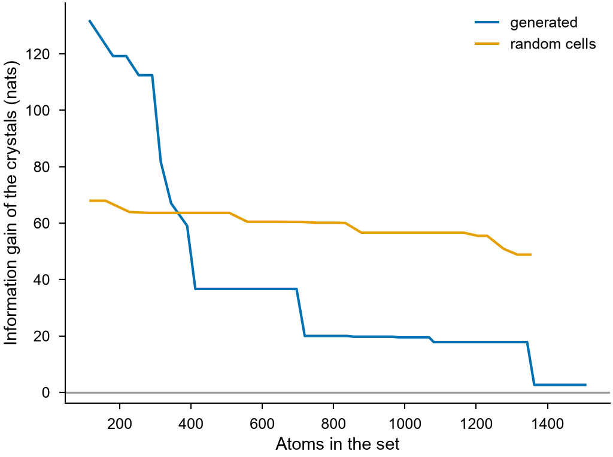

# Generated structures

`generate_structures` makes the structures of a training set without a
model or a calculation: small periodic cells of random shape, size and
composition whose atoms, box and elements are moved, one structure after
the other, as long as they raise the entropy of the descriptors of the set.
The structures spread over the environments atoms can have, from compressed
to expanded, ordered to disordered, rather than around a few crystals. They
complement, not replace, structures near equilibrium such as
[perturbed crystals](perturbation.md), and an existing training set can be
given for them to complement.

```python
import numpy as np
from mdapy.build import build_crystal
from mdapy.io import write
from mdapy.mlip import QUESTS, generate_structures, information_gain, perturb
from mdapy.visualization import plot

# aluminium, 16.6 ų per atom in its crystal, from half to twice that
frames = generate_structures("Al", 300, volume=(8.3, 33.2), seed=0)
write("generated.xyz", frames)

# the same random cells, not moved
cells = generate_structures("Al", 300, volume=(8.3, 33.2), steps=0, seed=0)

# shaken crystals that neither set was made from
quests = QUESTS()
fcc = build_crystal("fcc", 4.05, elements="Al", repeat=(3, 3, 3))
bcc = build_crystal("bcc", 3.24, elements="Al", repeat=(3, 3, 3))
squeezed = fcc.with_box(fcc.box.matrix * 0.8, scale_positions=True)
crystals = [fcc, bcc, squeezed]
test = np.concatenate(
    [
        quests.descriptors(f)
        for c in crystals
        for f in perturb(c, 2, displacement=0.1, seed=1)
    ]
)

with plot.style():
    fig, ax = plot.figure("single")
    for name, structures in (("generated", frames), ("random cells", cells)):
        atoms, gain = [], []
        for n in range(10, len(structures) + 1, 5):
            x = np.concatenate([quests.descriptors(f) for f in structures[:n]])
            atoms.append(len(x))
            gain.append(np.median(information_gain(test, x)))
        ax.plot(atoms, gain, label=name)
    ax.axhline(0, color="0.6", lw=0.8)
    ax.set_xlabel("Atoms in the set")
    ax.set_ylabel("Information gain of the crystals (nats)")
    ax.legend()
    plot.save(fig, "images/generation", formats=("png",))
```



*What shaken fcc, bcc and compressed fcc aluminium would add to each set,
by the median [information gain](coverage.md) of their atoms: the lower,
the better the set covers them, though no structure was made from a
crystal. The first structures go to the edges of the volumes and shapes
allowed and cover the crystals less than random cells; from about 400 atoms
on, the set covers them better, down to 3 nats at 1500 atoms against 50 for
the random cells. These stop raising the entropy after 150 structures,
where their generation stops.*

## How it works

Each structure starts as a cell of a random number of atoms within
`atoms`, a random volume per atom within `volume`, drawn on a logarithmic
scale, and a random shape; with several elements, its composition is drawn
uniformly over all compositions, and each atom's element from it. The atoms
are placed at random, no two closer than `closest` times the sum of their
covalent radii, also across the periodic boundaries.

The points of the set are the descriptors of its atoms (`per="atom"`), or
their mean in each structure (`per="structure"`), each value divided by its
standard deviation over 20 random cells. The entropy of the set is that of
a Gaussian of these points: half the logarithm of the determinant of their
covariance, with a thousandth added to its diagonal. `steps` times, the
structure is moved, one of:

- in two moves out of ten, the box strained by a symmetric strain of
  components of 0.03, the atoms with it, when the volume per atom stays
  within `volume` and no face of the box is narrower than a quarter of its
  longest edge;
- with atoms of several elements, in one move out of ten, the elements of
  two of them swapped;
- in the other moves, an atom displaced by a Gaussian of 0.3 times the mean
  covalent radius of the elements;

and the move is taken when it raises the entropy of the set with the
structure, keeps the atoms apart and, with a `calculator`, keeps the energy
per atom at most `max_energy`. The structure is kept when it raises the
entropy of the set, and joins it.

The descriptor of an atom is in a fixed basis, on the distance of each
neighbor over the sum of their covalent radii, s = r / (R<sub>i</sub> + R<sub>j</sub>):
the sums over the neighbors of the radial functions of NEP,
f<sub>k</sub>(s) = [T<sub>k</sub>(2(s/s<sub>c</sub> − 1)² − 1) + 1] f<sub>c</sub>(s) / 2,
k < 8, with T<sub>k</sub> the Chebyshev polynomials and
f<sub>c</sub>(s) = [1 + cos(π s / s<sub>c</sub>)] / 2 up to s<sub>c</sub> = 2.4;
the sums over pairs of neighbors j, k up to s<sub>c</sub> = 1.7 of
f<sub>n</sub>(s<sub>j</sub>) f<sub>n</sub>(s<sub>k</sub>) P<sub>l</sub>(cos θ<sub>jk</sub>),
n < 4, 1 ≤ l ≤ 4; and with several elements, the sums of the first two
radial functions over the neighbors of each element: 24 values with one
element, 24 + 2 per element with several.

The generation stops after `count` structures, when fewer than `tolerance`
of the last 50 candidates were kept, or when 100 in a row were not.

## Parameters

`generate_structures(elements, count, *, volume, atoms=(2, 24), closest=0.75, per="atom", steps=200, reference=None, calculator=None, max_energy=None, tolerance=0.0, seed=None, progress=None, cancel=None)`

| Name | Type | Default | Unit | Meaning |
|---|---|---|---|---|
| `elements` | str or sequence of str | | | the elements; with several, each structure has a random composition |
| `count` | int32 | | | the most structures |
| `volume` | tuple of float64 | | ų | the smallest and largest volume per atom, such as half and twice that of the crystal |
| `atoms` | tuple of int32 | (2, 24) | | the fewest and most atoms of a structure |
| `closest` | float64 | 0.75 | | the shortest distance of two atoms, as a fraction of the sum of their covalent radii ([Cordero et al. 2008](../../reference/references.md#cordero2008)) |
| `per` | str | `"atom"` | | the points of the set: `"atom"`, the descriptor of each atom; `"structure"`, their mean in each structure |
| `steps` | int32 | 200 | | the moves tried on each structure; 0 keeps the random cells that raise the entropy |
| `reference` | sequence of `System` | `None` | | a training set of the elements, whose atoms are in the set from the start, for the structures to complement |
| `calculator` | calculator | `None` | | computes the energy of each structure and move, with `max_energy` |
| `max_energy` | float64 | `None` | eV/atom | the highest energy per atom of a structure |
| `tolerance` | float64 | 0.0 | | stop when fewer than this fraction of the last 50 candidates was kept |
| `seed` | int64 or `numpy.random.Generator` | `None` | | seed of the random numbers |

With `max_energy`, the moves push the structures toward the bound: the
entropy rises toward the edges of what is allowed. A bound some eV per atom
above the crystal keeps the structures within what DFT converges and a model
should learn.

## Results

A list of systems in the order they were kept, at most `count`: periodic
cells with an `element` column, the atoms wrapped into the box, without
energies or forces. The first n structures make a set of their own, so that
sets of several sizes come from one generation.

## Errors

`generate_structures` raises `InvalidParameter` for no element, an unknown
element or one without a covalent radius, an element given twice; a count,
`atoms` or `steps` that is not a non-negative integer or a pair of positive
ones; a `volume` that is not a pair of positive numbers, the smaller first;
a `closest` not above zero; an unknown `per`; `calculator` without
`max_energy` or the reverse; a `tolerance` outside 0 to below 1; a
`reference` that is not a sequence of systems or holds other elements; and
volumes too small for the atoms to be placed apart in 200 cells in a row. It
raises `MissingProperty` for a reference frame without an `element` column.

!!! quote "Please cite"
    [Subramanyam and Perez (2025)](../../reference/references.md#subramanyam2025)
    and [Bochkarev et al. (2026)](../../reference/references.md#bochkarev2026),
    whose method of raising the entropy of a Gaussian of the descriptors this
    follows.

## See also

- [Coverage of descriptor space](coverage.md): the entropy and the
  information gain of the QUESTS descriptor, to compare sets.
- [Perturbed structures](perturbation.md).
- [Training sets from VASP](vasp.md): computing the structures with DFT.
