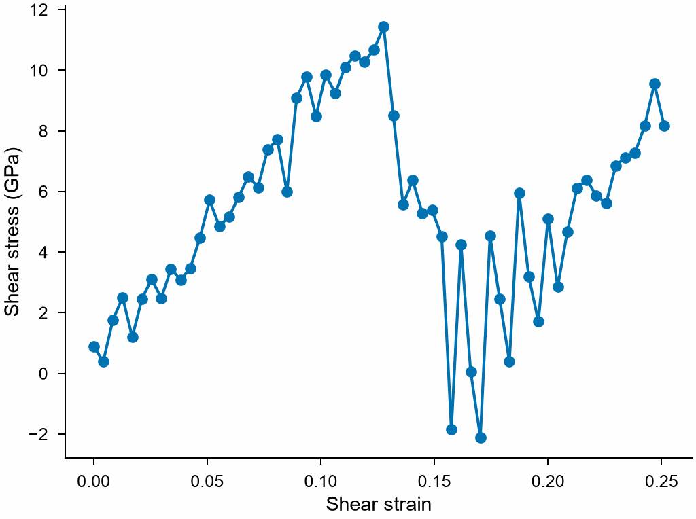

# Groups and controls

<p class="runs-on" markdown>**Runs on** the processor · the [GPU](gpu.md) · [LAMMPS](in-lammps.md) as `fix setforce`, `move`, `addforce` and `langevin`</p>

A run of [molecular dynamics](running.md) can hold some atoms still, move
others at a velocity, push others and keep others at a temperature: the
controls of the run. Each acts on
a group, an (N,) bool mask over the atoms of the system, and lasts for the
run it is given to, through `controls` of `run` or `iterate`. Others act on the
whole run: a [`Deform`](deformation.md) deforms the box, an
[`AdaptiveTimestep`](adaptive-timestep.md) sets the time step, a
[`Switch`](switching.md) turns the potential into another, and a [`Wall`](walls.md) or
an [`Indenter`](indentation.md) pushes the atoms that reach it. All of them act in
MDAPY, on the processor and on the [GPU](gpu.md); all but the `Switch` act in LAMMPS
too.

Copper sheared between two walls at 300 K: the bottom wall held, the top
one moved along x at 0.2 Å/ps, 20 m/s, the force of the crystal on it
recorded.

```python
import numpy as np

import mdapy
from mdapy.build import build_crystal
from mdapy.calculators import EAM
from mdapy.simulation import Hold, MolecularDynamics, Move

crystal = build_crystal("fcc", 3.615, elements="Cu", repeat=(6, 6, 8))
crystal = crystal.with_box(mdapy.Box(crystal.box.matrix, pbc=(True, True, False)))
z = crystal["positions"][:, 2]
bottom, top = z < 5.0, z > z.max() - 5.0  # the walls, two layers of cells each
copper = EAM.zhou(["Cu"])

with MolecularDynamics(crystal, copper, timestep=0.002) as md:
    md.velocities(300, seed=1)
    md.run(2000, ensemble="nvt", temperature=300, controls=[Hold(bottom), Hold(top)])
    md.run(
        15000,
        ensemble="nvt",
        temperature=300,
        thermo=250,
        controls=[Hold(bottom), Move(top, (0.2, 0.0, 0.0), name="top")],
    )
    thermo = md.thermo
```

`thermo` records `top_force`, the force of the potential on the atoms of the
top wall; the stress of the crystal is the opposite force per area of the
walls, and its strain the distance the top wall went over the distance
between the walls:

```python
from mdapy.visualization import plot

shear = thermo.filter(thermo["top_force"].is_not_null())
time = shear["time"].to_numpy() - shear["time"][0]
area = crystal.box.matrix[0, 0] * crystal.box.matrix[1, 1]
gap = crystal["positions"][top, 2].mean() - crystal["positions"][bottom, 2].mean()
strain = 0.2 * time / gap
stress = -np.stack(shear["top_force"])[:, 0] / area * 160.21766  # eV/ų to GPa

with plot.style():
    fig, ax = plot.figure("single")
    ax.plot(strain, stress, marker="o", markersize=3)
    ax.set(xlabel="Shear strain", ylabel="Shear stress (GPa)")
    plot.save(fig, "images/controls-shear", formats=("png",))
```



*The shear stress of copper sheared along [100] on (001) at 300 K. It rises
at first by 68 GPa per unit strain, near the elastic constant C44 = 75 GPa
of this potential at 0 K, softer at 300 K; at about 11 GPa the crystal
yields and the stress falls, to rise again as the walls go on. Each point is
the force at one step, which the vibrations of the atoms shake.*

## Controls

| Control | Meaning |
|---|---|
| `Hold(mask, *, directions="xyz")` | the atoms keep still along the axes `directions` of the system, any of `"x"`, `"y"` and `"z"`: their velocities there are zero and their forces do nothing, as a `movable` column that is False there |
| `Move(mask, velocity, *, name=None)` | the atoms move together at `velocity`, (3,) float64 in Å/ps in the axes of the system, whatever the forces on them; with a `name`, `thermo` records `<name>_force`, the force of the potential on them |
| `AddForce(mask, force)` | adds `force`, (3,) float64 in eV/Å in the axes of the system, to each atom (LAMMPS `fix addforce`) |
| `Langevin(mask, temperature, *, damping=None, seed=None, name=None)` | a heat bath: friction and random forces on the atoms of the group alone, as the `"langevin"` thermostat of `run` gives every atom; with a `name`, `thermo` records `<name>_energy`, the heat in eV it gave the group since the run began, negative when it took heat away |
| `Deform(*, xx=0.0, yy=0.0, zz=0.0, yz=0.0, xz=0.0, xy=0.0, kind="engineering")` | the box stretched, compressed or sheared at constant strain rates, the atoms carried with it: see [Deformation](deformation.md) |
| `AdaptiveTimestep(max_distance, *, min_timestep=None, max_timestep=None, every=1)` | the time step of the fastest atom, in which no atom moves more than `max_distance`: see [Adaptive time step](adaptive-timestep.md) |
| `Switch(target, *, start=0.0, stop=1.0, name=None)` | the potential turned into another along the run, for thermodynamic integration: see [Switching between potentials](switching.md) |
| `Wall(axis="z", *, side="low", position=None, velocity=0.0)` | a flat wall that reflects the atoms, still or moving as a piston: see [Walls](walls.md) |
| `Indenter(shape="sphere", *, center=None, radius=None, axis=None, position=None, side=None, stiffness=10.0, velocity=None, name=None)` | a virtual indenter that pushes the atoms out of a sphere, a cylinder or the region beyond a plane, the force on it recorded: see [Indentation](indentation.md) |

| Parameter | Type | Default | Unit | Meaning |
|---|---|---|---|---|
| `mask` | (N,) bool | | | the atoms of the group |
| `directions` | str | `"xyz"` | | the axes along which `Hold` holds them |
| `velocity` | (3,) float64 | | Å/ps | the velocity of the atoms `Move` moves |
| `force` | (3,) float64 | | eV/Å | the force `AddForce` adds to each atom |
| `temperature` | float64 or (float64, float64) | | K | the temperature of a `Langevin` bath, or its values at the start and the end of the run |
| `damping` | float64 | 100 time steps | ps | the damping time of a `Langevin` bath |
| `seed` | int32 | `None` | | seed of the random forces of a `Langevin` bath, positive; unpredictable when `None` |
| `name` | str | `None` | | a word: the column `<name>_force` or `<name>_energy` of `thermo` |

## How they act

- The order of the controls in `controls` does not matter. In each step, after the
  atoms move, the [walls](walls.md) put back the atoms that passed them; then come the
  forces of the potential, the force on each named `Move` group is recorded, the
  [indenters](indentation.md) and `AddForce` add theirs, and last `Hold` and `Move`
  set the velocities of their atoms. The baths act at each half step, as the
  thermostat does. In LAMMPS the indenters and the added forces are defined first,
  as LAMMPS applies its fixes in the order they are defined.
- The velocities of held and moved atoms are set at the start of the run,
  and stay: the steps of the integrator and the thermostat leave them, and
  their forces do nothing.
- The temperature, that of `thermo` and that the thermostat holds, counts
  the directions that move freely, those no control or `movable` column
  holds or moves; with atoms held or moved, the total momentum is not kept,
  and no direction is taken away for it. The kinetic and total energies are
  those of all the atoms.
- `<name>_force` is the force of the potential, without the forces controls
  add, in eV/Å in the axes of the system; it is null in the rows of the runs
  without that control.
- An added force does work on the atoms but has no part in the virial: the
  pressure and stress are those of the potential and the velocities.
- A `Langevin` bath takes the place of the thermostat of the run, with
  `"nve"` or `"nph"`: a hot bath at one end of a crystal and a cold one at the
  other drive heat through it, and borders that take up the heat of a
  collision cascade keep the rest at its temperature. The energy of the atoms
  changes by the heat the baths give, to the error of the integrator. Each
  bath draws its random forces in MDAPY as the `"langevin"` thermostat does,
  over half steps; in LAMMPS it is a `fix langevin`, whose random forces
  differ, so the runs agree in their averages.
- Atoms held or moved by a control do not go together with a barostat or a
  `Deform`: the box would carry the walls.
- In LAMMPS the controls are its fixes: `setforce` with `velocity set` for
  `Hold`, `move linear` for `Move`, `addforce` for `AddForce`, and the
  ensemble on the atoms that move freely, whose temperature counts the
  same directions; the runs are those of MDAPY, step by step. Atoms held
  along some directions only need there a box whose first vector is along x
  and second in the xy plane, the axes of LAMMPS.
- On the [GPU](gpu.md) the controls act on the device as on the processor,
  their groups following the atoms; a bath draws its random forces there as
  the GPU's `"langevin"` thermostat does, the same for the same seed, other
  than those of the processor.

## Errors

`run` and `iterate` raise `InvalidParameter` for a control that is not a
`Hold`, `Move`, `AddForce`, `Langevin`, `Deform`, `AdaptiveTimestep`, `Switch`, `Wall` or `Indenter`, a group of another number of atoms,
an atom both held and moved, moved by two controls, moved and in a bath, or
in two baths, two controls of one name, held or moved atoms with a barostat or a `Deform`,
a bath with the thermostat of `"nvt"` or `"npt"`, on the GPU more than 31
groups moved with a name or bathed, and, in LAMMPS, more than 24 controls or
atoms held along some directions in a box not in the form of LAMMPS. The controls raise it for a mask that is not
(N,) bool, `directions` other than some of x, y and z, a velocity or force
that is not three finite numbers, a temperature that is not positive, a
damping that is not positive, a seed that is not a positive integer, and a
name that is not a word.
