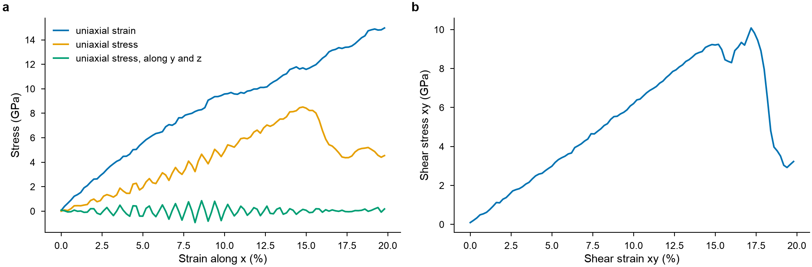

# Deformation

<p class="runs-on" markdown>**Runs on** the processor · the [GPU](gpu.md) · [LAMMPS](in-lammps.md) as `fix deform`</p>

`Deform`, a [control](controls.md) of a run of
[molecular dynamics](running.md), stretches, compresses or shears the box at
constant rates, the atoms carried with it: the loading of a tensile, a
compression or a shear test.

Copper at 300 K stretched along x by 2 % of its length every ps to 20 %, once
with its sides held (uniaxial strain), once with them free under zero stress, a
barostat on y and z (uniaxial stress), and sheared in the xy plane at the same
rate:

```python
import numpy as np

from mdapy.build import build_crystal
from mdapy.calculators import EAM
from mdapy.simulation import Deform, MolecularDynamics

crystal = build_crystal("fcc", 3.615, elements="Cu", repeat=(6, 6, 6))
copper = EAM.zhou(["Cu"])
rate = 0.02  # 1/ps

runs = {
    "uniaxial strain": {"ensemble": "nvt", "controls": Deform(xx=rate)},
    "uniaxial stress": {
        "ensemble": "npt",
        "pressure": 0.0,
        "barostat": "aniso",
        "controls": Deform(xx=rate),
    },
    "shear": {"ensemble": "nvt", "controls": Deform(xy=rate)},
}
curves = {}
for name, options in runs.items():
    with MolecularDynamics(crystal, copper, timestep=0.002) as md:
        md.velocities(300, seed=1)
        md.run(2500, ensemble="npt", temperature=300, pressure=0.0, barostat="aniso")
        start = len(md.thermo)
        md.run(5000, temperature=300, thermo=50, **options)
        pulled = md.thermo[start:]
    time = pulled["time"].to_numpy() - pulled["time"][0]
    curves[name] = (rate * time, np.stack(pulled["stress"].to_numpy()))
```

The strain is the rate times the time since the run began: each length grows by
the rate times its length at the start every ps, and the tilt xy by the rate
times the length along y. `stress` of `thermo` is in the order xx, yy, zz, yz,
xz, xy, positive under tension:

```python
from mdapy.visualization import plot

with plot.style():
    fig, (a, b) = plot.figure("double", 60, nrows=1, ncols=2)
    for name in ("uniaxial strain", "uniaxial stress"):
        strain, stress = curves[name]
        a.plot(strain * 100, stress[:, 0], label=name)
    strain, stress = curves["uniaxial stress"]
    a.plot(
        strain * 100,
        stress[:, 1:3].mean(axis=1),
        label="uniaxial stress, along y and z",
    )
    a.set(xlabel="Strain along x (%)", ylabel="Stress (GPa)")
    a.legend()
    strain, stress = curves["shear"]
    b.plot(strain * 100, stress[:, 5])
    b.set(xlabel="Shear strain xy (%)", ylabel="Shear stress xy (GPa)")
    for ax, label in zip((a, b), "ab"):
        plot.panel_label(ax, label)
    plot.save(fig, "images/deformation", formats=("png",))
```



*a: With its sides held, the stress along x rises by about 130 GPa per unit
strain over the first percent, below C11 = 168.6 GPa of this potential at 0 K,
as heat and the strain soften the crystal; the sides pull too, 13.5 GPa at
20 %, and the crystal holds to the end. With its sides free, the stress rises by
about 50 GPa per unit strain, against the Young's modulus along [100] of
66.7 GPa at 0 K, to 8.5 GPa near 15 %, where the crystal gives way; the stresses
along y and z stay at zero but for the vibrations of the atoms and the box.
b: The shear stress rises by about 55 GPa per unit strain, below C44 = 75.4 GPa
at 0 K, to 10 GPa near 17 %, where the crystal gives way. Each point is the
stress at one step.*

## Parameters

`Deform(*, xx=0.0, yy=0.0, zz=0.0, yz=0.0, xz=0.0, xy=0.0, kind="engineering")`,
given to `run` or `iterate` by `controls`, alone or beside other controls.

| Parameter | Type | Default | Unit | Meaning |
|---|---|---|---|---|
| `xx`, `yy`, `zz` | float64 | 0.0 | 1/ps | strain rates of the lengths of the box along x, y and z, positive stretching, negative compressing; 0 leaves the length |
| `yz`, `xz`, `xy` | float64 | 0.0 | 1/ps | shear strain rates: every ps the tilt yz grows by the rate times the length along z at the start of the run, xz the same, and xy by the rate times the length along y |
| `kind` | str | `"engineering"` | | of the lengths: `"engineering"`, each grows by the rate times its length at the start every ps, at a constant speed; `"true"`, by the rate times its length now, exponentially |

## How it acts

- The box takes the lengths and tilts of the rates at the end of each step, its
  lengths about the middle of the box, and the atoms are carried with it: their
  positions keep their place in the box, as fractions of its vectors. Their
  velocities are left; the motion of the box reaches them through the forces.
- The rates hold for the run they are given to; the next run starts from the box
  it finds, and runs without a `Deform` keep it.
- A barostat, `"npt"` or `"nph"` with `barostat="iso"` or `"aniso"`, holds the
  pressure of the lengths the deformation leaves: of y and z together with
  `"iso"`, of each with `"aniso"`, while x is stretched.
- In LAMMPS it is `fix deform 1` with `erate` or `trate`, `remap x` and
  `flip no`, and the barostat on the lengths left: the runs are those of MDAPY,
  step by step. On the [GPU](gpu.md) the box changes as on the processor.

## Errors

`Deform` raises `InvalidParameter` for rates that are not finite, all zero, or a
`kind` that is not `"engineering"` or `"true"`. `run` and `iterate` raise it for
two `Deform` in one run, a `Deform` with held or moved atoms, true rates of
tilts, a rate on a length that is not periodic or a tilt across one (yz and xz
across z, xy across y), a box whose first vector is not along x and second in
the xy plane, and, with a barostat, one other than `"iso"` or `"aniso"`, a shear,
all three lengths deformed, or a sheet.
