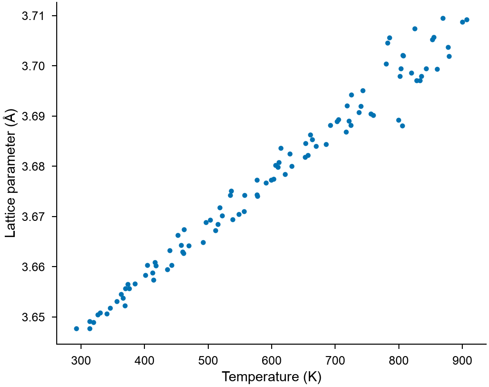

# Ensembles

<p class="runs-on" markdown>**Runs on** the processor · the [GPU](gpu.md) · [LAMMPS](in-lammps.md) as `fix nve`, `nvt`, `npt`, `nph` and `langevin`</p>

`ensemble` of [`run`](running.md#running) says what the dynamics keeps: the energy,
the temperature, the pressure, or for a shock the states behind it. A thermostat holds
the temperature and a barostat the pressure; their targets may change across a run.

Copper heated from 300 K to 900 K in 20 ps at zero pressure, the box free along each
axis: its lattice parameter grows with the temperature, as thermal expansion does.

```python
from mdapy.build import build_crystal
from mdapy.calculators import EAM
from mdapy.simulation import MolecularDynamics

crystal = build_crystal("fcc", 3.615, elements="Cu", repeat=(6, 6, 6))  # 864 atoms
copper = EAM.zhou(["Cu"])

with MolecularDynamics(crystal, copper, timestep=0.002) as md:
    md.velocities(600, seed=1)
    md.run(2500, ensemble="npt", temperature=300, pressure=0.0, barostat="aniso")
    start = len(md.thermo)
    md.run(
        10000,
        ensemble="npt",
        temperature=(300, 900),  # from 300 K at the start to 900 K at the end
        pressure=0.0,
        barostat="aniso",
        thermo=100,
    )
    heating = md.thermo[start:]
```

```python
from mdapy.visualization import plot

a = (heating["volume"] / 216) ** (1 / 3)  # lattice parameter of the 6 x 6 x 6 cells
with plot.style():
    fig, ax = plot.figure("single", 70)
    ax.plot(heating["temperature"], a, ".", markersize=3)
    ax.set_xlabel("Temperature (K)")
    ax.set_ylabel("Lattice parameter (Å)")
    plot.save(fig, "images/ensembles", formats=("png",))
```



*Each point is a record of the run: the temperature of the atoms scatters about the
target that rises from 300 K to 900 K, and the box follows it at zero pressure.*

| `ensemble` | Keeps | LAMMPS |
|---|---|---|
| `"nve"` | the energy | `fix nve` |
| `"nvt"` | the temperature, with a thermostat | `fix nvt`, or `fix langevin` with `fix nve` |
| `"npt"` | the temperature and the pressure, with a thermostat and a barostat | `fix npt`, or `fix langevin` with `fix nph` |
| `"nph"` | the pressure, with a barostat alone | `fix nph` |
| `"nphug"` | the pressure, and the energy on the Hugoniot of a reference state: see [Hugoniostat](hugoniostat.md) | `fix nphug` |
| `"msst"` | the stress along an axis on the Rayleigh line of a shock: see [Multiscale shock technique](msst.md) | `fix msst` |

## Thermostats

`thermostat="nose-hoover"`, the default, is a chain of three Nosé–Hoover thermostats:
deterministic, the same run for the same start. `thermostat="langevin"` adds friction
and random forces to every atom, as LAMMPS's `fix langevin` with `fix nve` or `fix nph`,
with the random numbers of `seed`; `keep_momentum=True` makes the random forces sum to
zero, so that the total momentum is kept, as `fix langevin ... zero yes`: each atom's
noise less an equal share of their total momentum, with no atoms held or moved. In mixed
precision on the GPU the forces, of single precision, move the momentum a little
themselves. `thermostat_damping`, 100 time steps by default, is the time over which
the thermostat brings the temperature to its target. A
[`Langevin` control](controls.md) is a heat bath on a group of atoms alone.

## Barostats

`barostat_damping`, 1000 time steps by default, is the time over which the barostat
brings the pressure to its target. `barostat` says how the box may change:

| `barostat` | The box | LAMMPS |
|---|---|---|
| `"iso"` | alike in every direction | `iso` |
| `"aniso"` | along each axis, in a box periodic in every direction | `aniso` |
| `"tri"` | in any way, in a box periodic in every direction | `tri` |
| `"xy"` | alike along its first two vectors, the third kept, in a box periodic along them | `x`, `y`, `couple xy` |
| `"x"`, `"y"`, `"z"` | along that axis alone, the others kept, in a box periodic along it with its first vector along x and its second in the xy plane | `x`, `y` or `z` |

[A sheet](../properties/sheets.md#molecular-dynamics) changes in its plane only.

## How MDAPY integrates

MDAPY integrates the equations of motion that LAMMPS's fixes `nve`, `nvt`,
`npt`, `nph`, `nphug` and `msst` integrate, in the same steps: velocity Verlet, a chain of
three Nosé–Hoover thermostats, and the barostat of Martyna, Tobias and Klein
on the lengths and tilts of the box. Its constants of nature are those of
MDAPY (CODATA 2018), which differ from those of LAMMPS's metal units by about
one part in a million. Langevin dynamics adds friction and random forces for
half a step before and after each step. Every step calls the calculator
once; a neighbor list with a skin of 1 Å serves several steps while the box
keeps its shape. The masses are those of the `mass` column, or of the
elements; LAMMPS takes those of some potential files, such as EAM's.

## Errors

The ensembles, thermostats and barostats raise what [`run`](running.md#errors) raises
for them.

!!! quote "Please cite"
    For MDAPY's own dynamics:
    [Martyna et al. (1994)](../../reference/references.md#martyna1994),
    [Shinoda et al. (2004)](../../reference/references.md#shinoda2004)
    and [Tuckerman et al. (2006)](../../reference/references.md#tuckerman2006)
    for the thermostats and barostat;
    [Bussi and Parrinello (2007)](../../reference/references.md#bussi2007) for
    Langevin dynamics.
