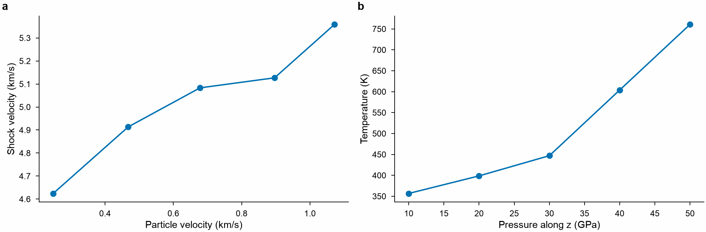

# Hugoniostat

<p class="runs-on" markdown>**Runs on** the processor · the [GPU](gpu.md) · [LAMMPS](in-lammps.md) as `fix nphug`</p>

`run(..., ensemble="nphug")` holds a crystal at a pressure, along one axis or alike
along every axis, while its thermostat drives the energy to the Hugoniot of a
reference state: the states that a steady shock wave leaves behind it,

$$
E - E_0 = \tfrac{1}{2}\,(P + P_0)\,(V_0 - V).
$$

Each run gives one point of the Hugoniot, with its temperature, without the shock wave
itself: the box is compressed homogeneously, as LAMMPS's `fix nphug` does
[(Ravelo et al. 2004)](../../reference/references.md#ravelo2004). A [piston](walls.md)
drives the shock itself, through a long crystal.

Copper at 300 K and no pressure, compressed along z to 10–50 GPa, 20 ps at each
pressure:

<!-- skip-test -->
```python
from mdapy.build import build_crystal
from mdapy.calculators import EAM
from mdapy.simulation import MolecularDynamics

copper = EAM.zhou(["Cu"])
crystal = build_crystal("fcc", 3.615, elements="Cu", repeat=8)  # 2048 atoms
with MolecularDynamics(crystal, copper, timestep=0.001) as md:
    md.velocities(600, seed=1)
    md.run(10000, ensemble="npt", temperature=300, pressure=0.0, barostat="aniso")
    warm = md.system
    md.run(0)
    ambient = md.thermo[-1]
reference = (ambient["total_energy"][0], ambient["volume"][0], 0.0)

points = []
for pressure in (10.0, 20.0, 30.0, 40.0, 50.0):
    with MolecularDynamics(warm, copper, timestep=0.001) as md:
        md.run(
            20000,
            ensemble="nphug",
            pressure=pressure,
            barostat="z",
            hugoniot=reference,
            thermostat_damping=0.1,
            barostat_damping=1.0,
        )
        late = md.thermo.filter(md.thermo["time"] >= 10.0)  # the last 10 ps
    points.append(
        (
            pressure,
            late["particle_velocity"].mean(),
            late["shock_velocity"].mean(),
            late["temperature"].mean(),
            late["hugoniot"].mean(),
        )
    )
```

Every run starts from the same crystal and keeps its Hugoniot, `hugoniot`, the state at
0 GPa: the energy and volume of the warm crystal, and no pressure. The velocities are in
Å/ps, 10 Å/ps being 1 km/s:

<!-- skip-test -->
```python
import numpy as np

from mdapy.visualization import plot

pressure, particle, shock, temperature, distance = np.array(points).T
with plot.style():
    fig, (a, b) = plot.figure("double", 60, nrows=1, ncols=2)
    a.plot(particle / 10, shock / 10, "o-")
    a.set(xlabel="Particle velocity (km/s)", ylabel="Shock velocity (km/s)")
    b.plot(pressure, temperature, "o-")
    b.set(xlabel="Pressure along z (GPa)", ylabel="Temperature (K)")
    for ax, label in zip((a, b), "ab"):
        plot.panel_label(ax, label)
    plot.save(fig, "images/hugoniostat", formats=("png",))
```



*a: The shock velocity rises from 4.6 to 5.4 km/s as the particle velocity rises from
0.25 to 1.07 km/s; between 0.9 and 1.07 km/s it is about the 5.18 km/s at which the
front that a [piston](walls.md) at 1 km/s drove moved. b: The temperature on the
Hugoniot. Up to 30 GPa the crystal stays elastic, its shear stress, half the pressure
along z less that across, growing to 4.5 GPa. At 40 GPa stacking faults relax it to
2.7 GPa, 700 of the atoms hcp by [common neighbor analysis](../analysis/cna.md), and
more of the energy of the Hugoniot goes into heat: 600 K instead of 450 K. At every
pressure the distance from the Hugoniot averages to less than 1.5 K.*

## Parameters

The ensemble `"nphug"` of [`run` and `iterate`](running.md#running), with these of
their parameters:

| Parameter | Type | Default | Unit | Meaning |
|---|---|---|---|---|
| `pressure` | float64 | | GPa | the pressure, one value |
| `barostat` | str | `"iso"` | | the pressure alike along every axis, with the box changing alike (`"iso"`), along each axis (`"aniso"`) or in any way (`"tri"`); or along one axis alone, a uniaxial compression (`"x"`, `"y"` or `"z"`), in a box with its first vector along x and its second in the xy plane |
| `hugoniot` | (float64, float64, float64) | `None` | eV, ų, GPa | the reference state: its total energy, volume and pressure, along the axis of a barostat along one axis; `None`, the state at the start of the run |
| `thermostat_damping` | float64 | 100 time steps | ps | the damping time of the thermostat |
| `barostat_damping` | float64 | 1000 time steps | ps | the damping time of the barostat |

`thermo` records, besides the usual columns:

| Column | Type | Unit | Meaning |
|---|---|---|---|
| `hugoniot` | float64 | K | how far the state is from the Hugoniot: the energy it lacks, ½(P + P₀)(V₀ − V) + E₀ − E, over the kinetic energy of 1 K, N_f k_B |
| `shock_velocity` | float64 | Å/ps | the velocity of a steady shock to this state, √((P − P₀)/(ρ₀ε)), with ε = 1 − V/V₀ and ρ₀ the density of the reference; 0 before the box is compressed |
| `particle_velocity` | float64 | Å/ps | the velocity of the matter behind it, ε times the shock velocity |

## How it acts

- The barostat is that of `"nph"`, held at one pressure; the thermostat is the chain of
  Nosé–Hoover thermostats of `"nvt"`. At the start of each step its target
  temperature is the temperature now plus the distance from the Hugoniot, so the
  energy follows the Hugoniot as the box is compressed. P is the pressure along the
  axis of a barostat along one axis, else the mean of the diagonal.
- The masses of the thermostats and of the barostat are those of the temperature at
  the start of the run, and stay so; the reference state is that of the start unless
  `hugoniot` gives it. A run that goes on from another needs the same `hugoniot`.
- Along one axis the box keeps its other lengths: the compression of a plane shock.
  The crystal is compressed homogeneously, without the front of a shock; where it
  starts to flow depends on the size of the box and the length of the run, as for
  copper above between 30 and 40 GPa.
- In LAMMPS it is `fix nphug` with `temp`, the barostat and, with `hugoniot`,
  `fix_modify ... e0 v0 p0`; the runs are those of MDAPY, step by step. On the
  [GPU](gpu.md) it runs as on the processor.

## Errors

`run` and `iterate` raise `InvalidParameter` for `"nphug"` without a pressure, with a
start and a stop of the pressure, with a temperature, with Langevin dynamics or
Langevin controls, with the barostat `"xy"`, in a box that is not periodic in every
direction, with atoms without a temperature, and for a `hugoniot` that is not three
numbers with a positive volume, or that is given to another ensemble.
