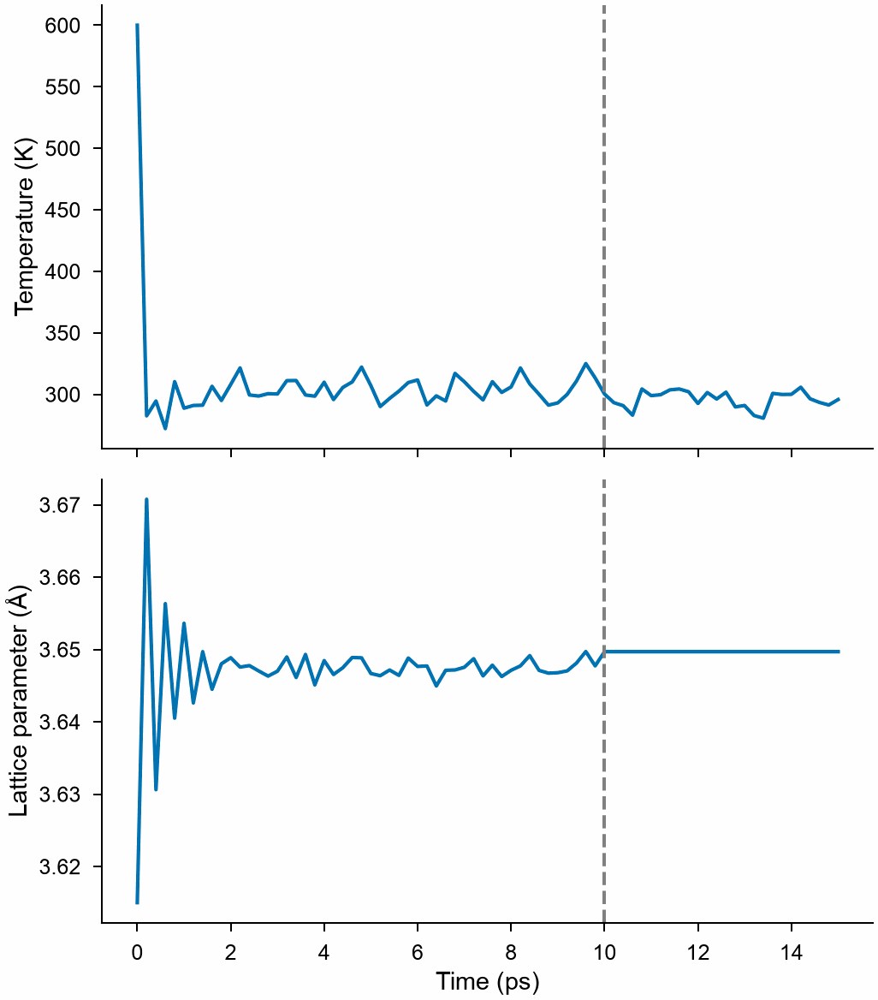

# Molecular dynamics

`mdapy.simulation.MolecularDynamics(system, potential, *, timestep=0.001)`
runs molecular dynamics of a system and gives back the thermodynamic state,
the atoms along the way and the system at the end. With any calculator of MDAPY,
such as [EAM](../potentials/eam.md), [NEP](../potentials/nep.md) or an
[ASE calculator](../interop/ase-calculators.md), it runs in MDAPY itself, on the
processor or, for a potential with `device="cuda"`, on an NVIDIA [GPU](gpu.md); with a
[LAMMPS calculator](../potentials/lammps.md) it runs in LAMMPS. The two take the same calls and give
the same runs, step by step.
[A copper cluster melting in MDAPY](../../examples/cluster-melting.md) runs it in MDAPY,
writing the atoms to a file as the run goes;
[Molecular dynamics through LAMMPS](../../examples/molecular-dynamics.md) runs it in
LAMMPS on several threads or a GPU.

```python
from mdapy.build import build_crystal
from mdapy.calculators import EAM
from mdapy.simulation import MolecularDynamics

copper = EAM.zhou(["Cu"])
crystal = build_crystal("fcc", 3.615, elements="Cu", repeat=(6, 6, 6))  # 864 atoms

with MolecularDynamics(crystal, copper, timestep=0.002) as md:
    md.velocities(600, seed=1)
    md.run(5000, ensemble="npt", temperature=300, pressure=0.0, thermo=100)
    md.run(2500, ensemble="nvt", temperature=300, save_every=500)
    md.thermo  # polars DataFrame: step, time, temperature, energies, ...
    md.frames  # the atoms every 500 steps of the second run
    hot = md.system  # the atoms at the end, with velocities and images
```

The thermodynamic state along the two runs:

```python
from mdapy.visualization import plot

thermo = md.thermo
a = (thermo["volume"] / 216) ** (1 / 3)  # lattice parameter of the 6 x 6 x 6 cells
with plot.style():
    fig, (top, bottom) = plot.figure("single", 100, nrows=2, sharex=True)
    top.plot(thermo["time"], thermo["temperature"])
    top.set_ylabel("Temperature (K)")
    bottom.plot(thermo["time"], a)
    bottom.set_ylabel("Lattice parameter (Å)")
    bottom.set_xlabel("Time (ps)")
    for ax in (top, bottom):
        ax.axvline(10.0, color="0.5", linestyle="--")  # npt, then nvt
    plot.save(fig, "images/dynamics", formats=("png",))
```



*Copper started at 600 K: half the kinetic energy goes into the potential
energy at once, and the thermostat holds the rest at 300 K. The barostat
expands the box from the lattice parameter of 0 K, 3.615 Å, to that of 300 K at zero
pressure, 3.648 Å; after the dashed line the box is fixed (nvt).*

## In MDAPY

The same calls run a calculator that LAMMPS does not have, here a NEP model, or any
model with an ASE calculator, with no LAMMPS installed:

<!-- skip-test -->
```python
from mdapy.calculators import NEP

model = NEP("nep.txt")
small = build_crystal("fcc", 3.615, elements="Cu", repeat=(3, 3, 3))
with MolecularDynamics(small, model, timestep=0.002) as md:
    md.velocities(300, seed=1)
    md.run(5000, ensemble="nvt", temperature=300, thermostat="langevin", seed=2)
    md.run(5000, ensemble="npt", temperature=300, pressure=0.0, save_every=100)
```

MDAPY integrates the equations of motion that LAMMPS's fixes `nve`, `nvt`,
`npt`, `nph`, `nphug` and `msst` integrate, in the same steps: velocity Verlet, a chain of
three Nosé–Hoover thermostats, and the barostat of Martyna, Tobias and Klein
on the lengths and tilts of the box. Its constants of nature are those of
MDAPY (CODATA 2018), which differ from those of LAMMPS's metal units by about
one part in a million. Langevin dynamics adds friction and random forces for
half a step before and after each step. Every step calls the calculator
once; a neighbor list with a skin of 1 Å serves several steps while the box
keeps its shape. The masses are those of the `mass` column, or of the
elements; LAMMPS takes those of some potential files, such as EAM's.

On the processor it suits small systems, from a few atoms to some thousands, such as
those of the training sets of machine-learned potentials; with a potential on an NVIDIA
GPU the same dynamics runs there, for millions of atoms: see [On the GPU](gpu.md). Its
[controls](controls.md) hold, move, push, heat, deform, indent and shock the atoms, on
the processor and on the GPU alike. Large systems on many processors, and fixes beyond
these, are for LAMMPS.

A `movable` column, (N, 3) bool as VASP's selective dynamics, keeps atoms
still along the directions where it is False, in MDAPY's dynamics only; the
temperature then counts the directions in which the atoms move.

| Name | Type | Default | Unit | Meaning |
|---|---|---|---|---|
| `system` | `System` | | | the atoms, with an `element` column (or, in MDAPY, a `mass` column), `velocities` in Å/ps when it has them, and a `movable` column (MDAPY only) |
| `potential` | calculator | | | the interaction: a `LAMMPS` calculator, run in LAMMPS, or any other calculator, run in MDAPY, which needs energies and forces, and the virial for a barostat |
| `timestep` | float64 | 0.001 | ps | the time step |
| `log` | str, path or stream | `None` | | writes the runs to this file, which it overwrites, or to this stream, such as `sys.stdout`: see [Log](#log) |

## In LAMMPS

With a [LAMMPS calculator](../potentials/lammps.md) the same calls run in LAMMPS: its fixes `nve`,
`nvt`, `npt`, `nph`, `nphug` and `msst`, and the controls as its fixes, with any of its
potentials and packages, on several processes with MPI or on GPUs:

<!-- skip-test -->
```python
from mdapy.calculators import LAMMPS

potential = LAMMPS(
    "pair_style eam/alloy\npair_coeff * * Cu_mishin1.eam.alloy Cu", elements=["Cu"]
)
crystal = build_crystal("fcc", 3.615, elements="Cu", repeat=(8, 8, 8))
with MolecularDynamics(crystal, potential, timestep=0.002) as md:
    md.velocities(600, seed=1)
    md.run(10000, ensemble="npt", temperature=300, pressure=0.0, thermo=100)
    md.command("compute peratom all pe/atom")  # any LAMMPS command between runs
```

[Molecular dynamics through LAMMPS](../../examples/molecular-dynamics.md) says what it
is not made for, and how to run it on several threads or a GPU;
[LAMMPS on many processes with MPI](../../examples/mpi.md) runs it with MPI.

## Running

| Method or attribute | Meaning |
|---|---|
| `velocities(temperature, *, seed)` | random velocities of a temperature in K, Gaussian, with no total momentum; the same for the same seed and atoms, whatever their positions |
| `run(steps, *, ensemble="nve", temperature=None, pressure=None, barostat="iso", thermostat="nose-hoover", thermostat_damping=None, barostat_damping=None, seed=None, keep_momentum=False, hugoniot=None, shock_velocity=None, msst=None, thermo=100, save_every=None, controls=None, progress=None, cancel=None)` | runs `steps` steps |
| `iterate(steps, *, save_every, ...)`, the other parameters those of `run` | runs as `run` does, giving the atoms every `save_every` steps as the run reaches them and keeping none: see [Frames in files](#frames-in-files) |
| `command(commands)` | runs any LAMMPS commands, one or several lines (LAMMPS only) |
| `lammps` | the LAMMPS instance itself (LAMMPS only) |
| `close()` | closes the instance; leaving a `with` block closes it too |

| Parameter of `run` | Type | Default | Unit | Meaning |
|---|---|---|---|---|
| `ensemble` | str | `"nve"` | | `"nve"`, or `"nvt"` with a thermostat, or `"npt"` with a thermostat and a barostat, or `"nph"` with a barostat alone (LAMMPS `fix nve`, `nvt`, `npt`, `nph`), or `"nphug"`, a barostat and a thermostat that holds the atoms on the Hugoniot of a reference state (`fix nphug`): see [Hugoniostat](hugoniostat.md), or `"msst"`, the box compressed along an axis as by a steady shock (`fix msst`): see [Multiscale shock technique](msst.md) |
| `temperature` | float64 or (float64, float64) | | K | the temperature of the thermostat, or its values at the start and end of the run; for `"nvt"` and `"npt"` |
| `pressure` | float64 or (float64, float64) | | GPa | the pressure of the barostat, or its values at the start and end; for `"npt"`, `"nph"` and `"nphug"`, which takes one value |
| `barostat` | str | `"iso"` | | the box changes alike in every direction (`"iso"`), along each axis (`"aniso"`), in any way (`"tri"`), alike along its first two vectors with the third kept (`"xy"`), or along one axis alone, the others kept (`"x"`, `"y"` or `"z"`, LAMMPS `fix npt ... z`), in a box periodic along it with its first vector along x and its second in the xy plane; [a sheet](../properties/sheets.md#molecular-dynamics) changes in its plane only |
| `thermostat` | str | `"nose-hoover"` | | a chain of Nosé–Hoover thermostats, or `"langevin"` dynamics (LAMMPS `fix langevin` with `fix nve` or `nph`) |
| `thermostat_damping` | float64 | 100 time steps | ps | the damping time of the thermostat |
| `barostat_damping` | float64 | 1000 time steps | ps | the damping time of the barostat |
| `seed` | int32 | `None` | | seed of the random forces of Langevin dynamics, positive (at most 900000000 in LAMMPS); unpredictable when `None` |
| `keep_momentum` | bool | `False` | | with Langevin dynamics, random forces that sum to zero, so that the total momentum is kept, as LAMMPS's `fix langevin ... zero yes`: each atom's noise less an equal share of their total momentum; with no atoms held or moved. In mixed precision on the GPU the forces, of single precision, move the momentum a little themselves |
| `hugoniot` | (float64, float64, float64) | `None` | eV, ų, GPa | for `"nphug"` and `"msst"`, the reference state of the Hugoniot: its total energy, volume and pressure, along the axis of a barostat along one axis or of the shock; `None`, the state at the start of the run |
| `shock_velocity` | float64 | `None` | Å/ps | for `"msst"`, the velocity of the shock, along the axis `barostat` names |
| `msst` | dict | `None` | | for `"msst"`, its settings `"q"`, `"mu"` and `"tscale"`: see [Multiscale shock technique](msst.md#parameters) |
| `thermo` | int32 | 100 | | records the thermodynamic state every this many steps, and at the start and the end |
| `save_every` | int32 | `None` | | keeps the atoms every this many steps, in `frames`; `iterate` gives them instead, and needs it |
| `controls` | sequence | `None` | | `Hold`, `Move`, `AddForce`, `Langevin`, `Deform`, `AdaptiveTimestep`, `Switch`, `Wall` or `Indenter`: what is done to groups of atoms, the box, the time step or the potential during the run, or the walls and indenters that push the atoms; see [Groups and controls](controls.md) |
| `progress` | callable | `None` | | called as `progress(done, total)` with the steps run |
| `cancel` | `CancelToken` | `None` | | stops the run, which raises `Cancelled` |

The velocities of `system`, if it has them, are where the dynamics starts;
`thermal_velocities` gives a system those of a temperature, the same as
`velocities` gives in MDAPY with the same seed, to all its atoms or to a
part, the others still: a flyer of copper at 300 K that strikes the rest
at 1 km/s, 10 Å/ps,

```python
from mdapy.build import build_crystal
from mdapy.calculators import EAM
from mdapy.simulation import MolecularDynamics, thermal_velocities

crystal = build_crystal("fcc", 3.615, elements="Cu", repeat=(12, 4, 4))
flyer = crystal["positions"][:, 0] < 20.0
v = thermal_velocities(crystal, 300.0, seed=1, mask=flyer)
v[flyer, 0] += 10.0
with MolecularDynamics(crystal.with_columns(velocities=v), EAM.zhou(["Cu"])) as md:
    md.run(10)
```

| Parameter of `thermal_velocities` | Type | Default | Unit | Meaning |
|---|---|---|---|---|
| `system` | `System` | | | the atoms, with a `mass` or an `element` column; a `movable` column keeps them still along the directions where it is False, and then their total momentum is not removed |
| `temperature` | float64 | | K | the temperature, not negative |
| `seed` | int32 | | | seed of the random numbers, positive |
| `mask` | (N,) bool | every atom | | the atoms that get velocities, with no total momentum among them; the others get none |

It returns the (N, 3) float64 velocities in Å/ps: Gaussian, scaled so that
their kinetic energy is that of the temperature over 3n − 3 directions of
the n atoms of `mask`, or over those a `movable` column frees.

A run goes in pieces between the steps at which something is recorded; the
pieces run as one run would, a temperature or pressure changing from its
start to its end value across all of them. With Langevin dynamics and a
barostat, the barostat's mass is that of the temperature at the start.

In LAMMPS, the dynamics runs in metal units, those of MDAPY, through its
Python module, installed as the
[LAMMPS documentation](https://docs.lammps.org/Python_install.html) describes;
`potential` gives the commands of the interaction, the element of each atom
type and the command-line arguments of LAMMPS, such as those of Kokkos. The
box may have any orientation and need not be periodic: LAMMPS gets it rotated
into its own form, its non-periodic directions shrink-wrapped but never
smaller than the box of `system`, and everything comes back in the
orientation of `system`. MDAPY's own dynamics works in the same form of the
box.

### Log

With `log`, the dynamics writes what it does as it goes, so that a long run
shows its progress, `tail -f md.log` in a terminal:

```python
from mdapy.build import build_crystal
from mdapy.calculators import EAM
from mdapy.simulation import MolecularDynamics

crystal = build_crystal("fcc", 3.615, elements="Cu", repeat=(5, 5, 5))
copper = EAM.zhou(["Cu"])
with MolecularDynamics(crystal, copper, timestep=0.002, log="md.log") as md:
    md.velocities(600, seed=1)
    md.run(200, thermo=50)
```

```text
# MDAPY 2.2.0, molecular dynamics, 2026-11-19 13:29:02
# 500 atoms; box vectors 18.0750 18.0750 18.0750 Å long, periodic along a b c
# engine: MDAPY on the processor, 10 threads
# potential: EAM(elements=('Cu',), cutoff=5.715751993501819)
# time step: 0.002 ps
#
# run 1: 200 steps, nve; thermo every 50
#     step        time   temperature    potential_energy    kinetic_energy        total_energy      pressure            volume      wall
         0      0.0000       600.000        -1769.991294         38.700444        -1731.290850      0.697585         5905.2042      0.00
        50      0.1000       256.824        -1747.829401         16.565321        -1731.264079      3.565728         5905.2042      0.02
       100      0.2000       324.699        -1752.217267         20.943354        -1731.273913      3.078099         5905.2042      0.03
       150      0.3000       307.193        -1751.084251         19.814151        -1731.270099      3.109218         5905.2042      0.04
       200      0.4000       301.119        -1750.691224         19.422382        -1731.268842      3.167338         5905.2042      0.06
# run 1: 200 steps in 0.06 s; 3340.2 steps/s, 1.67 million atom-steps/s, 577.2 ns/day
```

Each run writes its settings, a row every `thermo` steps, the row
`thermo` records, with `wall`, the seconds since the run began, and its
speed; a run that stops early, cancelled or failed, says where it stopped.
The engine is MDAPY on the processor with its threads, MDAPY on a GPU with
its precision, or LAMMPS with its processes and command-line arguments.
Lines that are not rows of numbers start with `#`, so that
`numpy.loadtxt("md.log")` reads the rows of every run as one table. Under
MPI the main process alone writes. Every run and `iterate` of the
`MolecularDynamics` writes to the same log, which `close` closes.

### Frames in files

The frames that `save_every` keeps stay in memory as long as the
`MolecularDynamics` or its `frames` do, about 60 bytes per atom each: a
hundred frames of a million atoms take 6 GB. `iterate` runs as `run` does
but gives each frame as the run reaches it and keeps none, so that
[`mdapy.io.write`](../../basics/io.md) writes them to a file one at a
time while the run goes on, and
[`read_trajectory`](../../basics/trajectory.md) reads them back one at a time:

<!-- skip-test -->
```python
import mdapy
from mdapy.identify import CommonNeighborAnalysis
from mdapy.io import read_trajectory

with MolecularDynamics(crystal, potential, timestep=0.002) as md:
    md.velocities(600, seed=1)
    frames = md.iterate(5000, save_every=500, ensemble="nvt", temperature=300)
    mdapy.io.write("frames.xyz", frames)  # one frame in memory at a time

cna = CommonNeighborAnalysis()
with read_trajectory("frames.xyz") as trajectory:
    for frame in trajectory:
        print(frame.info["time"], cna.compute(frame).counts()["fcc"])
```

or analyzes them as they come, without a file:

<!-- skip-test -->
```python
with MolecularDynamics(crystal, potential, timestep=0.002) as md:
    md.velocities(600, seed=1)
    for frame in md.iterate(5000, save_every=500, ensemble="nvt", temperature=300):
        print(frame.info["time"], cna.compute(frame).counts()["fcc"])
```

Each frame is a `System` as `system` gives it: the atoms in the order of
`system`, with their velocities, images and other columns, in full
precision, the box, and the step and the time in `info`, in LAMMPS and in
MDAPY alike. The run goes on as the frames are read, from the first, and
stops where their reading stops, such as at a `break` out of the loop, with
the steps run so far kept; while they are being read, the dynamics takes no
other `run`, `iterate`, `velocities` or `command`. As `save_every` does, it
gives the atoms at the start unless the run before gave them there, so that
the frames of runs one after the other follow each other once each.

With LAMMPS, a `dump` writes the frames too, from LAMMPS itself:

<!-- skip-test -->
```python
with MolecularDynamics(crystal, potential, timestep=0.002) as md:
    md.velocities(600, seed=1)
    md.command(
        "dump frames all custom 500 frames.*.lammpstrj id element x y z vx vy vz\n"
        "dump_modify frames element Cu time yes"
    )
    md.run(5000, ensemble="nvt", temperature=300)
    md.command("undump frames")
```

LAMMPS writes the atoms in the order it holds them, which changes as it runs,
each with its `id`, numbered from 1 in the order of `system`.
[`AtomicDisplacement`](../analysis/displacement.md) and
[`MeanSquaredDisplacement`](../analysis/msd.md) match the atoms of frames by
it, and `frame.sort("id")` puts them in the order of `system`. Their positions
are those of LAMMPS, which are those of `system` for a box at the origin with
its first vector along x and its second in the xy plane, as `build_crystal`
makes them, to the six digits a dump writes by default (`format float %.10g`
writes more). `iterate` is the better choice: it writes any format of
several frames, in the order and the orientation of `system`, in LAMMPS and
in MDAPY. A dump suits a run over several processes with
[MPI](../../examples/mpi.md), where each process would receive every atom
of every frame of `iterate`.

## Results

| Attribute | Type | Meaning |
|---|---|---|
| `system` | `System` | the atoms now, with `velocities` and `image` columns, the box, and `timestep` and `time` in `info`; the other columns of `system`, except forces and energies, which would be out of date |
| `thermo` | polars `DataFrame` | the thermodynamic state of all the runs so far, one row per record |
| `frames` | tuple of `System` | the atoms that `save_every` of `run` kept in all the runs so far, as `system` gives them |
| `step` | int64 | the time step number |

| Column of `thermo` | Type | Unit | Meaning |
|---|---|---|---|
| `step` | int64 | | time step number |
| `time` | float64 | ps | time |
| `temperature` | float64 | K | temperature, from the kinetic energy of 3N − 3 directions, or of those the `movable` column frees |
| `potential_energy`, `kinetic_energy`, `total_energy` | float64 | eV | energies of all the atoms |
| `pressure` | float64 | GPa | pressure; NaN in MDAPY with a calculator without virials |
| `volume` | float64 | ų | volume of the box |
| `stress` | (6,) float64 | GPa | stress in Voigt order xx, yy, zz, yz, xz, xy, positive under tension, in the axes of `system` |
| `hugoniot` | float64 | K | with `"nphug"`: how far the state is from the Hugoniot, the energy it lacks over the kinetic energy of 1 K: see [Hugoniostat](hugoniostat.md) |
| `shock_velocity`, `particle_velocity` | float64 | Å/ps | with `"nphug"`: the velocities of a steady shock to this state and of the matter behind it; with `"msst"`, the second |
| `rayleigh`, `lagrangian_position`, `msst_energy` | float64 | GPa, Å, eV | with `"msst"`: see [Multiscale shock technique](msst.md#parameters) |

## Errors

`MolecularDynamics` raises `InvalidParameter` for a potential that is not a
calculator, a time step that is not positive, elements without an atom type
in LAMMPS, a `movable` column that holds atoms in LAMMPS, commands that
LAMMPS rejects, and a `log` that is neither a path nor a stream, or that
cannot be written; `MissingProperty` for a system without elements (or, in
MDAPY, without masses); `ImportError` without the LAMMPS Python module, for a
LAMMPS calculator. `velocities` and `thermal_velocities` raise `InvalidParameter` for a negative
temperature or a seed that is not positive, and `thermal_velocities` for a
mask that is not one bool for each atom and `MissingProperty` for a system
without masses or elements; `run` for a negative number of
steps, an unknown ensemble, barostat or thermostat, a thermostat without a
positive temperature, a barostat without a pressure, `"aniso"` or `"tri"` in
a box that is not periodic, `"xy"` in a box not periodic along its first two
vectors, `"x"`, `"y"` or `"z"` in a box not periodic along that axis or not
in the form of LAMMPS, `"nphug"` with two pressures, a temperature, Langevin
dynamics or controls, `"xy"` or a box that is not periodic, a `hugoniot`
that is not three numbers with a positive volume or that is given to another
ensemble, the errors of `"msst"` (see [Multiscale shock technique](msst.md#errors)),
`thermo`, `save_every` or `seed` that are not positive, a barostat
in MDAPY with a calculator without virials or, for `"nph"` and `"nphug"`,
atoms without a temperature, and a thermostat with no atom free to move; in MDAPY, it raises
`CalculationFailed` when the energy or the forces stop being finite. `command`
and `lammps` raise `InvalidParameter` in MDAPY, `command` for commands LAMMPS
rejects, and `lammps` after `close`. `iterate` raises what `run` raises, for
its options at once and for the rest as its frames are read, and
`InvalidParameter` without `save_every`; `run`, `iterate`, `velocities` and
`command` raise `InvalidParameter` while the frames of an `iterate` are
being read.

!!! quote "Please cite"
    For MDAPY's own dynamics:
    [Martyna et al. (1994)](../../reference/references.md#martyna1994),
    [Shinoda et al. (2004)](../../reference/references.md#shinoda2004)
    and [Tuckerman et al. (2006)](../../reference/references.md#tuckerman2006)
    for the thermostats and barostat;
    [Bussi and Parrinello (2007)](../../reference/references.md#bussi2007) for
    Langevin dynamics.
