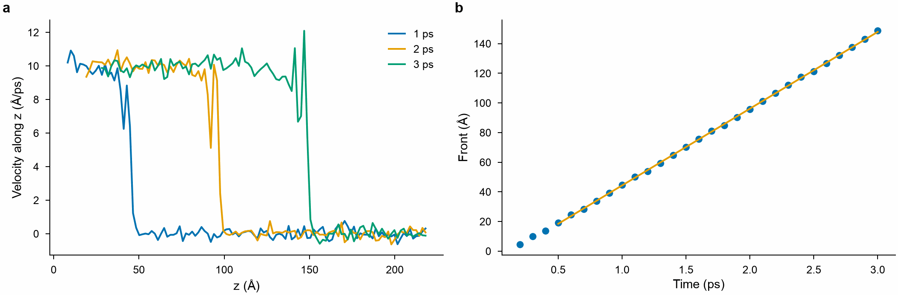

# Walls

<p class="runs-on" markdown>**Runs on** the processor · the [GPU](gpu.md) · [LAMMPS](in-lammps.md) as `fix wall/reflect`, and `fix wall/piston` for a wall moving up from below along z</p>

`Wall`, a [control](controls.md) of a run of [molecular dynamics](running.md), is a
flat wall across an axis that reflects the atoms that reach it. A still wall is a
momentum mirror that a moving crystal hits; a moving wall is a piston that drives a
shock wave into the crystal before it.

Copper at 300 K, open along z, pushed from below by a piston at 1 km/s for 3 ps:

```python
import numpy as np

import mdapy
from mdapy.analysis import SpatialBinning
from mdapy.build import build_crystal
from mdapy.calculators import EAM
from mdapy.simulation import MolecularDynamics, Wall

copper = EAM.zhou(["Cu"])
crystal = build_crystal("fcc", 3.615, elements="Cu", repeat=(6, 6, 60))  # 8640 atoms
with MolecularDynamics(crystal, copper, timestep=0.002) as md:
    md.velocities(600, seed=1)
    md.run(2000, ensemble="npt", temperature=300, pressure=0.0, barostat="aniso")
    warm = md.system

# open along z: free surfaces at the bottom and the top
box = mdapy.Box(warm.box.matrix, origin=warm.box.origin, pbc=(True, True, False))
warm = warm.with_box(box)
bottom = float(warm["positions"][:, 2].min())
piston = Wall("z", position=bottom - 1.0, velocity=10.0)  # 1 km/s up z

profile = SpatialBinning("velocities.z", 120, axes="z")  # slabs of 1.8 Å
times, profiles = [], []
with MolecularDynamics(warm, copper, timestep=0.001) as md:
    for frame in md.iterate(3000, save_every=100, controls=piston):
        times.append(frame.info["time"])
        profiles.append(profile.compute(frame).values)
centers = profile.compute(warm).centers[0]
```

The front of the shock is the highest slab that moves faster than half the piston:

```python
from mdapy.visualization import plot

times, profiles = np.array(times), np.array(profiles)
fronts = np.array(
    [centers[v > 5.0].max() if (v > 5.0).any() else np.nan for v in profiles]
)
late = times >= 0.5
speed, start = np.polyfit(times[late], fronts[late], 1)  # Å/ps

with plot.style():
    fig, (a, b) = plot.figure("double", 60, nrows=1, ncols=2)
    for t in (1.0, 2.0, 3.0):
        k = int(np.argmin(np.abs(times - t)))
        a.plot(centers, profiles[k], label=f"{t:g} ps")
    a.set(xlabel="z (Å)", ylabel="Velocity along z (Å/ps)")
    a.legend()
    b.plot(times, fronts, "o", markersize=3)
    b.plot(times[late], start + speed * times[late])
    b.set(xlabel="Time (ps)", ylabel="Front (Å)")
    for ax, label in zip((a, b), "ab"):
        plot.panel_label(ax, label)
    plot.save(fig, "images/walls", formats=("png",))
```



*a: The mean velocity along z of the atoms in each slab. Behind the front the copper
moves with the piston at 10 Å/ps; ahead of it the copper is at rest. Below the piston
the slabs are empty. b: The piston reaches the crystal after 0.1 ps; from 0.5 ps the
front moves at a constant 51.8 Å/ps, 5.18 km/s, five times as fast as the piston.*

## Parameters

`Wall(axis="z", *, side="low", position=None, velocity=0.0)`, given to `run` or
`iterate` by `controls`.

| Parameter | Type | Default | Unit | Meaning |
|---|---|---|---|---|
| `axis` | str | `"z"` | | `"x"`, `"y"` or `"z"`, the axis of the system the wall is across |
| `side` | str | `"low"` | | `"low"` keeps the atoms above the wall, `"high"` below it |
| `position` | float64 | `None` | Å | the coordinate of the wall along the axis at the start of the run; `None`, the face of the box on that side |
| `velocity` | float64 | 0.0 | Å/ps | the velocity of the wall along the axis, positive up the axis; 0, a still wall |

## How it acts

- In each step, after the atoms move and before their forces are computed, an atom
  that has passed a wall is put back by as far as it passed, and its velocity across
  the wall becomes $2u - v$, where $u$ is the velocity of the wall and $v$ that of
  the atom. Its velocity along the wall does not change. A still wall turns the
  velocity across it.
- A moving wall starts at its position at the start of the run and moves at its
  velocity. Each run starts again from `position`, or from the face of the box, so a
  piston that goes on in another run needs the position it reached.
- A wall acts on every atom. A run takes at most one wall on each side of an axis,
  for instance a floor and a ceiling across z.
- The periodic vectors of the box must be normal to the axis. The box itself does
  not change: atoms leave it across an open face as they would without the wall.
- A crystal given a velocity $-u$ towards a still wall is the same as a crystal at
  rest hit by a piston at $u$, seen from the piston. This is the momentum mirror.
- In LAMMPS a still wall is `fix wall/reflect` and a moving one `fix wall/piston`,
  both with `units box`. LAMMPS moves a wall only on the low side of z and up z, and
  during the run it shrink-wraps the low side of z, as `fix wall/piston` needs. The
  runs are those of MDAPY, step by step. On the [GPU](gpu.md) the walls act on the
  device as on the processor.

## Errors

`Wall` raises `InvalidParameter` for an `axis` other than `"x"`, `"y"` or `"z"`, a
`side` other than `"low"` or `"high"`, and a `position` or `velocity` that is not a
finite number. `run` and `iterate` raise it for two walls on the same side of an
axis, a box with a periodic vector that is not normal to the axis of a wall, a wall
with a [`Deform`](deformation.md), and a moving wall with an
[`AdaptiveTimestep`](adaptive-timestep.md). In LAMMPS they raise it for a box whose
first vector is not along x or whose second is not in the xy plane, and for a moving
wall other than one on the low side of z moving up z.
