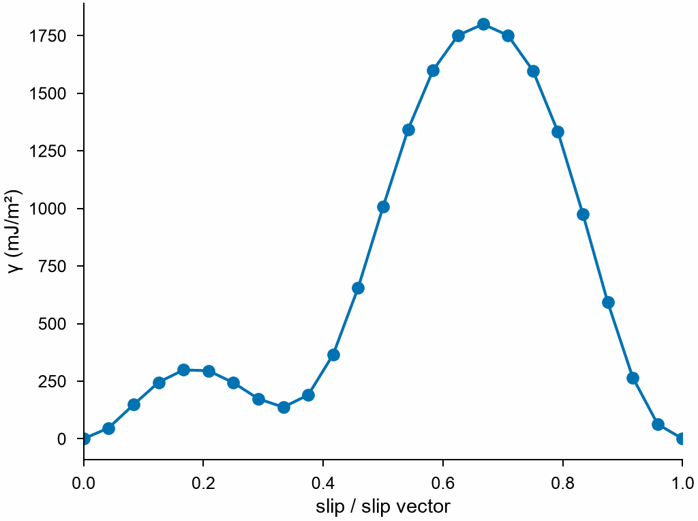

# ADP

<!-- skip-test -->
```python
from mdapy.calculators import ADP

potential = ADP("Ni.adp")
potential.elements, potential.cutoff
```

The potential [`Ni.adp`](https://github.com/lammps/lammps/blob/develop/potentials/Ni.adp)
of LAMMPS, in the same folder. The generalized stacking fault energy of nickel
along [11-2] on its (111) planes:

<!-- skip-test -->
```python
import numpy as np
from mdapy.build import build_crystal
from mdapy.simulation import minimize, stacking_fault_energy
from mdapy.visualization import plot

cell = build_crystal("fcc", 3.52, elements="Ni")
a = minimize(cell, potential, cell="full", max_stress=1e-4).system.box.matrix[0, 0]
layers = build_crystal(
    "fcc",
    a,
    elements="Ni",
    orientation=[(1, 1, -2), (-1, 1, 0), (1, 1, 1)],
    repeat=(2, 3, 4),
)
# along [11-2] on (111), to the stacking fault at a sixth and beyond
fault = stacking_fault_energy(layers, potential, [a * np.sqrt(6) / 2, 0, 0], points=25)
with plot.style():
    fig, ax = plot.figure("single")
    plot.stacking_fault(fault, ax=ax)
    plot.save(fig, "images/adp", formats=("png",))
```



*Nickel of the ADP potential of Mishin et al.: the intrinsic stacking fault
at a third of the way, 1/6 [11-2], of 137 mJ/m², near the measured 125 mJ/m²,
and the unstable fault before it, of 299 mJ/m².*

`ADP(path)` reads a potential file of `pair_style adp` of LAMMPS and computes
it as LAMMPS does: the [embedded atom method](eam.md) with the dipole and the
quadrupole of the neighbors of each atom, which make the energy depend on
the angles between the bonds,

$$
E_i = F(\bar\rho_i) + \frac{1}{2} \sum_{j} \phi(r_{ij})
+ \frac{1}{2} \sum_\alpha (\mu_i^\alpha)^2
+ \frac{1}{2} \sum_{\alpha \beta} (\lambda_i^{\alpha\beta})^2
- \frac{1}{6} \nu_i^2,
$$

$$
\mu_i^\alpha = \sum_j u(r_{ij}) r_{ij}^\alpha,
\qquad
\lambda_i^{\alpha\beta} = \sum_j w(r_{ij}) r_{ij}^\alpha r_{ij}^\beta,
\qquad
\nu_i = \sum_\alpha \lambda_i^{\alpha\alpha}.
$$

The file is an `eam/alloy` file followed by the tables of u(r) and of w(r)
for each pair of elements, all interpolated as those of EAM. Beyond its table
the embedding energy stays at its last value, as in LAMMPS, unlike that of
`EAM`, which goes on linearly.

## Parameters

| Parameter | Type | Meaning |
|---|---|---|
| `path` | str or path-like | the potential file |
| `device` | str | `"cpu"`, or `"cuda"` to compute on an NVIDIA GPU: see [On the GPU](../molecular-dynamics/gpu.md) |
| `precision` | str or `None` | on the GPU `"mixed"` (by default) or `"double"`; the processor computes in double precision only |

| Attribute | Type | Meaning |
|---|---|---|
| `path` | str | the potential file |
| `elements` | tuple of str | the elements of the potential, in the order of the file |
| `masses` | (E,) float64 | their masses in amu |
| `cutoff` | float64 | cutoff radius in Å |

The energy of each pair and its virial are shared equally between its two
atoms. Its force is not along the bond, so the virial of an atom is not
symmetric; as in LAMMPS, its component xy is the sum of the x components of
the bonds times the y components of their forces.

## Errors

`ADP` raises `FileFormatError` for a file without the number of elements and
their names, the line of the tables (Nrho drho Nr dr cutoff, with Nrho and
Nr at least 5 and the rest positive), or the atomic number and mass of an
element, and `InvalidParameter` for a file that cannot be read, names that
are not elements, and atoms of an element it has no tables for.

!!! quote "Please cite"
    [Mishin, Mehl and Papaconstantopoulos (2005)](../../reference/references.md#mishin2005), and the paper of the potential.
