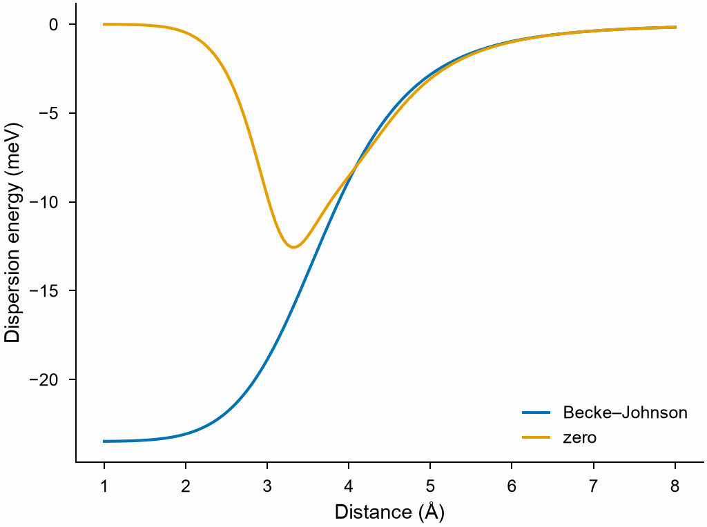

# DFT-D3 dispersion

<p class="runs-on" markdown>**Runs on** the processor · the [GPU](../simulation/gpu.md) · LAMMPS has it as `pair_style dispersion/d3`, VASP as `IVDW = 11` and `12`</p>

`D3(functional="pbe", damping="bj")` is the dispersion correction DFT-D3 of
[Grimme et al. (2010)](../../reference/references.md#grimme2010), computed as
[s-dftd3](https://github.com/dftd3/simple-dftd3) computes it. Density functionals such
as PBE miss the attraction of fluctuating dipoles, which holds the layers of graphite
and molecular crystals together; D3 adds it, with C6 coefficients that follow the
coordination of each atom. Its usual use is on a machine-learned potential fitted to
such a functional, added with [`Overlay`](overlay.md):

<!-- skip-test -->
```python
from mdapy.calculators import D3, NEP, Overlay

potential = Overlay([NEP("nep.txt"), D3("pbe")])
```

Two argon atoms, with the parameters of PBE and each damping:

```python
import numpy as np

import mdapy
from mdapy.calculators import D3
from mdapy.visualization import plot

distance = np.linspace(1.0, 8.0, 141)
box = mdapy.Box(40.0, pbc=False)
dimers = [mdapy.System([[0, 0, 0], [r, 0, 0]], box, elements="Ar") for r in distance]
with plot.style():
    fig, ax = plot.figure("single")
    for damping, label in (("bj", "Becke–Johnson"), ("zero", "zero")):
        d3 = D3("pbe", damping)
        energy = [1000 * d3.compute(dimer).energy for dimer in dimers]
        ax.plot(distance, energy, label=label)
    ax.set(xlabel="Distance (Å)", ylabel="Dispersion energy (meV)")
    ax.legend()
    plot.save(fig, "images/d3", formats=("png",))
```



*The dispersion energy of the pair: −11.3 meV with Becke–Johnson damping and −10.1 meV
with zero damping at 3.76 Å, the distance of the argon dimer. Closer, Becke–Johnson
damping levels off at −23.5 meV, and zero damping falls back to zero from its lowest,
−12.6 meV at 3.3 Å; the repulsion is the functional's. From 7 Å on the two agree
within 1 %, the C6/r⁶ and C8/r⁸ of the pair.*

In a crystal the pairs reach 31.75 Å, through as many periodic images as that takes.
The dispersion energy of graphite at the distance of its layers, from that of the
sheets apart:

```python
from mdapy.build import build_crystal

d3 = D3("pbe")
graphite = build_crystal("graphite", 2.46, c=6.70, elements="C")
sheet = build_crystal("graphene", 2.46, c=80.0, elements="C")
binding = d3.compute(graphite).energy / 4 - d3.compute(sheet).energy / 2
round(1000 * binding, 1)  # -68.0 meV per atom
```

and in a [molecular dynamics](../simulation/running.md) it computes like any other
potential, alone or overlaid, on the processor or on the
[GPU](../simulation/gpu.md):

<!-- skip-test -->
```python
from mdapy.simulation import MolecularDynamics

potential = Overlay(
    [NEP("nep.txt", device="cuda"), D3("pbe", elements=["C", "H"], device="cuda")]
)
with MolecularDynamics(system, potential, timestep=0.0005) as md:
    md.run(10000, ensemble="npt", temperature=300, pressure=0.0)
```

## Definition

The energy is a sum over the pairs of atoms within the cutoff, and with
`three_body=True` over the triangles whose three sides are within theirs, the term of
[Axilrod and Teller (1943)](../../reference/references.md#axilrod1943) and Muto:

$$
E = -\sum_{i<j} \left( s_6 \frac{C_6^{ij}}{r_{ij}^6} f_6(r_{ij})
+ s_8 \frac{C_8^{ij}}{r_{ij}^8} f_8(r_{ij}) \right)
+ \sum_{i<j<k} C_9^{ijk}
\frac{3 \cos\theta_i \cos\theta_j \cos\theta_k + 1}{(r_{ij} r_{jk} r_{ki})^3} f_9
$$

$C_6^{ij}$ is interpolated between the C6 of the reference systems of the two
elements, with Gaussian weights of the distance of their coordination numbers, counted
over the neighbors within `cn_cutoff` with 4/3 of the covalent radii of
[Pyykkö and Atsumi (2009)](../../reference/references.md#pyykko2009), from those of the
references; $C_8^{ij} = 3
C_6^{ij} \sqrt{Q_i Q_j}$ from the ⟨r⁴⟩/⟨r²⟩ of the atoms; and $C_9^{ijk} = -s_9
\sqrt{C_6^{ij} C_6^{jk} C_6^{ki}}$, with $s_9 = 1$. The damping of
[Becke and Johnson](../../reference/references.md#grimme2011) replaces $r^n$ by $r^n +
R_0^n$, with $R_0 = a_1 \sqrt{C_8/C_6} + a_2$; zero damping is $f_n = 1 / (1 + 6
(r / (s_{r,n} R_0^{ij}))^{-\alpha_n})$ with the radius $R_0^{ij}$ of each pair of
elements, $s_{r,6}$ = `rs6`, $s_{r,8}$ = `rs8`, $\alpha_6 = 14$ and $\alpha_8 = 16$.
The three-body damping is that of zero damping with 4/3 of the radii and $\alpha =
16$, whichever damping the pairs have. The forces carry the change of the C6 with the
coordination numbers.

## Parameters

| Parameter | Type | Meaning |
|---|---|---|
| `functional` | str or `None` | the functional whose parameters to take, in any case: see the table below; `None` with all the numbers of the damping given |
| `damping` | str | `"bj"`, the rational damping of Becke and Johnson (VASP's `IVDW = 12`), or `"zero"` (VASP's `IVDW = 11`) |
| `three_body` | bool | add the three-body term of Axilrod, Teller and Muto; default `False` |
| `cutoff` | float64 | cutoff of the pairs in Å, at least the other two; default 60 bohr, 31.75 Å |
| `cn_cutoff` | float64 | cutoff of the coordination numbers in Å; default 40 bohr, 21.17 Å |
| `three_body_cutoff` | float64 | cutoff of each side of the triangles in Å; default 40 bohr, 21.17 Å |
| `s6`, `s8`, `a1`, `a2` | float64 or `None` | the numbers of Becke–Johnson damping, `a2` in bohr as published; given, they replace those of the functional |
| `rs6`, `rs8` | float64 or `None` | the numbers of zero damping, with `s6` and `s8`; `rs8` is 1 unless given |
| `elements` | sequence of str or `None` | the elements in the order of the species of an `Overlay` on the GPU; default any element from H to Lr |
| `device` | str | `"cpu"`, or `"cuda"` to compute on an NVIDIA GPU: see [On the GPU](../simulation/gpu.md) |
| `precision` | str or `None` | on the GPU `"mixed"` (by default) or `"double"`; the processor computes in double precision only |

| Attribute | Type | Meaning |
|---|---|---|
| `functional` | str or `None` | the functional, in lower case |
| `damping` | str | `"bj"` or `"zero"` |
| `three_body` | bool | whether the three-body term is added |
| `parameters` | dict of str to float64 | `s6`, `s8`, `a1` and `a2` (in bohr), or `s6`, `s8`, `rs6` and `rs8`, and `s9` |
| `cutoff` | float64 | the cutoff of the pairs in Å, the largest of the three |
| `cn_cutoff` | float64 | the cutoff of the coordination numbers in Å |
| `three_body_cutoff` | float64 | the cutoff of the triangles in Å |
| `elements` | tuple of str or `None` | the elements given, or `None` for any |

The functionals and where their numbers come from; s6 is 1 for all:

| `functional` | `"bj"`: s8, a1, a2 | `"zero"`: s8, rs6 | Published in |
|---|---|---|---|
| `"pbe"` | 0.7875, 0.4289, 4.4407 | 0.722, 1.217 | [Grimme et al. (2011)](../../reference/references.md#grimme2011), [(2010)](../../reference/references.md#grimme2010) |
| `"pbesol"` | 2.9491, 0.4466, 6.1742 | 0.612, 1.345 | [Goerigk and Grimme (2011)](../../reference/references.md#goerigk2011); zero damping as the Grimme group tabulates it |
| `"revpbe"` | 2.3550, 0.5238, 3.5016 | 1.010, 0.923 | Grimme et al. (2011), (2010) |
| `"rpbe"` | 0.8318, 0.1820, 4.0094 | 0.514, 0.872 | as the Grimme group tabulates it |
| `"pbe0"` | 1.2177, 0.4145, 4.8593 | 0.928, 1.287 | Grimme et al. (2011), (2010) |
| `"hse06"` | 2.310, 0.383, 5.685 | 0.109, 1.129 | [Moellmann and Grimme (2014)](../../reference/references.md#moellmann2014) |
| `"b3lyp"` | 1.9889, 0.3981, 4.4211 | 1.703, 1.261 | Grimme et al. (2011), (2010) |
| `"blyp"` | 2.6996, 0.4298, 4.2359 | 1.682, 1.094 | Grimme et al. (2011), (2010) |
| `"bp86"` | 3.2822, 0.3946, 4.8516 | 1.683, 1.139 | Grimme et al. (2011), (2010) |
| `"tpss"` | 1.9435, 0.4535, 4.4752 | 1.105, 1.166 | Grimme et al. (2011), (2010) |
| `"scan"` | 0.0, 0.5380, 5.4200 | 0.000, 1.324 | [Brandenburg et al. (2016)](../../reference/references.md#brandenburg2016) |
| `"r2scan"` | 0.78981345, 0.49484001, 5.73083694 | – | [Ehlert et al. (2021)](../../reference/references.md#ehlert2021) |

Other functionals take their published numbers, `D3(None, s8=..., a1=..., a2=...)`.

## How it acts

- `compute` gives the energy, the energy of each atom, the forces, the virial and the
  virial of each atom, in eV, eV/Å and eV. Each pair's energy and virial are shared
  equally by its two atoms, and each triangle's in thirds, as s-dftd3 shares the
  energies.
- The cutoffs are sharp, as in s-dftd3, LAMMPS and VASP: a pair adds nothing beyond
  them. At the default a pair of carbon atoms that crosses it changes the energy by
  1e-8 eV, a pair of heavy atoms by a few 1e-6 eV, which a long run without a
  thermostat sees as a slow drift. VASP's defaults are
  `VDW_RADIUS = 50.2` and `VDW_CNRADIUS = 20` Å: give `cutoff=50.2, cn_cutoff=20.0` for
  its numbers.
- The tables of the references cover H to Lr, with the actinides of
  [Wittmann et al. (2024)](../../reference/references.md#wittmann2024), and convert
  with the bohr and the hartree of CODATA 2022. With the constants of s-dftd3, CODATA
  2018, the energies, forces and virials are those of s-dftd3 1.7.0 to rounding, 1e-13
  of the largest; with MDAPY's the energies differ by 1e-9 (5e-9 with zero damping) and
  the forces and virials by 5e-8 of the largest. s-dftd3 1.7.0 counts six references for
  Cm and for Md, whose tables have seven and five; MDAPY, like tad-dftd3, takes those of
  the tables, and its C6 of Md differs from that of s-dftd3 by up to 2 %.
- Against `pair_style dispersion/d3` of LAMMPS, which converts with other constants
  and holds its covalent radii and ⟨r⁴⟩/⟨r²⟩ in bohr converted with yet another bohr,
  the energies agree to 1e-8 (1e-7 with zero damping) and the forces to 1e-5 of the
  largest. LAMMPS rounds the numbers of r²SCAN to four decimals and has no three-body
  term.
- Each atom of a solid has 7000 to 11 000 neighbors within the default cutoff; the
  neighbor list of the processor takes about 15 bytes a pair, 1 GB for 10 000 atoms of
  silicon.
  The three-body term goes over the pairs of neighbors of each atom within its cutoff,
  millions of them in a solid at the default: give it a shorter cutoff, or use it on
  molecules.
- On the [GPU](../simulation/gpu.md) D3 finds its pairs itself, from cells of a third
  of its cutoff, so that it needs neither the memory of a neighbor list nor a box
  thicker than twice its cutoff; in an `Overlay` there the list of the device is that
  of the other potentials. In double precision it gives the energies, forces and virials
  of the processor to rounding, and its runs of molecular dynamics the trajectories of
  the processor.
- D3 computes on one process: [MDAPY's dynamics on many
  processes](../simulation/processes.md) does not split it. It does not give the
  atomic virials of a heat flux.

## Errors

`D3` raises `InvalidParameter` for a functional it has no numbers for, or none of the
damping asked, a damping other than `"bj"` and `"zero"`, numbers that are missing
without a functional, belong to the other damping, are not finite, or out of range (a
negative a1 or a2, both zero, an rs6 or rs8 not positive), cutoffs that are not
positive or beyond the cutoff of the pairs, a `three_body` that is not `True` or
`False`, elements beyond Lr or named twice, and a device or precision it does not
have. `compute` raises it for atoms of an element beyond Lr or not among those given,
and `MissingProperty` without the `element` column.

!!! quote "Please cite"
    [Grimme et al. (2010)](../../reference/references.md#grimme2010); with Becke–Johnson
    damping [Grimme, Ehrlich and Goerigk (2011)](../../reference/references.md#grimme2011);
    for actinides [Wittmann et al. (2024)](../../reference/references.md#wittmann2024);
    and the paper of the parameters of the functional.

## See also

- [`pair_style dispersion/d3`](https://docs.lammps.org/pair_dispersion_d3.html) of LAMMPS
- [s-dftd3](https://dftd3.readthedocs.io), the reference implementation
