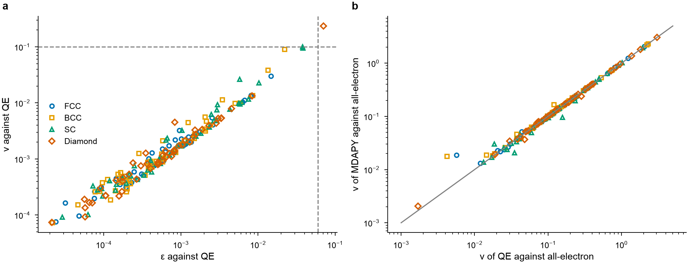

# Verification of the DFT

A density functional code is only as useful as it is right. MDAPY's
[plane-wave DFT](dft.md) is checked in three ways, from the code to the physics:

1. against its own derivatives and invariances;
2. against [Quantum ESPRESSO](https://www.quantum-espresso.org) 7.6 (`pw.x`), run
   on the same input;
3. against all-electron equations of state of 49 metals in four crystal structures,
   by the protocol of [Bosoni et al. (2024)](../../reference/references.md#bosoni2024).

The first two show that MDAPY solves the equations it means to solve. The third
measures its results against the exact solution of density functional theory with
the same functional, where what remains is the error of the pseudopotentials.

## Its own derivatives

The tests check, each time they run:

| Quantity | Against | Agreement |
|---|---|---|
| forces | central differences of the energy of displaced atoms (silicon, aluminium, iron with spin; norm-conserving, ultrasoft and PAW) | 1e-7 hartree/bohr |
| stress | differences of the energy of strained cells whose plane waves keep their Miller indices | 5e-8 hartree |
| symmetry | the same cell on the whole mesh of k-points without symmetry | 1e-14 hartree (norm-conserving), 1e-8 (PAW, see below) |
| exchange and correlation | [libxc](https://libxc.gitlab.io), point by point, with and without spin | 1e-10 of the energy |
| eigenvalues | the dense matrix of the Hamiltonian diagonalized by NumPy | 1e-10 hartree |
| PAW one-center terms on the GPU | a NumPy implementation of the same equations | 1e-11 of each term |

With PAW, the one-center terms are integrated over a set of directions that is not
cubic, as in Quantum ESPRESSO; a cell run without symmetry keeps a trace of that, 1e-8
hartree in bcc iron, which the symmetry, averaging the occupations and strengths of the
projectors over the operations, removes, as Quantum ESPRESSO's does.

## Quantum ESPRESSO on the same input

Every term of the energy, the eigenvalues, the Fermi level, the forces, the stress and
the magnetization agree with `pw.x` 7.6 on the same cells, pseudopotentials, cutoffs,
k-points and FFT grids, for norm-conserving, ultrasoft and PAW pseudopotentials, with
and without spin, with and without symmetry. The tests run `pw.x` each time; the
numbers are on the page of the [DFT](dft.md#how-the-results-compare-with-quantum-espresso).

## All-electron equations of state

Bosoni et al. computed the equations of state of every element from hydrogen to curium
in four cubic structures, FCC, BCC, SC and diamond, and of six oxides of each, with two
all-electron codes, WIEN2k and FLEUR, whose results agree with each other closely;
their average is the reference ([data](https://doi.org/10.24435/materialscloud:s4-3h),
CC BY 4.0). They also ran nine pseudopotential codes on the same structures by the same
protocol, among them Quantum ESPRESSO with the pseudopotentials used here.

### The protocol

MDAPY follows it as the paper sets it out:

- PBE (`"pbe_pw"`) without spin, the valence scalar relativistic;
- the pseudopotentials of [PseudoDojo](http://www.pseudo-dojo.org) 0.4, PBE, scalar
  relativistic, standard, in UPF ([van Setten et al. 2018](../../reference/references.md#vansetten2018)),
  at the cutoff of their "high" hint, 26 to 65 hartree, and `ecutrho` four times that;
- Fermi–Dirac smearing of 0.0045 Ry, and the free energy E − TS;
- seven volumes from 94 % to 106 % of the central volume of the set, in steps of 2 %;
- a Γ-centered mesh of k-points no more than 0.06 1/Å apart (2π included) along each
  reciprocal vector at the smallest volume, the same mesh at every volume: from
  17 × 17 × 17 to 61 × 61 × 61, 400 to 4000 irreducible k-points with the
  [symmetry](dft.md#what-it-computes) of the crystal;
- the Birch–Murnaghan equation of state fitted as the Delta project fits it, the
  energy a cubic polynomial in V^(−2/3), for the volume V0, the bulk modulus B0 and its
  derivative B1.

Two numbers compare two equations of state. ν is 100 times the length of the relative
differences of V0, B0 and B1, the last two weighted by 1/20 and 1/400. ε is the root
of the mean squared difference of the two energies over the volumes, aligned at their
minima, over the root of the product of their variances. Below 0.1 for ν or 0.06 for
ε the paper calls the agreement excellent; below 0.33 or 0.2, good.

### Results

| Structure | ν against Quantum ESPRESSO, median | largest | ν against all-electron, median | of Quantum ESPRESSO |
|---|---:|---:|---:|---:|
| FCC | 0.0013 | 0.030 | 0.120 | 0.120 |
| BCC | 0.0009 | 0.090 | 0.136 | 0.121 |
| SC | 0.0013 | 0.100 | 0.111 | 0.118 |
| Diamond | 0.0011 | 0.236 | 0.168 | 0.168 |



*a: MDAPY against Quantum ESPRESSO on the same pseudopotentials, each of the 196
structures (49 metals in four structures); the dashed lines are the paper's bounds of
excellent agreement. b: MDAPY against the all-electron codes, beside Quantum ESPRESSO
against them, on the same pseudopotentials; the line is their equality.*

- **The code.** Against Quantum ESPRESSO, 194 of the 196 structures agree to
  ν < 0.1, half of them to 0.001. The largest differences, sodium and magnesium, have
  equations of state so flat (a bulk modulus of 3 to 8 GPa for sodium) that a few
  tenths of a meV between the energies of the volumes change B1 by 10 %; the energies
  of sodium agree volume by volume to 0.3 meV, and Quantum ESPRESSO took the "normal"
  cutoff of 44 hartree where MDAPY takes the "high" 48.
- **The pseudopotentials.** Against the all-electron codes MDAPY and Quantum ESPRESSO
  agree with each other structure by structure (b): 75 of the 196 structures within
  ν < 0.1 for both, 159 and 160 within 0.33. The largest differences, barium in
  diamond (3.0), copper (2.0 to 2.3) and zinc (1.2 to 2.2), are those of the
  pseudopotentials of PseudoDojo 0.4 for these elements, the same in both codes.

ε is computed as the paper defines it; the scripts of the paper take the mean energy
of the first curve where the definition has that of the second, which changes ε by
about 1e-4 of itself.

### Reproducing it

The script `benchmarks/dft_verification.py` downloads the structures and the
reference data of the paper and the pseudopotentials of PseudoDojo with their hints,
runs the volumes of each structure and compares them:

```bash
pip install spglib  # the symmetry of the crystals
python benchmarks/dft_verification.py prepare verification
python benchmarks/dft_verification.py run verification Fe BCC Fe FCC Fe SC Fe Diamond
python benchmarks/dft_verification.py report verification table.md
python benchmarks/dft_verification.py figure verification verification.png
```

The 196 structures took 32 GPU-hours on V100 GPUs, 20 to 60 minutes each.

??? note "Every structure"

    | Element | Structure | V0 (ų) | B0 (GPa) | B1 | ν against QE | ε against QE | ν against all-electron | ν of QE against all-electron |
    |---|---|---:|---:|---:|---:|---:|---:|---:|
    | Ag | FCC | 17.843 | 91.2 | 5.83 | 0.002 | 0.001 | 0.027 | 0.029 |
    | Ag | BCC | 17.989 | 88.6 | 5.71 | 0.002 | 0.001 | 0.041 | 0.042 |
    | Ag | SC | 20.812 | 67.2 | 5.84 | 0.001 | 0.000 | 0.026 | 0.025 |
    | Ag | Diamond | 60.201 | 30.1 | 5.69 | 0.000 | 0.000 | 0.104 | 0.104 |
    | Al | FCC | 16.441 | 78.3 | 4.64 | 0.014 | 0.008 | 0.332 | 0.319 |
    | Al | BCC | 16.868 | 69.3 | 4.46 | 0.010 | 0.005 | 0.347 | 0.338 |
    | Al | SC | 20.108 | 57.1 | 4.42 | 0.010 | 0.006 | 0.236 | 0.226 |
    | Al | Diamond | 55.184 | 37.4 | 4.17 | 0.005 | 0.003 | 0.135 | 0.130 |
    | Au | FCC | 17.924 | 140.6 | 5.95 | 0.001 | 0.000 | 0.310 | 0.309 |
    | Au | BCC | 17.988 | 137.9 | 5.98 | 0.001 | 0.001 | 0.305 | 0.304 |
    | Au | SC | 20.707 | 106.6 | 5.61 | 0.001 | 0.000 | 0.306 | 0.306 |
    | Au | Diamond | 58.354 | 53.2 | 5.88 | 0.001 | 0.001 | 0.323 | 0.322 |
    | Ba | FCC | 64.338 | 8.2 | 2.57 | 0.000 | 0.000 | 0.353 | 0.352 |
    | Ba | BCC | 63.521 | 8.8 | 2.95 | 0.000 | 0.000 | 0.344 | 0.344 |
    | Ba | SC | 62.234 | 7.4 | 3.69 | 0.003 | 0.001 | 1.019 | 1.021 |
    | Ba | Diamond | 116.598 | 7.3 | 8.16 | 0.000 | 0.000 | 3.038 | 3.038 |
    | Be | FCC | 7.932 | 119.6 | 3.52 | 0.002 | 0.001 | 0.760 | 0.761 |
    | Be | BCC | 7.874 | 124.5 | 3.41 | 0.011 | 0.003 | 0.744 | 0.753 |
    | Be | SC | 10.320 | 75.6 | 3.30 | 0.023 | 0.010 | 0.512 | 0.493 |
    | Be | Diamond | 29.493 | 43.9 | 3.46 | 0.004 | 0.002 | 0.405 | 0.409 |
    | Bi | FCC | 31.803 | 51.7 | 4.66 | 0.000 | 0.000 | 0.030 | 0.030 |
    | Bi | BCC | 31.628 | 52.2 | 4.64 | 0.000 | 0.000 | 0.026 | 0.026 |
    | Bi | SC | 35.178 | 46.3 | 4.71 | 0.000 | 0.000 | 0.080 | 0.080 |
    | Bi | Diamond | 96.813 | 28.8 | 4.39 | 0.000 | 0.000 | 0.094 | 0.094 |
    | Ca | FCC | 42.178 | 17.4 | 3.27 | 0.002 | 0.001 | 0.039 | 0.041 |
    | Ca | BCC | 42.125 | 16.6 | 2.75 | 0.002 | 0.001 | 0.060 | 0.062 |
    | Ca | SC | 43.571 | 10.7 | 3.26 | 0.005 | 0.003 | 0.033 | 0.037 |
    | Ca | Diamond | 159.903 | 4.1 | 2.74 | 0.001 | 0.000 | 0.042 | 0.042 |
    | Cd | FCC | 22.988 | 41.2 | 5.85 | 0.001 | 0.000 | 0.644 | 0.644 |
    | Cd | BCC | 23.543 | 35.4 | 6.38 | 0.000 | 0.000 | 0.532 | 0.532 |
    | Cd | SC | 27.055 | 29.5 | 5.94 | 0.000 | 0.000 | 0.496 | 0.496 |
    | Cd | Diamond | 75.615 | 13.7 | 6.45 | 0.000 | 0.000 | 0.964 | 0.964 |
    | Co | FCC | 10.317 | 254.3 | 4.75 | 0.002 | 0.001 | 0.081 | 0.083 |
    | Co | BCC | 10.550 | 238.6 | 4.76 | 0.001 | 0.001 | 0.053 | 0.054 |
    | Co | SC | 11.904 | 183.2 | 4.64 | 0.000 | 0.000 | 0.089 | 0.089 |
    | Co | Diamond | 29.790 | 131.4 | 4.67 | 0.001 | 0.001 | 0.073 | 0.074 |
    | Cr | FCC | 11.907 | 239.2 | 4.13 | 0.001 | 0.000 | 0.181 | 0.180 |
    | Cr | BCC | 11.566 | 260.2 | 4.24 | 0.001 | 0.000 | 0.160 | 0.160 |
    | Cr | SC | 12.835 | 189.7 | 4.16 | 0.008 | 0.003 | 0.223 | 0.229 |
    | Cr | Diamond | 33.186 | 102.0 | 3.81 | 0.001 | 0.000 | 0.349 | 0.348 |
    | Cs | FCC | 117.269 | 1.9 | 3.51 | 0.002 | 0.001 | 0.078 | 0.079 |
    | Cs | BCC | 116.752 | 2.0 | 3.48 | 0.001 | 0.000 | 0.077 | 0.077 |
    | Cs | SC | 128.237 | 1.5 | 3.70 | 0.001 | 0.001 | 0.095 | 0.096 |
    | Cs | Diamond | 377.134 | 0.7 | 3.13 | 0.001 | 0.001 | 0.100 | 0.099 |
    | Cu | FCC | 12.190 | 156.8 | 2.78 | 0.001 | 0.001 | 2.043 | 2.043 |
    | Cu | BCC | 11.787 | 184.7 | 5.37 | 0.000 | 0.000 | 2.312 | 2.312 |
    | Cu | SC | 14.184 | 87.4 | 11.86 | 0.009 | 0.003 | 1.955 | 1.947 |
    | Cu | Diamond | 38.873 | 57.4 | 6.87 | 0.001 | 0.001 | 1.368 | 1.369 |
    | Fe | FCC | 10.252 | 286.2 | 4.59 | 0.004 | 0.003 | 0.079 | 0.075 |
    | Fe | BCC | 10.488 | 268.6 | 4.63 | 0.003 | 0.002 | 0.118 | 0.115 |
    | Fe | SC | 11.646 | 208.1 | 4.44 | 0.005 | 0.003 | 0.046 | 0.042 |
    | Fe | Diamond | 28.902 | 155.3 | 4.46 | 0.005 | 0.003 | 0.078 | 0.072 |
    | Ga | FCC | 18.950 | 48.7 | 4.85 | 0.003 | 0.001 | 0.024 | 0.025 |
    | Ga | BCC | 19.213 | 47.8 | 5.06 | 0.004 | 0.002 | 0.039 | 0.043 |
    | Ga | SC | 20.135 | 46.2 | 4.90 | 0.002 | 0.001 | 0.088 | 0.087 |
    | Ga | Diamond | 50.926 | 35.7 | 5.09 | 0.003 | 0.002 | 0.174 | 0.176 |
    | Hf | FCC | 22.577 | 103.0 | 3.35 | 0.001 | 0.000 | 0.081 | 0.081 |
    | Hf | BCC | 22.334 | 101.1 | 3.30 | 0.000 | 0.000 | 0.152 | 0.153 |
    | Hf | SC | 24.840 | 73.5 | 3.45 | 0.002 | 0.001 | 0.238 | 0.237 |
    | Hf | Diamond | 70.416 | 30.3 | 1.32 | 0.002 | 0.001 | 0.381 | 0.379 |
    | Hg | FCC | 32.081 | 5.6 | 0.44 | 0.030 | 0.015 | 0.831 | 0.808 |
    | Hg | BCC | 29.038 | 9.8 | 10.90 | 0.005 | 0.002 | 0.721 | 0.725 |
    | Hg | SC | 29.671 | 14.1 | 11.11 | 0.006 | 0.002 | 0.644 | 0.638 |
    | Hg | Diamond | 111.640 | 1.8 | 3.27 | 0.003 | 0.002 | 0.841 | 0.843 |
    | In | FCC | 27.468 | 35.7 | 5.09 | 0.003 | 0.002 | 0.153 | 0.150 |
    | In | BCC | 27.741 | 34.3 | 5.32 | 0.003 | 0.002 | 0.143 | 0.141 |
    | In | SC | 29.522 | 31.0 | 5.38 | 0.002 | 0.001 | 0.100 | 0.099 |
    | In | Diamond | 76.399 | 21.4 | 5.43 | 0.002 | 0.001 | 0.052 | 0.051 |
    | Ir | FCC | 14.473 | 348.7 | 5.11 | 0.000 | 0.000 | 0.221 | 0.220 |
    | Ir | BCC | 15.023 | 308.0 | 5.07 | 0.001 | 0.000 | 0.216 | 0.215 |
    | Ir | SC | 16.959 | 246.9 | 5.02 | 0.001 | 0.000 | 0.210 | 0.209 |
    | Ir | Diamond | 43.099 | 185.1 | 5.02 | 0.000 | 0.000 | 0.220 | 0.220 |
    | K | FCC | 74.014 | 3.5 | 3.77 | 0.001 | 0.001 | 0.013 | 0.012 |
    | K | BCC | 73.794 | 3.6 | 3.78 | 0.001 | 0.001 | 0.020 | 0.019 |
    | K | SC | 79.365 | 2.8 | 3.77 | 0.001 | 0.000 | 0.014 | 0.013 |
    | K | Diamond | 223.802 | 1.2 | 3.24 | 0.000 | 0.000 | 0.002 | 0.002 |
    | La | FCC | 36.906 | 24.5 | 2.58 | 0.002 | 0.001 | 0.112 | 0.110 |
    | La | BCC | 37.780 | 26.2 | 2.83 | 0.002 | 0.001 | 0.101 | 0.099 |
    | La | SC | 36.655 | 23.7 | 3.59 | 0.003 | 0.002 | 0.247 | 0.245 |
    | La | Diamond | 74.345 | 43.6 | 6.14 | 0.003 | 0.001 | 0.394 | 0.392 |
    | Li | FCC | 20.248 | 13.8 | 3.31 | 0.005 | 0.003 | 0.114 | 0.119 |
    | Li | BCC | 20.286 | 13.9 | 3.36 | 0.002 | 0.001 | 0.091 | 0.092 |
    | Li | SC | 20.428 | 12.2 | 3.31 | 0.008 | 0.004 | 0.094 | 0.102 |
    | Li | Diamond | 51.428 | 5.4 | 2.95 | 0.003 | 0.002 | 0.082 | 0.082 |
    | Lu | FCC | 28.888 | 41.3 | 4.47 | 0.001 | 0.000 | 0.308 | 0.308 |
    | Lu | BCC | 29.561 | 43.8 | 3.58 | 0.001 | 0.000 | 0.244 | 0.243 |
    | Lu | SC | 32.683 | 31.8 | 5.57 | 0.002 | 0.001 | 0.905 | 0.906 |
    | Lu | Diamond | 101.942 | 12.3 | 1.34 | 0.005 | 0.001 | 0.718 | 0.719 |
    | Mg | FCC | 23.176 | 35.2 | 3.97 | 0.011 | 0.007 | 0.220 | 0.229 |
    | Mg | BCC | 22.967 | 34.8 | 3.59 | 0.038 | 0.014 | 0.223 | 0.214 |
    | Mg | SC | 27.632 | 23.0 | 3.80 | 0.095 | 0.038 | 0.197 | 0.233 |
    | Mg | Diamond | 80.999 | 10.7 | 4.29 | 0.008 | 0.005 | 0.183 | 0.190 |
    | Mn | FCC | 10.749 | 281.4 | 4.40 | 0.001 | 0.000 | 0.022 | 0.022 |
    | Mn | BCC | 10.779 | 279.2 | 4.46 | 0.001 | 0.000 | 0.018 | 0.018 |
    | Mn | SC | 11.903 | 211.9 | 4.29 | 0.001 | 0.000 | 0.037 | 0.037 |
    | Mn | Diamond | 30.354 | 145.2 | 4.17 | 0.001 | 0.001 | 0.037 | 0.038 |
    | Mo | FCC | 16.056 | 237.9 | 4.05 | 0.000 | 0.000 | 0.133 | 0.132 |
    | Mo | BCC | 15.814 | 258.8 | 4.21 | 0.000 | 0.000 | 0.136 | 0.136 |
    | Mo | SC | 17.622 | 189.2 | 4.20 | 0.000 | 0.000 | 0.144 | 0.144 |
    | Mo | Diamond | 46.088 | 106.6 | 4.12 | 0.000 | 0.000 | 0.175 | 0.175 |
    | Na | FCC | 37.160 | 7.7 | 3.67 | 0.002 | 0.001 | 0.164 | 0.165 |
    | Na | BCC | 37.067 | 7.7 | 2.74 | 0.090 | 0.022 | 0.166 | 0.120 |
    | Na | SC | 39.778 | 6.1 | 4.56 | 0.100 | 0.038 | 0.095 | 0.157 |
    | Na | Diamond | 109.381 | 2.9 | 3.21 | 0.236 | 0.071 | 0.239 | 0.284 |
    | Nb | FCC | 18.792 | 163.4 | 3.66 | 0.000 | 0.000 | 0.128 | 0.128 |
    | Nb | BCC | 18.168 | 169.4 | 3.68 | 0.000 | 0.000 | 0.145 | 0.145 |
    | Nb | SC | 20.137 | 129.6 | 3.87 | 0.001 | 0.000 | 0.111 | 0.111 |
    | Nb | Diamond | 51.648 | 66.6 | 4.30 | 0.000 | 0.000 | 0.168 | 0.168 |
    | Ni | FCC | 10.847 | 200.8 | 4.88 | 0.001 | 0.001 | 0.119 | 0.119 |
    | Ni | BCC | 10.905 | 196.9 | 4.91 | 0.001 | 0.001 | 0.099 | 0.100 |
    | Ni | SC | 12.575 | 146.0 | 4.85 | 0.000 | 0.000 | 0.131 | 0.131 |
    | Ni | Diamond | 33.054 | 91.0 | 4.82 | 0.001 | 0.001 | 0.136 | 0.137 |
    | Os | FCC | 14.314 | 390.7 | 4.80 | 0.000 | 0.000 | 0.190 | 0.189 |
    | Os | BCC | 14.753 | 352.8 | 4.79 | 0.000 | 0.000 | 0.191 | 0.191 |
    | Os | SC | 16.703 | 271.7 | 4.68 | 0.000 | 0.000 | 0.165 | 0.165 |
    | Os | Diamond | 42.829 | 205.3 | 4.62 | 0.000 | 0.000 | 0.168 | 0.168 |
    | Pb | FCC | 31.996 | 39.7 | 4.74 | 0.001 | 0.001 | 0.120 | 0.120 |
    | Pb | BCC | 31.937 | 39.0 | 4.77 | 0.001 | 0.000 | 0.107 | 0.107 |
    | Pb | SC | 34.437 | 35.5 | 4.87 | 0.001 | 0.001 | 0.117 | 0.118 |
    | Pb | Diamond | 87.989 | 25.4 | 4.77 | 0.001 | 0.000 | 0.118 | 0.118 |
    | Pd | FCC | 15.275 | 171.4 | 5.55 | 0.000 | 0.000 | 0.342 | 0.341 |
    | Pd | BCC | 15.386 | 167.4 | 5.54 | 0.000 | 0.000 | 0.394 | 0.393 |
    | Pd | SC | 17.821 | 122.4 | 5.41 | 0.002 | 0.001 | 0.229 | 0.228 |
    | Pd | Diamond | 48.918 | 67.3 | 5.35 | 0.001 | 0.001 | 0.212 | 0.211 |
    | Po | FCC | 32.606 | 49.7 | 4.97 | 0.001 | 0.001 | 0.131 | 0.131 |
    | Po | BCC | 32.876 | 50.1 | 4.98 | 0.000 | 0.000 | 0.068 | 0.068 |
    | Po | SC | 37.573 | 45.6 | 4.89 | 0.000 | 0.000 | 0.063 | 0.063 |
    | Po | Diamond | 104.946 | 25.6 | 4.57 | 0.000 | 0.000 | 0.019 | 0.019 |
    | Pt | FCC | 15.619 | 248.4 | 5.47 | 0.000 | 0.000 | 0.240 | 0.240 |
    | Pt | BCC | 15.803 | 239.0 | 5.43 | 0.000 | 0.000 | 0.230 | 0.230 |
    | Pt | SC | 18.042 | 186.4 | 5.45 | 0.001 | 0.001 | 0.248 | 0.247 |
    | Pt | Diamond | 48.106 | 115.1 | 5.44 | 0.001 | 0.001 | 0.258 | 0.257 |
    | Rb | FCC | 91.411 | 2.8 | 3.76 | 0.013 | 0.008 | 0.019 | 0.006 |
    | Rb | BCC | 91.128 | 2.8 | 3.78 | 0.014 | 0.009 | 0.018 | 0.004 |
    | Rb | SC | 98.950 | 2.1 | 3.84 | 0.012 | 0.008 | 0.030 | 0.018 |
    | Rb | Diamond | 282.658 | 1.0 | 3.31 | 0.004 | 0.003 | 0.034 | 0.030 |
    | Re | FCC | 14.996 | 363.5 | 4.46 | 0.003 | 0.001 | 0.140 | 0.138 |
    | Re | BCC | 15.083 | 355.0 | 4.54 | 0.001 | 0.000 | 0.144 | 0.143 |
    | Re | SC | 17.145 | 259.8 | 4.36 | 0.004 | 0.002 | 0.098 | 0.094 |
    | Re | Diamond | 45.114 | 177.9 | 4.21 | 0.005 | 0.003 | 0.080 | 0.075 |
    | Rh | FCC | 14.076 | 256.1 | 5.21 | 0.001 | 0.000 | 0.179 | 0.179 |
    | Rh | BCC | 14.502 | 232.4 | 5.16 | 0.001 | 0.000 | 0.195 | 0.195 |
    | Rh | SC | 16.341 | 183.1 | 5.08 | 0.001 | 0.001 | 0.221 | 0.222 |
    | Rh | Diamond | 42.002 | 128.4 | 5.16 | 0.000 | 0.000 | 0.242 | 0.241 |
    | Ru | FCC | 13.862 | 305.3 | 4.87 | 0.000 | 0.000 | 0.180 | 0.180 |
    | Ru | BCC | 14.266 | 278.6 | 4.87 | 0.001 | 0.000 | 0.214 | 0.214 |
    | Ru | SC | 15.874 | 220.2 | 4.76 | 0.000 | 0.000 | 0.224 | 0.224 |
    | Ru | Diamond | 40.673 | 163.2 | 4.75 | 0.000 | 0.000 | 0.213 | 0.213 |
    | Sc | FCC | 24.705 | 51.1 | 3.14 | 0.002 | 0.001 | 0.075 | 0.074 |
    | Sc | BCC | 24.901 | 52.9 | 3.25 | 0.003 | 0.002 | 0.063 | 0.059 |
    | Sc | SC | 26.153 | 35.3 | 3.00 | 0.026 | 0.006 | 0.021 | 0.035 |
    | Sc | Diamond | 68.976 | 8.4 | 5.61 | 0.001 | 0.001 | 0.109 | 0.109 |
    | Sn | FCC | 28.030 | 46.9 | 4.75 | 0.000 | 0.000 | 0.076 | 0.076 |
    | Sn | BCC | 27.677 | 47.2 | 4.78 | 0.000 | 0.000 | 0.106 | 0.106 |
    | Sn | SC | 29.480 | 46.3 | 4.87 | 0.000 | 0.000 | 0.090 | 0.090 |
    | Sn | Diamond | 73.760 | 35.8 | 4.90 | 0.000 | 0.000 | 0.099 | 0.100 |
    | Sr | FCC | 54.880 | 11.7 | 3.29 | 0.002 | 0.001 | 0.023 | 0.021 |
    | Sr | BCC | 54.003 | 11.5 | 3.76 | 0.006 | 0.002 | 0.019 | 0.014 |
    | Sr | SC | 57.151 | 7.1 | 3.31 | 0.003 | 0.002 | 0.038 | 0.040 |
    | Sr | Diamond | 223.669 | 2.7 | 2.89 | 0.002 | 0.001 | 0.051 | 0.049 |
    | Ta | FCC | 18.829 | 190.7 | 3.71 | 0.000 | 0.000 | 0.069 | 0.069 |
    | Ta | BCC | 18.291 | 194.4 | 3.76 | 0.001 | 0.000 | 0.037 | 0.037 |
    | Ta | SC | 20.671 | 143.0 | 3.79 | 0.001 | 0.000 | 0.031 | 0.031 |
    | Ta | Diamond | 56.851 | 69.9 | 3.16 | 0.002 | 0.001 | 0.064 | 0.065 |
    | Tc | FCC | 14.528 | 296.9 | 4.50 | 0.000 | 0.000 | 0.106 | 0.106 |
    | Tc | BCC | 14.640 | 291.9 | 4.57 | 0.000 | 0.000 | 0.138 | 0.139 |
    | Tc | SC | 16.258 | 223.0 | 4.48 | 0.000 | 0.000 | 0.141 | 0.141 |
    | Tc | Diamond | 42.548 | 150.7 | 4.35 | 0.000 | 0.000 | 0.132 | 0.132 |
    | Ti | FCC | 17.413 | 107.3 | 3.43 | 0.001 | 0.000 | 0.109 | 0.109 |
    | Ti | BCC | 17.288 | 105.8 | 3.38 | 0.000 | 0.000 | 0.121 | 0.121 |
    | Ti | SC | 18.416 | 78.0 | 3.42 | 0.000 | 0.000 | 0.017 | 0.017 |
    | Ti | Diamond | 45.821 | 34.2 | 2.78 | 0.000 | 0.000 | 0.054 | 0.054 |
    | Tl | FCC | 31.038 | 27.1 | 5.52 | 0.001 | 0.000 | 0.331 | 0.331 |
    | Tl | BCC | 31.311 | 26.6 | 5.42 | 0.000 | 0.000 | 0.333 | 0.332 |
    | Tl | SC | 34.277 | 22.1 | 5.34 | 0.000 | 0.000 | 0.345 | 0.345 |
    | Tl | Diamond | 90.001 | 14.1 | 5.32 | 0.001 | 0.000 | 0.324 | 0.325 |
    | V | FCC | 13.917 | 176.1 | 3.86 | 0.002 | 0.001 | 0.089 | 0.089 |
    | V | BCC | 13.476 | 181.5 | 3.81 | 0.004 | 0.001 | 0.112 | 0.115 |
    | V | SC | 14.687 | 136.8 | 3.81 | 0.010 | 0.006 | 0.049 | 0.060 |
    | V | Diamond | 37.205 | 64.2 | 4.14 | 0.001 | 0.000 | 0.096 | 0.095 |
    | W | FCC | 16.451 | 282.7 | 4.04 | 0.010 | 0.006 | 0.051 | 0.044 |
    | W | BCC | 16.140 | 303.4 | 4.19 | 0.010 | 0.006 | 0.046 | 0.037 |
    | W | SC | 18.369 | 214.1 | 4.16 | 0.010 | 0.006 | 0.024 | 0.028 |
    | W | Diamond | 49.565 | 120.1 | 3.77 | 0.013 | 0.008 | 0.037 | 0.048 |
    | Y | FCC | 32.488 | 39.0 | 3.28 | 0.000 | 0.000 | 0.052 | 0.052 |
    | Y | BCC | 33.048 | 38.7 | 2.99 | 0.000 | 0.000 | 0.052 | 0.052 |
    | Y | SC | 34.850 | 26.0 | 3.00 | 0.000 | 0.000 | 0.095 | 0.095 |
    | Y | Diamond | 87.812 | 9.1 | 12.30 | 0.001 | 0.000 | 0.395 | 0.394 |
    | Zn | FCC | 14.981 | 73.4 | 6.18 | 0.002 | 0.001 | 1.234 | 1.232 |
    | Zn | BCC | 15.664 | 50.6 | 5.18 | 0.002 | 0.001 | 2.211 | 2.211 |
    | Zn | SC | 18.238 | 50.8 | 6.08 | 0.005 | 0.003 | 0.444 | 0.442 |
    | Zn | Diamond | 48.490 | 28.7 | 7.37 | 0.001 | 0.001 | 1.820 | 1.819 |
    | Zr | FCC | 23.240 | 90.1 | 3.29 | 0.001 | 0.001 | 0.113 | 0.114 |
    | Zr | BCC | 22.870 | 87.6 | 3.13 | 0.001 | 0.001 | 0.110 | 0.111 |
    | Zr | SC | 24.769 | 67.9 | 3.56 | 0.001 | 0.001 | 0.106 | 0.107 |
    | Zr | Diamond | 62.045 | 36.2 | 3.15 | 0.001 | 0.001 | 0.217 | 0.218 |

!!! quote "Please cite"
    The protocol and the all-electron data: [Bosoni et al. (2024)](../../reference/references.md#bosoni2024);
    the pseudopotentials: [van Setten et al. (2018)](../../reference/references.md#vansetten2018).
