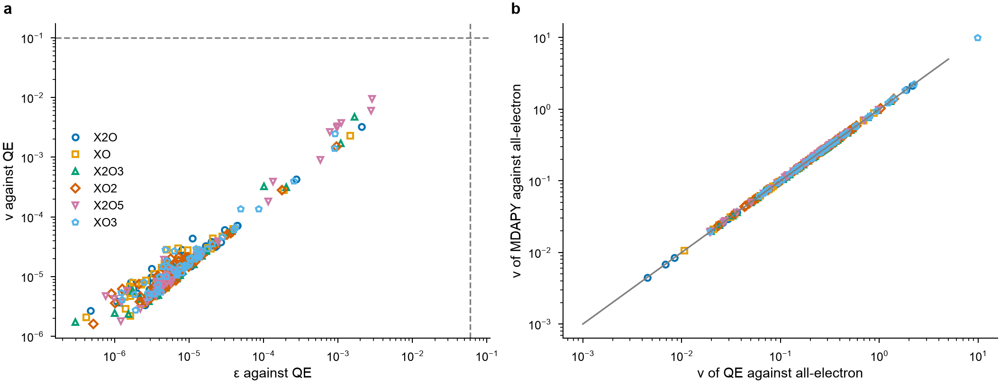

# Verification of the DFT

A density functional code is only as useful as it is right. MDAPY's
[plane-wave DFT](dft.md) is checked in three ways, from the code to the physics:

1. against its own derivatives and invariances;
2. against [Quantum ESPRESSO](https://www.quantum-espresso.org) 7.6 (`pw.x`), run
   on the same input;
3. against all-electron equations of state of 72 elements, from hydrogen to radon, in
   four crystal structures, and of six oxides of 49 metals, by the protocol of
   [Bosoni et al. (2024)](../../reference/references.md#bosoni2024).
4. against the all-electron equations of state of six magnetic elements with spin,
   those of the Delta project.

The first two show that MDAPY solves the equations it means to solve. The last two
measure its results against the exact solution of density functional theory with
the same functional, where what remains is the error of the pseudopotentials.

## Its own derivatives

The tests check, each time they run:

| Quantity | Against | Agreement |
|---|---|---|
| forces | central differences of the energy of displaced atoms (silicon, aluminium, iron with spin; norm-conserving, ultrasoft and PAW) | 1e-7 hartree/bohr |
| stress | differences of the energy of strained cells whose plane waves keep their Miller indices | 5e-8 hartree |
| symmetry | the same cell on the whole mesh of k-points without symmetry | 1e-14 hartree (norm-conserving), 1e-8 (PAW, see below) |
| exchange and correlation | [libxc](https://libxc.gitlab.io), point by point, with and without spin | 1e-10 of the energy |
| eigenvalues | the dense matrix of the Hamiltonian diagonalized by NumPy | 1e-10 hartree |
| PAW one-center terms on the GPU | a NumPy implementation of the same equations | 1e-11 of each term |

With PAW, the one-center terms are integrated over a set of directions that is not
cubic, as in Quantum ESPRESSO; a cell run without symmetry keeps a trace of that, 1e-8
hartree in bcc iron, which the symmetry, averaging the occupations and strengths of the
projectors over the operations, removes, as Quantum ESPRESSO's does.

## Quantum ESPRESSO on the same input

Every term of the energy, the eigenvalues, the Fermi level, the forces, the stress and
the magnetization agree with `pw.x` 7.6 on the same cells, pseudopotentials, cutoffs,
k-points and FFT grids, for norm-conserving, ultrasoft and PAW pseudopotentials, with
and without spin, with and without symmetry. The tests run `pw.x` each time; the
numbers are on the page of the [DFT](dft.md#how-the-results-compare-with-quantum-espresso).

## All-electron equations of state

Bosoni et al. computed the equations of state of every element from hydrogen to curium
in four cubic structures, FCC, BCC, SC and diamond, and of six oxides of each, with two
all-electron codes, WIEN2k and FLEUR, whose results agree with each other closely;
their average is the reference ([data](https://doi.org/10.24435/materialscloud:s4-3h),
CC BY 4.0). They also ran nine pseudopotential codes on the same structures by the same
protocol, among them Quantum ESPRESSO with the pseudopotentials used here.

### The protocol

MDAPY follows it as the paper sets it out, on the input of the Quantum ESPRESSO the
paper ran:

- PBE (`"pbe_pw"`) without spin, the valence scalar relativistic;
- the pseudopotentials of [PseudoDojo](http://www.pseudo-dojo.org) 0.4, PBE, scalar
  relativistic, standard, in UPF ([van Setten et al. 2018](../../reference/references.md#vansetten2018)),
  at the cutoff of their "normal" hint, 18 to 55 hartree, and `ecutrho` four times
  that, as the paper's Quantum ESPRESSO took them;
- the FFT grids Quantum ESPRESSO makes for these cutoffs: of the factors 2, 3 and 5
  and, with symmetry, multiples of the denominators of the fractional translations
  (4 in diamond);
- Fermi–Dirac smearing of 0.0045 Ry, and the free energy E − TS;
- seven volumes from 94 % to 106 % of the central volume of the set, in steps of 2 %;
- a Γ-centered mesh of k-points no more than 0.06 1/Å apart (2π included) along each
  reciprocal vector at the smallest volume, the same mesh at every volume: from
  17 × 17 × 17 to 61 × 61 × 61, 400 to 4000 irreducible k-points with the
  [symmetry](dft.md#what-it-computes) of the crystal;
- the Birch–Murnaghan equation of state fitted as the Delta project fits it, the
  energy a cubic polynomial in V^(−2/3), for the volume V0, the bulk modulus B0 and its
  derivative B1.

Two numbers compare two equations of state. ν is 100 times the length of the relative
differences of V0, B0 and B1, the last two weighted by 1/20 and 1/400. ε is the root
of the mean squared difference of the two energies over the volumes, aligned at their
minima, over the root of the product of their variances. Below 0.1 for ν or 0.06 for
ε the paper calls the agreement excellent; below 0.33 or 0.2, good.

### Results

The 288 structures of the elements:

| Structure | ν against Quantum ESPRESSO, median | largest | ν against all-electron, median | of Quantum ESPRESSO |
|---|---:|---:|---:|---:|
| FCC | 0.00005 | 0.004 | 0.134 | 0.134 |
| BCC | 0.00004 | 0.012 | 0.138 | 0.138 |
| SC | 0.00005 | 0.004 | 0.133 | 0.133 |
| Diamond | 0.00005 | 0.005 | 0.147 | 0.147 |


*a: MDAPY against Quantum ESPRESSO on the same pseudopotentials, each of the 288
structures (the 72 elements of PseudoDojo's table in four structures); the dashed
lines are the paper's bounds of excellent agreement. b: MDAPY against the all-electron codes, beside Quantum ESPRESSO
against them, on the same pseudopotentials; the line is their equality.*

- **The code.** Against Quantum ESPRESSO, all 288 structures agree to ν < 0.013, an
  eighth of the paper's bound of excellent agreement, 271 of them to 0.001, and all to
  ε < 0.004.
- **The pseudopotentials.** Against the all-electron codes MDAPY and Quantum ESPRESSO
  agree with each other structure by structure (b), to the second decimal of ν: 105 of
  the 288 structures within ν < 0.1 for both, 220 within 0.33. The largest
  differences, neon in BCC (3.4), barium in diamond (3.0), copper (2.0 to 2.3) and zinc
  (1.8 to 2.2), are those of the pseudopotentials of PseudoDojo 0.4 for these
  elements, the same in both codes.

The 294 oxides X2O, XO, X2O3, XO2, X2O5 and XO3 of 49 metals, from lithium to polonium,
at the higher of the "normal" hints of the metal and of oxygen:

| Oxide | ν against Quantum ESPRESSO, median | largest | ν against all-electron, median | of Quantum ESPRESSO |
|---|---:|---:|---:|---:|
| X2O | 0.00002 | 0.003 | 0.150 | 0.150 |
| XO | 0.00001 | 0.002 | 0.220 | 0.220 |
| X2O3 | 0.00001 | 0.005 | 0.257 | 0.257 |
| XO2 | 0.00001 | 0.002 | 0.254 | 0.254 |
| X2O5 | 0.00001 | 0.010 | 0.225 | 0.225 |
| XO3 | 0.00002 | 0.003 | 0.278 | 0.278 |



*The oxides as the elements above: a, against Quantum ESPRESSO on the same
pseudopotentials; b, against the all-electron codes beside Quantum ESPRESSO.*

- **The code.** All 294 oxides agree with Quantum ESPRESSO to ν < 0.01, 281 of them to
  0.001, and to ε < 0.003.
- **The pseudopotentials.** Against the all-electron codes the two codes agree again
  oxide by oxide (b). The largest differences, BaO3 (9.9), RbO3 (2.2), Ba2O (2.1),
  Cu2O (1.9) and PoO3 (1.8), are the pseudopotentials'.

What brings two codes this close is the same input in full: the cutoff the reference
took (at the "high" hints, a few hartree higher, the softest structures move by
tenths of a meV: ν 0.24 for sodium in diamond, 0.28 for BaO3) and the same FFT grid
at every volume, since the exchange and correlation of GGA is integrated on the grid
(grids of 50 and 54 points where Quantum ESPRESSO kept 60 made ν 0.8 for neon in
diamond).

ε is computed as the paper defines it; the scripts of the paper take the mean energy
of the first curve where the definition has that of the second, which changes ε by
about 1e-4 of itself.

### Reproducing it

The script `benchmarks/dft_verification.py` downloads the structures and the
reference data of the paper and the pseudopotentials of PseudoDojo with their hints,
runs the volumes of each structure and compares them:

```bash
pip install spglib  # the symmetry of the crystals
python benchmarks/dft_verification.py prepare verification
python benchmarks/dft_verification.py run verification Fe BCC Fe FCC Fe SC Fe Diamond --hint normal
python benchmarks/dft_verification.py run verification Fe XO Fe X2O3 --hint normal  # oxides
python benchmarks/dft_verification.py report verification table.md --hint normal
python benchmarks/dft_verification.py figure verification verification.png unaries --hint normal
python benchmarks/dft_verification.py figure verification oxides.png oxides --hint normal
```

The 288 structures of the elements took 36 GPU-hours, mostly on V100 GPUs, 1 to 22
minutes each; the 294 oxides 73 GPU-hours.

## Magnetic elements

The protocol above is without spin. The Delta project
([Lejaeghere et al. 2016](../../reference/references.md#lejaeghere2016)) took six
elements with their magnetic order: oxygen, chromium and manganese antiferromagnetic
(the two molecules of oxygen, the corner and the centre of bcc chromium, and the (001)
planes of manganese in its simpler fcc cell opposed), iron, cobalt and nickel
ferromagnetic, with WIEN2k as the all-electron reference. MDAPY takes them with spin,
the first moments of these orders, and the protocol above otherwise; against pw.x on
the same input (the moments, the mesh, the grids, `conv_thr` 1e-11 Ry) and against
WIEN2k, with PseudoDojo at its "normal" hints and with SSSP 1.3 precision
([Prandini et al. 2018](../../reference/references.md#prandini2018)):

| Element | Order | ν against pw.x, PseudoDojo | Δ against WIEN2k, PseudoDojo (meV/atom) | Δ against WIEN2k, SSSP (meV/atom) | \|m\| at V0, PseudoDojo / SSSP (μB/atom) |
|---|---|---:|---:|---:|---:|
| O | AFM | 0.0000 | 2.0 | 1.2 | 0.96 / 0.96 |
| Cr | AFM | 0.0001 | 11.1 | 1.6 | 1.63 / 1.20 |
| Mn | AFM | 0.0000 | 8.5 | 1.6 | 2.22 / 1.96 |
| Fe | FM | 0.0045 | 5.1 | 1.7 | 2.41 / 2.28 |
| Co | FM | 0.0006 | 0.9 | 0.4 | 1.81 / 1.83 |
| Ni | FM | 0.0000 | 0.8 | 0.3 | 0.75 / 0.75 |

- **The code.** On the same input MDAPY and pw.x give the same equations of state with
  spin, ν below 0.005.
- **The pseudopotentials.** Δ is the root of the mean squared difference of two
  equations of state over ±6 % of the volume, the number of the Delta project. With
  the standard PseudoDojo, chromium, manganese and iron are 5 to 11 meV per atom from
  WIEN2k, in pw.x as in MDAPY; with SSSP's files all six are within 2 meV per atom:
  for labels of magnetic systems, these.
- **The magnetic state.** With Kerker's preconditioner, nickel of SSSP's ultrasoft file
  fell to the state without moment at the three largest volumes, from 0.7 Bohr
  magnetons, 59 to 83 meV per atom above the ferromagnet; the preconditioner of the
  local density of states (`preconditioner="ldos"`) keeps the moment at every volume,
  and the row above is of that run.

`benchmarks/dft_magnetic.py` takes the structures and WIEN2k's equations of state from
the archive of the Delta project:

```bash
python benchmarks/dft_magnetic.py prepare verification
python benchmarks/dft_magnetic.py run verification O Cr Mn Fe Co Ni --hint normal
python benchmarks/dft_magnetic.py run verification O Cr Mn Fe Co --library sssp
python benchmarks/dft_magnetic.py run verification Ni --library sssp --preconditioner ldos
python benchmarks/dft_magnetic.py report verification --library sssp
```

??? note "Every structure of the elements"

    | Element | Structure | V0 (ų) | B0 (GPa) | B1 | ν against QE | ε against QE | ν against all-electron | ν of QE against all-electron |
    |---|---|---:|---:|---:|---:|---:|---:|---:|
    | Ag | FCC | 17.843 | 91.2 | 5.83 | 0.000 | 0.000 | 0.029 | 0.029 |
    | Ag | BCC | 17.989 | 88.6 | 5.70 | 0.000 | 0.000 | 0.042 | 0.042 |
    | Ag | SC | 20.812 | 67.1 | 5.83 | 0.000 | 0.000 | 0.025 | 0.025 |
    | Ag | Diamond | 60.201 | 30.1 | 5.68 | 0.000 | 0.000 | 0.104 | 0.104 |
    | Al | FCC | 16.443 | 78.4 | 4.62 | 0.001 | 0.000 | 0.320 | 0.319 |
    | Al | BCC | 16.869 | 69.2 | 4.46 | 0.001 | 0.000 | 0.339 | 0.338 |
    | Al | SC | 20.110 | 57.1 | 4.41 | 0.001 | 0.000 | 0.227 | 0.226 |
    | Al | Diamond | 55.187 | 37.4 | 4.16 | 0.001 | 0.000 | 0.130 | 0.130 |
    | Ar | FCC | 51.833 | 0.8 | 7.24 | 0.001 | 0.000 | 0.879 | 0.880 |
    | Ar | BCC | 52.830 | 0.8 | 7.29 | 0.002 | 0.000 | 1.036 | 1.037 |
    | Ar | SC | 64.792 | 0.5 | 5.84 | 0.001 | 0.000 | 0.720 | 0.720 |
    | Ar | Diamond | 195.932 | 0.2 | 7.53 | 0.000 | 0.000 | 0.675 | 0.675 |
    | As | FCC | 19.325 | 79.1 | 4.31 | 0.000 | 0.000 | 0.041 | 0.041 |
    | As | BCC | 19.061 | 81.3 | 4.29 | 0.000 | 0.000 | 0.048 | 0.048 |
    | As | SC | 20.380 | 77.9 | 4.27 | 0.000 | 0.000 | 0.059 | 0.059 |
    | As | Diamond | 57.054 | 46.3 | 3.79 | 0.000 | 0.000 | 0.037 | 0.037 |
    | Au | FCC | 17.924 | 140.6 | 5.95 | 0.000 | 0.000 | 0.309 | 0.309 |
    | Au | BCC | 17.988 | 137.9 | 5.98 | 0.000 | 0.000 | 0.304 | 0.304 |
    | Au | SC | 20.707 | 106.6 | 5.61 | 0.000 | 0.000 | 0.306 | 0.306 |
    | Au | Diamond | 58.355 | 53.2 | 5.89 | 0.000 | 0.000 | 0.322 | 0.322 |
    | B | FCC | 5.901 | 270.9 | 3.76 | 0.000 | 0.000 | 0.163 | 0.163 |
    | B | BCC | 6.153 | 228.3 | 4.88 | 0.000 | 0.000 | 0.230 | 0.230 |
    | B | SC | 6.699 | 233.7 | 3.63 | 0.000 | 0.000 | 0.021 | 0.021 |
    | B | Diamond | 16.602 | 176.9 | 3.54 | 0.000 | 0.000 | 0.145 | 0.145 |
    | Ba | FCC | 64.338 | 8.2 | 2.57 | 0.000 | 0.000 | 0.353 | 0.352 |
    | Ba | BCC | 63.521 | 8.8 | 2.95 | 0.000 | 0.000 | 0.344 | 0.344 |
    | Ba | SC | 62.236 | 7.4 | 3.67 | 0.000 | 0.000 | 1.021 | 1.021 |
    | Ba | Diamond | 116.598 | 7.3 | 8.16 | 0.000 | 0.000 | 3.038 | 3.038 |
    | Be | FCC | 7.932 | 119.7 | 3.51 | 0.000 | 0.000 | 0.761 | 0.761 |
    | Be | BCC | 7.875 | 124.5 | 3.31 | 0.000 | 0.000 | 0.753 | 0.753 |
    | Be | SC | 10.318 | 75.7 | 3.40 | 0.000 | 0.000 | 0.493 | 0.493 |
    | Be | Diamond | 29.494 | 43.9 | 3.45 | 0.000 | 0.000 | 0.409 | 0.409 |
    | Bi | FCC | 31.803 | 51.7 | 4.66 | 0.000 | 0.000 | 0.030 | 0.030 |
    | Bi | BCC | 31.628 | 52.2 | 4.64 | 0.000 | 0.000 | 0.026 | 0.026 |
    | Bi | SC | 35.178 | 46.3 | 4.71 | 0.000 | 0.000 | 0.080 | 0.080 |
    | Bi | Diamond | 96.813 | 28.8 | 4.39 | 0.000 | 0.000 | 0.094 | 0.094 |
    | Br | FCC | 26.372 | 27.7 | 5.55 | 0.000 | 0.000 | 0.176 | 0.176 |
    | Br | BCC | 26.740 | 28.0 | 5.54 | 0.000 | 0.000 | 0.165 | 0.165 |
    | Br | SC | 29.783 | 29.2 | 5.52 | 0.000 | 0.000 | 0.153 | 0.153 |
    | Br | Diamond | 86.046 | 15.0 | 5.20 | 0.000 | 0.000 | 0.146 | 0.146 |
    | C | FCC | 7.359 | 150.3 | 3.59 | 0.000 | 0.000 | 0.507 | 0.507 |
    | C | BCC | 6.720 | 180.8 | 4.43 | 0.000 | 0.000 | 0.508 | 0.508 |
    | C | SC | 5.602 | 328.0 | 4.25 | 0.000 | 0.000 | 0.356 | 0.356 |
    | C | Diamond | 11.397 | 432.4 | 3.71 | 0.000 | 0.000 | 0.050 | 0.050 |
    | Ca | FCC | 42.177 | 17.4 | 3.27 | 0.000 | 0.000 | 0.041 | 0.041 |
    | Ca | BCC | 42.124 | 16.6 | 2.75 | 0.000 | 0.000 | 0.062 | 0.062 |
    | Ca | SC | 43.569 | 10.8 | 3.26 | 0.000 | 0.000 | 0.037 | 0.037 |
    | Ca | Diamond | 159.904 | 4.1 | 2.73 | 0.000 | 0.000 | 0.042 | 0.042 |
    | Cd | FCC | 22.988 | 41.2 | 5.85 | 0.000 | 0.000 | 0.644 | 0.644 |
    | Cd | BCC | 23.543 | 35.4 | 6.38 | 0.000 | 0.000 | 0.532 | 0.532 |
    | Cd | SC | 27.055 | 29.5 | 5.94 | 0.000 | 0.000 | 0.496 | 0.496 |
    | Cd | Diamond | 75.615 | 13.7 | 6.45 | 0.000 | 0.000 | 0.964 | 0.964 |
    | Cl | FCC | 21.260 | 30.4 | 5.45 | 0.000 | 0.000 | 0.135 | 0.135 |
    | Cl | BCC | 21.430 | 31.2 | 5.41 | 0.000 | 0.000 | 0.119 | 0.119 |
    | Cl | SC | 23.441 | 33.8 | 5.38 | 0.000 | 0.000 | 0.101 | 0.101 |
    | Cl | Diamond | 67.446 | 17.9 | 5.06 | 0.000 | 0.000 | 0.104 | 0.104 |
    | Co | FCC | 10.317 | 254.3 | 4.75 | 0.000 | 0.000 | 0.083 | 0.083 |
    | Co | BCC | 10.550 | 238.6 | 4.76 | 0.000 | 0.000 | 0.054 | 0.054 |
    | Co | SC | 11.904 | 183.2 | 4.64 | 0.000 | 0.000 | 0.089 | 0.089 |
    | Co | Diamond | 29.790 | 131.4 | 4.66 | 0.000 | 0.000 | 0.074 | 0.074 |
    | Cr | FCC | 11.907 | 239.2 | 4.14 | 0.000 | 0.000 | 0.180 | 0.180 |
    | Cr | BCC | 11.566 | 260.1 | 4.23 | 0.000 | 0.000 | 0.160 | 0.160 |
    | Cr | SC | 12.836 | 189.8 | 4.11 | 0.000 | 0.000 | 0.229 | 0.229 |
    | Cr | Diamond | 33.186 | 102.0 | 3.82 | 0.000 | 0.000 | 0.349 | 0.348 |
    | Cs | FCC | 117.268 | 1.9 | 3.51 | 0.000 | 0.000 | 0.079 | 0.079 |
    | Cs | BCC | 116.752 | 2.0 | 3.48 | 0.000 | 0.000 | 0.077 | 0.077 |
    | Cs | SC | 128.236 | 1.5 | 3.70 | 0.000 | 0.000 | 0.096 | 0.096 |
    | Cs | Diamond | 377.137 | 0.7 | 3.13 | 0.000 | 0.000 | 0.099 | 0.099 |
    | Cu | FCC | 12.190 | 156.7 | 2.78 | 0.000 | 0.000 | 2.043 | 2.043 |
    | Cu | BCC | 11.787 | 184.7 | 5.37 | 0.000 | 0.000 | 2.312 | 2.312 |
    | Cu | SC | 14.183 | 87.6 | 11.86 | 0.000 | 0.000 | 1.947 | 1.947 |
    | Cu | Diamond | 38.873 | 57.4 | 6.87 | 0.000 | 0.000 | 1.369 | 1.369 |
    | F | FCC | 10.120 | 50.8 | 5.66 | 0.000 | 0.000 | 0.276 | 0.276 |
    | F | BCC | 10.059 | 53.3 | 5.61 | 0.000 | 0.000 | 0.250 | 0.250 |
    | F | SC | 10.502 | 61.9 | 5.59 | 0.000 | 0.000 | 0.181 | 0.181 |
    | F | Diamond | 28.963 | 38.6 | 5.34 | 0.000 | 0.000 | 0.148 | 0.148 |
    | Fe | FCC | 10.252 | 286.2 | 4.59 | 0.004 | 0.002 | 0.078 | 0.075 |
    | Fe | BCC | 10.488 | 268.6 | 4.63 | 0.004 | 0.002 | 0.118 | 0.115 |
    | Fe | SC | 11.646 | 208.0 | 4.44 | 0.004 | 0.003 | 0.046 | 0.042 |
    | Fe | Diamond | 28.902 | 155.3 | 4.46 | 0.005 | 0.003 | 0.077 | 0.072 |
    | Ga | FCC | 18.950 | 48.8 | 4.86 | 0.000 | 0.000 | 0.025 | 0.025 |
    | Ga | BCC | 19.213 | 47.8 | 5.06 | 0.000 | 0.000 | 0.043 | 0.043 |
    | Ga | SC | 20.135 | 46.2 | 4.90 | 0.000 | 0.000 | 0.087 | 0.087 |
    | Ga | Diamond | 50.927 | 35.7 | 5.10 | 0.000 | 0.000 | 0.176 | 0.176 |
    | Ge | FCC | 19.567 | 63.1 | 4.32 | 0.000 | 0.000 | 0.080 | 0.080 |
    | Ge | BCC | 19.261 | 64.1 | 4.60 | 0.000 | 0.000 | 0.048 | 0.048 |
    | Ge | SC | 19.945 | 67.6 | 4.67 | 0.000 | 0.000 | 0.021 | 0.021 |
    | Ge | Diamond | 47.881 | 59.0 | 4.86 | 0.000 | 0.000 | 0.113 | 0.113 |
    | H | FCC | 2.961 | 108.5 | 3.24 | 0.000 | 0.000 | 0.142 | 0.142 |
    | H | BCC | 2.963 | 108.0 | 3.27 | 0.000 | 0.000 | 0.130 | 0.130 |
    | H | SC | 3.082 | 102.2 | 3.24 | 0.000 | 0.000 | 0.153 | 0.153 |
    | H | Diamond | 6.821 | 91.3 | 3.17 | 0.000 | 0.000 | 0.154 | 0.154 |
    | He | FCC | 17.677 | 0.9 | 6.51 | 0.002 | 0.000 | 0.560 | 0.562 |
    | He | BCC | 17.948 | 0.8 | 6.42 | 0.004 | 0.001 | 0.481 | 0.478 |
    | He | SC | 21.354 | 0.6 | 6.33 | 0.003 | 0.001 | 0.663 | 0.665 |
    | He | Diamond | 64.010 | 0.3 | 6.63 | 0.000 | 0.000 | 0.332 | 0.332 |
    | Hf | FCC | 22.576 | 103.0 | 3.34 | 0.000 | 0.000 | 0.081 | 0.081 |
    | Hf | BCC | 22.335 | 101.1 | 3.29 | 0.000 | 0.000 | 0.153 | 0.153 |
    | Hf | SC | 24.839 | 73.5 | 3.46 | 0.000 | 0.000 | 0.237 | 0.237 |
    | Hf | Diamond | 70.415 | 30.3 | 1.32 | 0.000 | 0.000 | 0.379 | 0.379 |
    | Hg | FCC | 32.088 | 5.6 | 0.41 | 0.002 | 0.000 | 0.807 | 0.808 |
    | Hg | BCC | 29.036 | 9.8 | 10.94 | 0.000 | 0.000 | 0.726 | 0.725 |
    | Hg | SC | 29.673 | 14.0 | 11.09 | 0.000 | 0.000 | 0.638 | 0.638 |
    | Hg | Diamond | 111.637 | 1.8 | 3.28 | 0.000 | 0.000 | 0.843 | 0.843 |
    | I | FCC | 35.179 | 23.4 | 5.64 | 0.000 | 0.000 | 0.213 | 0.213 |
    | I | BCC | 36.037 | 23.0 | 5.61 | 0.000 | 0.000 | 0.141 | 0.141 |
    | I | SC | 41.583 | 22.4 | 5.66 | 0.000 | 0.000 | 0.050 | 0.050 |
    | I | Diamond | 121.296 | 10.9 | 5.25 | 0.000 | 0.000 | 0.124 | 0.124 |
    | In | FCC | 27.469 | 35.7 | 5.09 | 0.000 | 0.000 | 0.150 | 0.150 |
    | In | BCC | 27.742 | 34.3 | 5.32 | 0.000 | 0.000 | 0.141 | 0.141 |
    | In | SC | 29.522 | 31.0 | 5.38 | 0.000 | 0.000 | 0.099 | 0.099 |
    | In | Diamond | 76.401 | 21.4 | 5.43 | 0.000 | 0.000 | 0.051 | 0.051 |
    | Ir | FCC | 14.473 | 348.7 | 5.11 | 0.000 | 0.000 | 0.220 | 0.220 |
    | Ir | BCC | 15.023 | 308.0 | 5.07 | 0.000 | 0.000 | 0.215 | 0.215 |
    | Ir | SC | 16.959 | 246.9 | 5.02 | 0.000 | 0.000 | 0.209 | 0.209 |
    | Ir | Diamond | 43.099 | 185.1 | 5.02 | 0.000 | 0.000 | 0.220 | 0.220 |
    | K | FCC | 74.013 | 3.5 | 3.77 | 0.000 | 0.000 | 0.012 | 0.012 |
    | K | BCC | 73.793 | 3.6 | 3.78 | 0.000 | 0.000 | 0.019 | 0.019 |
    | K | SC | 79.364 | 2.8 | 3.77 | 0.000 | 0.000 | 0.013 | 0.013 |
    | K | Diamond | 223.803 | 1.2 | 3.24 | 0.000 | 0.000 | 0.002 | 0.002 |
    | Kr | FCC | 65.531 | 0.7 | 7.23 | 0.000 | 0.000 | 0.810 | 0.809 |
    | Kr | BCC | 66.958 | 0.6 | 7.07 | 0.001 | 0.000 | 0.780 | 0.781 |
    | Kr | SC | 82.181 | 0.4 | 7.47 | 0.001 | 0.000 | 0.604 | 0.605 |
    | Kr | Diamond | 248.359 | 0.2 | 7.50 | 0.000 | 0.000 | 0.565 | 0.565 |
    | La | FCC | 36.906 | 24.5 | 2.59 | 0.000 | 0.000 | 0.110 | 0.110 |
    | La | BCC | 37.780 | 26.2 | 2.83 | 0.000 | 0.000 | 0.099 | 0.099 |
    | La | SC | 36.656 | 23.7 | 3.59 | 0.000 | 0.000 | 0.245 | 0.245 |
    | La | Diamond | 74.346 | 43.6 | 6.14 | 0.000 | 0.000 | 0.392 | 0.392 |
    | Li | FCC | 20.248 | 13.8 | 3.30 | 0.000 | 0.000 | 0.119 | 0.119 |
    | Li | BCC | 20.286 | 13.9 | 3.37 | 0.000 | 0.000 | 0.092 | 0.092 |
    | Li | SC | 20.430 | 12.2 | 3.30 | 0.000 | 0.000 | 0.102 | 0.102 |
    | Li | Diamond | 51.429 | 5.4 | 2.97 | 0.000 | 0.000 | 0.082 | 0.082 |
    | Lu | FCC | 28.888 | 41.3 | 4.47 | 0.000 | 0.000 | 0.308 | 0.308 |
    | Lu | BCC | 29.561 | 43.8 | 3.56 | 0.000 | 0.000 | 0.243 | 0.243 |
    | Lu | SC | 32.683 | 31.8 | 5.57 | 0.000 | 0.000 | 0.906 | 0.906 |
    | Lu | Diamond | 101.943 | 12.3 | 1.33 | 0.000 | 0.000 | 0.719 | 0.719 |
    | Mg | FCC | 23.178 | 35.1 | 4.00 | 0.000 | 0.000 | 0.229 | 0.229 |
    | Mg | BCC | 22.966 | 34.9 | 4.05 | 0.000 | 0.000 | 0.214 | 0.214 |
    | Mg | SC | 27.645 | 22.6 | 3.95 | 0.000 | 0.000 | 0.233 | 0.233 |
    | Mg | Diamond | 81.005 | 10.7 | 4.27 | 0.000 | 0.000 | 0.190 | 0.190 |
    | Mn | FCC | 10.749 | 281.4 | 4.40 | 0.000 | 0.000 | 0.022 | 0.022 |
    | Mn | BCC | 10.779 | 279.2 | 4.46 | 0.000 | 0.000 | 0.018 | 0.018 |
    | Mn | SC | 11.903 | 211.9 | 4.30 | 0.000 | 0.000 | 0.036 | 0.037 |
    | Mn | Diamond | 30.354 | 145.2 | 4.17 | 0.000 | 0.000 | 0.038 | 0.038 |
    | Mo | FCC | 16.056 | 237.9 | 4.05 | 0.000 | 0.000 | 0.132 | 0.132 |
    | Mo | BCC | 15.814 | 258.8 | 4.21 | 0.000 | 0.000 | 0.136 | 0.136 |
    | Mo | SC | 17.622 | 189.2 | 4.20 | 0.000 | 0.000 | 0.144 | 0.144 |
    | Mo | Diamond | 46.088 | 106.6 | 4.12 | 0.000 | 0.000 | 0.175 | 0.175 |
    | N | FCC | 7.629 | 178.9 | 4.17 | 0.000 | 0.000 | 0.366 | 0.366 |
    | N | BCC | 7.264 | 186.9 | 4.03 | 0.000 | 0.000 | 0.407 | 0.407 |
    | N | SC | 6.528 | 206.9 | 3.50 | 0.000 | 0.000 | 0.744 | 0.744 |
    | N | Diamond | 18.438 | 157.1 | 3.41 | 0.000 | 0.000 | 0.458 | 0.458 |
    | Na | FCC | 37.160 | 7.7 | 3.69 | 0.000 | 0.000 | 0.165 | 0.165 |
    | Na | BCC | 37.060 | 7.7 | 3.69 | 0.000 | 0.000 | 0.120 | 0.120 |
    | Na | SC | 39.813 | 6.1 | 3.74 | 0.000 | 0.000 | 0.157 | 0.157 |
    | Na | Diamond | 109.416 | 2.8 | 3.60 | 0.000 | 0.000 | 0.284 | 0.284 |
    | Nb | FCC | 18.792 | 163.4 | 3.66 | 0.000 | 0.000 | 0.128 | 0.128 |
    | Nb | BCC | 18.168 | 169.3 | 3.68 | 0.000 | 0.000 | 0.145 | 0.145 |
    | Nb | SC | 20.137 | 129.6 | 3.87 | 0.000 | 0.000 | 0.111 | 0.111 |
    | Nb | Diamond | 51.648 | 66.6 | 4.30 | 0.000 | 0.000 | 0.168 | 0.168 |
    | Ne | FCC | 23.830 | 1.2 | 9.28 | 0.001 | 0.000 | 1.972 | 1.973 |
    | Ne | BCC | 24.444 | 1.4 | -5.33 | 0.000 | 0.000 | 3.381 | 3.381 |
    | Ne | SC | 29.366 | 0.9 | 7.38 | 0.002 | 0.001 | 1.301 | 1.302 |
    | Ne | Diamond | 88.363 | 0.4 | 7.20 | 0.000 | 0.000 | 0.905 | 0.905 |
    | Ni | FCC | 10.847 | 200.8 | 4.88 | 0.000 | 0.000 | 0.119 | 0.119 |
    | Ni | BCC | 10.905 | 196.9 | 4.91 | 0.000 | 0.000 | 0.100 | 0.100 |
    | Ni | SC | 12.575 | 146.0 | 4.85 | 0.000 | 0.000 | 0.131 | 0.131 |
    | Ni | Diamond | 33.054 | 91.0 | 4.82 | 0.000 | 0.000 | 0.137 | 0.137 |
    | O | FCC | 7.992 | 140.7 | 4.76 | 0.000 | 0.000 | 0.081 | 0.081 |
    | O | BCC | 7.781 | 151.6 | 4.68 | 0.000 | 0.000 | 0.064 | 0.064 |
    | O | SC | 7.951 | 172.0 | 4.56 | 0.000 | 0.000 | 0.035 | 0.035 |
    | O | Diamond | 21.359 | 118.7 | 4.42 | 0.000 | 0.000 | 0.016 | 0.016 |
    | Os | FCC | 14.314 | 390.7 | 4.80 | 0.000 | 0.000 | 0.189 | 0.189 |
    | Os | BCC | 14.753 | 352.7 | 4.79 | 0.000 | 0.000 | 0.191 | 0.191 |
    | Os | SC | 16.703 | 271.7 | 4.68 | 0.000 | 0.000 | 0.165 | 0.165 |
    | Os | Diamond | 42.829 | 205.3 | 4.62 | 0.000 | 0.000 | 0.168 | 0.168 |
    | P | FCC | 14.568 | 92.4 | 3.96 | 0.000 | 0.000 | 0.035 | 0.035 |
    | P | BCC | 14.240 | 97.2 | 3.88 | 0.000 | 0.000 | 0.069 | 0.069 |
    | P | SC | 14.677 | 108.8 | 4.90 | 0.000 | 0.000 | 0.144 | 0.144 |
    | P | Diamond | 41.383 | 43.3 | 2.61 | 0.000 | 0.000 | 0.159 | 0.159 |
    | Pb | FCC | 31.995 | 39.7 | 4.75 | 0.000 | 0.000 | 0.120 | 0.120 |
    | Pb | BCC | 31.937 | 39.0 | 4.77 | 0.000 | 0.000 | 0.107 | 0.107 |
    | Pb | SC | 34.437 | 35.5 | 4.88 | 0.000 | 0.000 | 0.118 | 0.118 |
    | Pb | Diamond | 87.989 | 25.4 | 4.77 | 0.000 | 0.000 | 0.118 | 0.118 |
    | Pd | FCC | 15.276 | 171.4 | 5.55 | 0.000 | 0.000 | 0.341 | 0.341 |
    | Pd | BCC | 15.386 | 167.4 | 5.54 | 0.000 | 0.000 | 0.393 | 0.393 |
    | Pd | SC | 17.821 | 122.3 | 5.39 | 0.000 | 0.000 | 0.228 | 0.228 |
    | Pd | Diamond | 48.919 | 67.3 | 5.35 | 0.000 | 0.000 | 0.211 | 0.211 |
    | Po | FCC | 32.606 | 49.7 | 4.97 | 0.000 | 0.000 | 0.131 | 0.131 |
    | Po | BCC | 32.876 | 50.1 | 4.97 | 0.000 | 0.000 | 0.068 | 0.068 |
    | Po | SC | 37.572 | 45.6 | 4.89 | 0.000 | 0.000 | 0.063 | 0.063 |
    | Po | Diamond | 104.946 | 25.6 | 4.57 | 0.000 | 0.000 | 0.019 | 0.019 |
    | Pt | FCC | 15.619 | 248.4 | 5.47 | 0.000 | 0.000 | 0.240 | 0.240 |
    | Pt | BCC | 15.803 | 239.0 | 5.43 | 0.000 | 0.000 | 0.230 | 0.230 |
    | Pt | SC | 18.042 | 186.4 | 5.45 | 0.000 | 0.000 | 0.247 | 0.247 |
    | Pt | Diamond | 48.106 | 115.1 | 5.44 | 0.000 | 0.000 | 0.257 | 0.257 |
    | Rb | FCC | 91.423 | 2.8 | 3.76 | 0.000 | 0.000 | 0.006 | 0.006 |
    | Rb | BCC | 91.140 | 2.8 | 3.77 | 0.000 | 0.000 | 0.004 | 0.004 |
    | Rb | SC | 98.961 | 2.1 | 3.84 | 0.000 | 0.000 | 0.019 | 0.018 |
    | Rb | Diamond | 282.670 | 1.0 | 3.31 | 0.000 | 0.000 | 0.030 | 0.030 |
    | Re | FCC | 14.996 | 363.4 | 4.46 | 0.000 | 0.000 | 0.138 | 0.138 |
    | Re | BCC | 15.083 | 354.9 | 4.54 | 0.000 | 0.000 | 0.143 | 0.143 |
    | Re | SC | 17.145 | 259.8 | 4.36 | 0.000 | 0.000 | 0.094 | 0.094 |
    | Re | Diamond | 45.116 | 177.9 | 4.21 | 0.000 | 0.000 | 0.075 | 0.075 |
    | Rh | FCC | 14.076 | 256.1 | 5.22 | 0.000 | 0.000 | 0.179 | 0.179 |
    | Rh | BCC | 14.502 | 232.4 | 5.15 | 0.000 | 0.000 | 0.195 | 0.195 |
    | Rh | SC | 16.342 | 183.1 | 5.08 | 0.000 | 0.000 | 0.222 | 0.222 |
    | Rh | Diamond | 42.002 | 128.3 | 5.16 | 0.000 | 0.000 | 0.241 | 0.241 |
    | Rn | FCC | 91.808 | 0.6 | 7.13 | 0.001 | 0.000 | 1.505 | 1.506 |
    | Rn | BCC | 94.139 | 0.5 | 7.31 | 0.000 | 0.000 | 1.419 | 1.419 |
    | Rn | SC | 116.628 | 0.4 | 7.17 | 0.000 | 0.000 | 0.923 | 0.923 |
    | Rn | Diamond | 350.566 | 0.2 | 7.54 | 0.003 | 0.001 | 1.008 | 1.008 |
    | Ru | FCC | 13.862 | 305.3 | 4.87 | 0.000 | 0.000 | 0.180 | 0.180 |
    | Ru | BCC | 14.266 | 278.6 | 4.87 | 0.000 | 0.000 | 0.214 | 0.214 |
    | Ru | SC | 15.874 | 220.1 | 4.76 | 0.000 | 0.000 | 0.224 | 0.224 |
    | Ru | Diamond | 40.673 | 163.2 | 4.75 | 0.000 | 0.000 | 0.213 | 0.213 |
    | S | FCC | 15.873 | 78.9 | 4.31 | 0.000 | 0.000 | 0.048 | 0.048 |
    | S | BCC | 15.754 | 83.1 | 4.27 | 0.000 | 0.000 | 0.048 | 0.048 |
    | S | SC | 17.214 | 83.6 | 4.11 | 0.000 | 0.000 | 0.035 | 0.035 |
    | S | Diamond | 48.540 | 43.9 | 3.54 | 0.000 | 0.000 | 0.045 | 0.045 |
    | Sb | FCC | 27.519 | 58.7 | 4.60 | 0.000 | 0.000 | 0.107 | 0.107 |
    | Sb | BCC | 27.254 | 59.9 | 4.62 | 0.000 | 0.000 | 0.105 | 0.105 |
    | Sb | SC | 30.072 | 54.8 | 4.63 | 0.000 | 0.000 | 0.029 | 0.030 |
    | Sb | Diamond | 85.368 | 31.1 | 4.06 | 0.000 | 0.000 | 0.008 | 0.008 |
    | Sc | FCC | 24.705 | 51.1 | 3.14 | 0.000 | 0.000 | 0.074 | 0.074 |
    | Sc | BCC | 24.901 | 52.9 | 3.25 | 0.000 | 0.000 | 0.059 | 0.059 |
    | Sc | SC | 26.151 | 35.2 | 3.20 | 0.000 | 0.000 | 0.035 | 0.035 |
    | Sc | Diamond | 68.976 | 8.4 | 5.61 | 0.001 | 0.000 | 0.109 | 0.109 |
    | Se | FCC | 20.367 | 69.6 | 4.66 | 0.000 | 0.000 | 0.056 | 0.056 |
    | Se | BCC | 20.348 | 71.9 | 4.62 | 0.000 | 0.000 | 0.062 | 0.062 |
    | Se | SC | 22.668 | 70.3 | 4.56 | 0.000 | 0.000 | 0.069 | 0.069 |
    | Se | Diamond | 63.472 | 38.8 | 4.10 | 0.000 | 0.000 | 0.062 | 0.062 |
    | Si | FCC | 14.481 | 82.8 | 4.28 | 0.000 | 0.000 | 0.013 | 0.013 |
    | Si | BCC | 14.642 | 92.9 | 4.43 | 0.000 | 0.000 | 0.022 | 0.022 |
    | Si | SC | 16.220 | 100.5 | 4.44 | 0.000 | 0.000 | 0.058 | 0.058 |
    | Si | Diamond | 40.894 | 88.2 | 4.29 | 0.000 | 0.000 | 0.054 | 0.054 |
    | Sn | FCC | 28.030 | 46.9 | 4.75 | 0.000 | 0.000 | 0.076 | 0.076 |
    | Sn | BCC | 27.677 | 47.2 | 4.78 | 0.000 | 0.000 | 0.106 | 0.106 |
    | Sn | SC | 29.479 | 46.3 | 4.87 | 0.000 | 0.000 | 0.090 | 0.090 |
    | Sn | Diamond | 73.761 | 35.8 | 4.90 | 0.000 | 0.000 | 0.099 | 0.100 |
    | Sr | FCC | 54.881 | 11.7 | 3.29 | 0.000 | 0.000 | 0.021 | 0.021 |
    | Sr | BCC | 54.009 | 11.5 | 3.62 | 0.012 | 0.003 | 0.013 | 0.014 |
    | Sr | SC | 57.152 | 7.1 | 3.31 | 0.000 | 0.000 | 0.040 | 0.040 |
    | Sr | Diamond | 223.673 | 2.7 | 2.89 | 0.000 | 0.000 | 0.049 | 0.049 |
    | Ta | FCC | 18.829 | 190.6 | 3.71 | 0.000 | 0.000 | 0.069 | 0.069 |
    | Ta | BCC | 18.291 | 194.5 | 3.76 | 0.000 | 0.000 | 0.037 | 0.037 |
    | Ta | SC | 20.671 | 143.0 | 3.79 | 0.000 | 0.000 | 0.031 | 0.031 |
    | Ta | Diamond | 56.852 | 69.9 | 3.16 | 0.000 | 0.000 | 0.065 | 0.065 |
    | Tc | FCC | 14.528 | 296.9 | 4.50 | 0.000 | 0.000 | 0.106 | 0.106 |
    | Tc | BCC | 14.640 | 291.9 | 4.57 | 0.000 | 0.000 | 0.139 | 0.139 |
    | Tc | SC | 16.258 | 223.0 | 4.48 | 0.000 | 0.000 | 0.141 | 0.141 |
    | Tc | Diamond | 42.548 | 150.7 | 4.35 | 0.000 | 0.000 | 0.132 | 0.132 |
    | Te | FCC | 28.388 | 53.6 | 4.84 | 0.000 | 0.000 | 0.387 | 0.387 |
    | Te | BCC | 28.600 | 54.9 | 4.88 | 0.000 | 0.000 | 0.295 | 0.295 |
    | Te | SC | 32.838 | 50.2 | 4.79 | 0.000 | 0.000 | 0.135 | 0.135 |
    | Te | Diamond | 92.979 | 26.5 | 4.33 | 0.000 | 0.000 | 0.192 | 0.192 |
    | Ti | FCC | 17.414 | 107.3 | 3.43 | 0.000 | 0.000 | 0.109 | 0.109 |
    | Ti | BCC | 17.288 | 105.8 | 3.38 | 0.000 | 0.000 | 0.121 | 0.121 |
    | Ti | SC | 18.416 | 78.0 | 3.42 | 0.000 | 0.000 | 0.017 | 0.017 |
    | Ti | Diamond | 45.821 | 34.2 | 2.78 | 0.000 | 0.000 | 0.054 | 0.054 |
    | Tl | FCC | 31.038 | 27.1 | 5.52 | 0.000 | 0.000 | 0.331 | 0.331 |
    | Tl | BCC | 31.311 | 26.6 | 5.42 | 0.000 | 0.000 | 0.332 | 0.332 |
    | Tl | SC | 34.277 | 22.1 | 5.34 | 0.000 | 0.000 | 0.345 | 0.345 |
    | Tl | Diamond | 90.001 | 14.1 | 5.32 | 0.000 | 0.000 | 0.324 | 0.325 |
    | V | FCC | 13.917 | 176.1 | 3.86 | 0.000 | 0.000 | 0.089 | 0.089 |
    | V | BCC | 13.476 | 181.4 | 3.78 | 0.000 | 0.000 | 0.116 | 0.115 |
    | V | SC | 14.689 | 136.7 | 3.82 | 0.000 | 0.000 | 0.060 | 0.060 |
    | V | Diamond | 37.205 | 64.1 | 4.14 | 0.001 | 0.000 | 0.095 | 0.095 |
    | W | FCC | 16.453 | 282.7 | 4.02 | 0.000 | 0.000 | 0.044 | 0.044 |
    | W | BCC | 16.141 | 303.2 | 4.18 | 0.000 | 0.000 | 0.037 | 0.037 |
    | W | SC | 18.371 | 214.2 | 4.16 | 0.000 | 0.000 | 0.028 | 0.028 |
    | W | Diamond | 49.572 | 120.1 | 3.76 | 0.000 | 0.000 | 0.048 | 0.048 |
    | Xe | FCC | 86.549 | 0.6 | 7.19 | 0.000 | 0.000 | 0.545 | 0.545 |
    | Xe | BCC | 88.564 | 0.5 | 7.23 | 0.001 | 0.000 | 0.548 | 0.548 |
    | Xe | SC | 109.342 | 0.4 | 7.60 | 0.001 | 0.000 | 0.431 | 0.431 |
    | Xe | Diamond | 330.411 | 0.2 | 7.58 | 0.003 | 0.001 | 0.466 | 0.464 |
    | Y | FCC | 32.488 | 38.9 | 3.27 | 0.000 | 0.000 | 0.052 | 0.052 |
    | Y | BCC | 33.048 | 38.7 | 2.99 | 0.000 | 0.000 | 0.052 | 0.052 |
    | Y | SC | 34.850 | 26.0 | 3.00 | 0.000 | 0.000 | 0.096 | 0.095 |
    | Y | Diamond | 87.811 | 9.1 | 12.30 | 0.000 | 0.000 | 0.394 | 0.394 |
    | Zn | FCC | 14.981 | 73.4 | 6.17 | 0.000 | 0.000 | 1.232 | 1.232 |
    | Zn | BCC | 15.664 | 50.5 | 5.21 | 0.000 | 0.000 | 2.211 | 2.211 |
    | Zn | SC | 18.237 | 50.9 | 6.08 | 0.000 | 0.000 | 0.442 | 0.442 |
    | Zn | Diamond | 48.491 | 28.6 | 7.35 | 0.002 | 0.000 | 1.818 | 1.819 |
    | Zr | FCC | 23.240 | 90.1 | 3.29 | 0.000 | 0.000 | 0.114 | 0.114 |
    | Zr | BCC | 22.870 | 87.6 | 3.13 | 0.000 | 0.000 | 0.111 | 0.111 |
    | Zr | SC | 24.770 | 67.9 | 3.56 | 0.000 | 0.000 | 0.107 | 0.107 |
    | Zr | Diamond | 62.045 | 36.2 | 3.15 | 0.000 | 0.000 | 0.218 | 0.218 |

??? note "Every oxide"

    | Metal | Oxide | V0 (ų) | B0 (GPa) | B1 | ν against QE | ε against QE | ν against all-electron | ν of QE against all-electron |
    |---|---|---:|---:|---:|---:|---:|---:|---:|
    | Ag | X2O | 48.351 | 83.7 | 5.24 | 0.000 | 0.000 | 0.079 | 0.079 |
    | Ag | XO | 25.502 | 129.0 | 5.22 | 0.000 | 0.000 | 0.034 | 0.034 |
    | Ag | X2O3 | 131.315 | 127.3 | 5.17 | 0.000 | 0.000 | 0.033 | 0.033 |
    | Ag | XO2 | 34.398 | 144.6 | 5.25 | 0.000 | 0.000 | 0.044 | 0.044 |
    | Ag | X2O5 | 149.899 | 129.6 | 5.12 | 0.000 | 0.000 | 0.020 | 0.020 |
    | Ag | XO3 | 65.457 | 79.2 | 4.94 | 0.000 | 0.000 | 0.342 | 0.342 |
    | Al | X2O | 46.017 | 57.3 | 5.24 | 0.000 | 0.000 | 0.435 | 0.435 |
    | Al | XO | 22.366 | 133.9 | 4.02 | 0.000 | 0.000 | 0.405 | 0.405 |
    | Al | X2O3 | 98.018 | 186.5 | 4.00 | 0.000 | 0.000 | 0.470 | 0.469 |
    | Al | XO2 | 26.184 | 208.2 | 4.10 | 0.000 | 0.000 | 0.445 | 0.445 |
    | Al | X2O5 | 125.652 | 172.5 | 4.26 | 0.000 | 0.000 | 0.391 | 0.391 |
    | Al | XO3 | 49.563 | 121.5 | 4.04 | 0.000 | 0.000 | 0.364 | 0.364 |
    | Au | X2O | 49.294 | 105.3 | 5.42 | 0.000 | 0.000 | 0.324 | 0.324 |
    | Au | XO | 26.808 | 145.3 | 5.17 | 0.000 | 0.000 | 0.277 | 0.277 |
    | Au | X2O3 | 133.869 | 152.9 | 5.08 | 0.000 | 0.000 | 0.298 | 0.298 |
    | Au | XO2 | 34.899 | 176.6 | 5.11 | 0.000 | 0.000 | 0.300 | 0.300 |
    | Au | X2O5 | 149.886 | 153.4 | 5.09 | 0.000 | 0.000 | 0.318 | 0.318 |
    | Au | XO3 | 63.747 | 98.2 | 5.01 | 0.000 | 0.000 | 0.337 | 0.337 |
    | Ba | X2O | 81.619 | 34.3 | 4.92 | 0.000 | 0.000 | 2.145 | 2.145 |
    | Ba | XO | 43.691 | 68.5 | 4.62 | 0.000 | 0.000 | 0.886 | 0.886 |
    | Ba | X2O3 | 236.905 | 48.2 | 4.10 | 0.000 | 0.000 | 1.301 | 1.301 |
    | Ba | XO2 | 61.191 | 45.5 | 3.92 | 0.000 | 0.000 | 1.399 | 1.399 |
    | Ba | X2O5 | 229.446 | 61.5 | 4.36 | 0.000 | 0.000 | 0.980 | 0.980 |
    | Ba | XO3 | 100.706 | 15.3 | 5.86 | 0.000 | 0.000 | 9.933 | 9.933 |
    | Be | X2O | 26.839 | 107.9 | 3.23 | 0.000 | 0.000 | 0.021 | 0.021 |
    | Be | XO | 12.086 | 243.3 | 3.80 | 0.000 | 0.000 | 0.315 | 0.315 |
    | Be | X2O3 | 77.428 | 175.9 | 3.98 | 0.000 | 0.000 | 0.222 | 0.222 |
    | Be | XO2 | 22.141 | 182.3 | 4.08 | 0.000 | 0.000 | 0.200 | 0.200 |
    | Be | X2O5 | 114.376 | 151.1 | 4.13 | 0.004 | 0.001 | 0.239 | 0.238 |
    | Be | XO3 | 39.021 | 113.2 | 4.17 | 0.000 | 0.000 | 0.076 | 0.076 |
    | Bi | X2O | 69.309 | 67.7 | 4.68 | 0.000 | 0.000 | 0.098 | 0.098 |
    | Bi | XO | 36.060 | 105.0 | 4.53 | 0.000 | 0.000 | 0.097 | 0.097 |
    | Bi | X2O3 | 175.338 | 104.8 | 4.39 | 0.000 | 0.000 | 0.262 | 0.262 |
    | Bi | XO2 | 42.234 | 133.7 | 4.75 | 0.000 | 0.000 | 0.383 | 0.383 |
    | Bi | X2O5 | 178.419 | 117.8 | 4.11 | 0.000 | 0.000 | 0.267 | 0.267 |
    | Bi | XO3 | 75.021 | 79.8 | 5.26 | 0.000 | 0.000 | 1.317 | 1.317 |
    | Ca | X2O | 55.930 | 47.1 | 4.12 | 0.000 | 0.000 | 0.290 | 0.290 |
    | Ca | XO | 28.112 | 105.5 | 4.34 | 0.000 | 0.000 | 0.279 | 0.279 |
    | Ca | X2O3 | 159.461 | 77.6 | 4.37 | 0.000 | 0.000 | 0.257 | 0.257 |
    | Ca | XO2 | 42.209 | 79.7 | 4.34 | 0.000 | 0.000 | 0.232 | 0.232 |
    | Ca | X2O5 | 168.366 | 93.2 | 4.28 | 0.000 | 0.000 | 0.282 | 0.282 |
    | Ca | XO3 | 94.043 | 30.8 | 3.96 | 0.000 | 0.000 | 0.255 | 0.255 |
    | Cd | X2O | 53.200 | 73.4 | 5.05 | 0.000 | 0.000 | 0.224 | 0.224 |
    | Cd | XO | 27.109 | 125.8 | 4.82 | 0.000 | 0.000 | 0.056 | 0.056 |
    | Cd | X2O3 | 146.537 | 98.4 | 4.77 | 0.000 | 0.000 | 0.024 | 0.024 |
    | Cd | XO2 | 38.553 | 105.4 | 4.75 | 0.000 | 0.000 | 0.043 | 0.043 |
    | Cd | X2O5 | 161.266 | 113.7 | 4.77 | 0.000 | 0.000 | 0.019 | 0.019 |
    | Cd | XO3 | 73.366 | 53.8 | 5.02 | 0.000 | 0.000 | 0.292 | 0.292 |
    | Co | X2O | 29.804 | 186.3 | 4.63 | 0.000 | 0.000 | 0.110 | 0.110 |
    | Co | XO | 17.252 | 217.6 | 4.66 | 0.000 | 0.000 | 0.146 | 0.146 |
    | Co | X2O3 | 90.493 | 226.4 | 4.65 | 0.000 | 0.000 | 0.152 | 0.152 |
    | Co | XO2 | 24.970 | 254.2 | 4.62 | 0.000 | 0.000 | 0.254 | 0.254 |
    | Co | X2O5 | 117.781 | 197.7 | 4.62 | 0.000 | 0.000 | 0.111 | 0.111 |
    | Co | XO3 | 47.108 | 147.8 | 4.74 | 0.000 | 0.000 | 0.067 | 0.067 |
    | Cr | X2O | 30.441 | 203.7 | 4.48 | 0.000 | 0.000 | 0.004 | 0.005 |
    | Cr | XO | 17.626 | 247.5 | 4.54 | 0.000 | 0.000 | 0.220 | 0.220 |
    | Cr | X2O3 | 96.302 | 234.1 | 4.40 | 0.000 | 0.000 | 0.269 | 0.269 |
    | Cr | XO2 | 25.357 | 273.8 | 4.41 | 0.000 | 0.000 | 0.268 | 0.268 |
    | Cr | X2O5 | 115.964 | 233.4 | 4.48 | 0.003 | 0.001 | 0.260 | 0.260 |
    | Cr | XO3 | 46.781 | 197.8 | 4.55 | 0.002 | 0.001 | 0.203 | 0.202 |
    | Cs | X2O | 96.235 | 20.7 | 4.96 | 0.000 | 0.000 | 0.276 | 0.276 |
    | Cs | XO | 53.167 | 18.9 | 5.64 | 0.000 | 0.000 | 0.244 | 0.244 |
    | Cs | X2O3 | 281.928 | 10.8 | 5.51 | 0.000 | 0.000 | 0.512 | 0.512 |
    | Cs | XO2 | 63.304 | 17.1 | 7.05 | 0.000 | 0.000 | 0.434 | 0.434 |
    | Cs | X2O5 | 243.228 | 28.4 | 5.22 | 0.000 | 0.000 | 0.429 | 0.429 |
    | Cs | XO3 | 75.493 | 48.7 | 7.12 | 0.000 | 0.000 | 0.936 | 0.936 |
    | Cu | X2O | 35.160 | 133.1 | 3.86 | 0.000 | 0.000 | 1.872 | 1.872 |
    | Cu | XO | 19.060 | 170.2 | 3.83 | 0.000 | 0.000 | 0.318 | 0.318 |
    | Cu | X2O3 | 104.486 | 174.3 | 4.24 | 0.000 | 0.000 | 0.766 | 0.766 |
    | Cu | XO2 | 28.186 | 183.0 | 5.33 | 0.000 | 0.000 | 0.351 | 0.351 |
    | Cu | X2O5 | 128.635 | 146.8 | 4.70 | 0.000 | 0.000 | 0.185 | 0.185 |
    | Cu | XO3 | 52.133 | 103.4 | 4.48 | 0.000 | 0.000 | 0.259 | 0.259 |
    | Fe | X2O | 29.326 | 201.7 | 4.35 | 0.003 | 0.002 | 0.230 | 0.227 |
    | Fe | XO | 17.090 | 233.9 | 4.70 | 0.002 | 0.001 | 0.272 | 0.270 |
    | Fe | X2O3 | 90.533 | 241.4 | 4.56 | 0.002 | 0.001 | 0.373 | 0.371 |
    | Fe | XO2 | 24.109 | 275.5 | 4.62 | 0.002 | 0.001 | 0.352 | 0.350 |
    | Fe | X2O5 | 115.778 | 212.4 | 4.55 | 0.001 | 0.001 | 0.206 | 0.205 |
    | Fe | XO3 | 45.804 | 172.2 | 4.63 | 0.001 | 0.001 | 0.288 | 0.286 |
    | Ga | X2O | 52.980 | 49.6 | 4.64 | 0.000 | 0.000 | 0.120 | 0.120 |
    | Ga | XO | 24.330 | 123.9 | 4.59 | 0.000 | 0.000 | 0.094 | 0.094 |
    | Ga | X2O3 | 110.805 | 159.6 | 4.49 | 0.000 | 0.000 | 0.168 | 0.168 |
    | Ga | XO2 | 29.222 | 184.9 | 4.57 | 0.000 | 0.000 | 0.136 | 0.136 |
    | Ga | X2O5 | 135.431 | 148.8 | 4.69 | 0.000 | 0.000 | 0.183 | 0.183 |
    | Ga | XO3 | 57.551 | 99.1 | 3.85 | 0.000 | 0.000 | 0.146 | 0.146 |
    | Hf | X2O | 48.599 | 116.0 | 4.38 | 0.000 | 0.000 | 0.098 | 0.098 |
    | Hf | XO | 24.065 | 191.5 | 4.44 | 0.000 | 0.000 | 0.695 | 0.695 |
    | Hf | X2O3 | 127.128 | 208.7 | 4.27 | 0.000 | 0.000 | 0.964 | 0.964 |
    | Hf | XO2 | 32.777 | 247.7 | 4.24 | 0.000 | 0.000 | 1.031 | 1.031 |
    | Hf | X2O5 | 141.660 | 223.7 | 4.24 | 0.000 | 0.000 | 0.706 | 0.706 |
    | Hf | XO3 | 70.265 | 125.8 | 4.01 | 0.000 | 0.000 | 0.809 | 0.809 |
    | Hg | X2O | 55.991 | 67.0 | 6.14 | 0.000 | 0.000 | 0.343 | 0.343 |
    | Hg | XO | 29.721 | 112.7 | 5.16 | 0.000 | 0.000 | 0.319 | 0.319 |
    | Hg | X2O3 | 152.160 | 101.1 | 5.13 | 0.000 | 0.000 | 0.343 | 0.343 |
    | Hg | XO2 | 39.163 | 114.0 | 5.35 | 0.000 | 0.000 | 0.358 | 0.358 |
    | Hg | X2O5 | 165.980 | 112.7 | 5.05 | 0.000 | 0.000 | 0.339 | 0.339 |
    | Hg | XO3 | 72.447 | 63.9 | 4.94 | 0.000 | 0.000 | 0.253 | 0.253 |
    | In | X2O | 65.876 | 43.4 | 4.99 | 0.000 | 0.000 | 0.088 | 0.088 |
    | In | XO | 30.488 | 102.7 | 4.68 | 0.000 | 0.000 | 0.024 | 0.024 |
    | In | X2O3 | 140.553 | 131.7 | 4.74 | 0.000 | 0.000 | 0.123 | 0.123 |
    | In | XO2 | 36.533 | 151.5 | 4.67 | 0.000 | 0.000 | 0.164 | 0.164 |
    | In | X2O5 | 156.875 | 140.1 | 4.76 | 0.000 | 0.000 | 0.027 | 0.027 |
    | In | XO3 | 75.196 | 65.0 | 4.36 | 0.000 | 0.000 | 0.571 | 0.571 |
    | Ir | X2O | 40.241 | 228.1 | 4.93 | 0.000 | 0.000 | 0.237 | 0.237 |
    | Ir | XO | 23.347 | 204.5 | 4.56 | 0.000 | 0.000 | 0.256 | 0.256 |
    | Ir | X2O3 | 110.620 | 256.6 | 4.88 | 0.000 | 0.000 | 0.378 | 0.378 |
    | Ir | XO2 | 30.318 | 279.6 | 4.76 | 0.000 | 0.000 | 0.311 | 0.311 |
    | Ir | X2O5 | 130.523 | 242.6 | 4.75 | 0.000 | 0.000 | 0.281 | 0.281 |
    | Ir | XO3 | 53.611 | 193.0 | 5.17 | 0.000 | 0.000 | 0.469 | 0.469 |
    | K | X2O | 67.845 | 27.0 | 4.44 | 0.000 | 0.000 | 0.232 | 0.232 |
    | K | XO | 42.653 | 23.5 | 4.42 | 0.000 | 0.000 | 0.217 | 0.217 |
    | K | X2O3 | 227.201 | 21.1 | 4.81 | 0.000 | 0.000 | 0.170 | 0.170 |
    | K | XO2 | 58.247 | 24.0 | 4.84 | 0.000 | 0.000 | 0.202 | 0.202 |
    | K | X2O5 | 198.239 | 46.9 | 5.32 | 0.000 | 0.000 | 0.268 | 0.268 |
    | K | XO3 | 136.159 | 5.5 | 3.50 | 0.000 | 0.000 | 0.278 | 0.278 |
    | La | X2O | 64.915 | 72.3 | 4.69 | 0.000 | 0.000 | 0.339 | 0.339 |
    | La | XO | 34.318 | 124.8 | 4.53 | 0.000 | 0.000 | 0.329 | 0.329 |
    | La | X2O3 | 181.865 | 111.4 | 4.20 | 0.000 | 0.000 | 0.359 | 0.358 |
    | La | XO2 | 47.719 | 112.5 | 4.19 | 0.000 | 0.000 | 0.336 | 0.336 |
    | La | X2O5 | 189.325 | 123.0 | 4.26 | 0.000 | 0.000 | 0.334 | 0.334 |
    | La | XO3 | 90.806 | 28.6 | 3.55 | 0.000 | 0.000 | 0.076 | 0.076 |
    | Li | X2O | 24.693 | 79.7 | 3.88 | 0.000 | 0.000 | 0.120 | 0.120 |
    | Li | XO | 16.807 | 72.2 | 4.20 | 0.000 | 0.000 | 0.115 | 0.115 |
    | Li | X2O3 | 89.467 | 82.0 | 4.16 | 0.000 | 0.000 | 0.036 | 0.036 |
    | Li | XO2 | 24.909 | 93.6 | 4.57 | 0.000 | 0.000 | 0.056 | 0.056 |
    | Li | X2O5 | 123.475 | 97.7 | 4.57 | 0.010 | 0.003 | 0.176 | 0.174 |
    | Li | XO3 | 46.185 | 52.4 | 4.64 | 0.000 | 0.000 | 0.214 | 0.214 |
    | Lu | X2O | 54.082 | 63.9 | 4.90 | 0.000 | 0.000 | 0.284 | 0.284 |
    | Lu | XO | 26.476 | 136.3 | 4.56 | 0.000 | 0.000 | 0.318 | 0.318 |
    | Lu | X2O3 | 144.191 | 143.2 | 3.81 | 0.000 | 0.000 | 0.189 | 0.189 |
    | Lu | XO2 | 37.049 | 153.4 | 4.33 | 0.000 | 0.000 | 0.586 | 0.586 |
    | Lu | X2O5 | 157.208 | 152.3 | 4.46 | 0.000 | 0.000 | 0.430 | 0.430 |
    | Lu | XO3 | 76.989 | 62.3 | 3.89 | 0.000 | 0.000 | 1.412 | 1.412 |
    | Mg | X2O | 44.909 | 58.2 | 3.58 | 0.000 | 0.000 | 0.106 | 0.106 |
    | Mg | XO | 19.233 | 149.0 | 4.10 | 0.000 | 0.000 | 0.084 | 0.084 |
    | Mg | X2O3 | 113.494 | 111.6 | 4.20 | 0.000 | 0.000 | 0.054 | 0.054 |
    | Mg | XO2 | 30.577 | 118.7 | 4.25 | 0.000 | 0.000 | 0.045 | 0.045 |
    | Mg | X2O5 | 138.736 | 119.4 | 4.30 | 0.000 | 0.000 | 0.115 | 0.115 |
    | Mg | XO3 | 62.228 | 57.9 | 4.37 | 0.000 | 0.000 | 0.144 | 0.144 |
    | Mn | X2O | 29.523 | 205.3 | 4.56 | 0.000 | 0.000 | 0.157 | 0.157 |
    | Mn | XO | 17.236 | 244.7 | 4.60 | 0.000 | 0.000 | 0.334 | 0.334 |
    | Mn | X2O3 | 92.626 | 240.8 | 4.47 | 0.000 | 0.000 | 0.330 | 0.330 |
    | Mn | XO2 | 24.573 | 277.7 | 4.48 | 0.000 | 0.000 | 0.329 | 0.329 |
    | Mn | X2O5 | 115.073 | 223.7 | 4.49 | 0.000 | 0.000 | 0.220 | 0.220 |
    | Mn | XO3 | 45.473 | 192.7 | 4.64 | 0.000 | 0.000 | 0.294 | 0.294 |
    | Mo | X2O | 39.729 | 200.2 | 4.50 | 0.000 | 0.000 | 0.029 | 0.029 |
    | Mo | XO | 21.504 | 241.5 | 4.72 | 0.000 | 0.000 | 0.062 | 0.062 |
    | Mo | X2O3 | 113.373 | 242.2 | 4.50 | 0.000 | 0.000 | 0.146 | 0.146 |
    | Mo | XO2 | 29.683 | 278.4 | 4.46 | 0.000 | 0.000 | 0.154 | 0.154 |
    | Mo | X2O5 | 125.617 | 274.3 | 4.55 | 0.000 | 0.000 | 0.151 | 0.151 |
    | Mo | XO3 | 55.568 | 209.3 | 4.57 | 0.000 | 0.000 | 0.094 | 0.094 |
    | Na | X2O | 43.703 | 45.4 | 4.31 | 0.000 | 0.000 | 0.022 | 0.022 |
    | Na | XO | 27.765 | 41.9 | 4.52 | 0.000 | 0.000 | 0.021 | 0.021 |
    | Na | X2O3 | 141.866 | 44.0 | 4.75 | 0.000 | 0.000 | 0.105 | 0.105 |
    | Na | XO2 | 36.686 | 53.2 | 4.84 | 0.000 | 0.000 | 0.034 | 0.034 |
    | Na | X2O5 | 148.544 | 76.8 | 5.04 | 0.000 | 0.000 | 0.118 | 0.118 |
    | Na | XO3 | 82.261 | 19.3 | 4.38 | 0.000 | 0.000 | 0.153 | 0.153 |
    | Nb | X2O | 43.283 | 164.2 | 4.18 | 0.000 | 0.000 | 0.007 | 0.007 |
    | Nb | XO | 22.359 | 229.8 | 4.63 | 0.000 | 0.000 | 0.077 | 0.077 |
    | Nb | X2O3 | 119.962 | 224.9 | 4.40 | 0.000 | 0.000 | 0.170 | 0.170 |
    | Nb | XO2 | 31.189 | 261.5 | 4.34 | 0.000 | 0.000 | 0.183 | 0.183 |
    | Nb | X2O5 | 131.320 | 263.7 | 4.42 | 0.000 | 0.000 | 0.184 | 0.184 |
    | Nb | XO3 | 61.560 | 175.3 | 4.43 | 0.000 | 0.000 | 0.104 | 0.104 |
    | Ni | X2O | 31.594 | 152.5 | 4.68 | 0.000 | 0.000 | 0.144 | 0.144 |
    | Ni | XO | 17.941 | 205.3 | 4.60 | 0.000 | 0.000 | 0.301 | 0.301 |
    | Ni | X2O3 | 95.793 | 201.8 | 4.67 | 0.000 | 0.000 | 0.217 | 0.217 |
    | Ni | XO2 | 26.146 | 220.0 | 4.71 | 0.000 | 0.000 | 0.212 | 0.212 |
    | Ni | X2O5 | 121.323 | 178.5 | 4.64 | 0.000 | 0.000 | 0.093 | 0.093 |
    | Ni | XO3 | 49.199 | 127.1 | 4.61 | 0.000 | 0.000 | 0.020 | 0.020 |
    | Os | X2O | 39.475 | 251.1 | 4.62 | 0.000 | 0.000 | 0.200 | 0.200 |
    | Os | XO | 22.473 | 221.2 | 4.65 | 0.000 | 0.000 | 0.277 | 0.277 |
    | Os | X2O3 | 108.983 | 276.4 | 4.73 | 0.000 | 0.000 | 0.392 | 0.392 |
    | Os | XO2 | 28.682 | 317.3 | 4.69 | 0.000 | 0.000 | 0.395 | 0.395 |
    | Os | X2O5 | 125.973 | 273.3 | 4.68 | 0.000 | 0.000 | 0.313 | 0.313 |
    | Os | XO3 | 52.859 | 232.9 | 4.76 | 0.000 | 0.000 | 0.432 | 0.432 |
    | Pb | X2O | 70.325 | 55.1 | 4.74 | 0.000 | 0.000 | 0.024 | 0.024 |
    | Pb | XO | 36.502 | 86.9 | 4.56 | 0.000 | 0.000 | 0.031 | 0.031 |
    | Pb | X2O3 | 173.133 | 81.8 | 4.77 | 0.000 | 0.000 | 0.303 | 0.303 |
    | Pb | XO2 | 39.777 | 130.8 | 5.11 | 0.000 | 0.000 | 0.501 | 0.500 |
    | Pb | X2O5 | 176.913 | 96.4 | 5.34 | 0.000 | 0.000 | 0.258 | 0.258 |
    | Pb | XO3 | 80.244 | 61.6 | 3.74 | 0.000 | 0.000 | 1.222 | 1.222 |
    | Pd | X2O | 42.110 | 132.3 | 5.23 | 0.000 | 0.000 | 0.251 | 0.251 |
    | Pd | XO | 23.250 | 173.1 | 5.01 | 0.000 | 0.000 | 0.261 | 0.261 |
    | Pd | X2O3 | 117.919 | 182.3 | 5.03 | 0.000 | 0.000 | 0.114 | 0.114 |
    | Pd | XO2 | 31.377 | 206.2 | 4.96 | 0.000 | 0.000 | 0.048 | 0.048 |
    | Pd | X2O5 | 137.758 | 174.8 | 4.95 | 0.000 | 0.000 | 0.120 | 0.120 |
    | Pd | XO3 | 58.733 | 108.2 | 4.87 | 0.000 | 0.000 | 0.247 | 0.247 |
    | Po | X2O | 70.461 | 69.8 | 4.74 | 0.000 | 0.000 | 0.188 | 0.188 |
    | Po | XO | 37.395 | 99.4 | 4.63 | 0.000 | 0.000 | 0.154 | 0.154 |
    | Po | X2O3 | 169.868 | 117.7 | 4.56 | 0.000 | 0.000 | 0.360 | 0.360 |
    | Po | XO2 | 41.943 | 161.3 | 4.63 | 0.000 | 0.000 | 0.379 | 0.379 |
    | Po | X2O5 | 171.339 | 152.6 | 4.47 | 0.000 | 0.000 | 0.389 | 0.389 |
    | Po | XO3 | 72.193 | 81.4 | 5.05 | 0.000 | 0.000 | 1.836 | 1.836 |
    | Pt | X2O | 43.114 | 173.7 | 5.21 | 0.000 | 0.000 | 0.257 | 0.257 |
    | Pt | XO | 24.592 | 187.1 | 4.90 | 0.000 | 0.000 | 0.242 | 0.242 |
    | Pt | X2O3 | 120.883 | 208.6 | 4.92 | 0.000 | 0.000 | 0.289 | 0.289 |
    | Pt | XO2 | 32.198 | 234.2 | 4.88 | 0.000 | 0.000 | 0.273 | 0.273 |
    | Pt | X2O5 | 138.172 | 202.7 | 4.90 | 0.000 | 0.000 | 0.255 | 0.255 |
    | Pt | XO3 | 57.079 | 139.0 | 5.46 | 0.000 | 0.000 | 0.451 | 0.451 |
    | Rb | X2O | 81.037 | 22.7 | 4.63 | 0.000 | 0.000 | 0.052 | 0.052 |
    | Rb | XO | 48.751 | 18.3 | 4.14 | 0.000 | 0.000 | 0.076 | 0.076 |
    | Rb | X2O3 | 268.946 | 16.0 | 4.52 | 0.005 | 0.002 | 0.072 | 0.068 |
    | Rb | XO2 | 69.037 | 16.6 | 4.33 | 0.000 | 0.000 | 0.055 | 0.055 |
    | Rb | X2O5 | 228.520 | 35.7 | 4.92 | 0.000 | 0.000 | 0.079 | 0.079 |
    | Rb | XO3 | 112.131 | 3.8 | 6.55 | 0.000 | 0.000 | 2.249 | 2.249 |
    | Re | X2O | 40.128 | 242.0 | 4.31 | 0.000 | 0.000 | 0.159 | 0.159 |
    | Re | XO | 22.053 | 245.3 | 4.73 | 0.000 | 0.000 | 0.280 | 0.280 |
    | Re | X2O3 | 110.318 | 277.3 | 4.63 | 0.000 | 0.000 | 0.340 | 0.340 |
    | Re | XO2 | 29.204 | 311.2 | 4.57 | 0.000 | 0.000 | 0.340 | 0.340 |
    | Re | X2O5 | 124.065 | 296.5 | 4.64 | 0.003 | 0.001 | 0.333 | 0.333 |
    | Re | XO3 | 53.605 | 241.9 | 4.62 | 0.000 | 0.000 | 0.368 | 0.368 |
    | Rh | X2O | 38.901 | 184.2 | 5.01 | 0.000 | 0.000 | 0.095 | 0.095 |
    | Rh | XO | 22.018 | 194.1 | 4.81 | 0.000 | 0.000 | 0.052 | 0.052 |
    | Rh | X2O3 | 108.811 | 221.7 | 4.97 | 0.000 | 0.000 | 0.050 | 0.050 |
    | Rh | XO2 | 29.590 | 251.2 | 4.80 | 0.000 | 0.000 | 0.024 | 0.024 |
    | Rh | X2O5 | 130.798 | 209.9 | 4.80 | 0.000 | 0.000 | 0.027 | 0.027 |
    | Rh | XO3 | 54.349 | 155.1 | 4.79 | 0.000 | 0.000 | 0.158 | 0.158 |
    | Ru | X2O | 37.920 | 214.4 | 4.76 | 0.000 | 0.000 | 0.092 | 0.092 |
    | Ru | XO | 21.408 | 214.4 | 4.94 | 0.000 | 0.000 | 0.011 | 0.011 |
    | Ru | X2O3 | 107.244 | 246.9 | 4.74 | 0.000 | 0.000 | 0.059 | 0.059 |
    | Ru | XO2 | 28.176 | 286.2 | 4.73 | 0.000 | 0.000 | 0.075 | 0.074 |
    | Ru | X2O5 | 126.519 | 237.8 | 4.69 | 0.000 | 0.000 | 0.050 | 0.050 |
    | Ru | XO3 | 52.554 | 196.9 | 4.86 | 0.000 | 0.000 | 0.103 | 0.103 |
    | Sc | X2O | 43.036 | 91.3 | 4.25 | 0.000 | 0.000 | 0.195 | 0.195 |
    | Sc | XO | 22.285 | 175.3 | 4.41 | 0.000 | 0.000 | 0.213 | 0.213 |
    | Sc | X2O3 | 124.125 | 158.2 | 4.04 | 0.000 | 0.000 | 0.250 | 0.250 |
    | Sc | XO2 | 32.918 | 169.4 | 4.19 | 0.000 | 0.000 | 0.215 | 0.215 |
    | Sc | X2O5 | 142.441 | 162.0 | 4.22 | 0.000 | 0.000 | 0.217 | 0.217 |
    | Sc | XO3 | 70.400 | 81.1 | 3.99 | 0.000 | 0.000 | 0.139 | 0.139 |
    | Sn | X2O | 63.585 | 61.4 | 4.63 | 0.000 | 0.000 | 0.107 | 0.108 |
    | Sn | XO | 33.561 | 92.7 | 4.47 | 0.000 | 0.000 | 0.075 | 0.075 |
    | Sn | X2O3 | 145.693 | 107.8 | 4.61 | 0.000 | 0.000 | 0.476 | 0.476 |
    | Sn | XO2 | 34.178 | 185.0 | 4.99 | 0.000 | 0.000 | 0.506 | 0.506 |
    | Sn | X2O5 | 154.044 | 143.2 | 4.95 | 0.000 | 0.000 | 0.307 | 0.307 |
    | Sn | XO3 | 68.202 | 112.4 | 4.85 | 0.000 | 0.000 | 0.788 | 0.788 |
    | Sr | X2O | 70.052 | 36.9 | 4.29 | 0.000 | 0.000 | 0.146 | 0.146 |
    | Sr | XO | 34.976 | 84.8 | 4.49 | 0.000 | 0.000 | 0.225 | 0.225 |
    | Sr | X2O3 | 194.876 | 61.9 | 4.47 | 0.000 | 0.000 | 0.213 | 0.213 |
    | Sr | XO2 | 51.194 | 62.1 | 4.30 | 0.000 | 0.000 | 0.186 | 0.186 |
    | Sr | X2O5 | 195.075 | 77.8 | 4.70 | 0.000 | 0.000 | 0.252 | 0.252 |
    | Sr | XO3 | 113.618 | 18.7 | 2.24 | 0.000 | 0.000 | 0.209 | 0.209 |
    | Ta | X2O | 44.957 | 174.5 | 3.95 | 0.000 | 0.000 | 0.150 | 0.150 |
    | Ta | XO | 22.769 | 231.5 | 4.43 | 0.000 | 0.000 | 0.391 | 0.391 |
    | Ta | X2O3 | 119.288 | 243.4 | 4.42 | 0.000 | 0.000 | 0.533 | 0.533 |
    | Ta | XO2 | 31.224 | 275.7 | 4.35 | 0.000 | 0.000 | 0.540 | 0.540 |
    | Ta | X2O5 | 130.641 | 284.2 | 4.40 | 0.000 | 0.000 | 0.483 | 0.484 |
    | Ta | XO3 | 61.390 | 187.6 | 4.40 | 0.000 | 0.000 | 0.584 | 0.584 |
    | Tc | X2O | 38.379 | 212.7 | 4.37 | 0.000 | 0.000 | 0.026 | 0.026 |
    | Tc | XO | 21.198 | 238.0 | 4.87 | 0.000 | 0.000 | 0.080 | 0.080 |
    | Tc | X2O3 | 109.063 | 249.9 | 4.63 | 0.000 | 0.000 | 0.151 | 0.151 |
    | Tc | XO2 | 28.676 | 287.6 | 4.58 | 0.000 | 0.000 | 0.163 | 0.163 |
    | Tc | X2O5 | 124.434 | 261.5 | 4.67 | 0.003 | 0.001 | 0.136 | 0.135 |
    | Tc | XO3 | 53.067 | 213.4 | 4.67 | 0.000 | 0.000 | 0.069 | 0.069 |
    | Ti | X2O | 36.258 | 146.9 | 4.31 | 0.000 | 0.000 | 0.162 | 0.162 |
    | Ti | XO | 19.575 | 222.5 | 4.45 | 0.000 | 0.000 | 0.224 | 0.224 |
    | Ti | X2O3 | 108.222 | 207.0 | 4.27 | 0.000 | 0.000 | 0.286 | 0.286 |
    | Ti | XO2 | 28.097 | 249.5 | 4.27 | 0.000 | 0.000 | 0.298 | 0.298 |
    | Ti | X2O5 | 127.179 | 211.4 | 4.32 | 0.000 | 0.000 | 0.225 | 0.225 |
    | Ti | XO3 | 57.280 | 141.1 | 4.30 | 0.000 | 0.000 | 0.124 | 0.124 |
    | Tl | X2O | 72.076 | 38.3 | 5.02 | 0.000 | 0.000 | 0.218 | 0.218 |
    | Tl | XO | 33.911 | 81.4 | 5.42 | 0.000 | 0.000 | 0.146 | 0.146 |
    | Tl | X2O3 | 159.314 | 99.9 | 5.23 | 0.000 | 0.000 | 0.020 | 0.020 |
    | Tl | XO2 | 40.752 | 117.8 | 5.12 | 0.000 | 0.000 | 0.097 | 0.097 |
    | Tl | X2O5 | 171.857 | 111.7 | 5.14 | 0.000 | 0.000 | 0.067 | 0.067 |
    | Tl | XO3 | 79.650 | 54.5 | 4.89 | 0.000 | 0.000 | 0.769 | 0.769 |
    | V | X2O | 32.662 | 179.9 | 4.28 | 0.000 | 0.000 | 0.163 | 0.163 |
    | V | XO | 18.271 | 242.5 | 4.49 | 0.000 | 0.000 | 0.262 | 0.262 |
    | V | X2O3 | 101.256 | 222.3 | 4.34 | 0.000 | 0.000 | 0.310 | 0.310 |
    | V | XO2 | 26.493 | 263.5 | 4.35 | 0.000 | 0.000 | 0.320 | 0.320 |
    | V | X2O5 | 119.629 | 231.6 | 4.41 | 0.006 | 0.003 | 0.257 | 0.261 |
    | V | XO3 | 50.150 | 182.5 | 4.40 | 0.000 | 0.000 | 0.181 | 0.181 |
    | W | X2O | 41.744 | 212.5 | 4.12 | 0.000 | 0.000 | 0.095 | 0.095 |
    | W | XO | 22.192 | 247.8 | 4.53 | 0.000 | 0.000 | 0.193 | 0.193 |
    | W | X2O3 | 113.948 | 266.1 | 4.52 | 0.000 | 0.000 | 0.281 | 0.281 |
    | W | XO2 | 30.060 | 296.8 | 4.46 | 0.000 | 0.000 | 0.282 | 0.282 |
    | W | X2O5 | 125.171 | 305.0 | 4.53 | 0.000 | 0.000 | 0.313 | 0.313 |
    | W | XO3 | 55.854 | 232.9 | 4.52 | 0.000 | 0.000 | 0.347 | 0.347 |
    | Y | X2O | 56.008 | 71.5 | 4.35 | 0.000 | 0.000 | 0.036 | 0.036 |
    | Y | XO | 28.023 | 137.9 | 4.93 | 0.000 | 0.000 | 0.114 | 0.114 |
    | Y | X2O3 | 152.287 | 133.6 | 4.12 | 0.000 | 0.000 | 0.159 | 0.159 |
    | Y | XO2 | 40.130 | 140.5 | 4.21 | 0.000 | 0.000 | 0.153 | 0.153 |
    | Y | X2O5 | 164.670 | 143.5 | 4.27 | 0.000 | 0.000 | 0.176 | 0.176 |
    | Y | XO3 | 88.832 | 55.3 | 2.55 | 0.000 | 0.000 | 0.103 | 0.103 |
    | Zn | X2O | 40.590 | 92.0 | 4.75 | 0.000 | 0.000 | 0.225 | 0.225 |
    | Zn | XO | 20.290 | 154.9 | 4.71 | 0.000 | 0.000 | 0.334 | 0.334 |
    | Zn | X2O3 | 112.946 | 132.5 | 4.93 | 0.000 | 0.000 | 0.277 | 0.277 |
    | Zn | XO2 | 30.339 | 141.2 | 4.74 | 0.000 | 0.000 | 0.188 | 0.188 |
    | Zn | X2O5 | 136.991 | 133.3 | 4.58 | 0.000 | 0.000 | 0.036 | 0.036 |
    | Zn | XO3 | 56.730 | 80.2 | 4.65 | 0.000 | 0.000 | 0.322 | 0.322 |
    | Zr | X2O | 48.084 | 122.4 | 4.28 | 0.000 | 0.000 | 0.008 | 0.008 |
    | Zr | XO | 24.271 | 195.6 | 4.72 | 0.000 | 0.000 | 0.057 | 0.057 |
    | Zr | X2O3 | 130.092 | 197.4 | 4.25 | 0.000 | 0.000 | 0.138 | 0.138 |
    | Zr | XO2 | 33.419 | 236.4 | 4.22 | 0.000 | 0.000 | 0.163 | 0.163 |
    | Zr | X2O5 | 143.744 | 214.8 | 4.25 | 0.000 | 0.000 | 0.156 | 0.156 |
    | Zr | XO3 | 72.278 | 117.6 | 3.78 | 0.000 | 0.000 | 0.061 | 0.061 |

!!! quote "Please cite"
    The protocol and the all-electron data: [Bosoni et al. (2024)](../../reference/references.md#bosoni2024);
    the pseudopotentials: [van Setten et al. (2018)](../../reference/references.md#vansetten2018).
