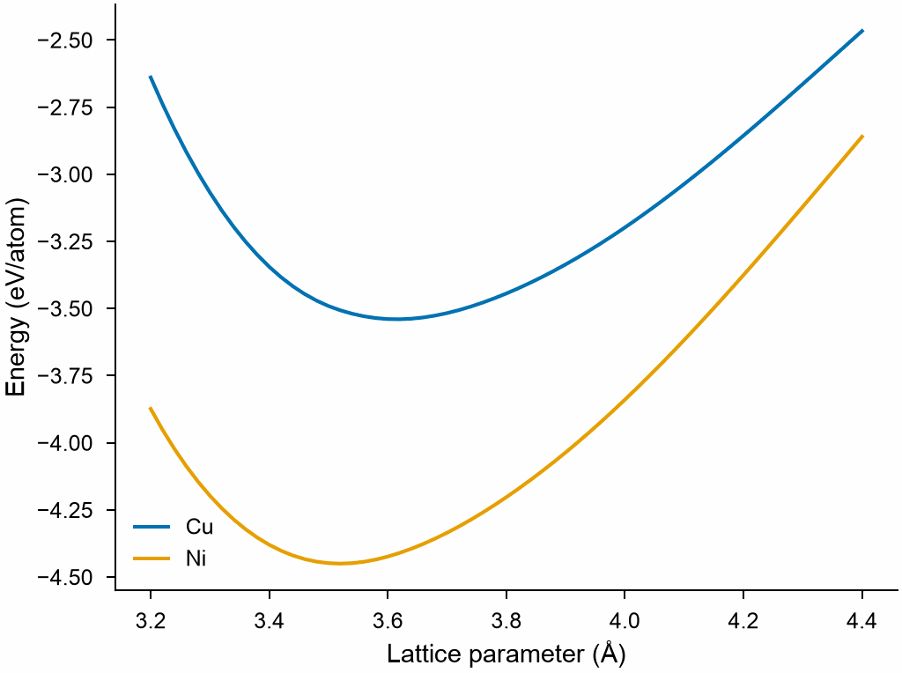

# EAM

```python
from mdapy.calculators import EAM

# or a file: EAM("CuNi.eam.alloy"), EAM("CuZr.eam.fs"), EAM("Cu_u3.eam")
potential = EAM.zhou(["Cu", "Ni"])
potential.elements, potential.cutoff
potential.write("CuNi.eam.alloy")
```

The energy per atom of fcc copper and nickel against the lattice parameter,
from the potential:

```python
import numpy as np
from mdapy.build import build_crystal
from mdapy.visualization import plot

lattice = np.linspace(3.2, 4.4, 61)
with plot.style():
    fig, ax = plot.figure("single")
    for element in potential.elements:
        cells = [build_crystal("fcc", a, elements=element) for a in lattice]
        energy = [potential.compute(cell, ("energy",)).energy / 4 for cell in cells]
        ax.plot(lattice, energy, label=element)
    ax.set_xlabel("Lattice parameter (Å)")
    ax.set_ylabel("Energy (eV/atom)")
    ax.legend()
    plot.save(fig, "images/eam", formats=("png",))
```



*The minima are the lattice parameters and cohesive energies of the
potential, near the measured 3.615 Å and 3.52 Å; the curvature at the
minimum gives the bulk modulus.*

`EAM(path)` reads an embedded atom method potential in the `eam/alloy`
(setfl) or the `eam/fs` (Finnis–Sinclair) format of LAMMPS, or the funcfl
files of `pair_style eam`, and computes every property. The two setfl
formats have the same lines, but an `eam/fs` file holds more values, which
tells them apart: see [Finnis–Sinclair potentials](#finnissinclair-potentials).
A funcfl file holds numbers where a setfl file names its elements: see
[Funcfl files](#funcfl-files). `EAM(path, *, device="cpu", precision=None)`
computes on the processor, or with `device="cuda"` on an NVIDIA GPU, in
mixed or double precision: see [On the GPU](../simulation/gpu.md).

| Attribute | Type | Meaning |
|---|---|---|
| `path` | str, tuple of str or `None` | the potential file, the funcfl files, `None` for a built potential |
| `elements` | tuple of str or `None` | the elements of the potential, in the order of the file; `None` for an average-atom potential |
| `masses` | (n,) float64 | their masses in amu; the mass of the average atom for an average-atom potential |
| `cutoff` | float64 | cutoff radius in Å |
| `device`, `precision` | str | where it computes and in what precision, `"cpu"` and `"double"` or `"cuda"` and `"mixed"` or `"double"` |

| Method | Returns |
|---|---|
| `compute(system, properties, *, neighbors=None, progress=None, cancel=None)` | as every calculator, with the `progress=` and `cancel=` of [Parallelism](../../basics/parallelism.md#progress-and-cancellation) |
| `write(path)` | writes the potential as an `eam/alloy` file, or an `eam/fs` file for a Finnis–Sinclair potential, which LAMMPS reads and which reads back to the same tables |
| `EAM.zhou(elements, *, nr=2000, nrho=2000, device="cpu", precision=None)` | the potential of Zhou, Johnson and Wadley for the elements |
| `average(fractions)` | the average-atom potential of an alloy of the elements, for a potential of the `eam/alloy` form, on the device of this one; see [Average atom](#average-atom) |

The atoms need an `element` column; elements the potential does not have
raise `InvalidParameter`, and a malformed file raises
[`FileFormatError`](../../reference/api/utilities.md#mdapy.errors.FileFormatError) with
its line. A file may name species that are not elements, such as the `A` of
an average atom; they are kept when the potential is written, but no atom
of a system is one of them.

The energy of atom $i$ is

$$
E_i = F_{s_i}\Big(\sum_j \rho_{s_j s_i}(r_{ij})\Big) + \frac{1}{2}\sum_j \phi_{s_i s_j}(r_{ij}),
$$

where the sums run over the neighbors $j$ of atom $i$ within the cutoff, at
the distances $r_{ij}$, with the embedding energy $F$, the electron density
$\rho_{ab}$ that an atom of species $a$ gives one of species $b$, and the pair
potential $\phi$ of the species $s_i$ and $s_j$ of the atoms, interpolated from the tables of the file as LAMMPS
`pair_style eam/alloy` and `eam/fs` do. In `eam/alloy` the density depends
on the species that gives it only, $\rho_{ab} = \rho_a$. Each pair's virial
is shared equally by its two atoms, as LAMMPS shares it. For the heat flux of the
[Green–Kubo](../properties/green-kubo.md) and [HNEMD](../properties/hnemd.md)
conductivities the virial of each atom is instead that of the derivatives of the
others' energies by its position
([Fan et al. (2015)](../../reference/references.md#fan2015)): the pair forces split in
halves do not give the heat flux of EAM, and give copper a conductivity about a tenth
too high; their sums are the same.

!!! quote "Please cite"
    [Daw and Baskes (1984)](../../reference/references.md#daw1984), and the paper of the potential.

## Potentials of Zhou, Johnson and Wadley

<!-- skip-test -->
```python
potential = EAM.zhou(["Cu", "Ni", "Al"])
potential.write("CuNiAl.eam.alloy")
```

`EAM.zhou` builds the potential for any of Cu, Ag, Au, Ni, Pd, Pt, Al, Pb,
Fe, Mo, Ta, W, Mg, Co, Ti, Zr and Cr, with the tables that the database tool
of LAMMPS (`tools/eam_database`) writes for them: the parameters of
[Zhou et al. (2004)](../../reference/references.md#zhou2004), those of
[Lin et al. (2008)](../../reference/references.md#lin2008) for Cr, and their rule for the pair
potential between two elements,

$$
\phi_{ab}(r) = \frac{1}{2}\left(\frac{\rho_b(r)}{\rho_a(r)}\phi_{aa}(r)
+ \frac{\rho_a(r)}{\rho_b(r)}\phi_{bb}(r)\right).
$$

| Name | Type | Default | Unit | Meaning |
|---|---|---|---|---|
| `elements` | sequence of str | | | the elements, in the order of the file |
| `nr` | int32 | 2000 | | points of the tables in distance, up to the cutoff $\sqrt{10}/2$ times the largest fcc lattice constant $\sqrt 2\, r_e$, with $r_e$ the nearest-neighbor distance of an element in Zhou's parameters |
| `nrho` | int32 | 2000 | | points of the embedding tables in density |
| `device`, `precision` | str | `"cpu"`, `None` | | as for `EAM` |

The parameters are fitted to the pure metals; the pair potentials between
elements come from the rule above, not from a fit to alloys. An unknown or
repeated element raises `InvalidParameter`.

!!! warning "A cutoff on a shell of neighbors"
    The cutoff, $\sqrt{10}/2$ times the fcc lattice constant, is the distance of
    the fifth neighbors in fcc. In a relaxed fcc crystal of one element they lie
    less than $10^{-4}$ Å beyond it, and a strain above about $10^{-5}$ brings
    some of them inside: the stress jumps, and what comes from small strains
    depends on their size. The elastic constant $C_{11}$ of relaxed copper from
    [`elastic_constants`](../properties/elastic-constants.md) is 168.6 GPa with the default
    `strain=1e-3`, 158.8 GPa with 1e-4, and 169.7 GPa with 1e-6, which leaves the
    fifth neighbors where they are. LAMMPS, with the same tables, does the same.
    Potentials that reach zero smoothly at their cutoff, such as [NEP](nep.md),
    do not.

!!! quote "Please cite"
    [Zhou et al. (2004)](../../reference/references.md#zhou2004); with Cr, also [Lin et al. (2008)](../../reference/references.md#lin2008).

## Finnis–Sinclair potentials

<!-- skip-test -->
```python
potential = EAM("CuZr_mm.eam.fs")  # pair_style eam/fs in LAMMPS
potential.write("CuZr.eam.fs")
```

In an `eam/fs` file each element gives each element a density of its own,
$\rho_{ab} \ne \rho_{ac}$, as in the potentials of Mendelev, Ackland and
coworkers for alloys such as Cu–Zr, Al–Fe and Fe–P. After the embedding
energy of each element come the densities it gives each element, in the
order of the elements; the pair potentials follow as in `eam/alloy`. The
energies, forces and virials are those of LAMMPS `pair_style eam/fs`, and
`write` writes the file back in the same format. A file of one element, or
one whose elements give every element the same density, is an `eam/alloy`
potential written in the other format, and reads as one.

!!! quote "Please cite"
    [Finnis and Sinclair (1984)](../../reference/references.md#finnis1984), and the paper of the potential.

## Funcfl files

<!-- skip-test -->
```python
copper = EAM("Cu_u3.eam")  # pair_style eam with pair_coeff 1 1 Cu_u3.eam
alloy = EAM(["Cu_u3.eam", "Ni_u3.eam"])  # pair_coeff 1 1 Cu_u3.eam, 2 2 Ni_u3.eam
alloy.write("CuNi_u3.eam.alloy")
```

A funcfl file of LAMMPS `pair_style eam`, the format of DYNAMO, holds one
element: a comment, its atomic number, mass, lattice constant and lattice,
the grid, then its embedding energy $F(\rho)$, its effective charge $Z(r)$ and
its electron density $\rho(r)$; the potentials of
[Foiles et al. (1986)](../../reference/references.md#foiles1986), such as
`Cu_u3.eam`, come as such files. `EAM` takes one, or several of different
elements, and builds the tables as LAMMPS does: each function interpolated by
four-point Lagrange polynomials onto the grid of the largest spacings and
ranges of the files, the cutoff the largest of theirs, and the pair potential
of each two elements from their charges,

$$
\phi_{ab}(r) = \frac{27.2 \times 0.529\; Z_a(r)\, Z_b(r)}{r},
$$

with 27.2 eV per hartree and 0.529 Å per bohr. The energies, forces and
virials are those of LAMMPS `pair_style eam` with the files in the order of
the types, also beyond the tables of the embedding energy, which LAMMPS
extends linearly from one step past their end. `write` writes the tables as
an `eam/alloy` file, which LAMMPS computes alike up to the end of the tables
of the embedding energy. Repeated elements, or funcfl files mixed with setfl
files, raise `InvalidParameter`.

!!! quote "Please cite"
    [Daw and Baskes (1984)](../../reference/references.md#daw1984), and the paper of the potential, such as [Foiles et al. (1986)](../../reference/references.md#foiles1986).

## Average atom

<!-- skip-test -->
```python
average = potential.average({"Cu": 0.4, "Ni": 0.4, "Al": 0.2})
average.compute(system)  # every atom is the average atom
average.write("CuNiAl.average.eam.alloy")  # Cu, Ni, Al and the average atom A
```

`average(fractions)` returns the average-atom potential of
[Varvenne et al. (2016)](../../reference/references.md#varvenne2016) for a random alloy. It
takes a potential of the `eam/alloy` form, in which the density an atom gives
depends on its own element only: one read from an `eam/alloy` file, funcfl
files mixed into an alloy, `EAM.zhou`, or an `eam/fs` file whose elements give
every element the same density. A Finnis–Sinclair potential whose elements give
each element a density of its own raises `InvalidParameter`: the average atom
would need a density for each element it gives one to.

With $c_a$ the fraction of element $a$, the average atom $A$ has the
embedding energy $F_A$, the density $\rho_A$ it gives, the pair potential
$\phi_{Ab}$ with an atom of element $b$, and $\phi_{AA}$ with another average
atom:

$$
F_A = \sum_a c_a F_a, \qquad \rho_A = \sum_a c_a \rho_a, \qquad
\phi_{Ab} = \sum_a c_a \phi_{ab}, \qquad
\phi_{AA} = \sum_{a,b} c_a c_b \phi_{ab},
$$

the sums running over the elements of the potential, and $F_a$, $\rho_a$ and
$\phi_{ab}$ being those of its elements.

`fractions` is a mapping from element to fraction, or the fractions in
the order of `elements`; elements left out have none, and the fractions sum
to 1. In MDAPY every atom of a system is the average atom, whatever its
element. The written file holds the elements of the potential and the
average atom, named `A`, last, so that LAMMPS can mix them, for example
with `pair_coeff * * CuNiAl.average.eam.alloy A Cu` for a Cu solute in the
average alloy. Invalid fractions raise `InvalidParameter`.

!!! quote "Please cite"
    [Varvenne et al. (2016)](../../reference/references.md#varvenne2016), and the paper of the potential averaged.
