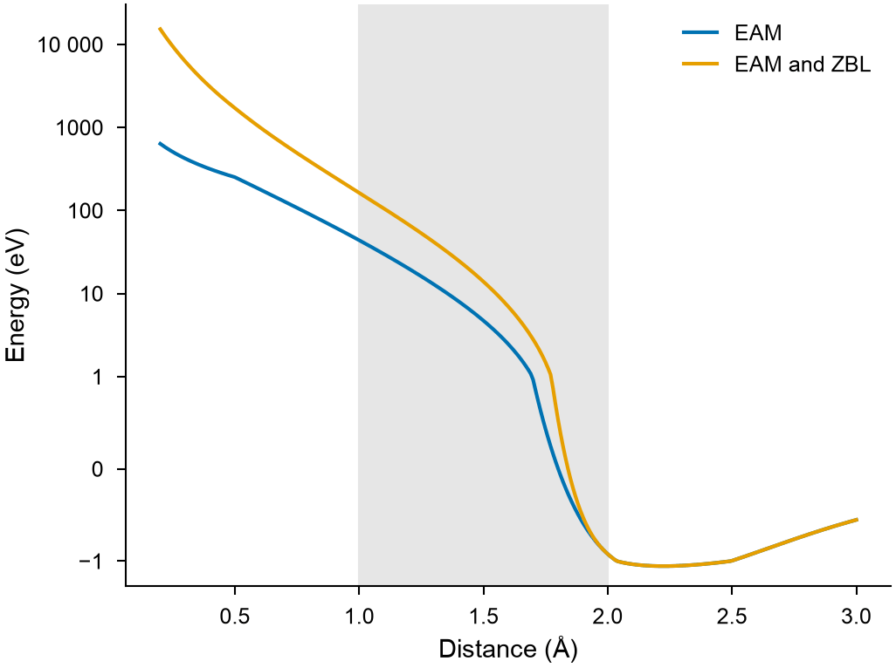

# Overlaid potentials

<p class="runs-on" markdown>**Runs on** the processor, on many processes · the [GPU](../simulation/gpu.md) · LAMMPS has it as `pair_style hybrid/overlay`</p>

`Overlay(calculators)` adds calculators together: its energy, forces and virials are
the sums of theirs, as LAMMPS's `pair_style hybrid/overlay`. Its usual use is a
[ZBL](pair-potentials.md#the-zbl-repulsion) repulsion on a potential fitted to the
solid, which gives the close collisions of a cascade of radiation damage.

Two copper atoms brought together, with the EAM of Zhou et al. alone and with a ZBL
switched off between 1 and 2 Å added:

```python
import numpy as np

import mdapy
from mdapy.calculators import EAM, ZBL, Overlay
from mdapy.visualization import plot

eam = EAM.zhou(["Cu"])
overlay = Overlay([eam, ZBL(["Cu"], 1.0, 2.0)])

distance = np.linspace(0.2, 3.0, 281)
box = mdapy.Box(30.0, pbc=False)
pairs = [mdapy.System([[0, 0, 0], [r, 0, 0]], box, elements="Cu") for r in distance]
energies = {
    name: np.array([p.compute(pair).energy for pair in pairs])
    for name, p in (("EAM", eam), ("EAM and ZBL", overlay))
}

with plot.style():
    fig, ax = plot.figure("single")
    for name, energy in energies.items():
        ax.plot(distance, energy, label=name)
    ax.set_yscale("symlog", linthresh=1.0)  # linear between -1 and 1 eV
    ax.set_yticks([-1, 0, 1, 10, 100, 1000, 10000],
                  ["−1", "0", "1", "10", "100", "1000", "10 000"])  # fmt: skip
    ax.set(xlabel="Distance (Å)", ylabel="Energy (eV)", ylim=(-2, 3e4))
    ax.axvspan(1.0, 2.0, color="0.9", zorder=0)
    ax.legend()
    plot.save(fig, "images/overlay", formats=("png",))
```



*The energy of the pair, on a scale logarithmic above 1 eV and linear below. The EAM
of Zhou et al. is fitted near the distances of the crystal: closer, its repulsion
bends at 0.5 Å and reaches 0.64 keV at 0.2 Å. With the ZBL added the pair rises to
15 keV there, the repulsion of two copper nuclei. In the gray band the ZBL is switched
off, and from 2 Å on the two are the same.*

In a [molecular dynamics](../simulation/running.md) of a cascade it is the potential,
with an [`ElectronicStopping`](../simulation/electronic-stopping.md) among the
controls:

<!-- skip-test -->
```python
with MolecularDynamics(crystal, overlay, timestep=0.0005) as md:
    md.run(4000, controls=[AdaptiveTimestep(0.05), stopping])
```

## Parameters

| Name | Type | Meaning |
|---|---|---|
| `calculators` | sequence of Calculator | two or more calculators, all on the processor or all on the GPU |

| Attribute | Type | Meaning |
|---|---|---|
| `calculators` | tuple of Calculator | the calculators, in their order |
| `cutoff` | float64 | the largest of their cutoffs, in Å |
| `elements` | tuple of str or `None` | the elements of all of them, in the order they first come; `None` when one takes any element |
| `implemented` | frozenset of str | the properties every one of them computes |
| `device` | str | the device of the calculators |

## How it acts

- `compute` asks each calculator in turn for the same properties and adds what they
  give: the energies, the forces and the virials, total and of each atom. A property
  one of them leaves out, the sum leaves out.
- One neighbor list serves all, with the largest cutoff; MDAPY's potentials pass over
  the pairs beyond their own cutoff, and other calculators get the pairs within
  theirs.
- On the [GPU](../simulation/gpu.md) the calculators must be MDAPY's potentials with
  `device="cuda"` and the same elements in the same order: they compute in turn on
  the device, with one neighbor list.
- On [many processes](../simulation/processes.md) each process computes its atoms and
  their ghosts whole: ghosts within the cutoff of a pair potential, within twice the
  cutoff of a many-body one.
- In [LAMMPS](lammps.md) it is `pair_style hybrid/overlay`, which a `LAMMPS`
  calculator gives; the energies, forces and virials of an `Overlay` of `EAM` and `ZBL`
  are those of `hybrid/overlay eam/alloy zbl`, atom by atom, and so are the runs of a
  cascade, step by step.

## Errors

`Overlay` raises `InvalidParameter` for fewer than two calculators, something that is
not a calculator, calculators on different devices, and on the GPU a calculator
without a potential there or elements in another order. `compute` raises it for a
property one of them does not compute.

## See also

- [`pair_style hybrid/overlay`](https://docs.lammps.org/pair_hybrid.html) of LAMMPS
