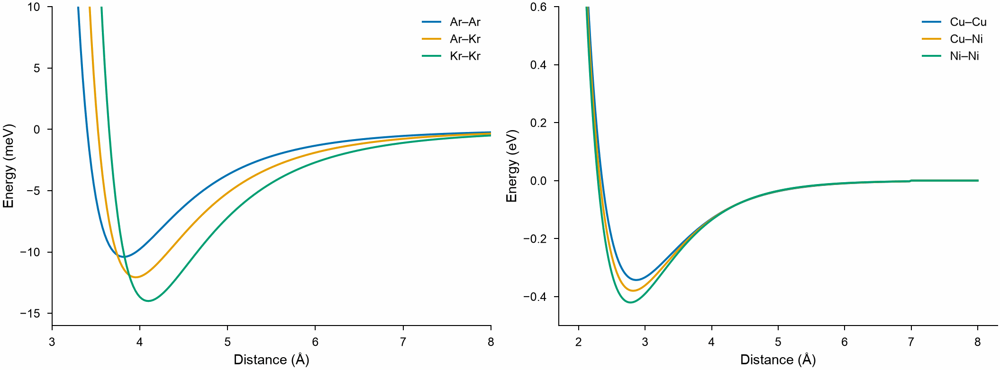

# Pair potentials

```python
from mdapy.calculators import LennardJones, Morse

# argon and krypton, epsilon in eV and sigma in Å, their pair mixed
lj = LennardJones({"Ar": (0.0104, 3.40), "Kr": (0.0140, 3.65)}, 8.5)
# copper and nickel, D0 in eV, alpha in 1/Å and r0 in Å for every pair
morse = Morse(
    {
        "Cu": (0.3429, 1.3588, 2.866),
        "Ni": (0.4205, 1.4199, 2.780),
        ("Cu", "Ni"): (0.38, 1.39, 2.82),
    },
    7.0,
)
lj.elements, lj.cutoff
```

The energy of two atoms against their distance, of both potentials:

```python
import numpy as np
import mdapy
from mdapy.visualization import plot

distance = np.linspace(2.0, 8.0, 241)


def curve(potential, a, b):
    box = mdapy.Box(30.0, pbc=False)
    pairs = [
        mdapy.System([[0, 0, 0], [r, 0, 0]], box, elements=[a, b]) for r in distance
    ]
    return [potential.compute(pair, ("energy",)).energy for pair in pairs]


with plot.style():
    fig, (left, right) = plot.figure("double", ncols=2)
    for pair in (("Ar", "Ar"), ("Ar", "Kr"), ("Kr", "Kr")):
        left.plot(distance, 1000 * np.array(curve(lj, *pair)), label="–".join(pair))
    left.set(xlabel="Distance (Å)", ylabel="Energy (meV)", ylim=(-16, 10), xlim=(3, 8))
    left.legend()
    for pair in (("Cu", "Cu"), ("Cu", "Ni"), ("Ni", "Ni")):
        right.plot(distance, curve(morse, *pair), label="–".join(pair))
    right.set(xlabel="Distance (Å)", ylabel="Energy (eV)", ylim=(-0.5, 0.6))
    right.legend()
    plot.save(fig, "images/pair-potentials", formats=("png",))
```



*The Lennard-Jones potential of argon and krypton, their pair mixed by the
geometric means, and the Morse potential of copper and nickel: each pair
lowest at 2^(1/6) σ, or at r0, by ε or D0.*

`LennardJones(parameters, cutoff, *, mixing="geometric", shift=False)` and
`Morse(parameters, cutoff, *, shift=False)` are pair potentials with numbers
for each pair of elements, computed as LAMMPS computes `pair_style lj/cut`
and `pair_style morse`. Their energy is

$$
E_{LJ}(r) = 4 \varepsilon \left[ \left( \frac{\sigma}{r} \right)^{12} -
\left( \frac{\sigma}{r} \right)^{6} \right], \qquad
E_{M}(r) = D_0 \left[ e^{-2 \alpha (r - r_0)} - 2 e^{-\alpha (r - r_0)} \right]
$$

below the cutoff of the pair, and zero beyond.

## Parameters

| Parameter | Type | Meaning |
|---|---|---|
| `parameters` | mapping, or sequence of float64 for `LennardJones` | keyed by an element, the numbers of its pairs with itself; by a tuple of two elements, as `("Cu", "Ni")`, those of that pair: (ε, σ) or (ε, σ, cutoff) of `LennardJones`, (D0, α, r0) or (D0, α, r0, cutoff) of `Morse` |
| `cutoff` | float64 | cutoff in Å of the pairs given none |
| `mixing` | str | of `LennardJones`, how the pairs of two elements given alone mix, as `pair_modify mix`: `"geometric"` (ε, σ and the cutoff), `"arithmetic"` (ε geometric, σ and the cutoff arithmetic, Lorentz–Berthelot) or `"sixthpower"` |
| `shift` | bool | take off each pair its energy at its cutoff, as `pair_modify shift yes`, so that the energy goes to zero there |
| `device` | str | `"cpu"`, or `"cuda"` to compute on an NVIDIA GPU: see [On the GPU](../simulation/gpu.md) |
| `precision` | str or `None` | on the GPU `"mixed"` (by default) or `"double"`; the processor computes in double precision only |

`LennardJones((ε, σ), cutoff)`, numbers alone, is one kind of atom of any
element: it computes systems that have no elements.

Morse parameters do not mix: every pair of the elements needs its own, as in
LAMMPS. A pair given as a tuple is taken as it is, and an element given both
alone and as its own pair must have the same numbers in both.

| Attribute | Type | Meaning |
|---|---|---|
| `elements` | tuple of str or `None` | the elements, in the order of the parameters; `None` for one kind of atom |
| `cutoffs` | (E, E) float64 | the cutoff of each pair of elements in Å |
| `cutoff` | float64 | the largest of them |
| `epsilon`, `sigma` | (E, E) float64 | of `LennardJones`, the numbers of each pair after mixing |

The energy and the virial of each pair are shared equally between its two
atoms. The long-range corrections of LAMMPS (`pair_modify tail`) and the
weights of bonded neighbors (`special_bonds`) are not part of these
calculators.

## The Uhlenbeck–Ford model

`UhlenbeckFord(parameters, cutoff, *, mixing="geometric", shift=False)` is the
Uhlenbeck–Ford model of LAMMPS's `pair_style ufm`, a soft repulsion of finite reach,

$$
E_{UF}(r) = -\varepsilon \ln\left(1 - e^{-r^2/\sigma^2}\right),
$$

with ε in eV and σ in Å, the reference liquid of
[free energies](../properties/free-energy.md#definition), whose own free energy is known
([Paula Leite et al. (2016)](../../reference/references.md#paulaleite2016)).
Its parameters, mixing and shift are those of `LennardJones`: (ε, σ) or
(ε, σ, cutoff) for an element or a pair, or numbers alone for any atom.

```python
from mdapy.calculators import UhlenbeckFord

model = UhlenbeckFord((1.29, 1.5), 6.0)  # ε = 50 kT at 300 K, σ = 1.5 Å
```

## The ZBL repulsion

`ZBL(elements, inner, cutoff)` is the universal screened repulsion of two nuclei of
[Ziegler et al. (1985)](../../reference/references.md#ziegler1985), as LAMMPS's
`pair_style zbl`:

$$
E_{ZBL}(r) = \frac{Z_i Z_j e^2}{4 \pi \varepsilon_0 r}\, \phi(r / a), \qquad
a = \frac{0.46850\ \text{Å}}{Z_i^{0.23} + Z_j^{0.23}},
$$

$$
\phi(x) = 0.18175\, e^{-3.19980 x} + 0.50986\, e^{-0.94229 x}
+ 0.28022\, e^{-0.40290 x} + 0.02817\, e^{-0.20162 x},
$$

with $Z_i$ and $Z_j$ the atomic numbers of the elements. From `inner` to `cutoff`
a polynomial in $r - r_\text{inner}$ added to it brings its energy and its first
two derivatives to zero at the cutoff. It is the repulsion of atoms that come much
closer than in a solid, a few tenths of an ångström apart in a cascade of radiation
damage, where most potentials are not fitted: [overlaid](overlay.md) on a potential
it gives the close collisions, its `cutoff` below the nearest neighbors of the
crystal.

```python
from mdapy.calculators import ZBL

zbl = ZBL(["Cu", "Ni"], 1.0, 2.0)  # switched off between 1 and 2 Å
```

| Parameter | Type | Unit | Meaning |
|---|---|---|---|
| `elements` | sequence of str | | the elements, whose atomic numbers are the charges of the nuclei |
| `inner` | float64 | Å | the distance from which it is switched off |
| `cutoff` | float64 | Å | the distance beyond which it is zero, greater than `inner` |
| `device`, `precision` | str | | as for the others |

Its attributes are `elements`, `inner`, `cutoffs` and `cutoff`.

## Errors

The calculators raise `InvalidParameter` for parameters that are not a
mapping with an entry, a key that is not an element or a pair of elements,
numbers of the wrong count or not finite, a negative ε or D0, a σ, α or r0
that is not positive, a cutoff that is not positive, an unknown mixing rule,
a pair given twice with other numbers, a pair of elements without numbers,
and atoms of an element they have no numbers for. `ZBL` raises it for
elements that are not a sequence of different elements, and an `inner` that is not
positive and less than the cutoff.

!!! quote "Please cite"
    [Jones (1924)](../../reference/references.md#jones1924),
    [Morse (1929)](../../reference/references.md#morse1929) or
    [Ziegler et al. (1985)](../../reference/references.md#ziegler1985), and the paper of the parameters.
