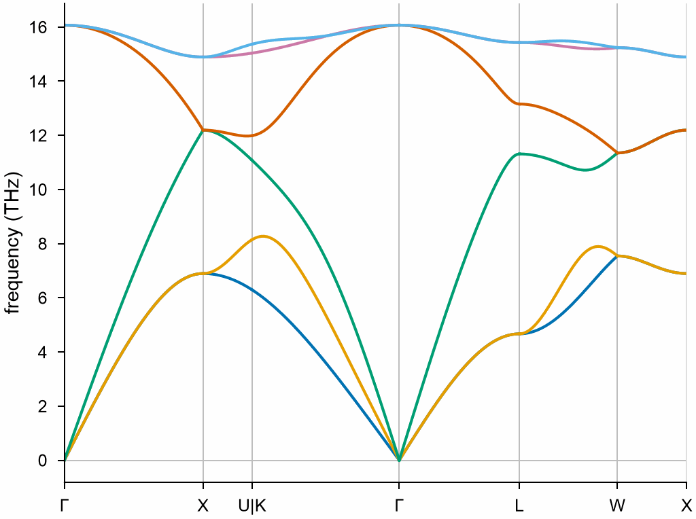

# Tersoff

```python
from pathlib import Path

from mdapy.calculators import Tersoff

# silicon of Tersoff (1989), as a line of a .tersoff file of LAMMPS:
# m gamma lambda3 c d cos(theta0) n beta lambda2 B R D lambda1 A
Path("Si.tersoff").write_text(
    "Si Si Si 3.0 1.0 0.0 1.0039e5 16.217 -0.59825 0.78734\n"
    "         1.1e-6 1.7322 471.18 2.85 0.15 2.4799 1830.8\n"
)
potential = Tersoff("Si.tersoff")
potential.elements, potential.cutoff
```

The phonons of silicon with the potential, its crystal relaxed:

```python
from mdapy.build import build_crystal
from mdapy.lattice_dynamics import phonons, primitive_cell
from mdapy.simulation import minimize
from mdapy.visualization import plot

crystal = minimize(
    build_crystal("diamond", 5.43, elements="Si"),
    potential,
    cell="full",
    max_stress=1e-4,
).system
bands = phonons(primitive_cell(crystal), potential).band_structure(
    "fcc", connected=True
)
with plot.style():
    fig, ax = plot.figure("single")
    plot.band_structure(bands, ax=ax)
    plot.save(fig, "images/tersoff", formats=("png",))
```



*Silicon of the Tersoff potential: the diamond crystal relaxes to 5.432 Å, and
its optical phonons reach 16 THz at Γ, above the measured 15.5 THz.*

`Tersoff(path, elements=None)` reads a potential file of `pair_style tersoff`
of LAMMPS, in metal units, and computes it as LAMMPS does. The energy is a sum
over the bonds, each the repulsion of its two atoms and their attraction
weakened by the bond order, which falls with the number of the other
neighbors of the atom and with their angles:

$$
E = \frac{1}{2} \sum_i \sum_{j \neq i} f_C(r_{ij}) \left[ f_R(r_{ij}) + b_{ij} f_A(r_{ij}) \right],
\qquad
b_{ij} = \left( 1 + \beta^n \zeta_{ij}^n \right)^{-1/2n},
\qquad
\zeta_{ij} = \sum_{k \neq i, j} f_C(r_{ik}) g(\theta_{ijk}) e^{\lambda_3^m (r_{ij} - r_{ik})^m}
$$

with $f_R = A e^{-\lambda_1 r}$, $f_A = -B e^{-\lambda_2 r}$,
$g(\theta) = \gamma \left[ 1 + c^2/d^2 - c^2/(d^2 + (\cos\theta - \cos\theta_0)^2) \right]$
and the cutoff $f_C$ falling from 1 to 0 between R − D and R + D.

## Parameters

| Parameter | Type | Meaning |
|---|---|---|
| `path` | str or path-like | a `.tersoff` file: for each triplet of elements i, j, k, the 14 numbers m, γ, λ3, c, d, cos θ0, n, β, λ2, B, R, D, λ1, A, over one or more lines |
| `elements` | sequence of str, or mapping | the elements to use, as the names after the file in `pair_coeff` of LAMMPS; every triplet of them needs an entry. A mapping takes the element of the atoms to a label of the file, as `{"Si": "Si(D)", "C": "C"}` for the labels of `SiCGe.tersoff`. Default every element of the file |
| `device` | str | `"cpu"`, or `"cuda"` to compute on an NVIDIA GPU: see [On the GPU](../molecular-dynamics/gpu.md) |
| `precision` | str or `None` | on the GPU `"mixed"` (by default) or `"double"`; the processor computes in double precision only |

| Attribute | Type | Meaning |
|---|---|---|
| `path` | str | the potential file |
| `elements` | tuple of str | the elements of the potential |
| `cutoff` | float64 | the largest R + D in Å |

The two-body numbers of a bond i–j, n, β, λ2, B, R, D, λ1 and A, are those
of the entry i j j; the three-body ones of k in ζ<sub>ij</sub>, m, γ, λ3,
c, d, cos θ0, R and D, those of the entry i j k. The energy and the virial of
the repulsion and of the attraction at a fixed bond order are shared equally
between the two atoms of the bond, and the virial of each angle among its
three atoms, as LAMMPS shares them.

**Entries that disagree.** The repulsion of a pair i–j is in the entries
i j j and j i i. LAMMPS takes one of them by the numbering of the atoms, so
that its results depend on it when they differ, as in `SiC_1989.tersoff` and
`SiC_1994.tersoff` of LAMMPS by up to 1e-3 eV/Å. MDAPY takes their mean,
whatever the numbering; when they agree, as in most files, the results are
those of LAMMPS.

The styles `tersoff/mod`, `tersoff/mod/c` and `tersoff/zbl`, whose files have
more numbers, and the `shift` keyword of LAMMPS are not part of `Tersoff`.

## Errors

`Tersoff` raises `InvalidParameter` for a file that cannot be read, is in
other units than metal, or whose values are not entries of 17; an entry with
a word for a number, numbers that are not finite, an m other than 1 or 3, a
negative parameter or D greater than R; two entries of one triplet; a missing
triplet of the elements used; elements that are not in the file, named twice,
or labels that are not elements and are not mapped; and atoms of an element
it has no entries for.

!!! quote "Please cite"
    [Tersoff (1988)](../../reference/references.md#tersoff1988) and
    [Tersoff (1989)](../../reference/references.md#tersoff1989), and the paper of the parameters.
