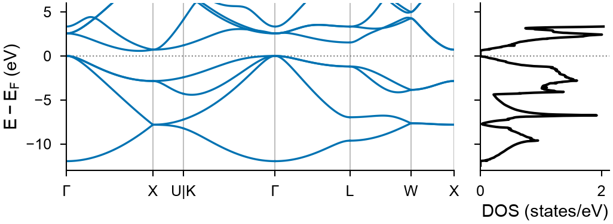
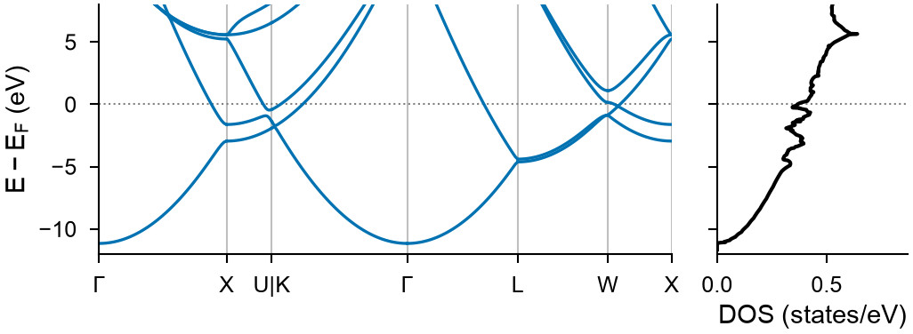
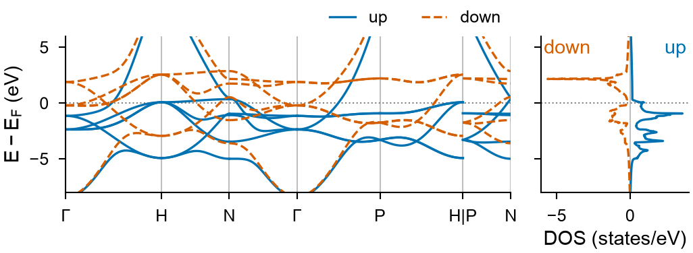

# Electronic structure

!!! warning "Under development"
    The electronic structure comes from MDAPY's [plane-wave DFT](../potentials/dft.md),
    which is new and runs on a GPU. Its results are those of Quantum ESPRESSO on the
    same input, as [below](#how-the-results-compare-with-quantum-espresso).

`mdapy.properties.electronic.electronic_structure(system, calculator)` runs the
self-consistent field of a crystal once with the calculator
[`DFT`](../potentials/dft.md), and then gives the energies of the electrons at any wave
vectors in the potential of that density: band structures along a path through the
Brillouin zone and densities of states.

<!-- skip-test -->
```python
from mdapy.build import build_crystal
from mdapy.calculators import DFT
from mdapy.properties.electronic import electronic_structure
from mdapy.properties.phonons import primitive_cell
from mdapy.visualization import plot

silicon = primitive_cell(build_crystal("diamond", 5.431, elements="Si"))
dft = DFT(500.0, kspacing=0.2, smearing="fixed")  # eV, 1/Å
structure = electronic_structure(silicon, dft)

structure.energies([0.5, 0.0, 0.5])  # eV relative to the Fermi level, at X
bands = structure.band_structure("fcc", bands=8)  # Γ–X–U|K–Γ–L–W–X
dos = structure.dos(14, bands=8)  # states per eV of the cell, 14 × 14 × 14 wave vectors

with plot.style():
    fig, (left, right) = plot.figure(
        "single", ncols=2, sharey=True, width_ratios=[3, 1]
    )
    plot.electronic_bands(bands, ax=left)
    plot.electronic_dos(dos, ax=right)
    plot.save(fig, "images/electronic-silicon", formats=("png",))
```



*The bands of silicon along Γ–X–U|K–Γ–L–W–X with PBE, and the density of states
beside them: four valence bands below the Fermi level at the top of the valence
bands at Γ, the gap above it, and four conduction bands.*

A metal and a magnet take the same calls, with a smearing and with first magnetic
moments:

<!-- skip-test -->
```python
import numpy as np

aluminium = primitive_cell(build_crystal("fcc", 4.04, elements="Al"))
dft = DFT(500.0, kspacing=0.2, smearing="marzari-vanderbilt", sigma=0.1)
structure = electronic_structure(aluminium, dft)
bands = structure.band_structure("fcc", bands=8)
dos = structure.dos(18, bands=8)

iron = primitive_cell(build_crystal("bcc", 2.83, elements="Fe"))
dft = DFT(1200.0, kspacing=0.2, smearing="marzari-vanderbilt", sigma=0.1,
          magmoms={"Fe": 2.5})  # fmt: skip
structure = electronic_structure(iron, dft)
bands = structure.band_structure("bcc", bands=16)  # Γ–H–N–Γ–P–H|P–N
# up and down, (2, F), from 8 eV below the Fermi level: the 3s and 3p
# semicore states of the pseudopotential lie far lower
dos = structure.dos(energies=np.linspace(-8.0, 6.0, 1401), bands=16)
```



*The bands of aluminium, close to those of free electrons, and its density of
states, which rises as the square root of the energy from the bottom of the band.*



*The bands of ferromagnetic iron, 2.26 Bohr magnetons per atom, up in solid and
down in dashed lines, the d bands of the two spins split by 2 to 3 eV at Γ, and the
density of states of the two spins, up to the right and down to the left.*

| Name | Type | Default | Meaning |
|---|---|---|---|
| `system` | `System` | | the crystal, periodic along a, b and c, with an `element` column; best its [primitive cell](phonons.md) |
| `calculator` | `DFT` | | the [DFT](../potentials/dft.md) whose self-consistent field gives the density; not with DFT+U or with a communicator of several processes, for now |

The self-consistent field runs on the mesh of k-points of the calculator, with its
smearing, symmetry and every other setting, as `DFT.compute` runs it. Its density
then stays fixed: the energies at other wave vectors come from one step of the
bands in its potential, every band converged to a residual norm of 1e-6 hartree, as
Quantum ESPRESSO's `calculation = "bands"`. As many wave vectors are solved
together as fit a share of the memory of the GPU.

## Results

`electronic_structure` returns an `ElectronicStructure`. Wave vectors are in units of
the reciprocal lattice vectors of the cell: $\mathbf k = (h, k, l)$ is
$h\mathbf b_1 + k\mathbf b_2 + l\mathbf b_3$, with
$\mathbf a_i\cdot\mathbf b_j = 2\pi\delta_{ij}$. Energies are in eV relative to the
Fermi level of the self-consistent field; with fixed occupations, to its highest
occupied level.

| Attribute or method | Type | Meaning |
|---|---|---|
| `system` | `System` | the crystal |
| `fermi` | float64 | the Fermi level of the self-consistent field in eV |
| `spins` | int32 | 2 with spin, else 1 |
| `bands` | int32 | the number of bands of the self-consistent field |
| `energies(k, *, bands=None)` | (S, K, B) or (S, B) float64 | the energies at K wave vectors or one, ascending; S = 2 with spin, up then down |
| `band_structure(path, *, points=51, bands=None)` | `ElectronicBandStructure` | the energies along a path |
| `dos(mesh=None, *, energies=None, sigma=None, bands=None)` | `ElectronicDOS` | the density of states |

`bands` is the number of bands from the lowest, by default that of the
self-consistent field, which holds a few empty ones above the occupied: ask for
more to see more of the conduction bands.

**Band structures.** `path` is that of the [phonons](phonons.md): `"auto"` for
the standard path of any crystal from its symmetry by
[seekpath](https://seekpath.readthedocs.io), `"sc"`, `"fcc"`, `"bcc"` or
`"hexagonal"` for that of the lattice in the orientation `build_crystal` gives, or
the sections of a path by hand, `[[("Γ", (0, 0, 0)), ("X", (0.5, 0, 0.5))], ...]`.
`points` is the number of wave vectors on each line, its ends included.

| Attribute | Type | Meaning |
|---|---|---|
| `k` | (P, 3) float64 | the wave vectors |
| `distances` | (P,) float64 | their distance along the path in 1/Å |
| `energies` | (S, P, B) float64 | the energies in eV relative to `fermi`, ascending at each wave vector |
| `fermi` | float64 | the Fermi level in eV; `energies + fermi` are the eigenvalues |
| `labels` | tuple of (float64, str) | the distance and label of each special point; where the path breaks, the two labels join, as in `"U\|K"` |

**Densities of states.** The energies on a mesh through Γ of `mesh` wave vectors
along each reciprocal lattice vector give the density by the linear tetrahedron
method, or with a Gaussian of width `sigma` eV for each state. The default mesh is
the smallest with at most 0.15 1/Å (2π included) between neighbors along each
reciprocal lattice vector. It follows the lengths of the reciprocal vectors, and so
the choice of the cell: 14 × 14 × 14 for the primitive cell of silicon whose vectors
make 60° with each other, 16 × 14 × 14 for that of `primitive_cell` above, whose
vectors make 90° and 120°. A mesh that the symmetry maps onto itself, as the first,
needs the fewest wave vectors solved. Only one wave vector of each
set that the symmetry operations of the self-consistent field relate is solved,
and of k and −k one, which have the same energies; without the symmetry, k and −k
alone. `energies` are where the density is given, by default 1001 from 0.5 eV
(and 3 `sigma`) below the lowest band to the lowest energy of the highest band:
above that, states of higher bands are missing.

| Attribute | Type | Meaning |
|---|---|---|
| `energies` | (F,) float64 | energies in eV relative to `fermi` |
| `dos` | (S, F) float64 | states per eV of the cell; with spin, up then down, else both spins together |
| `fermi` | float64 | the Fermi level of the self-consistent field in eV |
| `mesh` | (3,) int32 | the number of wave vectors along each reciprocal lattice vector |

Below the Fermi level the density holds the electrons of the cell, to the accuracy
of the mesh: 8 for the two atoms of silicon, whose gap is empty. The Fermi level is
that of the self-consistent field, on its own mesh and with its smearing; a finer
mesh for the density of states places the states a little differently around it.
Gaussians of width $\sigma_\text{SCF}/\sqrt 2$ on the mesh of the field, with
`smearing="gaussian"`, hold its occupations exactly: their integral up to the Fermi
level is the number of electrons, and with spin the difference of the two its
magnetization.

`plot.electronic_bands(bands, ax=None, color=None)` and
`plot.electronic_dos(dos, ax=None)` of
[`mdapy.visualization.plot`](../visualization/plots.md) draw them, the density with
the energies upward to put beside the bands.

## Errors

`electronic_structure` raises `InvalidParameter` for a calculator that is not
`DFT`, a `DFT` with DFT+U or with a communicator of several processes, and what
`DFT.compute` raises for the system; `CalculationFailed` when the self-consistent
field does not converge. `energies`, `band_structure` and `dos` raise
`InvalidParameter` for `bands` that is not positive, `energies` for wave vectors
that are not three numbers each, `band_structure` for a path as the phonons raise
it, and `dos` for a mesh that is not one or three positive integers or a `sigma`
that is not positive; all three raise `CalculationFailed` when a band does not
converge.

## Definition

The density of states of a cell is

$$
g_s(E) = \frac{2}{S}\,\frac{1}{K}\sum_{\mathbf k, n} \delta(E - \varepsilon_{n s}(\mathbf k)),
$$

where $\varepsilon_{ns}(\mathbf k)$ is the energy of band $n$ of spin $s$ at the wave
vector $\mathbf k$ of a mesh of $K$, $S$ the number of spins (each state holds two
electrons without spin), and $\delta$ the Dirac delta function. The linear
tetrahedron method divides each cell of the mesh into six tetrahedra around its
shortest main diagonal and spreads each delta function over the tetrahedra between
the energies at their corners, interpolated linearly inside
([Lehmann and Taut (1972)](../../reference/references.md#lehmann1972),
[Blöchl et al. (1994)](../../reference/references.md#blochl1994), without the
correction of the latter). With `sigma`, each delta function is a Gaussian
$\exp(-(E - \varepsilon)^2/2\sigma^2)/(\sigma\sqrt{2\pi})$; Quantum ESPRESSO's
`degauss` is $\sqrt 2\,\sigma$.

## How the results compare with Quantum ESPRESSO

Quantum ESPRESSO 7.6 runs in the tests each time, on the same cells,
pseudopotentials, cutoffs, FFT grids and smearing, with `pbe_pw`.

- **Bands.** `pw.x` with `calculation = "bands"` after its own self-consistent
  field, on the same path and a wave vector without symmetry, every band converged
  (`diago_full_acc`): the eigenvalues of the occupied and empty bands agree to
  2e-9 hartree for silicon and aluminium (PseudoDojo) and for silicon with PAW
  (pslibrary), to 4e-9 hartree for nickel (GBRV, ultrasoft), and to 5e-8 hartree for
  iron with spin, norm-conserving and PAW, whose spin-polarized PBE in Quantum
  ESPRESSO takes a rounded constant (see the
  [DFT](../potentials/dft.md#how-the-results-compare-with-quantum-espresso)).
  Through `electronic_structure`, with the grids the calculator chooses, silicon
  agrees to 3e-7 eV and PAW iron to 1e-6 eV.
- **Densities of states.** `dos.x` of Quantum ESPRESSO with
  `bz_sum = "tetrahedra_lin"` and with `bz_sum = "smearing"`, on the energies of
  its own `calculation = "nscf"` on a mesh through Γ, every wave vector without
  symmetry: the densities of MDAPY's sums on the same energies agree to the four
  digits `dos.x` writes, half a unit of the last at most, for silicon (6 × 6 × 6)
  and iron with spin (5 × 5 × 5).

!!! quote "Please cite"
    The DFT as on [its page](../potentials/dft.md); the paths
    ([Setyawan and Curtarolo (2010)](../../reference/references.md#setyawan2010),
    [Hinuma et al. (2017)](../../reference/references.md#hinuma2017) for
    `"auto"` and fcc), and the tetrahedron method
    ([Lehmann and Taut (1972)](../../reference/references.md#lehmann1972),
    [Blöchl et al. (1994)](../../reference/references.md#blochl1994)).
