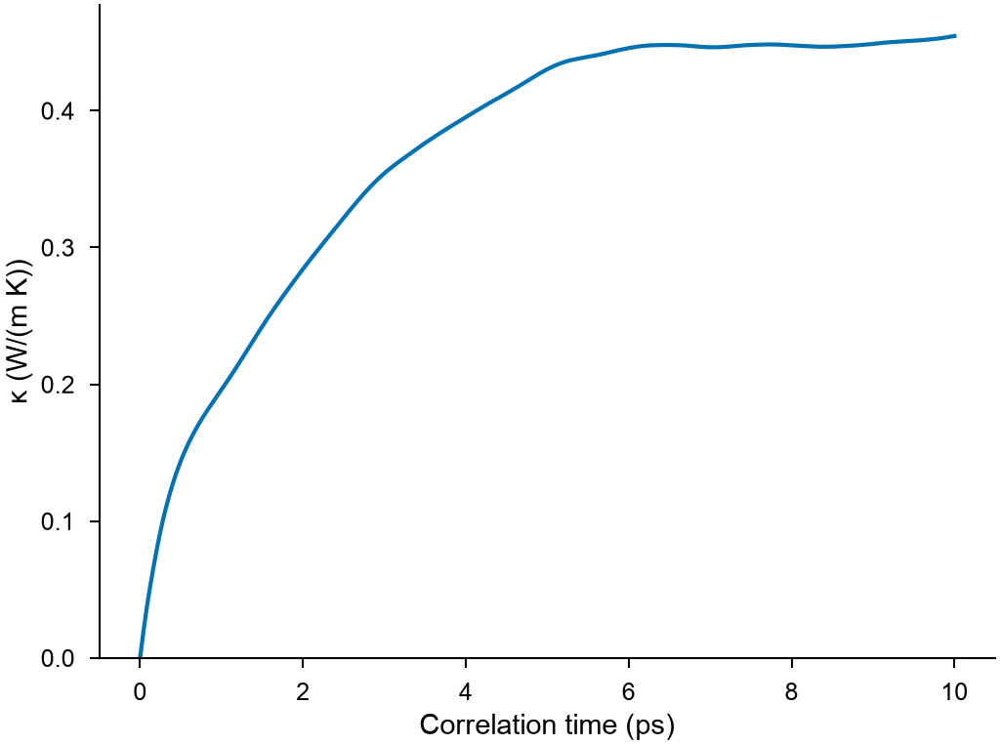

# Green–Kubo conductivity

`mdapy.lattice_dynamics.green_kubo(system, potential, temperature, ...)` gives the
thermal conductivity of a crystal or a liquid from the fluctuations of the heat flux in
equilibrium [molecular dynamics](../molecular-dynamics/running.md), in MDAPY or in LAMMPS for a
[LAMMPS calculator](../potentials/lammps.md), by the Green–Kubo relation;
`green_kubo_from_flux` does the same with a heat flux from any molecular dynamics. Unlike
the [relaxation-time approximation](thermal-conductivity.md), it holds every order of
anharmonicity, the atoms move as classical particles, and it needs no force constants.

Solid argon with MDAPY's [Lennard-Jones](../potentials/pair-potentials.md) potential; the 105 000
steps of 256 atoms run in MDAPY in about two minutes:

<!-- skip-test -->
```python
from mdapy.build import build_crystal
from mdapy.calculators import LennardJones
from mdapy.lattice_dynamics import green_kubo

argon = LennardJones({"Ar": (0.0104, 3.405)}, 8.5)  # ε in eV, σ in Å, cutoff
crystal = build_crystal("fcc", 5.28, elements="Ar", repeat=4)  # 256 atoms

result = green_kubo(
    crystal,
    argon,
    40.0,
    timestep=0.004,
    equilibration=5000,
    production=100000,
    every=5,
    correlation=10.0,
)
result.kappa, result.errors  # W/(m K)
result  # GreenKubo(0.4546 ± 0.099 W/(m K) at 39.9926 K), the mean of x, y and z
```

The integral of the correlation of the flux grows over the first picoseconds and then
holds its value, about which it wanders at longer lags by the noise of the correlation:

<!-- skip-test -->
```python
import numpy as np
from mdapy.visualization import plot

mean = np.trace(result.running, axis1=1, axis2=2) / 3
with plot.style():
    fig, ax = plot.figure("single")
    ax.plot(result.times, mean)
    ax.set(xlabel="Correlation time (ps)", ylabel="κ (W/(m K))", ylim=(0, None))
    plot.save(fig, "images/green-kubo", formats=("png",))
```



*Solid argon of the Lennard-Jones potential at 40 K, 256 atoms over 400 ps: the integral
of the correlation of the heat flux, the mean of x, y and z, up to each correlation
time.*

| Name | Type | Default | Unit | Meaning |
|---|---|---|---|---|
| `system` | `System` | | | the atoms in a box periodic in every direction, of its size at the temperature, with an `element` column |
| `potential` | `Calculator` | | | the interaction: in MDAPY, [EAM](../potentials/eam.md), a [pair potential](../potentials/pair-potentials.md), [NEP](../potentials/nep.md), [Stillinger–Weber](../potentials/stillinger-weber.md) or [Tersoff](../potentials/tersoff.md); in LAMMPS, a many-body one must give LAMMPS the centroid stress of each atom |
| `temperature` | float64 | | K | the temperature |
| `timestep` | float64 | 0.001 | ps | the time step |
| `equilibration` | int32 | 10000 | | steps at constant temperature first |
| `production` | int32 | 100000 | | steps at constant energy whose heat flux is recorded |
| `every` | int32 | 5 | | steps between the samples of the flux |
| `correlation` | float64 | 10 | ps | the longest lag of the correlation, over which it is integrated |
| `blocks` | int32 | 5 | | the number of blocks of the flux for the standard error |
| `seed` | int32 | 1 | | the seed of the starting velocities |

The atoms first reach the temperature with a Nosé–Hoover thermostat, then run at
constant energy, which the thermostat would disturb, while the heat flux is recorded
every `every` steps: the energy each atom carries and the work of the virial of each
atom. The virial must be one that gives the flux of heat:

- in LAMMPS, the [centroid stress](https://docs.lammps.org/compute_stress_atom.html)
  of each atom, the right one for many-body potentials
  ([Surblys et al. (2019)](../../reference/references.md#surblys2019)), with
  `compute heat/flux`; a potential for which LAMMPS has no centroid stress, such as
  Stillinger–Weber or Tersoff, is refused, and that of EAM is its pair forces split in
  halves, which does not give its heat flux (below);
- in MDAPY, the energy of each atom and the virial of each atom from the derivatives of
  the energies of the others with its position, as GPUMD computes it
  ([Fan et al. (2015)](../../reference/references.md#fan2015)): in a free cluster this
  flux is the change of the moment of the energies, as the heat flux is. For the pair
  potentials that virial is their pairwise forces split in halves, LAMMPS's centroid
  stress, so that the flux is that of `compute heat/flux` for the same atoms. For EAM
  it is not: its pair forces split in halves, LAMMPS's centroid stress of EAM, miss the
  change of the moment of its energies, by 15 to 44 % in a free cluster of copper and
  nickel, and on the same trajectories of copper, with Zhou's EAM, they give a
  conductivity 9 % higher than MDAPY's flux at 300 K, 7.55 against 6.94 W/(m K) over
  three runs, and 12 % higher in the liquid at 1600 K. Stillinger–Weber and Tersoff keep
  the energy of each three-body term whole with its centre atom, as LAMMPS's shares of
  their terms would give a wrong flux too; ADP and MEAM are refused. In MDAPY each
  record costs an evaluation of the forces more.

The temperature of the result is the mean of the run at constant energy.

`green_kubo_from_flux(flux, *, interval, volume, temperature, correlation, blocks=5)`
takes a heat flux of any molecular dynamics: (S, 3) samples of the heat flux times the
volume in eV Å/ps, as LAMMPS's `compute heat/flux` gives it in metal units, every
`interval` ps, with the volume in ų and the temperature in K.

**Converging.** The conductivity of one run is uncertain by its `errors`, from the
spread of the conductivities of `blocks` parts of the flux; longer runs make them
smaller, as one over the square root of the time. `correlation` should be long enough
that the integral has reached its value, and no longer, since the noise of the
correlation grows with the lag: a few times the time over which the integral rises.
Phonons longer than the box are missing, so a small box gives too small a conductivity;
compare boxes of growing size. For argon at 40 K, 500 atoms over 800 ps give
0.75 ± 0.14 W/(m K), and the relaxation-time approximation from the force constants of
the same potential 0.81 W/(m K); the two differ by the orders of anharmonicity the one
holds and the other leaves out, by the classical motion of the atoms, and by the
statistics of the run. Ten runs of 256 atoms over 200 ps, each with another seed, give
0.67 ± 0.08 W/(m K) in MDAPY and 0.70 ± 0.06 W/(m K) in LAMMPS, the means of the runs
with their standard errors, while single runs spread from 0.3 to 1.0 W/(m K).

## Results

`green_kubo` and `green_kubo_from_flux` return a `GreenKubo`.

| Attribute | Type | Unit | Meaning |
|---|---|---|---|
| `temperature` | float64 | K | the temperature |
| `volume` | float64 | ų | the volume |
| `times` | (C,) float64 | ps | the lags of the correlation, from 0 |
| `running` | (C, 3, 3) float64 | W/(m K) | the conductivity of the integral up to each lag |
| `kappa` | (3, 3) float64 | W/(m K) | the conductivity, that of the last lag |
| `errors` | (3, 3) float64 | W/(m K) | its standard error, from blocks of the flux |
| `flux` | (S, 3) float64 | eV Å/ps | the heat flux times the volume, at the samples |

Every array is read-only.

## Errors

`green_kubo` raises `InvalidParameter` for a box that is not periodic in every
direction, a temperature or numbers of steps that are not positive, a `potential` that
is not a calculator or whose virials do not give the heat flux, and the errors of `green_kubo_from_flux` and of
[`MolecularDynamics`](../molecular-dynamics/running.md). `green_kubo_from_flux` raises it for a flux that is
not (S, 3) and finite, an interval, volume, temperature or correlation that is not
positive, `blocks` less than 2 or not an integer, and blocks shorter than the
correlation.

## Definition

The heat flux of the atoms is

$$
\mathbf J = \frac{1}{V}\Big[\sum_i e_i \mathbf v_i + \sum_i \mathsf S_i \mathbf v_i\Big],
$$

with $V$ the volume of the box, $\mathbf v_i$ the velocity of atom $i$, $e_i$ its
kinetic and potential energy and $\mathsf S_i$ its centroid stress times the volume.
The thermal conductivity at the temperature $T$ is

$$
\kappa_{\alpha\beta} = \frac{V}{k_B T^2} \int_0^{\tau} \langle J_\alpha(0)\, J_\beta(t)
\rangle\, dt,
$$

where $\alpha$ and $\beta$ are the Cartesian directions x, y and z, $k_B$ is the
Boltzmann constant, $\langle J_\alpha(0)\, J_\beta(t) \rangle$ is the correlation of
the flux at the lag $t$, each lag the mean over every time origin of the samples, and
the integral is taken by trapezoids up to $\tau$, `correlation`, with the correlation
made symmetric in $\alpha$ and $\beta$
([Schelling et al. (2002)](../../reference/references.md#schelling2002)).

!!! quote "Please cite"

    [Schelling et al. (2002)](../../reference/references.md#schelling2002), and
    [Surblys et al. (2019)](../../reference/references.md#surblys2019) for the heat flux
    of many-body potentials.
