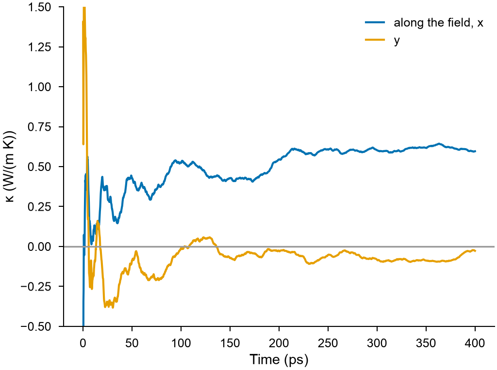

# HNEMD conductivity

`mdapy.lattice_dynamics.hnemd(system, potential, temperature, *, field)` gives the
thermal conductivity of a crystal by homogeneous nonequilibrium molecular dynamics
(HNEMD) in MDAPY ([Fan et al. (2019)](../../reference/references.md#fan2019)): a small
driving field pushes each atom through its virial, so that heat flows along the field
while a thermostat holds the temperature, and the mean heat flux over the field is the
conductivity. It needs no correlation of fluctuations, as the
[Green–Kubo relation](green-kubo.md) does, and no gradient of temperature, as a
temperature difference between two baths does.

Solid argon at 40 K with MDAPY's [Lennard-Jones](../potentials/pair-potentials.md) potential, the
field along x:

<!-- skip-test -->
```python
from mdapy.build import build_crystal
from mdapy.calculators import LennardJones
from mdapy.lattice_dynamics import hnemd

argon = LennardJones({"Ar": (0.0104, 3.405)}, 8.5, shift=True)
crystal = build_crystal("fcc", 5.28, elements="Ar", repeat=4)  # 256 atoms

result = hnemd(
    crystal,
    argon,
    40.0,
    field=(2e-3, 0.0, 0.0),  # 1/Å
    timestep=0.004,
    equilibration=5000,
    production=100000,
)
result  # HNEMD(0.596 ± 0.089 W/(m K) along the field at 39.9303 K)
result.kappa  # the conductivity tensor times the direction of the field, W/(m K)
```

The 105 000 steps run in MDAPY in about two minutes. The mean flux settles as the
run goes on:

<!-- skip-test -->
```python
from mdapy.visualization import plot

with plot.style():
    fig, ax = plot.figure("single")
    ax.plot(result.times, result.running[:, 0], label="along the field, x")
    ax.plot(result.times, result.running[:, 1], label="y")
    ax.axhline(0.0, color="0.6", lw=0.8)
    ax.set(xlabel="Time (ps)", ylabel="κ (W/(m K))", ylim=(-0.5, 1.5))
    ax.legend()
    plot.save(fig, "images/hnemd", formats=("png",))
```



*Solid argon of the Lennard-Jones potential at 40 K, 256 atoms over 400 ps: the
conductivity of the mean heat flux up to each time, along the field and across it,
where it goes to zero.*

| Name | Type | Default | Unit | Meaning |
|---|---|---|---|---|
| `system` | `System` | | | the atoms in a box periodic in every direction, of its size at the temperature, with an `element` column |
| `potential` | `Calculator` | | | the interaction, whose virials of each atom give the heat flux: [EAM](../potentials/eam.md), a [pair potential](../potentials/pair-potentials.md), [NEP](../potentials/nep.md), [Stillinger–Weber](../potentials/stillinger-weber.md) or [Tersoff](../potentials/tersoff.md), on the processor or the [GPU](../molecular-dynamics/gpu.md) |
| `temperature` | float64 | | K | the temperature of the thermostat |
| `field` | (3,) float64 | | 1/Å | the driving field |
| `timestep` | float64 | 0.001 | ps | the time step |
| `equilibration` | int32 | 10000 | | steps at the temperature without the field first |
| `production` | int32 | 1000000 | | steps with the field, whose heat flux is averaged |
| `every` | int32 | 10 | | steps between the samples of the flux |
| `blocks` | int32 | 5 | | blocks of the run for the standard error, at least 2 |
| `thermostat_damping` | float64 | 100 time steps | ps | the damping time of the Nosé–Hoover thermostat |
| `seed` | int32 | 1 | | the seed of the starting velocities |
| `progress` | callable | `None` | | called as `progress(done, total)` with the steps run |
| `cancel` | `CancelToken` | `None` | | stops the calculation, which raises `Cancelled` |

**The field.** The flux grows with the field, and its noise does not: a larger field
gives a smaller error, until the response stops being linear. In argon at 40 K, four
runs of 400 ps with a field of 2e-3 /Å gave 0.67 ± 0.08 W/(m K), as the Green–Kubo
conductivity of the same flux, 0.56 ± 0.08; with 4e-3 and 8e-3 /Å the conductivity
rose to 0.74 and 0.89 W/(m K), beyond the linear response. Check that half the field
gives the same conductivity. Fields of 1e-5 to 1e-4 /Å serve crystals that
conduct well, such as silicon or graphene.

**The flux.** The heat flux of HNEMD is its potential part, $\sum_i \mathsf W_i
\mathbf v_i$, as in GPUMD; the energy each atom carries, $\sum_i e_i \mathbf v_i$, is
left out of the field and of the flux. It is small in solids: in argon at 40 K the
Green–Kubo conductivity of the potential part alone was 0.56 ± 0.08 W/(m K), and
0.61 ± 0.08 with the energies carried, over the same six runs, each about 8 % less.

## Results

`hnemd` returns an `HNEMD`; every array is read-only.

| Attribute | Type | Unit | Meaning |
|---|---|---|---|
| `temperature` | float64 | K | the mean temperature of the run with the field |
| `volume` | float64 | ų | the volume |
| `field` | (3,) float64 | 1/Å | the field |
| `times` | (S,) float64 | ps | the time of each sample from the start of the field |
| `running` | (S, 3) float64 | W/(m K) | the conductivity of the mean flux up to each time |
| `kappa` | (3,) float64 | W/(m K) | that of the whole run: the conductivity tensor times the unit vector of the field |
| `errors` | (3,) float64 | W/(m K) | the standard errors of `kappa`, from blocks of the run |
| `flux` | (S, 3) float64 | eV Å/ps | the potential part of the heat flux times the volume, at the samples |
| `along` | float64 | W/(m K) | the conductivity along the field, `kappa` along its direction |

## Definition

Each atom $i$ feels besides its force the push $\mathsf W_i^\mathsf T \mathbf F_e$ of
the field $\mathbf F_e$, less the mean of the pushes, so that the momentum is kept,
where $\mathsf W_i$ is the virial of atom $i$ that gives the heat flux (the centroid
stress, see [Green–Kubo conductivity](green-kubo.md)). The field does the work
$\mathbf F_e \cdot \mathbf J$ on the atoms, with $\mathbf J = \sum_i \mathsf W_i
\mathbf v_i$, which the thermostat takes away, and by linear response

$$
\kappa_{\mu\nu} F_{e,\nu} = \frac{\langle J_\mu \rangle}{T V},
$$

with $T$ the temperature, $V$ the volume and $\langle \cdot \rangle$ the mean over the
run with the field.

## Errors

`hnemd` raises `InvalidParameter` for a box that is not periodic in every direction, a
temperature that is not positive, a field that is not three finite numbers or is zero,
numbers of steps that are not positive, fewer than two blocks or fewer samples than
blocks, a potential whose virials of each atom do not give the heat flux (such as
ADP and MEAM), a LAMMPS calculator, and
the errors of [`MolecularDynamics`](../molecular-dynamics/running.md); `Cancelled` when cancelled.

!!! quote "Please cite"
    [Fan et al. (2019)](../../reference/references.md#fan2019) for the method.
