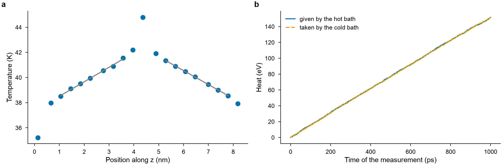

# NEMD conductivity

`mdapy.properties.transport.nemd(system, potential, temperature)` gives the thermal
conductivity of a crystal along a box vector by nonequilibrium molecular dynamics
(NEMD): a hot and a cold Langevin bath drive heat through the crystal between them, and
the conductivity is the heat flux over the gradient of temperature it sets up. It runs
in MDAPY, on the processor or the [GPU](../simulation/gpu.md), or in LAMMPS for a
[LAMMPS calculator](../potentials/lammps.md); the baths are [`Langevin`](../simulation/controls.md) controls.
The baths hold the atoms of their slabs at the start, a group each: in a liquid these
atoms wander out of their slabs, and the conductivity means nothing. A liquid takes the
[Green–Kubo](green-kubo.md) conductivity or [HNEMD](hnemd.md) with `convective=True`;
in liquid argon and silicon NEMD gave four times theirs.

Solid argon at 40 K in a box 8.4 nm long and 4.2 nm wide, the baths at 45 and 35 K:

<!-- skip-test -->
```python
from mdapy.build import build_crystal
from mdapy.calculators import LennardJones
from mdapy.properties.transport import nemd

argon = LennardJones({"Ar": (0.0104, 3.405)}, 8.5, shift=True)
crystal = build_crystal("fcc", 5.28, elements="Ar", repeat=(8, 8, 16))  # 4096 atoms

result = nemd(
    crystal,
    argon,
    40.0,
    difference=10.0,
    timestep=0.004,
    equilibration=2500,
    relaxation=50000,
    production=250000,
    every=50,
)
result  # NEMD(0.6024 ± 0.018 W/(m K) at 40.0055 K over 84.48 Å)
result.flux, result.gradient  # eV/(ps Ų) and K/Å
```

The 302 500 steps, 1.2 ns, run in MDAPY in 8 minutes on 8 cores. The temperature of
the slabs, and the heat the baths exchanged during the measurement:

<!-- skip-test -->
```python
import numpy as np
from mdapy.visualization import plot

x, t = result.positions / 10, result.temperatures  # nm, K
half = len(t) // 2
with plot.style():
    fig, (a, b) = plot.figure("double", 60, ncols=2)
    a.plot(x, t, marker="o", markersize=4, lw=0)
    for part in (np.arange(2, half - 1), np.arange(half + 2, len(t) - 1)):
        line = np.polyfit(x[part], t[part], 1)
        a.plot(x[part], np.polyval(line, x[part]), color="0.5", lw=1)
    a.set(xlabel="Position along z (nm)", ylabel="Temperature (K)")
    time = result.times - result.times[0]
    b.plot(time, result.hot - result.hot[0], label="given by the hot bath")
    b.plot(time, -(result.cold - result.cold[0]), "--", label="taken by the cold bath")
    b.set(xlabel="Time of the measurement (ps)", ylabel="Heat (eV)")
    b.legend()
    for ax, label in zip((a, b), "ab"):
        plot.panel_label(ax, label)
    plot.save(fig, "images/nemd", formats=("png",))
```



*a: The cold bath at the ends of the box and the hot one in its middle; between them
the temperature falls linearly, by 0.11 K/Å on both sides, with jumps at the baths,
where the atoms are thermalized by force. The lines are the fits whose slopes give the
gradient, of the slabs but those next to the baths, which stand off them by 0.1 to
0.3 K, alike on the two sides of a bath. Each point is at the mean position of the atoms
of its slab, which holds one or two of the atomic planes, 2.64 Å apart. b: The heat
the hot bath gave and the cold one took grow at one rate, 0.152 eV/ps, all through the measurement: the steady state holds from its start, after the
200 ps of `relaxation`. The flux is that rate over twice the section of the box, as the
heat flows from the hot bath both ways.*

| Name | Type | Default | Unit | Meaning |
|---|---|---|---|---|
| `system` | `System` | | | the crystal, with an `element` column, in a box periodic along `axis`, of its size at the temperature, long along the axis |
| `potential` | `Calculator` | | | the interaction: any calculator of energies and forces, in MDAPY on the processor or the GPU, or in LAMMPS |
| `temperature` | float64 | | K | the mean temperature |
| `difference` | float64 | a fifth of `temperature` | K | the difference of the temperatures of the baths |
| `axis` | int32 | 2 | | the box vector along which heat flows |
| `bins` | int32 | 20 | | the slabs across it, even and at least 10 |
| `damping` | float64 | 0.1 | ps | the damping time of the baths |
| `timestep` | float64 | 0.001 | ps | the time step |
| `equilibration` | int32 | 10000 | | steps at the temperature with a Nosé–Hoover thermostat first |
| `relaxation` | int32 | 50000 | | steps with the baths before the measurement, for the steady state |
| `production` | int32 | 200000 | | steps of the measurement |
| `every` | int32 | 100 | | steps between the samples of the temperatures and of the heat |
| `blocks` | int32 | 5 | | blocks of the measurement for the standard error, at least 2 |
| `seed` | int32 | 1 | | the seed of the starting velocities and of the baths |
| `progress` | callable | `None` | | called as `progress(done, total)` with the steps run |
| `cancel` | `CancelToken` | `None` | | stops the calculation, which raises `Cancelled` |

**The size of the box.** Phonons longer than the distance between the baths do not
carry heat as in the bulk: the conductivity of NEMD grows with the length of the box
towards that of the bulk. For solid argon at 40 K, 4.2 nm wide, three runs of 1 ns at
each length on one GPU gave

| Length | κ (W/(m K)) |
|---|---|
| 4.2 nm | 0.40 ± 0.01 |
| 8.4 nm | 0.58 ± 0.01 |
| 16.9 nm | 0.69 ± 0.02 |
| 33.8 nm | 0.76 ± 0.02 |

and a line of 1/κ against 1/L reaches 0.90 ± 0.03 W/(m K) at an infinite length.
The three runs at 8.4 nm spread from 0.566 to 0.597 W/(m K), and the one above, on the
processor, gave 0.602, as the errors of single runs from their blocks, 0.015 to
0.025 W/(m K), allow. Take the mean of runs with different seeds, and compare boxes
of growing length. The [Green–Kubo relation](green-kubo.md) and [HNEMD](hnemd.md) need
no such length.

**The slabs and the baths.** Each slab is the group of the atoms in it at the start,
for the temperatures as for the baths: groups that do not change, for crystals whose
atoms stay in their slabs. The atoms of the first slab along the axis are the cold bath
and those of the slab in the middle the hot one; the rest run at constant energy. An
atom of a bath that vibrates across the edge of its slab thus stays out of the
temperature of the next slab, which it would heat or cool, more on one side of the bath
than on the other, if the slabs were taken where the atoms are at each sample.
A larger `difference` gives a smaller error, as long as the gradient stays linear.

## Results

`nemd` returns an `NEMD`; every array is read-only.

| Attribute | Type | Unit | Meaning |
|---|---|---|---|
| `temperature` | float64 | K | the mean temperature during the measurement |
| `kappa` | float64 | W/(m K) | the conductivity along the axis |
| `error` | float64 | W/(m K) | its standard error, from blocks of the measurement |
| `flux` | float64 | eV/(ps Ų) | the heat flux through each half of the box |
| `gradient` | float64 | K/Å | the gradient of temperature, the mean of the two halves |
| `positions` | (B,) float64 | Å | the mean position along the axis of the atoms of each slab at the start |
| `temperatures` | (B,) float64 | K | the mean temperature of the atoms of each slab |
| `times` | (S,) float64 | ps | the time of each record of the measurement |
| `hot`, `cold` | (S,) float64 | eV | the heat the hot and the cold bath gave since the baths began, the cold one negative |
| `length` | float64 | Å | the length of the box normal to the slabs |
| `area` | float64 | Ų | the area of the slabs |

## Definition

The heat the baths drive through each half of the box per time and area is

$$
J = \frac{1}{2A}\,\frac{1}{2}\left(\frac{dQ_\mathrm{hot}}{dt} - \frac{dQ_\mathrm{cold}}{dt}\right),
$$

with $A$ the area of the slabs and $Q_\mathrm{hot}$ and $Q_\mathrm{cold}$ the heat the
baths gave, their slopes fitted over the measurement; the conductivity is
$\kappa = J / |dT/dz|$, with $dT/dz$ the mean of the slopes of the temperature of the
slabs of the two halves, the slabs next to the baths left out. The temperature of a
slab is $\sum_i m_i v_i^2 / (3 N k_B)$ of its $N$ atoms.

## Errors

`nemd` raises `InvalidParameter` for a box not periodic along the axis, a temperature
that is not positive, a difference that is not positive or not less than twice the
temperature, an axis other than 0, 1 or 2, a number of slabs that is odd or less than
10, slabs without atoms, numbers of steps or a damping that are not positive, fewer than
two blocks or fewer than two samples each, a `potential` that is not a calculator, and
the errors of [`MolecularDynamics`](../simulation/running.md); `Cancelled` when cancelled.
