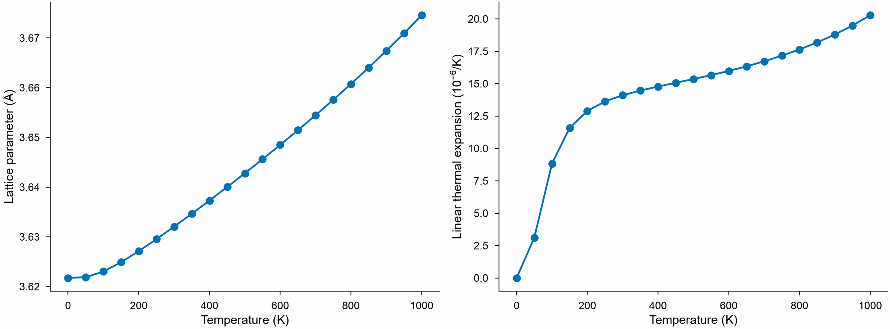

# Quasi-harmonic approximation

`mdapy.lattice_dynamics.quasi_harmonic(system, calculator, temperatures, *,
volumes=None, pressures=None, pressure=0.0, supercell=None, mesh=20,
displacement=0.01, max_force=1e-6, max_stress=1e-4, max_steps=5000, symmetry=None)` gives the thermal expansion, bulk modulus,
heat capacity and Gibbs energy of a crystal at finite temperature from its
[phonons](phonons.md) at several volumes.

<!-- skip-test -->
```python
import numpy as np
from mdapy.build import build_crystal
from mdapy.lattice_dynamics import primitive_cell, quasi_harmonic
from mdapy.simulation import minimize

crystal = minimize(
    build_crystal("fcc", 3.615, elements="Cu"),
    potential,
    cell="full",
    max_stress=1e-4,
).system
result = quasi_harmonic(primitive_cell(crystal), potential, np.arange(0, 1001, 50))
result.volume  # ų per atom at each temperature
result.thermal_expansion / 3  # linear thermal expansion coefficient, 1/K
result.bulk_modulus  # GPa
result.heat_capacity  # C_P, eV/K per atom
```

The lattice parameter of copper, four atoms to its cubic cell, and the
linear thermal expansion coefficient:

<!-- skip-test -->
```python
from mdapy.visualization import plot

t = result.temperatures
with plot.style():
    fig, (left, right) = plot.figure("double", ncols=2)
    left.plot(t, (4 * result.volume) ** (1 / 3), marker="o")
    left.set_xlabel("Temperature (K)")
    left.set_ylabel("Lattice parameter (Å)")
    right.plot(t, result.thermal_expansion / 3 * 1e6, marker="o")
    right.set_xlabel("Temperature (K)")
    right.set_ylabel(r"Linear thermal expansion ($10^{-6}$/K)")
    plot.save(fig, "images/quasi-harmonic", formats=("png",))
```



*Copper with the EAM potential of Mishin et al.: at 0 K the zero-point
vibrations already widen the lattice a little beyond its static 3.615 Å;
it grows slowly at first, while the vibrations freeze out, then nearly
linearly. The expansion coefficient rises from 0 and keeps growing slowly
above the Debye temperature.*

At each volume the box keeps its volume while its shape and the positions
relax, so that a crystal whose shape changes with the volume, such as hcp
with its c/a, takes its best shape at each; the phonons then give the free
energy of the vibrations. The volumes must hold the equilibrium volume at
every temperature: the default, from 0.97 to 1.09 times the volume of
`system`, reaches the melting point of most metals. Instead of volumes,
`pressures` relax the box and the positions under each pressure. The cells
of the grid are kept, for [elastic constants at finite
temperature](thermal-elastic.md).

The quasi-harmonic approximation leaves out the anharmonic vibrations
beyond the change of the frequencies with the volume, so it holds well
below the melting point; near it, molecular dynamics is needed. The bulk
modulus comes from the curvature of a fit through the volumes; with the
default nine volumes it is good to about 1 %.

| Name | Type | Default | Unit | Meaning |
|---|---|---|---|---|
| `system` | `System` | | | the cell of the crystal, periodic in every direction, or of a [sheet](sheets.md#quasi-harmonic-approximation), with an `element` or a `mass` column; best relaxed and primitive |
| `calculator` | `Calculator` | | | computes energies and forces |
| `temperatures` | (T,) float64 | | K | the temperatures, not negative |
| `volumes` | (V,) float64 | 9 from 0.97 to 1.09 | | the volumes of the phonons, as ratios to the volume of `system`; five or more |
| `pressures` | (V,) float64 | | GPa | instead of volumes, the pressures under which the box and the positions relax; five or more |
| `pressure` | float64 | 0 | GPa | the pressure $P$ |
| `supercell` | int32 or (3,) int32 | | | repeats of the cell for the phonons, as in [`phonons`](phonons.md) |
| `mesh` | int32 or (3,) int32 | 20 | | wave vectors along each reciprocal lattice vector for the thermal properties |
| `displacement` | float64 | 0.01 | Å | displacement of the atoms for the force constants |
| `max_force` | float64 | 1e-6 | eV/Å | convergence of the relaxation at each volume |
| `max_stress` | float64 | 1e-4 | GPa | convergence of the relaxation of the box |
| `max_steps` | int32 | 5000 | | largest number of steps of each relaxation |
| `symmetry` | bool or `None` | `None` | | use the symmetry operations of the crystal, found by [spglib](../analysis/space-group.md), in the phonons, as in [`phonons`](phonons.md): `True`, `False`, or by default whenever spglib is installed |

## Results

It returns a `QuasiHarmonicResult`, all per atom; arrays are read-only.

| Attribute | Type | Unit | Meaning |
|---|---|---|---|
| `temperatures` | (T,) float64 | K | the temperatures |
| `pressure` | float64 | GPa | the pressure |
| `volume` | (T,) float64 | ų | the equilibrium volume $V(T)$ |
| `gibbs_energy` | (T,) float64 | eV | the Gibbs energy $G(T, P)$ |
| `entropy` | (T,) float64 | eV/K | the entropy $S$ |
| `bulk_modulus` | (T,) float64 | GPa | the isothermal bulk modulus $B_T$ |
| `thermal_expansion` | (T,) float64 | 1/K | the volumetric thermal expansion coefficient $\alpha$; a third of it is the linear one of a cubic crystal |
| `heat_capacity` | (T,) float64 | eV/K | the heat capacity at constant pressure $C_P$ |
| `volumes` | (V,) float64 | ų | the volumes of the phonons |
| `energies` | (V,) float64 | eV | the static energy at each volume |
| `free_energies` | (V, T) float64 | eV | the free energy of the vibrations at each volume and temperature |
| `cells` | tuple of `System` | | the relaxed cell at each volume |

## Errors

`quasi_harmonic` raises `InvalidParameter` for a box neither periodic in
every direction nor that of a sheet, a negative temperature,
both volumes and pressures, fewer than five of them, a relaxation that does
not converge within `max_steps`, imaginary frequencies at a volume, and an
equilibrium volume outside the volumes, as well as for the errors of
[`phonons`](phonons.md). It also raises it, before the phonons of the grid,
where a pair of atoms crosses the cutoff of the calculator between the volumes
and the free energy jumps there by more than 2 % of its change over an eighth
of the range of the volumes, which distorts the results by percents or more.

### Crossing the cutoff

Where a pair of atoms comes within `displacement` of the cutoff at some
volumes and not at others, the free energy jumps by as much as the potential
is rough at its cutoff. `quasi_harmonic` measures the jump: it scales the cell
nearest the crossing so that the pair lies 2, 3 and 4 displacements inside and
outside the cutoff, and extrapolates the free energy of the vibrations at the
highest temperature to the cutoff from either side, and the static energy from
1e-4 Å either side. It compares the jump with the second difference of the
static energy over an eighth of the range of the volumes, the spacing of the
default nine. A jump distorts the fit through the volumes by as much whether
there are 6 or 25 of them, so their range sets the scale, not their number.
With the default volumes:

| Potential | Its functions at the cutoff | Jump, of the change over an eighth of the range |
|---|---|---|
| EAM of Mishin et al. (`Cu_mishin1.eam.alloy`) | vanish with their first and second derivatives | 0.2 % |
| `EAM.zhou` | about 1e-6 of their largest | 1 % |
| NEP | vanish with their first derivatives | 4 to 17 % |
| EAM of Foiles et al. (`Cu_u3.eam`), Mendelev et al. (`Al_mm.eam.fs`) | cut off | 8 to 33 % |

Up to 2 % the results change by less than 1 % with where the volumes fall
about the crossing, and the calculation goes on. Above it they can change by
much more, by up to 35 % for the thermal expansion with the potentials above,
and `quasi_harmonic` raises `InvalidParameter`, naming the pair, the jump and
its part. Choose volumes or pressures all on one side of the crossing, or a
potential smooth at its cutoff. The Zhou potentials cut off at the fifth shell
of their fcc crystal, which every range of volumes about it crosses, with a
jump of 1 %. Their copper also turns unstable between 1.07 and 1.08 of its
volume, which the default volumes reach: give it volumes up to 1.07.

## Definition

At each temperature $T$, the free energy

$$
F(V, T) = E(V) + F_\mathrm{vib}(V, T) + PV,
$$

with $E$ the static energy, $F_\mathrm{vib}$ the harmonic free energy
of the vibrations at volume $V$ and $P$ the pressure (`pressure`), is fit by the third-order Birch–Murnaghan
form, a cubic polynomial in $V^{-2/3}$, by least squares. Its minimum is the
equilibrium volume $V(T)$ and the Gibbs energy $G = F(V(T), T)$, its
curvature there the bulk modulus $B_T = V\,\partial^2F/\partial V^2$. The
entropy $S_\mathrm{vib}$ and the heat capacity $C_V$ of the vibrations,
fit alike, give at $V(T)$ the entropy $S$, the volumetric thermal expansion
$\alpha$ and the heat capacity at constant pressure $C_P$:

$$
S = S_\mathrm{vib}, \qquad
\alpha = \frac{1}{B_T}\left(\frac{\partial S_\mathrm{vib}}{\partial V}\right)_T, \qquad
C_P = C_V + T V B_T \alpha^2.
$$
