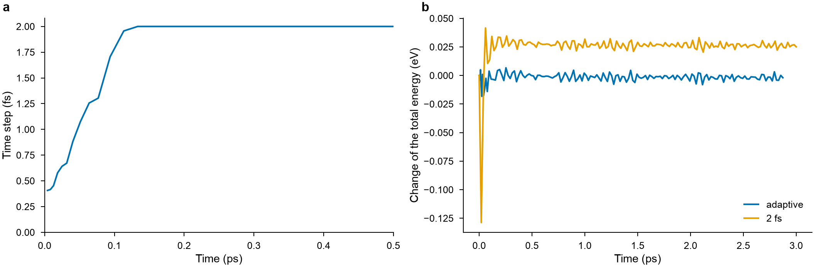

# Adaptive time step

`AdaptiveTimestep`, a [control](controls.md) of a run of
[molecular dynamics](dynamics.md), sets the time step by the fastest atom: no atom moves
more than a given distance in a step. An atom of a collision cascade starts with
hundreds of electronvolts and slows down in a fraction of a picosecond; a time step
short enough for it at the start would waste the rest of the run, and one fit for the
rest would let it pass too far into its neighbors.

Copper at 300 K, one atom near the middle sent off with 50 eV along [1 3 5], at
constant energy for 1500 steps, once with steps of at most 0.05 Å and once with a
fixed step of 2 fs:

```python
import numpy as np

from mdapy import units
from mdapy.build import build_crystal
from mdapy.calculators import EAM
from mdapy.simulation import AdaptiveTimestep, MolecularDynamics

copper = EAM.zhou(["Cu"])
crystal = build_crystal("fcc", 3.615, elements="Cu", repeat=8)  # 2048 atoms
with MolecularDynamics(crystal, copper, timestep=0.002) as md:
    md.velocities(600, seed=1)
    md.run(1000, ensemble="nvt", temperature=300)
    warm = md.system

center = warm.box.matrix.sum(axis=0) / 2
atom = int(np.argmin(np.linalg.norm(warm["positions"] - center, axis=1)))
speed = np.sqrt(2 * 50.0 / (63.546 * units.AMU_A2_PER_PS2_TO_EV))  # Å/ps
velocities = warm["velocities"].copy()
velocities[atom] = speed * np.array([1, 3, 5]) / np.sqrt(35)
knocked = warm.with_columns(velocities=velocities)

runs = {}
for name, controls in (("adaptive", AdaptiveTimestep(0.05)), ("2 fs", None)):
    with MolecularDynamics(knocked, copper, timestep=0.002) as md:
        md.run(1500, ensemble="nve", thermo=10, controls=controls)
        runs[name] = md.thermo
```

`time` of `thermo` is the time the steps add up to:

```python
from mdapy.visualization import plot

with plot.style():
    fig, (a, b) = plot.figure("double", 60, nrows=1, ncols=2)
    thermo = runs["adaptive"]
    time = thermo["time"].to_numpy()
    steps = np.diff(time) / np.diff(thermo["step"].to_numpy())
    a.plot(time[1:], steps * 1000)
    a.set(xlabel="Time (ps)", ylabel="Time step (fs)", xlim=(0, 0.5), ylim=(0, None))
    for name, thermo in runs.items():
        energy = thermo["total_energy"].to_numpy()
        b.plot(thermo["time"], energy - energy[0], label=name)
    b.set(xlabel="Time (ps)", ylabel="Change of the total energy (eV)")
    b.legend()
    for ax, label in zip((a, b), "ab"):
        plot.panel_label(ax, label)
    plot.save(fig, "images/adaptive-timestep", formats=("png",))
```



*a: The steps start at 0.41 fs, the time in which the atom of 123 Å/ps moves
0.05 Å, and grow as it slows down, to 2 fs, the time step of `MolecularDynamics`
and the longest, 0.13 ps later. b: With steps of 2 fs from the start, the total
energy jumps by 0.13 eV at the first collision and stays 0.025 eV above where it
began; with the adaptive time step it stays within 0.02 eV.*

## Parameters

`AdaptiveTimestep(max_distance, *, min_timestep=None, max_timestep=None, every=1)`,
given to `run` or `iterate` by `controls`.

| Parameter | Type | Default | Unit | Meaning |
|---|---|---|---|---|
| `max_distance` | float64 | | Å | the longest move of an atom in a step |
| `min_timestep` | float64 | `None` | ps | the shortest time step; `None`, no bound |
| `max_timestep` | float64 | `None` | ps | the longest time step; `None`, the time step of `MolecularDynamics` |
| `every` | int32 | 1 | | steps between the settings of the time step |

## How it acts

- At the start of the run and at the end of every step whose number is a multiple of
  `every`, each atom of mass $m$, velocity $v$ and force $f$ gives the time step
  $\min(d / |v|, \sqrt{2 d m / |f|})$, with $d$ = `max_distance`, shortened in
  proportion if its move $v\,\delta t + f\,\delta t^2 / 2m$ is still longer than $d$;
  the shortest over the atoms, within the bounds, is the time step of the next steps.
- `time` of `thermo` and of the frames is the time the steps add up to. The time steps
  of the thermostat, the barostat and the Langevin baths follow; their damping times
  stay what they are in ps. The next run starts again from the time step of
  `MolecularDynamics`.
- In LAMMPS it is `fix dt/reset` with `units box`: the runs are those of MDAPY, step by
  step, but where a Langevin thermostat or bath acts, whose friction and random forces
  count among the forces of LAMMPS. On the [GPU](gpu.md) the time step is that of the
  processor.

## Errors

`AdaptiveTimestep` raises `InvalidParameter` for a `max_distance`, `min_timestep` or
`max_timestep` that is not positive, a `min_timestep` not less than `max_timestep`, and
an `every` that is not a positive integer. `run` and `iterate` raise it for two
`AdaptiveTimestep` in one run, and one with a [`Deform`](deformation.md) or with
atoms that `Move` moves.
