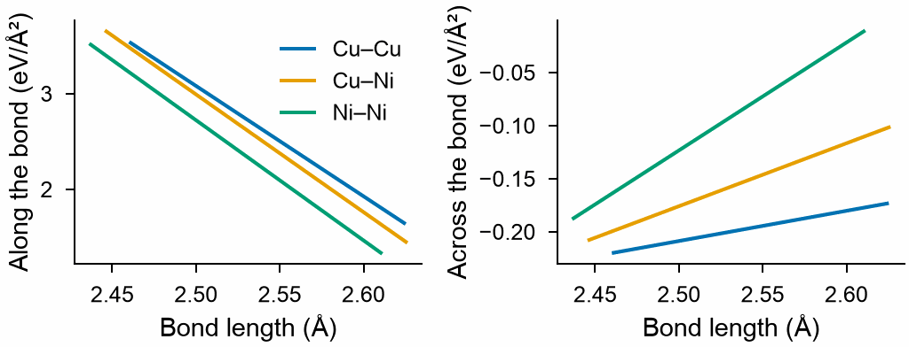

# Bond stiffness

`mdapy.lattice_dynamics.bond_stiffness(data, *, cutoff, degree=1)` fits springs along
and across the bonds of crystals, whose stiffnesses are polynomials of the length of the
bond for each pair of elements, to the forces on atoms displaced in supercells. The
springs then give the force constants, and so the [phonons](phonons.md) and the
vibrational free energy, of any arrangement of the same elements, such as a special
quasirandom structure, from the lengths of its bonds alone
([van de Walle and Ceder (2002)](../../reference/references.md#vandewalle2002)).

The springs of copper and nickel, from the pure metals, two ordered compounds and a
small random alloy, each at three sizes so that the bonds take several lengths:

```python
from mdapy.build import build_crystal, random_alloy
from mdapy.calculators import EAM
from mdapy.lattice_dynamics import bond_stiffness, displaced_supercells, phonons
from mdapy.simulation import minimize

potential = EAM.zhou(["Cu", "Ni"])


def relaxed(system, cell="full"):
    return minimize(system, potential, cell=cell, max_force=1e-8, max_stress=1e-7).system


def with_forces(frames):
    return [f.with_columns(forces=potential.compute(f, ("forces",)).forces) for f in frames]


alloy = random_alloy(
    build_crystal("fcc", 3.57, elements="Cu", repeat=2), {"Cu": 0.5, "Ni": 0.5}, seed=5
)
crystals = [
    (relaxed(build_crystal("fcc", 3.615, elements="Cu")), 3),
    (relaxed(build_crystal("fcc", 3.52, elements="Ni")), 3),
    (relaxed(build_crystal("l1_2", 3.59, elements=("Cu", "Ni"))), 3),
    (relaxed(build_crystal("l1_2", 3.55, elements=("Ni", "Cu"))), 3),
    (relaxed(alloy), 2),
]
data = []
for cell, supercell in crystals:
    for scale in (0.98, 1.0, 1.02):
        sized = cell.with_box(cell.box.matrix * scale).with_columns(
            positions=cell["positions"] * scale
        )
        sized = relaxed(sized, cell=None)  # the atoms at rest at this size
        moved = displaced_supercells(sized, supercell=supercell, method="random", seed=1)
        data.append((sized, with_forces(moved)))

springs = bond_stiffness(data, cutoff=(3.0, 4.0))  # nearest and second neighbors
springs.error  # 0.027: the forces the springs leave out
springs.stiffness("Cu", "Ni", 2.53)  # along and across, eV/Ų
```

The force constants of the springs give the vibrations of a random alloy of 108 atoms,
which none of the fits held, and those of the full calculation tell how good the springs
are for it:

```python
sqs = relaxed(
    random_alloy(
        build_crystal("fcc", 3.57, elements="Cu", repeat=3), {"Cu": 0.5, "Ni": 0.5}, seed=2
    )
)
model = springs.force_constants(sqs).phonons().thermal([300.0], mesh=4)
full = phonons(sqs, potential, supercell=1, symmetry=False).thermal([300.0], mesh=4)
model.entropy, full.entropy  # 3.496 and 3.479 k_B per atom
```

The stiffnesses of the nearest neighbors, over the lengths of the bonds in the fit:

```python
import numpy as np
from mdapy.visualization import plot

with plot.style():
    fig, (along, across) = plot.figure("single", ncols=2, sharex=True)
    for k, (first, second, shell) in enumerate(springs.pairs):
        if shell:
            continue
        lengths = np.linspace(*springs.lengths[k], 50)
        k_l, k_t = springs.stiffness(first, second, lengths)
        along.plot(lengths, k_l, label=f"{first}–{second}")
        across.plot(lengths, k_t)
    along.set(xlabel="Bond length (Å)", ylabel="Along the bond (eV/Ų)")
    across.set(xlabel="Bond length (Å)", ylabel="Across the bond (eV/Ų)")
    along.legend(frameon=False)
    plot.save(fig, "images/bond-stiffness", formats=("png",))
```



*The springs of the nearest neighbors of copper and nickel with `EAM.zhou`: along the
bond, stiffer the shorter the bond and the more nickel; across it, small, and of the
sign of the tension of the bond.*

| Name | Type | Default | Unit | Meaning |
|---|---|---|---|---|
| `data` | sequence of (`System`, sequence of `System`) | | | for each crystal its cell, with an `element` column and its atoms at rest, and supercells of it with atoms displaced, each with a `forces` column in eV/Å, such as those of [`displaced_supercells`](force-constants.md) |
| `cutoff` | float64 or array_like of float64 | | Å | the longest bond, or the outer radii of shells of neighbors, increasing, each shell with springs of its own; the last at most half the shortest vector of each supercell less 1e-3 Å |
| `degree` | int32 | 1 | | the degree of the polynomials of the length |

A bond of length r is of the first shell whose radius is r or more; with `cutoff=3.0`
only the nearest neighbors of copper and nickel have springs. Each pair of elements in
each shell has its own polynomials. A polynomial of degree d needs bonds of d + 1
lengths or more, which cells of other sizes give, as above. A crystal of one size gives
a single length for each shell of a simple lattice, so `degree=0` then. The frames of
each crystal are matched to its supercell by position, as for
[`force_constants`](force-constants.md), and every frame of every crystal enters one fit.

## Results

`bond_stiffness` returns a `BondStiffness`.

| Attribute or method | Type | Meaning |
|---|---|---|
| `pairs` | tuple of (str, str, int64) | the two elements, in alphabetical order, and the shell from 0, of each set of bonds |
| `shells` | (M,) float64 | the outer radius of each shell in Å; read-only |
| `degree` | int64 | the degree of the polynomials |
| `longitudinal` | (P, degree + 1) float64 | the coefficients of the stiffness along the bonds of each pair in eV/Ų, of the powers of the length in Šfrom the lowest; read-only |
| `transverse` | (P, degree + 1) float64 | the same for the stiffness across them; read-only |
| `lengths` | (P, 2) float64 | the shortest and the longest bond of each pair in the fit, in Å, over which the polynomials hold; read-only |
| `error` | float64 | the relative error of the forces |
| `stiffness(first, second, length)` | tuple of float64 arrays | the stiffness along and across bonds of two elements, in any order, of the lengths given, in eV/Ų |
| `force_constants(cell, supercell=1)` | `ForceConstants` | the [force constants](force-constants.md) of the springs of the bonds of a crystal, in its cell or a supercell of it in which half the shortest vector is longer than the last shell; zero beyond it, which is their `cutoff` |

`error` is the size of the forces that the springs leave out, over that of the forces:
those of interactions that are not springs between pairs, as the many-body forces of
EAM, and those of anharmonic terms. The springs hold only the bonds within the shells,
and a function of the length cannot tell bonds of the same length in other
surroundings apart, so the entropy and free energy of a structure from them are best
checked against a full calculation of one structure, as above. Lengths beyond the range
of `lengths` are extrapolations.

## Errors

`bond_stiffness` raises `InvalidParameter` for:

- no crystals, or a crystal without frames;
- a cell without atoms or without an element column;
- a frame whose box is not that of a supercell of its cell, that has no forces, or whose
  atoms are not one at each atom of the supercell;
- a cutoff that is not positive lengths, increasing, or that is too long for a
  supercell;
- no bonds within the cutoff;
- a degree that is not an integer from 0;
- the bonds of a pair of elements in a shell having fewer lengths than the degree needs;
- frames that do not determine every coefficient.

`stiffness` raises it for a length beyond the last shell or not positive, and for a pair
of elements with no bonds in the shell of a length. `force_constants` raises it for a
cell without an element column, a bond of a pair of elements and a shell that the
springs do not hold, and a supercell that is not valid or too small for the shells.

## Definition

A bond from atom $i$ to atom $j$, of length $r$ and direction $\mathbf e$, is a spring
of stiffness $k_\parallel(r)$ along it and $k_\perp(r)$ across it:

$$
\Phi_{ij} = -\left[k_\parallel(r)\, \mathbf e \mathbf e^{\mathsf T}
+ k_\perp(r) \left(\mathbf 1 - \mathbf e \mathbf e^{\mathsf T}\right)\right],
\qquad
\Phi_{ii} = -\sum_{j \ne i} \Phi_{ij},
$$

with $k(r) = \sum_{q=0}^{d} c_q r^q$ for each pair of elements in each shell. The
coefficients make the sum over all frames of $|\mathbf F - \mathbf F_\text{springs}|^2$
as small as they can, with $\mathbf F_\text{springs} = -\Phi \mathbf u$ of the
displacements $\mathbf u$ of the atoms
([Wu et al. (2003)](../../reference/references.md#wu2003)). For a pair potential
$\varphi(r)$ the springs are exact: $k_\parallel = \varphi''(r)$ and
$k_\perp = \varphi'(r)/r$, so that a bond in tension resists a turn.

!!! quote "Please cite"

    [van de Walle and Ceder (2002)](../../reference/references.md#vandewalle2002) and
    [Wu et al. (2003)](../../reference/references.md#wu2003), when you use the springs.
