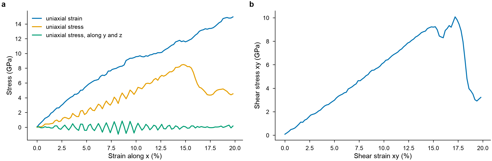

# Deformation

<p class="runs-on" markdown>**Runs on** the processor · the [GPU](gpu.md) · [LAMMPS](in-lammps.md) as `fix deform`</p>

`Deform`, a [control](controls.md) of a run of
[molecular dynamics](running.md), stretches, compresses or shears the box at
constant rates, the atoms carried with it: the loading of a tensile, a
compression or a shear test.

Copper at 300 K stretched along x by 2 % of its length every ps to 20 %, once
with its sides held (uniaxial strain), once with them free under zero stress, a
barostat on y and z (uniaxial stress), and sheared in the xy plane at the same
rate:

<!-- skip-test -->
```python
import numpy as np

from mdapy.build import build_crystal
from mdapy.calculators import EAM
from mdapy.simulation import MolecularDynamics
from mdapy.simulation.controls import Deform

crystal = build_crystal("fcc", 3.615, elements="Cu", repeat=(12, 12, 12))  # 6912 atoms
copper = EAM.zhou(["Cu"])
rate = 0.02  # 1/ps

runs = {
    "uniaxial strain": {"ensemble": "nvt", "controls": Deform(xx=rate)},
    "uniaxial stress": {
        "ensemble": "npt",
        "pressure": 0.0,
        "barostat": "aniso",
        "controls": Deform(xx=rate),
    },
    "shear": {"ensemble": "nvt", "controls": Deform(xy=rate)},
}
with MolecularDynamics(crystal, copper, timestep=0.002) as md:
    md.velocities(300, seed=1)
    md.run(2500, ensemble="npt", temperature=300, pressure=0.0, barostat="aniso")
    warm = md.system  # at 300 K and no pressure, with its velocities

curves = {}
for name, options in runs.items():
    with MolecularDynamics(warm, copper, timestep=0.002) as md:
        md.run(5000, temperature=300, thermo=10, **options)
        pulled = md.thermo  # every 10 steps from the start of the run
    time = pulled["time"].to_numpy() - pulled["time"][0]
    curves[name] = (rate * time, np.stack(pulled["stress"].to_numpy()))
```

Graphene, a sheet, stretched along x, a zigzag direction of its rings, and along
y, an armchair one, with the other held, at the same rate to 30 %, with the
[NEP model of carbon](../../examples/graphene-polycrystal.md#the-boundaries-settle)
of the graphene polycrystal: download [`nep.txt`](../../examples/carbon/nep.txt)
into the working directory.

<!-- files: ../../examples/carbon -->

<!-- skip-test -->
```python
import mdapy
from mdapy.calculators import NEP
from mdapy.transform import orthogonal_cell, replicate

carbon = NEP("nep.txt")
cell = orthogonal_cell(build_crystal("graphene", 2.46, c=20.0, elements="C"))
sheet = replicate(cell, (20, 12, 1))  # 960 atoms, 4.9 nm by 5.1 nm
sheet = sheet.with_box(mdapy.Box(sheet.box.matrix, pbc=(True, True, False)))
with MolecularDynamics(sheet, carbon, timestep=0.0005) as md:
    md.velocities(300, seed=1)
    md.run(10000, ensemble="npt", temperature=300, pressure=0.0, barostat="xy")
    flat = md.system

pulls = {}
for name, deform in (
    ("zigzag, along x", Deform(xx=rate)),
    ("armchair, along y", Deform(yy=rate)),
):
    with MolecularDynamics(flat, carbon, timestep=0.0005) as md:
        md.run(30000, ensemble="nvt", temperature=300, thermo=20, controls=deform)
        pulled = md.thermo
    time = pulled["time"].to_numpy() - pulled["time"][0]
    # the stress of a sheet 3.35 Å thick, the spacing of the layers of graphite,
    # from the stress over the box with its vacuum, 20 Å high
    stress = np.stack(pulled["stress"].to_numpy())[:, :2] * flat.box.matrix[2, 2] / 3.35
    pulls[name] = (rate * time, stress)
```

The strain is the rate times the time since the run began: each length grows by
the rate times its length at the start every ps, and the tilt xy by the rate
times the length along y. `stress` of `thermo` is in the order xx, yy, zz, yz,
xz, xy, positive under tension; that of a sheet is over the volume of its box,
[as LAMMPS has it](../properties/sheets.md#molecular-dynamics). Every point is the
stress at one step, every 10 steps for copper and 20 for graphene:

<!-- skip-test -->
```python
from mdapy.visualization import plot

with plot.style():
    fig, (a, b, c) = plot.figure("double", 60, nrows=1, ncols=3)
    for name in ("uniaxial strain", "uniaxial stress"):
        strain, stress = curves[name]
        a.plot(strain * 100, stress[:, 0], label=name, lw=0.8)
    strain, stress = curves["uniaxial stress"]
    a.plot(
        strain * 100,
        stress[:, 1:3].mean(axis=1),
        label="uniaxial stress, along y and z",
        lw=0.8,
    )
    a.set(xlabel="Strain along x (%)", ylabel="Stress (GPa)")
    a.legend()
    strain, stress = curves["shear"]
    b.plot(strain * 100, stress[:, 5], lw=0.8)
    b.set(xlabel="Shear strain xy (%)", ylabel="Shear stress xy (GPa)")
    for (name, (strain, stress)), k in zip(pulls.items(), (0, 1)):
        c.plot(strain * 100, stress[:, k], label=name, lw=0.8)
    c.set(xlabel="Strain (%)", ylabel="Stress of graphene (GPa)")
    c.legend()
    for ax, label in zip((a, b, c), "abc"):
        plot.panel_label(ax, label)
    plot.save(fig, "images/deformation", formats=("png",))
```



*a: With its sides held, the stress along x rises by 134 GPa per unit strain over
the first percent, against C11 = 137 GPa of this potential at 300 K from
[elastic constants from molecular dynamics](../properties/md-elastic.md) (169 GPa
at 0 K: the vibrations of the atoms soften copper with this potential by a fifth),
and less as the strain grows, to 15 GPa at 20 %. With its sides free, the stress rises by 45 GPa per unit strain
over the first 2 %, once the barostat has let the sides in, against the Young's
modulus along [100] of 46.5 GPa at 300 K, to 8.2 GPa at 14.6 %, where the crystal
gives way; the stresses along y and z swing about zero as the barostat sets in.
b: The shear stress rises by 54 GPa per unit strain, C44 = 55 GPa at 300 K, to
9.3 GPa at 17 %, where the crystal gives way. c: Graphene pulled along its two
directions: the curves fall on each other to 15 %, as the elastic response of a
hexagonal sheet is the same in every direction of its plane, and part at larger
strains. Over a thickness of 3.35 Å the sheet breaks at 125 GPa and 21.1 % along the
armchair direction and at 125 GPa and 22.2 % along the zigzag one, and the stress then
rings about zero. Suspended sheets indented by a tip gave a Young's modulus of 1.0 TPa
and a strength of 130 ± 10 GPa ([Lee et al. 2008](../../reference/references.md#lee2008)).*

The runs take about 3 minutes for copper and 2 for graphene on 8 cores. The rate,
2 % of the length every ps or 2 × 10¹⁰ per second, is one of molecular dynamics,
billions of times that of a test in a laboratory: the elastic part of the curves
does not depend on it, the stress where the crystal gives way does.

## Parameters

`Deform(*, xx=0.0, yy=0.0, zz=0.0, yz=0.0, xz=0.0, xy=0.0, kind="engineering")`,
given to `run` or `iterate` by `controls`, alone or beside other controls.

| Parameter | Type | Default | Unit | Meaning |
|---|---|---|---|---|
| `xx`, `yy`, `zz` | float64 | 0.0 | 1/ps | strain rates of the lengths of the box along x, y and z, positive stretching, negative compressing; 0 leaves the length |
| `yz`, `xz`, `xy` | float64 | 0.0 | 1/ps | shear strain rates: every ps the tilt yz grows by the rate times the length along z at the start of the run, xz the same, and xy by the rate times the length along y |
| `kind` | str | `"engineering"` | | of the lengths: `"engineering"`, each grows by the rate times its length at the start every ps, at a constant speed; `"true"`, by the rate times its length now, exponentially |

## How it acts

- The box takes the lengths and tilts of the rates at the end of each step, its
  lengths about the middle of the box, and the atoms are carried with it: their
  positions keep their place in the box, as fractions of its vectors. Their
  velocities are left; the motion of the box reaches them through the forces.
- The rates hold for the run they are given to; the next run starts from the box
  it finds, and runs without a `Deform` keep it.
- A barostat, `"npt"` or `"nph"` with `barostat="iso"` or `"aniso"`, holds the
  pressure of the lengths the deformation leaves: of y and z together with
  `"iso"`, of each with `"aniso"`, while x is stretched.
- In LAMMPS it is `fix deform 1` with `erate` or `trate`, `remap x` and
  `flip no`, and the barostat on the lengths left: the runs are those of MDAPY,
  step by step. On the [GPU](gpu.md) the box changes as on the processor.

## Errors

`Deform` raises `InvalidParameter` for rates that are not finite, all zero, or a
`kind` that is not `"engineering"` or `"true"`. `run` and `iterate` raise it for
two `Deform` in one run, a `Deform` with held or moved atoms, true rates of
tilts, a rate on a length that is not periodic or a tilt across one (yz and xz
across z, xy across y), a box whose first vector is not along x and second in
the xy plane, and, with a barostat, one other than `"iso"` or `"aniso"`, a shear,
all three lengths deformed, or a sheet.
