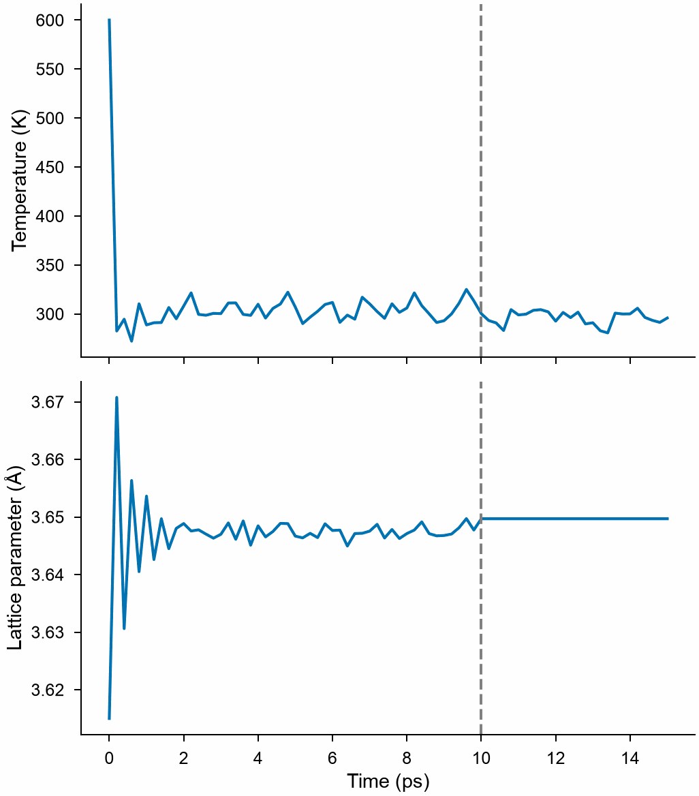

# Molecular dynamics

`mdapy.simulation.MolecularDynamics(system, potential, *, timestep=0.001)`
runs molecular dynamics of a system and gives back the thermodynamic state,
the atoms along the way and the system at the end. With a
[LAMMPS calculator](lammps.md), the dynamics runs in LAMMPS; with any other
calculator of MDAPY, such as [NEP](nep.md), [EAM](eam.md) or an
[ASE calculator](../interop/ase-calculators.md), it runs in MDAPY itself. The
two take the same calls and give the same results.
[Molecular dynamics through LAMMPS](../../examples/molecular-dynamics.md) shows it at
work, says what it is not made for, and how to run it on several threads or a GPU.

<!-- skip-test -->
```python
from mdapy.build import build_crystal
from mdapy.calculators import LAMMPS
from mdapy.simulation import MolecularDynamics

potential = LAMMPS(
    "pair_style eam/alloy\npair_coeff * * Cu_mishin1.eam.alloy Cu", elements=["Cu"]
)
crystal = build_crystal("fcc", 3.615, elements="Cu", repeat=(8, 8, 8))

with MolecularDynamics(crystal, potential, timestep=0.002) as md:
    md.velocities(600, seed=1)
    md.run(10000, ensemble="npt", temperature=300, pressure=0.0, thermo=100)
    md.run(5000, ensemble="nvt", temperature=300, save_every=500)
    md.thermo  # polars DataFrame: step, time, temperature, energies, ...
    md.frames  # the atoms every 500 steps of the second run
    hot = md.system  # the atoms at the end, with velocities and images
```

The thermodynamic state along the two runs:

<!-- skip-test -->
```python
from mdapy.visualization import plot

thermo = md.thermo
a = (thermo["volume"] / 512) ** (1 / 3)  # lattice parameter of the 8 x 8 x 8 cells
with plot.style():
    fig, (top, bottom) = plot.figure("single", 100, nrows=2, sharex=True)
    top.plot(thermo["time"], thermo["temperature"])
    top.set_ylabel("Temperature (K)")
    bottom.plot(thermo["time"], a)
    bottom.set_ylabel("Lattice parameter (Å)")
    bottom.set_xlabel("Time (ps)")
    for ax in (top, bottom):
        ax.axvline(20.0, color="0.5", linestyle="--")  # npt, then nvt
    plot.save(fig, "images/dynamics", formats=("png",))
```



*Copper started at 600 K: half the kinetic energy goes into the potential
energy at once, and the thermostat holds the rest at 300 K. The barostat
expands the box from the lattice parameter of 0 K to that of 300 K at zero
pressure; after the dashed line the box is fixed (nvt).*

## In MDAPY, with any calculator

The same calls run a small system with a calculator that LAMMPS does not
have, here a NEP model, or any model with an ASE calculator, with no LAMMPS
installed:

<!-- skip-test -->
```python
from mdapy.calculators import NEP

model = NEP("nep.txt")
small = build_crystal("fcc", 3.615, elements="Cu", repeat=(3, 3, 3))
with MolecularDynamics(small, model, timestep=0.002) as md:
    md.velocities(300, seed=1)
    md.run(5000, ensemble="nvt", temperature=300, thermostat="langevin", seed=2)
    md.run(5000, ensemble="npt", temperature=300, pressure=0.0, save_every=100)
```

MDAPY integrates the equations of motion that LAMMPS's fixes `nve`, `nvt`,
`npt` and `nph` integrate, in the same steps: velocity Verlet, a chain of
three Nosé–Hoover thermostats, and the barostat of Martyna, Tobias and Klein
on the lengths and tilts of the box. Its constants of nature are those of
MDAPY (CODATA 2018), which differ from those of LAMMPS's metal units by about
one part in a million. Langevin dynamics adds friction and random forces for
half a step before and after each step. Every step calls the calculator
once; a neighbor list with a skin of 1 Å serves several steps while the box
keeps its shape. The masses are those of the `mass` column, or of the
elements; LAMMPS takes those of some potential files, such as EAM's.

It is made for small systems, from a few atoms to some thousands, such as
those of the training sets of machine-learned potentials. Large systems, long
runs and anything beyond these ensembles are for LAMMPS.

A `movable` column, (N, 3) bool as VASP's selective dynamics, keeps atoms
still along the directions where it is False, in MDAPY's dynamics only; the
temperature then counts the directions in which the atoms move.

| Name | Type | Default | Unit | Meaning |
|---|---|---|---|---|
| `system` | `System` | | | the atoms, with an `element` column (or, in MDAPY, a `mass` column), `velocities` in Å/ps when it has them, and a `movable` column (MDAPY only) |
| `potential` | calculator | | | the interaction: a `LAMMPS` calculator, run in LAMMPS, or any other calculator, run in MDAPY, which needs energies and forces, and the virial for a barostat |
| `timestep` | float64 | 0.001 | ps | the time step |

## Running

| Method or attribute | Meaning |
|---|---|
| `velocities(temperature, *, seed)` | random velocities of a temperature in K, Gaussian, with no total momentum; the same for the same seed and atoms, whatever their positions |
| `run(steps, *, ensemble="nve", temperature=None, pressure=None, barostat="iso", thermostat="nose-hoover", thermostat_damping=None, barostat_damping=None, seed=None, thermo=100, save_every=None, progress=None, cancel=None)` | runs `steps` steps |
| `command(commands)` | runs any LAMMPS commands, one or several lines (LAMMPS only) |
| `lammps` | the LAMMPS instance itself (LAMMPS only) |
| `close()` | closes the instance; leaving a `with` block closes it too |

| Parameter of `run` | Type | Default | Unit | Meaning |
|---|---|---|---|---|
| `ensemble` | str | `"nve"` | | `"nve"`, or `"nvt"` with a thermostat, or `"npt"` with a thermostat and a barostat, or `"nph"` with a barostat alone (LAMMPS `fix nve`, `nvt`, `npt`, `nph`) |
| `temperature` | float64 or (float64, float64) | | K | the temperature of the thermostat, or its values at the start and end of the run; for `"nvt"` and `"npt"` |
| `pressure` | float64 or (float64, float64) | | GPa | the pressure of the barostat, or its values at the start and end; for `"npt"` and `"nph"` |
| `barostat` | str | `"iso"` | | the box changes alike in every direction (`"iso"`), along each axis (`"aniso"`), in any way (`"tri"`), or alike along its first two vectors with the third kept (`"xy"`); [a sheet](sheets.md#molecular-dynamics) changes in its plane only |
| `thermostat` | str | `"nose-hoover"` | | a chain of Nosé–Hoover thermostats, or `"langevin"` dynamics (LAMMPS `fix langevin` with `fix nve` or `nph`) |
| `thermostat_damping` | float64 | 100 time steps | ps | the damping time of the thermostat |
| `barostat_damping` | float64 | 1000 time steps | ps | the damping time of the barostat |
| `seed` | int32 | `None` | | seed of the random forces of Langevin dynamics, positive (at most 900000000 in LAMMPS); unpredictable when `None` |
| `thermo` | int32 | 100 | | records the thermodynamic state every this many steps, and at the start and the end |
| `save_every` | int32 | `None` | | keeps the atoms every this many steps |
| `progress` | callable | `None` | | called as `progress(done, total)` with the steps run |
| `cancel` | `CancelToken` | `None` | | stops the run, which raises `Cancelled` |

A run goes in pieces between the steps at which something is recorded; the
pieces run as one run would, a temperature or pressure changing from its
start to its end value across all of them. With Langevin dynamics and a
barostat, the barostat's mass is that of the temperature at the start.

In LAMMPS, the dynamics runs in metal units, those of MDAPY, through its
Python module, installed as the
[LAMMPS documentation](https://docs.lammps.org/Python_install.html) describes;
`potential` gives the commands of the interaction, the element of each atom
type and the command-line arguments of LAMMPS, such as those of Kokkos. The
box may have any orientation and need not be periodic: LAMMPS gets it rotated
into its own form, its non-periodic directions shrink-wrapped but never
smaller than the box of `system`, and everything comes back in the
orientation of `system`. MDAPY's own dynamics works in the same form of the
box. The velocities of `system`, if it has them, are where the dynamics
starts.

## Results

| Attribute | Type | Meaning |
|---|---|---|
| `system` | `System` | the atoms now, with `velocities` and `image` columns, the box, and `timestep` and `time` in `info`; the other columns of `system`, except forces and energies, which would be out of date |
| `thermo` | polars `DataFrame` | the thermodynamic state of all the runs so far, one row per record |
| `frames` | tuple of `System` | the atoms kept in all the runs so far, as `system` gives them |
| `step` | int64 | the time step number |

| Column of `thermo` | Type | Unit | Meaning |
|---|---|---|---|
| `step` | int64 | | time step number |
| `time` | float64 | ps | time |
| `temperature` | float64 | K | temperature, from the kinetic energy of 3N − 3 directions, or of those the `movable` column frees |
| `potential_energy`, `kinetic_energy`, `total_energy` | float64 | eV | energies of all the atoms |
| `pressure` | float64 | GPa | pressure; NaN in MDAPY with a calculator without virials |
| `volume` | float64 | ų | volume of the box |
| `stress` | (6,) float64 | GPa | stress in Voigt order xx, yy, zz, yz, xz, xy, positive under tension, in the axes of `system` |

## Errors

`MolecularDynamics` raises `InvalidParameter` for a potential that is not a
calculator, a time step that is not positive, elements without an atom type
in LAMMPS, a `movable` column that holds atoms in LAMMPS, and commands that
LAMMPS rejects; `MissingProperty` for a system without elements (or, in
MDAPY, without masses); `ImportError` without the LAMMPS Python module, for a
LAMMPS calculator. `velocities` raises `InvalidParameter` for a negative
temperature or a seed that is not positive; `run` for a negative number of
steps, an unknown ensemble, barostat or thermostat, a thermostat without a
positive temperature, a barostat without a pressure, `"aniso"` or `"tri"` in
a box that is not periodic, `"xy"` in a box not periodic along its first two
vectors, `thermo`, `save_every` or `seed` that are not positive, a barostat
in MDAPY with a calculator without virials or, for `"nph"`, atoms without a
temperature, and a thermostat with no atom free to move; in MDAPY, it raises
`CalculationFailed` when the energy or the forces stop being finite. `command`
and `lammps` raise `InvalidParameter` in MDAPY, `command` for commands LAMMPS
rejects, and `lammps` after `close`.

!!! quote "Please cite"
    For MDAPY's own dynamics:
    [Martyna et al. (1994)](../../reference/references.md#martyna1994),
    [Shinoda et al. (2004)](../../reference/references.md#shinoda2004)
    and [Tuckerman et al. (2006)](../../reference/references.md#tuckerman2006)
    for the thermostats and barostat;
    [Bussi and Parrinello (2007)](../../reference/references.md#bussi2007) for
    Langevin dynamics.
