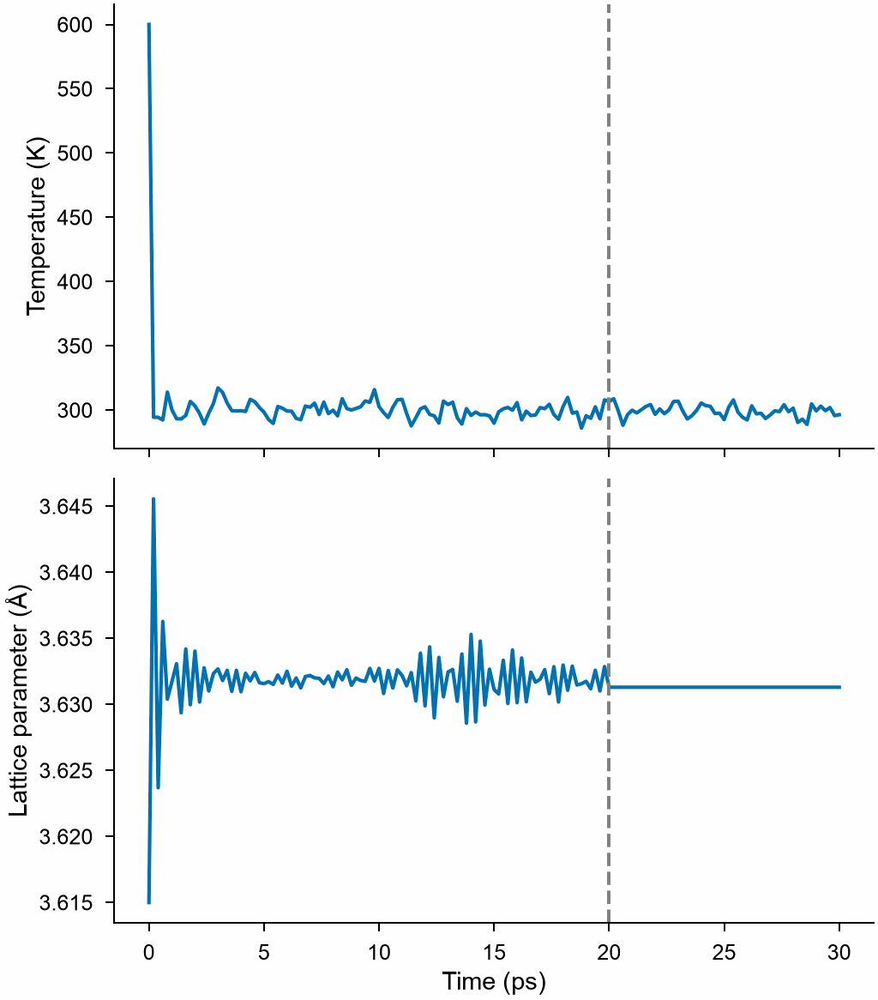

# Molecular dynamics

`mdapy.simulation.MolecularDynamics(system, potential, *, timestep=0.001)`
runs molecular dynamics of a system in LAMMPS, with the interaction of a
[LAMMPS calculator](lammps.md), and gives back the thermodynamic state, the
atoms along the way and the system at the end.

<!-- skip-test -->
```python
from mdapy.build import build_crystal
from mdapy.calculators import LAMMPS
from mdapy.simulation import MolecularDynamics

potential = LAMMPS(
    "pair_style eam/alloy\npair_coeff * * Cu_mishin1.eam.alloy Cu", elements=["Cu"]
)
crystal = build_crystal("fcc", 3.615, elements="Cu", repeat=(8, 8, 8))

with MolecularDynamics(crystal, potential, timestep=0.002) as md:
    md.velocities(600, seed=1)
    md.run(10000, ensemble="npt", temperature=300, pressure=0.0, thermo=100)
    md.run(5000, ensemble="nvt", temperature=300, save_every=500)
    md.thermo  # polars DataFrame: step, time, temperature, energies, ...
    md.frames  # the atoms every 500 steps of the second run
    hot = md.system  # the atoms at the end, with velocities and images
```

The thermodynamic state along the two runs:

<!-- skip-test -->
```python
from mdapy.visualization import plot

thermo = md.thermo
a = (thermo["volume"] / 512) ** (1 / 3)  # lattice parameter of the 8 x 8 x 8 cells
with plot.style():
    fig, (top, bottom) = plot.figure("single", 100, nrows=2, sharex=True)
    top.plot(thermo["time"], thermo["temperature"])
    top.set_ylabel("Temperature (K)")
    bottom.plot(thermo["time"], a)
    bottom.set_ylabel("Lattice parameter (Å)")
    bottom.set_xlabel("Time (ps)")
    for ax in (top, bottom):
        ax.axvline(20.0, color="0.5", linestyle="--")  # npt, then nvt
    plot.save(fig, "images/dynamics", formats=("png",))
```



*Copper started at 600 K: half the kinetic energy goes into the potential
energy at once, and the thermostat holds the rest at 300 K. The barostat
expands the box from the lattice parameter of 0 K to that of 300 K at zero
pressure; after the dashed line the box is fixed (nvt).*

LAMMPS runs in metal units, those of MDAPY, through its Python module,
installed as the [LAMMPS documentation](https://docs.lammps.org/Python_install.html)
describes; `potential` gives the commands of the interaction, the element
of each atom type and the command-line arguments of LAMMPS, such as those
of Kokkos. The box may have any orientation and need not be periodic:
LAMMPS gets it rotated into its own form, its non-periodic directions
shrink-wrapped but never smaller than the box of `system`, and everything comes
back in the orientation of `system`.
The velocities of `system`, if it has them, are where the dynamics starts.

| Name | Type | Default | Unit | Meaning |
|---|---|---|---|---|
| `system` | `System` | | | the atoms, with an `element` column, and `velocities` in Å/ps when it has them |
| `potential` | `LAMMPS` | | | the interaction, as a LAMMPS calculator |
| `timestep` | float64 | 0.001 | ps | the time step |

## Running

| Method or attribute | Meaning |
|---|---|
| `velocities(temperature, *, seed)` | random velocities of a temperature in K, Gaussian, with no total momentum; the same for the same seed and atoms, whatever their positions |
| `run(steps, *, ensemble="nve", temperature=None, pressure=None, barostat="iso", thermostat_damping=None, barostat_damping=None, thermo=100, save_every=None, progress=None, cancel=None)` | runs `steps` steps |
| `command(commands)` | runs any LAMMPS commands, one or several lines |
| `lammps` | the LAMMPS instance itself |
| `close()` | closes the instance; leaving a `with` block closes it too |

| Parameter of `run` | Type | Default | Unit | Meaning |
|---|---|---|---|---|
| `ensemble` | str | `"nve"` | | `"nve"`, or `"nvt"` with a Nosé–Hoover thermostat, or `"npt"` with a thermostat and a barostat, or `"nph"` with a barostat alone (LAMMPS `fix nve`, `nvt`, `npt`, `nph`) |
| `temperature` | float64 or (float64, float64) | | K | the temperature of the thermostat, or its values at the start and end of the run; for `"nvt"` and `"npt"` |
| `pressure` | float64 or (float64, float64) | | GPa | the pressure of the barostat, or its values at the start and end; for `"npt"` and `"nph"` |
| `barostat` | str | `"iso"` | | the box changes alike in every direction (`"iso"`), along each axis (`"aniso"`), in any way (`"tri"`), or alike along its first two vectors with the third kept (`"xy"`, as for [a sheet](sheets.md#molecular-dynamics)) |
| `thermostat_damping` | float64 | 100 time steps | ps | the damping time of the thermostat |
| `barostat_damping` | float64 | 1000 time steps | ps | the damping time of the barostat |
| `thermo` | int32 | 100 | | records the thermodynamic state every this many steps, and at the start and the end |
| `save_every` | int32 | `None` | | keeps the atoms every this many steps |
| `progress` | callable | `None` | | called as `progress(done, total)` with the steps run |
| `cancel` | `CancelToken` | `None` | | stops the run, which raises `Cancelled` |

A run is a LAMMPS `run` in pieces between the steps at which something is
recorded; the pieces run as one run would, a temperature or pressure
changing from its start to its end value across all of them.

## Results

| Attribute | Type | Meaning |
|---|---|---|
| `system` | `System` | the atoms now, with `velocities` and `image` columns, the box, and `timestep` and `time` in `info`; the other columns of `system`, but forces and energies, which are out of date |
| `thermo` | polars `DataFrame` | the thermodynamic state of all the runs so far, one row per record |
| `frames` | tuple of `System` | the atoms kept in all the runs so far, as `system` gives them |
| `step` | int64 | the time step number of LAMMPS |

| Column of `thermo` | Type | Unit | Meaning |
|---|---|---|---|
| `step` | int64 | | time step number |
| `time` | float64 | ps | time |
| `temperature` | float64 | K | temperature |
| `potential_energy`, `kinetic_energy`, `total_energy` | float64 | eV | energies of all the atoms |
| `pressure` | float64 | GPa | pressure |
| `volume` | float64 | ų | volume of the box |
| `stress` | (6,) float64 | GPa | stress in Voigt order xx, yy, zz, yz, xz, xy, positive under tension, in the axes of `system` |

## Errors

`MolecularDynamics` raises `InvalidParameter` for a potential that is not a
LAMMPS calculator, a time step that is not positive, elements without an
atom type, and commands that LAMMPS rejects; `MissingProperty` for a system
without elements; `ImportError` without the LAMMPS Python module.
`velocities` raises `InvalidParameter` for a negative temperature or a seed
that is not positive; `run` for a negative number of steps, an unknown
ensemble or barostat, a thermostat without a temperature, a barostat
without a pressure, `"aniso"` or `"tri"` in a box that is not periodic,
`"xy"` in a box not periodic along its first two vectors, and `thermo` or `save_every` that are not positive; `command` for
commands LAMMPS rejects; and `lammps` after `close`.
